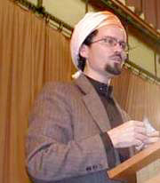

+++
title = "حمزة يوسف.. داعية أمريكاني مزدوج؟؟"
date = 2004-07-17
authors = ["أحمد زين"]

[taxonomies]
authors = ["ahmed-zein"]
sections = ["deen"]

[extra]
section_name = "دين"
share_image = "/media/images/articles/hamaza-youssef3.jpg"
summary = "سألوه ما الذي يدفع شاب أمريكي أبيض في السابعة عشرة إلي اعتناق الإسلام. فقال: \"أنا لا أدري، سئلت هذا السؤال كثيرا، وكانت إجاباتي ليست هي الواقع دائما.. وهذا يحير"
section_slug = "deen"
section_colour = "#2D6A4F"
thumb = "/media/images/articles/hamaza-youssef3.jpg"
n_comments = 4
original_url = "http://www.20at.com:80/article.php?sid=459"
archived = "20040814124746"
date_source = "byline/meta"
aliases_20at = ["/article.php?sid=459"]

[extra.provenance]
original_url = "http://www.20at.com:80/article.php?sid=459"
capture_url = "https://web.archive.org/web/20040814124746/http://www.20at.com:80/article.php?sid=459"
capture_label = "١٤ أغسطس ٢٠٠٤، ١٢:٤٧ UTC"
date_note = "من سطر التوقيع في المقال"
other_urls = []
comments = "٤"
missing_images = "٣"
+++

سألوه ما الذي يدفع شاب أمريكي أبيض في السابعة عشرة إلي اعتناق الإسلام. فقال: "أنا لا أدري، سئلت هذا السؤال كثيرا، وكانت إجاباتي ليست هي الواقع دائما.. وهذا يحيرني، كل ما أستطيع قوله إنني سمعت عن الإسلام فانشرح صدري، وبدأت الطريق..".

وحين اتهمه بعض المسلمين بالانحياز للغرب أجاب: "أنا منحاز لما أعتقد أنه صائب وعادل.. إذا كان ذلك على جانب المسلمين، فأنا مع المسلمين، وإذا كان مع الغرب فأنا مع الغرب.. أنا مسلم ولست قبليا"..!

أثارني بثنائيته التي يحلو للبعض أن يسميها ازدواجية..

<h3>كاليفورنيا - موريتانيا .. رايح جاى</h3>

اسمه حمزة يوسف هانسن .. - أمريكي الأصل... مالكي المذهب ... من عائلة مثقفة فوالده أستاذ لمادة الإنسانيات في جامعة هارفارد .. وأمه خريجة جامعة بيركلي العريقة.. أما جده فكان عمدة لإحدى مدن كاليفورنيا.

قرر في السابعة عشرة من عمره أن يسلم فترك دراسته الجامعية التي كان قد أوشك على الانتهاء منها ليذهب في جولة لعشر سنوات في المنطقة العربية... تعلم الفقه في الإمارات... وحفظ القرآن في المدينة المنورة... ودرس اللغة والشعر العربي في المغرب والجزائر وعاش التصوف مع مرابطي موريتانيا ..

10 سنوات كاملة أمضاها في التعلم والمعرفة قبل أن يعود لوطنه الحبيب ... أمريكا!!! فيحصل على البكالوريوس في التمريض من Imperial Valley College ودرجة علمية أخرى في الدراسات الدينية من جامعة San Jose State

في بدايات 1990 بدأ التدريس لبعض التجمعات الإسلامية في سان فرانسيسكو. وفي 1996 أسس معهد الزيتونة الذي يقول عنه أن من رسالته إحياء العلوم الإسلامية وكذلك طريقة التعليم القديمة (الشيخ والتلميذ).

ألف طالب، وفروع في 6 مدن أمريكية منها نيويورك وفيلادلفيا هي مجموعة ثمار زيتونة يوسف.. كما أن لدروسه ومواعظه الدينية تأثير كبير على مستمعيه، فقد وزع آلاف النسخ من دروسه التي ألقاها حول سيرة الرسول صلى الله عليه وسلم، التي شرحها في 24 ساعة، بالإضافة لذلك فهو يسافر إلى عواصم كثيرة في دول مختلفة في أمريكا الشمالية وأوروبا ليخاطب المسلمين وغير المسلمين معا..

<h3>بريتني سبيرز والفلسفة اليونانية!!</h3>

ربما يتعجب البعض من شيخ يتحدث عن بريتني سبيرز لكن حمزة لا يخشى ذلك، فيقول: "إن هذا العالم يهتم بقميص بريتني سبيرز، ورفعها له بضع بوصات أكثر من اهتمامه بأشخاص يموتون في كل مكان في العالم وهم ليسوا من المسلمين فقط"!

وفي نفس الوقت تكثر استشهادات حمزة بالفلاسفة والمفكرين الغربيين فيتحدث عن أرسطوطاليس وتعريفه للسعادة، وأفلاطون وآرائه في المدينة الفاضلة وعن برنارد شو وآرائه في الإسلام، وآرنولد توينبي حين يتحدث عن فرضيته بأن أزمة حادة ستقع في العالم بين نصفه الشمالي ونصفه الجنوبي..

<h3>أمريكا والمسلمين</h3>

هو يهاجم المسلمين بقدر ما يهاجم أمريكا.. أو لنقل إنه أمريكي ثائر على مساوئ مواطنيه ومسلم ثائر على مساوئ أهل دينه...

فيقول: "إذا كان الناس في أمريكا يعتقدون أن أمريكا هي المجتمع المثالي، فلا أعتقد أنهم يطالعون نفس المصادر التي أطالعها، معدلات الاكتئاب والانتحار والاغتصاب والجريمة ووضع المدارس والإجهاض والتفسخ الأسرى والطلاق".

عمل مستشارا للبيت الأبيض لكنه يهاجم بوش: "الناس يظنون أننا في أمريكا نعيش في ديمقراطية، هذه كلها أكاذيب.. من الذي أوصل بوش لكرسي الرئاسة.. الشركات الاحتكارية الكبرى!

فرانك جاردنر- مراسل البي بي سي طرح على حمزة سؤالا كان مفاداه: "برأيك هل كان بوش صائبا حين حارب الإرهاب؟".. فأجاب حمزة: "أعتقد أنه إرهاب دولة مقارنة بإرهاب الأفراد".

وبشجاعة يعيد حمزة تعريف الحرب على الإرهاب فيقول: "الحرب على الإرهاب ينبغي أن تكون حربا على الحرب".. ويهز رأسه قائلا: "هذا كل شيء".

لكنه في ذات الوقت لا ينافق المسلمين، ولا يجاملهم، تخديرا لمشاعرهم فهو يرى بوضوح أن: "العقبة الأساسية أمام الدعوة الإسلامية في هذه الأراضي هم المسلمون أنفسهم.. بسلوكياتهم"

ويشخص مرضهم فيقول: "صراحة إن الذين هاجروا، هاجروا بمشاكلهم، وعمروا مساجدهم بها، والمسلم الجديد يتعب جدا من هذه التناقضات"..

<h3>العمامة والكرافتة</h3>

تشاهد صوره القديمة بالزي الباكستاني التقليدي والعمامة الأفريقية؛ فتجده رجلا تاريخي الهيئة على الرغم من قصر قامته وضعف بنيانه، لكنه في الـ new look يرتدي الكاجوال والبدلة السبور..

<figure></figure>

ولما سئل عن ذلك، أرجع الأمر لأحداث 11 سبتمبر الذي صدمه تماما وكان أقرب إلى المفجوع حتى أنه أخذ قرارًا بإغلاق معهد «الزيتونة» مؤقتا ليتفرغ لمخاطبة صناع القرار والمسئولين المحليين والظهور في القنوات التلفزيونية لمحاولة توضيح الحقائق عن الإسلام.. ويضيف: "بل إنني نزعت العمامة ولبست بدلة وكرفتة"!

<h3>نهاية الكلام</h3>

سيدندن لك أغنية غربية تدعو للحب والأمل.. أو يشرح لك نظرية فلسفية..

سيداعبك بطرفة .. أو يحكي لك عن أصل كلمة في اللغة..

ستدمع عيناه وهو يتحدث عن النبي محمد – ص - أو يحلل لك قضية فقهية بمنتهى الجدية ..

لكنني أتصور أنه ككل الكبار سيترك فيك أثرًا ..

