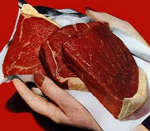

+++
title = "احذروا اللحوم الحمراء"
date = 2009-03-24
aliases = ["/articles/20at-ana-saudi-11692/"]

[taxonomies]
authors = []
sections = ["ana-s3ody"]

[extra]
section_name = "أنا سعودي"
share_image = "/media/currentarticleassets/meat.jpg"
summary = "توصل العلماء الى دلائل جديدة على ان تناول كميات كبيرة من اللحوم الحمراء واللحوم المصنعة يؤدي تدهور صحة الانسان."
section_slug = "ana-s3ody"
section_colour = "#0E9C9A"
thumb = "/media/currentarticleassets/meat.jpg"
n_comments = 0
original_url = "http://20at.com/20at/ana-saudi/11692.html"
archived = "20100105234421"
date_source = "byline/meta"
aliases_20at = ["/ana-s3ody/11692.html", "/20at/ana-saudi/11692.html"]

[extra.provenance]
original_url = "http://20at.com/20at/ana-saudi/11692.html"
capture_url = "https://web.archive.org/web/20100105234421/http://20at.com/20at/ana-saudi/11692.html"
capture_label = "٥ يناير ٢٠١٠، ٢٣:٤٤ UTC"
date_note = "من سطر التوقيع في المقال"
other_urls = ["/20at/ana-saudi/11692.html"]
comments = ""
missing_images = ""
+++

<figure></figure>

توصل العلماء الى دلائل جديدة على ان تناول كميات كبيرة من اللحوم الحمراء واللحوم المصنعة يؤدي تدهور صحة الانسان.

ووجد العلماء ان الاشخاص الذين يتناولون كميات كبيرة من اللحوم ترتفع لديهم مخاطر الموت خلال عقد من الزمان.

وفي المقابل فان تناول كميات كبيرة من اللحوم البيضاء ادى الى تقليل خطر الموت بشكل طفيف خلال نفس الفترة.

وشملت الدراسة التي قام بها باحثون في معهد السرطان القومي بالولايات المتحدة الامريكية 500 الف شخص.

ووجد الباحثون ان هؤلاء الذين تحتوي وجباتهم على اعلى كميات من اللحوم الحمراء او اللحوم المصنعة يعانون من ارتفاع المخاطر الكلية للوفاة خاصة خطر الموت بسبب السرطان وامراض القلب مقارنة مع من يأكلون أقل.

وكان الاشخاص الذين صنفوا بأنهم يأكلون اعلى كمية من اللحوم يتناولون حوالي 160 جرام من اللحم يوميا.

اما الاشخصا الذين يأكلون أقل فكانوا يتناولن 25 جرام يوميا.

وعلى العكس فان الاشخاص الذين يتناولون اكبر كميات من اللحوم البيضاء تقل لديهم مخاطر التعرض للموت بسبب الرسطان او امرض القلب مقارنة بنظرائهم الذين يتناولون كميات اقل.

وقال الباحثون انه يمكن منع 11% من الوفيات بين الرجال و16% بين النساء اذا خفض الناس كميات الللحوم التي يتناولونها الى القدر الذي تستهلكه المجموعة التي تتناول الكميات الاقل.

وقال أحد المشرفين على الدراسة إن هذه الدراسة تدعم نصائح العديد من المؤسسات الصحية بالحد من اللحوم الحمراء للتقليل من مخاطر الإصابة بأمراض القلب والسرطان.

نقلا عن موقع البي بي سي

