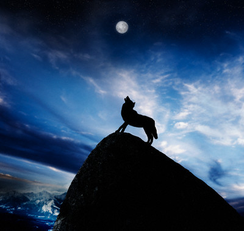

+++
title = "القمر  \"مخنوق \"!!"
date = 2006-03-27
authors = ["حجاج سلامة"]
aliases = ["/articles/b624/"]

[taxonomies]
authors = ["hagag-salama"]
sections = ["klam-rosas"]

[extra]
section_name = "قلم رصاص"
share_image = "/media/admins.20at.com/yasmine/moooon.jpg"
summary = "تقول المقوله.."
section_slug = "klam-rosas"
section_colour = "#333333"
thumb = "/media/admins.20at.com/yasmine/moooon.jpg"
n_comments = 9
original_url = "http://20at.com:80/archive/1944.html"
archived = "20090521175435"
date_source = "byline/meta"
aliases_20at = ["/article2.php?sid=624", "/archive/1944.html"]

[extra.provenance]
original_url = "http://20at.com:80/archive/1944.html"
capture_url = "https://web.archive.org/web/20090521175435/http://20at.com:80/archive/1944.html"
capture_label = "٢١ مايو ٢٠٠٩، ١٧:٥٤ UTC"
date_note = "من سطر التوقيع في المقال"
other_urls = ["/article2.php?sid=624"]
comments = "٩"
missing_images = ""
+++

<figure></figure>

تقول المقوله..

"لو أردت أن تعرف مكان وتكتشف سره الحضاري، تابع عادات وأعراف أهله .. تصل للحل".

وبكل مدينة قصص وأساطير خاصة تتحدث عن حضارة أهلها وإن سمعتها تشعر بحنين إلى ماضي غريب وغامض.

<h3>الأقصر على الطبول</h3>

وفي صعيد مصر وفى وسط المعابد الفرعونية تابع آلاف المصريين في محافظات الصعيد الأسبوع الماضي ظاهرة الخسوف الكلي للقمر، وعندها ودون تفكير استدعت القرى القديمة تاريخها وخرج الأهالي في مجموعات تردد القمر "مخنوق".

ولأنه مخنوق وجب على تلك المجموعات أن تقرع الطبول وألواح الصاج مبتهلين إلى الله أن يفك "خنقة القمر"، ورددوا أناشيد شعبية مثل "يارب إحنا عبيدك يارب الأمر بأيديك "، وحرص كبار السن على التهجد والصلاة امتثالا للقدرة الإلهية.

فكلنا نعرف أن ظاهرة خسوف القمر تحدث نتيجة اصطفاف الشمس والأرض والقمر في صف واحد وهو حدث يتزامن مع اكتمال القمر الذي يعبر عندها في ظل الأرض فلا يعود يتلقى أشعة الشمس التي تضيئه لكن خلافا للشمس فإن القمر لا يتوارى عند الخسوف التام بل يسطع باللون الأحمر الداكن.

ولكن الخسوف ب ( الصعيدي) يحمل معاني اخرى، وهي أن القمر مخنوق حزين كأهله .. ولونه غامق يوحى بأن هناك أزمات جديدة قد تحل علينا، لذا يكون الدعاء له ب( الشفاء) أمر هام لأن من غير هالته المنيرة يعيش الناس في كرب واكتئاب.

<h3>الخوف في عيون سوداء</h3>

الخوف من خسوف القمر لا يقتصر على أحفاد الفراعنة، فالعديد من الشعوب الإفريقية تنظر إليه على انه نبوءة شريرة تخبرنا عن وفاة أحد الآلهة وغالبا ما يلقى زعيم القبيلة حتفه لمرافقته في وفاته أو تصاب القبيلة كلها بوباء أو مجاعة طويلة الأمد.

وأن اكتفى أهالي الصعيد بدق الطبول، فأصحاب البشرة السوداء لديهم دائما ترتيبات أخرى..

ففي قبيلة فندا التي ما زالت موجودة شمال جمهورية جنوب أفريقي، يربى الأهالي طير جارح وحين يحدث الخسوف يتم إطلاقه في السماء اعتقادا انه سيذهب عالياً ويبتلع الشمس التي تسببت في خنقة القمر.

ويغمض أبناء القبيلة عيونهم طوال فترة الكسوف مقتنعين بأن إلههم "نوالي" يتفقد القرى أثناء هذه الظلمة، وسينزل عليهم الصواعق ويحيلهم إلى رماد إذا نظروا إليه.

ويشير انتهاء الكسوف إلى أن نوالي وجد كهفا يلجأ إليه فيقدم له زعماء القرية هدايا لطلب الصفح والشكر لأنهم نجوا بأنفسهم.

<h3>اوكوفيفالا كويلانجا.."يا ستار"!!</h3>

أما قبائل الزولو فتطلق على ظاهرة الكسوف اسم "أوكوفيفالا كويلانجا" أو "إغلاق الشمس"، وتبعا للتقاليد كانت قبيلة نجوني المنضوية تحت لواء الزولو تجتاز نهر زامبيز أثناء الكسوف عام 1835 هرباً من قمع الملك الكبير شاكا، فابتلعت التماسيح العجزة والنساء والأطفال في ذلك العبور، واعتبر الكسوف الذي حصل بعد ذلك بقليل علامة على الغضب الإلهي.

وفي زيمبابوي تعتبر هذه الظاهرة بمثابة تعفن الشمس ناجمة عن غضب الإله "كوكواني"، ويقول سكان المنطقة وهم من "الشانجان" أن الكسوف يعلن وفاة زعيمهم "مامبو".

وبعد انتهاء الكسوف يخلع الشانجان ملابسهم لإقامة احتفال يطلبون فيه الصفح من "كوكواني".

<h3>ليلة القبض على الأَرض!!</h3>

وفى قبيلة كاغورا في شرق أفريقيا معنى الخسوف ببساطة أن الأرض تم القبض عليها، ويقومون ببعض الطقوس لاستحضارارواح الأجداد لتأتي وتحررها.

يقول علماء الأساطير إن العديد من آثار زيمبابوي تكشف أن سكان البلاد الغامضين في تلك الفترة، كانوا قادرين على التنبؤ بالكسوف بطريقة علمية.

فقد عثرت الرحلات الاستكشافية هناك على نقوش تصور كوكب الزهرة وهو يمر بعدة مراحل فلكية كما توجد دلائل أثرية على وجود مرصد قديم بأعلى مكان في غابة بها .

أرسلوا لنا بغيرها من الأساطير التي تحكم تاريخنا ونعيش بها دون أن ندرى...!

