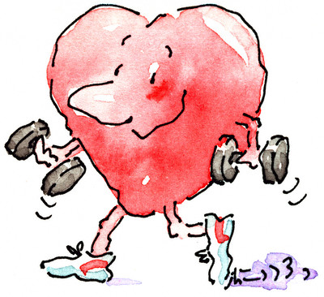

+++
title = "الحب \"بهدلة\" لوزنك!"
date = 2006-02-14
authors = ["الشرق الأوسط"]
aliases = ["/articles/b440/"]

[taxonomies]
authors = ["elshrk-elaost"]
sections = ["banat"]

[extra]
section_name = "بنات"
share_image = "/media/admins.20at.com/yasmine/heart123.jpg"
summary = "كما يقال أن الحب \" بهدلة\" نظرا للذل الذي يعيش فيه المحب من التفكير في حبيبه فيمتنع عن الأكل والشرب فيضعف الحبيب ويقل وزنه، ولكن كل هذه الأوضاع تعود مرة أخرى بعد"
section_slug = "banat"
section_colour = "#888888"
thumb = "/media/admins.20at.com/yasmine/heart123.jpg"
n_comments = 1
original_url = "http://20at.com/banat/health-and-beauty/health/1763--qq-.html"
archived = "20100106031545"
date_source = "byline/meta"
aliases_20at = ["/article2.php?sid=440", "/banat/health-and-beauty/health/1763--qq-.html"]

[extra.provenance]
original_url = "http://20at.com/banat/health-and-beauty/health/1763--qq-.html"
capture_url = "https://web.archive.org/web/20100106031545/http://20at.com/banat/health-and-beauty/health/1763--qq-.html"
capture_label = "٦ يناير ٢٠١٠، ٠٣:١٥ UTC"
date_note = "من سطر التوقيع في المقال"
other_urls = ["/article2.php?sid=440"]
comments = "١"
missing_images = ""
+++

<figure></figure>

<h3>كما يقال أن الحب " بهدلة" نظرا للذل الذي يعيش فيه المحب من التفكير في حبيبه فيمتنع عن الأكل والشرب فيضعف الحبيب ويقل وزنه، ولكن كل هذه الأوضاع تعود مرة أخرى بعد الزواج وكأن الزواج سبب في توقف الحب</h3>

<h3>الليلة الكبيرة</h3>

فقد أوضحت دراسة بريطانية أن ما يتحكم في وزن المرأة ليس ما تتناوله من طعام، وإنما الحالة العاطفية التي تمر بها، إذ كشفت عن أن حجم المرأة يتذبذب بتناغم مع الجانب العاطفي، وبينت الدراسة التي أجريت على ثلاثة آلاف امرأة بريطانية متزوجة أن المرأة تمر بمراحل مختلفة خلال حياتها ففي المرحلة الأولى أو"الليلة الكبيرة" كما وصفتها مؤسسة "ويت ووتشر" التي نشرت الدراسة تبدأ عندما يتقدم شريك حياتها ويطلب يدها رسميا للزواج فينقص وزنها حوالي بـ 4.5 كجم وتبدأ بعد ذلك في الحفاظ على وزنها حتى تبدو جميلة متألقة يوم الزفاف، فتتناول الأطعمة الصحية وتقوم بالتمارين، لتدخل بعد ذلك في مرحلة ثانية خلال شهر العسل إذ تفقد ما يزيد عن 4 كجم بسبب حالة الحب والإثارة التي تمر بها، لهذا فإنها تطلب الأطعمة الخفيفة مثل السلطة عندما تتناول وجبتها في المطعم مع شريك حياتها الجديد.

<h3>عودة للحبيب</h3>

ومع الزواج ينشغل كل من الزوجين في مسؤولياته وبعد ما يكبر الأولاد يتذكروا الحب والأيام "الخوالي"، وبعد عدة سنوات من الحياة الزوجية تدخل مرحلة "الراحة"، والراحة تتمثل في شعورها بالثقة في العلاقة، وهنا تبدأ في طلب الوجبات السريعة وتناولها وهي متكأة أمام التلفزيون، ومن ثم يبدأ جسمها في الزيادة بحوالى 5.5 كجم، أما المرحة الرابعة فتبدأ مع إنجاب الأطفال وفي تلك الفترة يزيد وزنها بمعدل 8 كجم بعد ما تكون قد أنجبت طفلها الأول ويصبح اهتمامها بمظهرها هو آخر ما تفكر به.

ثم تدخل بعد ذلك في المرحلة الخامسة والتي تبدأ فيها المرأة بإعادة تقديم نفسها من جديد، ولهذا ينقص وزنها 8 كجم أيضا وذلك بعد أن يكبر الأولاد ويكون عندها الوقت الكافي للعناية بنفسها وقضاء وقتا أطول مع شريك حياتها وتشعر أن هناك حاجة لأن تستعيد رونقها الذي فقدته، وأثبت المسح أن أكثر من 66 % من عينات الدراسة تذبذبت أوزانهن مع شعورهن بالسعادة الحياتية، وأن 84 % منهن، قلن أن العلاقة الزوجية هي أكبر عامل تأثير على صحتهن.

وقالت "ويت ووتشر" التي تعنى بدراسات الوزن والصحة أن هذه النتائج لن تفاجأ العديد من النساء والكثير منهن يتفق على أن وزن المرأة وصحتها مربوط بعواطفها "إنه من الطبيعي عندما نكون غير سعداء نلتجئ إلى الطعام للتعويض عن ذلك، وعندما نستعد لمناسبة سعيدة مثل الزواج نبذل الكثير من اجل الظهور بمظهر لائق، يتناسب مع المناسبة.

