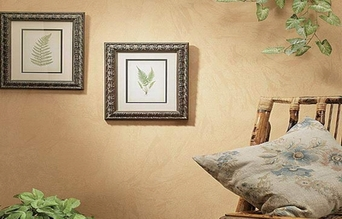

+++
title = "لوّن بيتك بنفسك"
date = 2006-12-03
authors = ["هبة الله أحمد"]

[taxonomies]
authors = ["heba-allah-ahmed"]
sections = ["banat"]

[extra]
section_name = "بنات"
share_image = "/media/admins.20at.com/aly/yaaa1.jpg"
summary = "هل تستيقظ كل صباح لتجد أمام عينيك تلك الألوان التي لا تختلف مع الأيام سوي أن تتحول إلي ألوان باهته.."
section_slug = "banat"
section_colour = "#888888"
thumb = "/media/admins.20at.com/aly/yaaa1.jpg"
n_comments = 6
original_url = "http://www.20at.com:80/banat/how-to/2861-2009-11-04-14-08-58.html"
archived = "20100226050805"
date_source = "byline/meta"
aliases_20at = ["/banat/how-to/2861-2009-11-04-14-08-58.html"]

[extra.provenance]
original_url = "http://www.20at.com:80/banat/how-to/2861-2009-11-04-14-08-58.html"
capture_url = "https://web.archive.org/web/20100226050805/http://www.20at.com:80/banat/how-to/2861-2009-11-04-14-08-58.html"
capture_label = "٢٦ فبراير ٢٠١٠، ٠٥:٠٨ UTC"
date_note = "من سطر التوقيع في المقال"
other_urls = []
comments = "٦"
missing_images = "٩"
+++

<figure></figure>

هل تستيقظ كل صباح لتجد أمام عينيك تلك الألوان التي لا تختلف مع الأيام سوي أن تتحول إلي ألوان باهته..

وتضع يدك في جيبك لتخبرك محفظتك أنه عليك أن تنتظر وقت طويل حتى تستطيع أن تجمع المال الكافي لرجل الدهانات، الذي يعد في وجهة نظرك القادر الوحيد علي أن يعطي شكلا جديدا أمام عينيك بفرشته السحرية..

ولكن إليك المفاجأة السارة..فأنت تستطيع أن تمتلك هذه الفرشة السحرية لتعيد بريق الألوان إلي حجرتك بشكل جديد وبدون تكلفة باهظة.. واليك الخطوات في الصور الآتية..

1ـ قم بخلط الدهانات ببعضها حتى تحصل علي درجة اللون الذي تريده.

2ـ قم بغمس الفرشاة الخاصة بالدهان في الدلو المحمل بالدهانات.

ـ قم بطلاء الحائط المراد تغير لونه ولا تدع فيه أي بقع تحمل أثار الطلاء المراد تغييره.

4ـ قم بوضع قطعة من ورق القزاز علي الحائط.

5 ـ استخدم الفرشاه لتثبيط الورق القزاز علي الحائط.

6 ـ قم بدهان الجزء المجاور لقطعة القزاز التي وضعتها بنفس الطريقة السابقة.

7 ـ ثم دع قطعة من ورق القزاز بجوار الأولي حتى تقوم بتغطية الحائط المراد دهانه بالكامل.

8 ـ ثم قم بنزع الورق القزاز بالكامل مرة واحدة.

9 ـ في النهاية تحصل علي حائط ملون بهذا الشكل.

