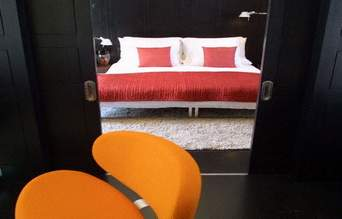

+++
title = "بيتك بالـFeng Shui"
date = 2006-12-14
authors = ["يسر عبد الدايم"]

[taxonomies]
authors = ["yasr-abdel-eldaim"]
sections = ["banat"]

[extra]
section_name = "بنات"
share_image = "/media/admins.20at.com/do3a2/feng_shui.jpg"
summary = "بالطبع كل فرد منا يشعر أحيانا بالاحتياج إلي التجديد في أسلوب حياته لإحساسه بالملل والرتابة والتي قد تصل أحيانا إلي حد الاكتئاب!."
section_slug = "banat"
section_colour = "#888888"
thumb = "/media/admins.20at.com/do3a2/feng_shui.jpg"
n_comments = 8
original_url = "http://www.20at.com:80/banat/how-to/2914--feng-shui-.html"
archived = "20100217090619"
date_source = "byline/meta"
aliases_20at = ["/banat/how-to/2914---feng-shui-.html", "/banat/how-to/2914--feng-shui-.html"]

[extra.provenance]
original_url = "http://www.20at.com:80/banat/how-to/2914--feng-shui-.html"
capture_url = "https://web.archive.org/web/20100217090619/http://www.20at.com:80/banat/how-to/2914--feng-shui-.html"
capture_label = "١٧ فبراير ٢٠١٠، ٠٩:٠٦ UTC"
date_note = "من سطر التوقيع في المقال"
other_urls = ["/banat/how-to/2914--feng-shui-.html"]
comments = "٨"
missing_images = ""
+++

<figure></figure>

بالطبع كل فرد منا يشعر أحيانا بالاحتياج إلي التجديد في أسلوب حياته لإحساسه بالملل والرتابة والتي قد تصل أحيانا إلي حد الاكتئاب!.

وقد اثبت فن "الفونج شواي" الصيني وجود علاقة بين نفسية الإنسان وبين ما يحيط به من أثاث وديكورات، حيث يبحث هذا الفن في علاقات الأشياء بعضها ببعض وتأثيرها في الإنسان، ومحاولة خلق مجال للتأثير الايجابي علي النفسية البشرية، واستغلال الطاقة من حولنا بما يخلق التوازن والتناغم بين الإنسان ومحيطه الكبير.

أما المعني الحرفي لكلمة "فونج شواي" هو الماء والريح، اللذان يعبران حسب منطق هذه الفلسفة عن قوة اندفاع عناصر الطبيعة وتأثيرها على تكوين سطح الأرض.

<h3>صحتك في ديكورك</h3>

تقول "إيستر يانغ"، وهي خبيرة في علم الفونج شواي، أن صحة أي بيت ترتبط بما يسمى بـ "التشي"، ومعناها تدفق الطاقة إلى مركز الصحة أو البيت، فإذا كان هذا الركن مزدحما بالأغراض القديمة والأثاث المتآكل، فإن الطاقة ستجد صعوبة كبيرة في الوصول إليه، عكس ما إذا كان به أثاث قليل ومرتب ومضاء إضاءة طبيعية جيدة.

وتؤكد إيستر أن صحتنا لا يمكن إن تتحسن إلا بعد أن ننجح في تحسين حالتنا النفسية والذهنية والروحية والمادية والعاطفية، وتستدل على قولها بحالة تابعتها بنفسها كانت لامرأة تعاني من صداع رأس مزمن وألم في الكتف لم تنفع معه المسكنات أو الأدوية، إلى أن قررت إعادة ترتيب ديكور بيتها، وكانت النتيجة مذهلة بالنسبة لها، فقد تخلصت من الصداع ومن الألم مباشرة بعد ذلك.

<h3>نفعل العكس</h3>

لكن على العكس من قواعد الفونج شواي ومما تنصح به إيستر، نجد أن من عادات ربات البيوت في اغلب الدول العربية تذهب لعدم التخلص من قطع الأثاث الكثيرة التي تم توارثها عبر السنين، ولا يتم التخلص منها لاعتبارات عاطفية وإن كانت الحاجة إليها منعدمة ولا تضيف إلى ديكور البيت أو جماله آي شيء، بل تساعد فقط على تجميع الغبار والتسبب في إمراض تتعلق بالحساسية والربو وغيرهما.

<h3>تجنبي.....!</h3>

من الأشياء الغير مستحبة عند إعداد ديكورات منزلك وفقا للفن الصيني، استخدام دهانات ذات ألوان صارخة، ويفضل استبدالها بالألوان الهادئة التي تساعد على الاسترخاء مثل درجات المشمشي والوردي الخفيفة، كذلك يفضل عدم استخدام الورود المجففة منعا باتا لأنها تقوم بتجميع الأتربة بدخلها ويفضل استخدام الورود الطبيعية.

كذلك يستحسن تجنب استخدام الإضاءة "النيون" لأنها لا تتناسب مطلقا مع حميمية البيوت، ويفضل الاستفادة قدر المستطاع من الإضاءة الطبيعية لإدخال الدفء علي المكان.

المرايا كذلك ليست مستحبة أبدا في غرف النوم، لأن الطاقة التي تخلقها فيها طاقة سلبية تسبب الأرق والنوم المتقطع المكان المفضل لها هو غرف الجلوس والطعام.

<h3>رتبي بيتك في دقائق</h3>

قد تتصل بك صديقة لك لتخبرك أنها قادمة لزيارتك مع اثنتين من صديقاتها خلال نصف ساعة، الأمر الذي يدفعك لفقدان أعصابك أثناء محاولتك تجهيز منزلك في زمن قياسي ليبدو جاهزاً لاستقبال الضيوف.

إليكِ بعض الملحوظات والتي قد تساعدك في الإسراع بتجهيز المنزل في أسرع وقت: -

• تفقدي هندامك وتسريحة شعرك ومكياجك، إذ أن أول أمر يلحظه الضيوف هو شكلك وليس غرفه جلوسك.

• حاولي إغلاق الأبواب، حيث أن إغلاق أبواب الغرف التي لن تستعمليها أثناء الزيارة سوف يوفر عليك الوقت الذي ستقضينه في ترتيبها.

• استخدمي أحد الأكياس الكبيرة لجمع كل ما هو غير ضروري في الغرفة التي ستقومين باستقبال الضيوف فيها، لكن تأكدي من وضع الكيس في مكان لا يراه الضيوف.

• حاولي مسح الغبار والأتربة الموجودة في الغرفة التي سوف تقومين فيها باستقبال الضيوف.

• قومي بترتيب الأثاث وإعادة ترتيب الوسائد الموجودة على المقاعد.

• تأكدي من نظافة الحمام، و قومي بالتأكد من نظافة المغسلة ومن وجود صابون وقومي بوضع مناشف نظيفة.

• إذا كان لديك المزيد من الوقت قومي بكنس الغرفة التي ستقضين فيها معظم الوقت مع ضيوفك.

• قومي بالتأكد من نظافة المطبخ لأنه من المحتمل أن تتبعك إحدى ضيفاتك إليه.

• قومي برش معطر الجو في أنحاء البيت لان ذلك يعطي شعوراً بالنظافة في كل أنحاء المنزل.

هذه هي الطريقة الصينية في ترتيب المنزل، فما هي طريقتك المفضلة في ترتيب منزلك؟

