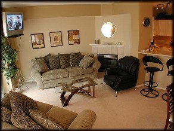

+++
title = "على كل لون يا .. living"
date = 2007-02-13
authors = ["يسر عبد الدايم"]

[taxonomies]
authors = ["yasr-abdel-eldaim"]
sections = ["banat"]

[extra]
section_name = "بنات"
share_image = "/media/admins.20at.com/aly/cgsgsgs.jpg"
summary = "لم تكن غرفة المعيشة متعارف علي وجودها بالمنزل كباقي غرف المسكن، ولكنها اليوم تعتبر من أهم غرف المنزل حيث تأتى في المرتبة الثانية مباشرة بعد غرفة النوم، فهي مكان"
section_slug = "banat"
section_colour = "#888888"
thumb = "/media/admins.20at.com/aly/cgsgsgs.jpg"
n_comments = 8
original_url = "http://www.20at.com:80/banat/how-to/3229--living.html"
archived = "20100315004225"
date_source = "byline/meta"
aliases_20at = ["/banat/how-to/3229------living.html", "/banat/how-to/3229--living.html"]

[extra.provenance]
original_url = "http://www.20at.com:80/banat/how-to/3229--living.html"
capture_url = "https://web.archive.org/web/20100315004225/http://www.20at.com:80/banat/how-to/3229--living.html"
capture_label = "١٥ مارس ٢٠١٠، ٠٠:٤٢ UTC"
date_note = "من سطر التوقيع في المقال"
other_urls = ["/banat/how-to/3229--living.html"]
comments = "٨"
missing_images = ""
+++

<figure></figure>

لم تكن غرفة المعيشة متعارف علي وجودها بالمنزل كباقي غرف المسكن، ولكنها اليوم تعتبر من أهم غرف المنزل حيث تأتى في المرتبة الثانية مباشرة بعد غرفة النوم، فهي مكان اجتماع الأسرة اليومي والتي تقضي بها اغلب أوقاتها، ولذلك يجب أن تتسم هذه الغرفة بجميع ملامح الراحة والاسترخاء.

إحدى الصفات الأساسية التي تتمتع بها غرفة المعيشة هي الخصوصية، فلا يتم استقبال الضيوف في هذه الغرفة، مما يتيح لك وضع جميع لمساتك الخاصة التي تناسبك وتلبي متطلبات أسرتك

هذه بعض النصائح التي تجعل لديك أجمل غرفة معيشة عصرية..

<h3>في مكتبتي</h3>

تعد "المكتبة" إحدى المكونات الأساسية لغرفة المعيشية، والتي يجب إن نراعي عند شرائها أن تتسع لإمكان وضع الأجهزة الالكترونية كالتليفزيون والفيديو وDVD والكاسيت وغيرها من الأجهزة، وننصحك بتخصيص مكان لوضع الصور الخاصة بأسرتك، وجزء آخر يخصص للكتب الخاصة بالأسرة.

وللمكتبات العديد من الأنواع، فمن الممكن اختيار المكتبة المفتوحة وهي التي لا تحتوي أي ألواح، والنوع الثاني هو المكتبة ذات الألواح الخشبية، أما النوع الثالث فهي المكتبة ذات الألواح الزجاجية التي تضفي على المكان أناقة دون أن تخفي ما بداخلها عن الأنظار، ويجب أن نراعي أن يتناسب حجم المكتبة مع الغرفة، فإذا كانت الغرفة صغيرة الحجم يجب شراء مكتبة صغيرة والعكس صحيح. شاهد معنا

<h3>الراحة هي الأساس</h3>

الشكل التقليدي لغرفة المعيشية والمتعارف علية لدي الجميع هو أن تحتوي الغرفة على أربع قطع، المقطع الأول وهو أريكة كبيرة الحجم والتي تتسع لثلاث أفراد، والثلاث قطع الأخرى تتسع لأربعة أفراد، ويجب أن تراعي حجم الأثاث ألي حجم الغرفة عند اختيارك للأثاث، وينصح أن يتم تجربة الجلوس علي الأثاث في المعرض قبل شرائه للتأكد من جودته والتأكد من أن المساند والأرائك والحشو مريح، وتفضل الأرائك الثقيلة كونها تتميز بصناعتها من مواد أكثر صلابة تعطيها عمر أطول للاستخدام.

والمعروف أن استخدام الأريكة في غرفة المعيشة يكون للراحة لذا يجب أن تتصف بالمتانة والراحة والاتساع، وفي الفترة الأخيرة استحدثت العديد من الأشكال فمن الممكن أن يحتوي علي ثلاث قطع، القطعة الأولى أريكة كبيرة الحجم تتسع لثلاثة أفراد، والقطعة الثانية أريكة متوسطة الحجم وهي تتسع لفردين، وكرسي كبير، ومن الممكن إدخال كرسي مخالف عن باقي الغرفة، أو شزلونج "مقعد طولي"، هذا بالإضافة إلي وجود عدد من الطاولات وهذا يتحدد علي حسب حجم الحجرة. شاهد معنا

<h3>مودرن × مودرن</h3>

عند اختيارك سجاد غرفة المعيشية يجب أن تختاري سجاد يتلاءم مع المظهر العصري للغرفة، ونفس الشيء ينطبق علي اختيار الستائر وننصح بالبعد كل البعد عن الطراز الكلاسيكي، فيجب أن تتسم ستائر غرفة المعيشية بالبساطة والمظهر العصري، فالأقمشة المزركشة والمعقدة التصميم غير عملية ولا تناسب الاستخدام اليومي.

<h3>طبيعي وصناعي</h3>

للإضاءة دور كبير في إظهار غرفة المعيشة، وتعتبر المحدد الأساسي في تحديد ديكورات الغرفة، وهي الجزء الجمالي الأكبر الذي يساعد علي أبراز الغرفة، وللإضاءة نوعين، النوع الأول هو "الإضاءة الطبيعية" والتي تنفذ عبر النوافذ، وهنا نؤكد علي فتح النوافذ صباحا كي يتم توزيع الضوء الطبيعي علي الغرفة لإضافة المزيد من الحيوية.

وإذا كانت الغرفة ذات نوافذ كبيرة فذلك يسمح للإضاءة بالدخول إلى الحيز بقدر أكبر مما يوحي بالاتساع ويعطي منظراً جميلا للأثاث، أما إذا كانت النوافذ صغيره فستكون الغرفة مظلمة نوعا ما، وفي هذه الحالة يجب أن نراعي تناسق الألوان بشدة.

أما النوع الثاني فهو "الإضاءة الكهربائية الصناعية"، والإضاءة المباشرة في غرفة المعيشية غير مستحبة ومن المستحب أن تكون الإضاءة غير مباشرة، لكن إذا كان لابد منها فيجيب توزيعها علي جميع أنحاء المكان بحيث تصل إلي جميع أركان الغرفة ولا تكون مركزة في منتصف الغرفة فقط، ويمكني استخدام الأباجورات لتوزيع الإضاءة، وكلمسة جمالية يفضل أن يكون النجف والأباجورات من نفس الطراز العصري.

<h3>قماش دافئ وبارد</h3>

عند اختيارك للون القماش فينصح بالألوان الدافئة مثل الأحمر والبرتقالي والأصفر في البلدان الباردة لأنها تضفي إحساس بالحميمة والحرارة، أما الألوان الباردة مثل الأزرق والبنفسجي والأخضر فهي توحي بالهدوء والانتعاش وتناسب البلدان المشمسة والحارة، كذلك فالألوان الفاتحة مناسبة في الغرف الصغيرة، أما الغرف الواسعة فحرية الحركة والتصميم أكبر واختيار النقوش والألوان واسع وإضافة الإكسسوارات من وسائد وغيرها يزيد من جمال الأرائك .

<h3>علي كل لون يا..ليفنج</h3>

عند اختيارك لدهانات الغرفة يجب إن تراعي إذا كانت الغرفة مفتوحة علي باقي المنزل أما لا، فإذا كانت الغرفة مفتوحة علي باقي المنزل فيفضل استخدام الألوان المحايدة لمعظم الجداران، أما إذا كانت الحجرة منفصلة فتترك لك حرية الاختيار.

وفي النهاية يأتي الجزء التجميلي الثاني بعد الإضاءة ووضع المسات الأخيرة علي الغرفة والتي تبرز الملامح الأخيرة للغرفة، وتأتى الورود والنباتات الخضراء في المرتبة الأولي للتجميل فيمكن التركيز على توزيع النباتات الخضراء في أركان الحجرة، والحرص علي وضع الورود بشكل معتاد، لكن يجب ألا تترك الورود حتى تجف وتذبل، فالنباتات الطبيعية والورود تعطي حيوية وطاقة للغرفة

ولكنها حين تذبل تسحب هذه الطاقة.

وعن الوسائل الأخرى للتجميل فيمكن التجميل بالوسائد الخاصة بالغرفة وترتيبها بشكل تجميلي، وأيضا يمكن التجميل بالشموع بوضعها في حامل خاص أو صحن يتسم بمظهر عصري، كذلك ينصح بترتيب الجرائد والمجلات في حامل خاص للحفاظ علي النظام داخل الغرفة. شاهد معنا

<h3>* اقرأ أيضا:</h3>

لوّن بيتك بنفسك 

