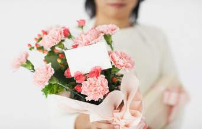

+++
title = "هدية حماتك.. واجب وطني"
date = 2007-03-20
authors = ["دعاء الشامي"]

[taxonomies]
authors = ["doaa-elshamy"]
sections = ["banat"]

[extra]
section_name = "بنات"
share_image = "/media/admins.20at.com/aly/hamatek_article.jpg"
summary = "21 مارس.. يوم نحتفل فيه بالأم تقديرا لها، يقاطعه البعض على أساس انه بدعة، ويسقطه البعض الآخر لضيق ذات اليد، إلا إن الأغلبية يحتفلون به ويحضرون هدية لست الكل \"ال"
section_slug = "banat"
section_colour = "#888888"
thumb = "/media/admins.20at.com/aly/hamatek_article.jpg"
n_comments = 5
original_url = "http://www.20at.com:80/banat/how-to/3463-2009-11-04-14-02-59.html"
archived = "20100211043159"
date_source = "byline/meta"
aliases_20at = ["/banat/how-to/3463-2009-11-04-14-02-59.html"]

[extra.provenance]
original_url = "http://www.20at.com:80/banat/how-to/3463-2009-11-04-14-02-59.html"
capture_url = "https://web.archive.org/web/20100211043159/http://www.20at.com:80/banat/how-to/3463-2009-11-04-14-02-59.html"
capture_label = "١١ فبراير ٢٠١٠، ٠٤:٣١ UTC"
date_note = "من سطر التوقيع في المقال"
other_urls = []
comments = "٥"
missing_images = ""
+++

<figure></figure>

21 مارس.. يوم نحتفل فيه بالأم تقديرا لها، يقاطعه البعض على أساس انه بدعة، ويسقطه البعض الآخر لضيق ذات اليد، إلا إن الأغلبية يحتفلون به ويحضرون هدية لست الكل "الأم".

هدية عيد الأم تعودنا أن نمنحها في بعض الأحيان إلى مدرسة الفصل أو الجارة أو إلى الجدة الحبيبة لأنها في النهاية أم، أما الجديد في السنوات الأخيرة أنها تمنح إلى أم من نوع آخر وهي "أم الزوج" حماتك.

لكن هدية والدتك تختلف تماما عن هدية حماتك، فعلاقتك بالأولى قوية والهدية زيادة للخير، أما الثانية فعلاقتك بها مذبذبة تحتاج إلى تقوية دائمة وإيجاد مصدات للرياح والأعاصير التي تهب فجأة وبدون مقدمات وقد تحدث دون أن تدرك ذلك!

<h3>هدية حماتك مختلفة</h3>

هديتك إلى والدتك أو مدرستك يمكن اختيارها بدون مجهود، ويمكنك أن تسألي كل منهن عما تحتاجه وتحضرينه كنوع من تفهمك للعلاقة، بل يكفيهم "كل سنة وأنت طيبة"..

ولكن بالنسبة لهدية حماتك فالأمر مختلف تماما فلا تغامري وتتخلى عن إحضار الهدية ولا تعامليها معاملة هدايا الأخريات.

إليك بعض النصائح التي يمكنك إتباعها عند شراء هدية حماتك:

- إذا كنت في مرحلة الخطوبة وهذا هو عيد الأم الأول لك في هذه العلاقة الجديدة، فحاولي أن تقتربي من شخصية حماتك لترصدي كل ما تحب من أشياء في ورقة، أو تحدثي معها لفترات طويلة لتعرفي ما تحتاجه، ولكن لا تسأليها بشكل مباشر.

- يمكنك أن تسألي خطيبك عن تلك الأشياء التي تفضلها والدته وذوقها وطبيعة الألوان التي تفضلها ونوع الماركات التي تستخدمها.

- حددي ميزانية الهدية واحرصي أن يكون المبلغ مناسب، وإذا كانت ظروفك المادية مضطربة فاختاري نوعية الهدايا البسيطة التي لا يظهر سعرها ولا يمكن تقييمها مثل الزهور، تابلوه.....الخ.

- ابتعدي عن الهدايا التقليدية مثل الايشاربات أو البلوزات والعبايات، لأنها عادية وقد لا تحصلي على المقاس المناسب، وبالتالي تخسري الهدية وحماتك في نفس الوقت.

- هدية والدتك تكون ذات طابع جماعي يمكنك أن تستخدميها أنت أو واحدة من أخواتك، أما حماتك فهديتها لها فقط وبالتالي حاولي أن تختاري هدية تخصها وحدها وليست جماعية.

- احرصي على أن تغلفي الهدية بغلاف جذاب ومبهر يخفي طبيعة الهدية.

- لا تتحدثي عن هديتك قبل يوم عيد الأم واحرصي ألا تزوري حماتك قبل هذا اليوم لأنها ستكون في انتظار هديتك، والأفضل أن تزوريها يوم عيد الأم حتى لا تفسدي المناسبة.

- اختاري كارت جذاب وضعيه داخل الهدية وغلفيه معها واكتبي عليه بعض العبارات الرقيقة، واحرصي ألا تكوني مبالغة حتى لا تشعر بالنفاق.

- عطّري الهدية بعطرها الذي تفضله واتركي زجاجة العطر داخل الهدية وقتها ستشعر انك مهتمة بتفاصيلها الدقيقة.

- إذا فضلتِ هدية مختلفة وعصرية يمكنك أن تجمعي صور حماتك القديمة والحديثة وتضعيها في البوم مميز وغلفيه جيدا واختاري هدية مناسبة معه.

- اجعلي يوم عيد الأم مختلفا فاختاري مكان تفضله حماتك.. مسرح، سينما، نزهة في حديقة، واختاري المطعم الذي تفضله لتجعليها تقضي يوم مختلف عن تلك الأيام العادية.

- احضري لها المجموعة الكاملة لأحد الدعاة إذا كانت من هواة حضور الدروس الدينية وسماع هذا النوع من الحلقات.

- إذا كانت حماتك من ذوات المجوهرات والذوق الرفيع، يمكنك إهدائها صندوق لحفظ المجوهرات والإكسسوارات.

- إذا كانت من محبي التحف وإكسسوارات المنزل، يمكنك إهدائها شمعدان قيم تناسب ألوانه مع أثاث منزلها.

- إذا كانت من هواة المطبخ فيمكنك اختيار هدية توفر مجهودها وتساعدها في عملها ولكن تأكدي أنها لا تمتلكها.

- أما إذا كانت حماتك من النوع الرومانسي فاجعلي الورود رسولك إليها واختاري فيلمها المفضل وأرسليه على اسطوانة أو شريط فيديو مع الورد ثم زوريها بعد الهدية مباشرة.

هكذا تضمنين يوم عيد أم مختلف ومميز ومعاملة خاصة من حماتك لعدة شهور قادمة وقد تستمر لسنوات.. وأنت وشطارتك!

