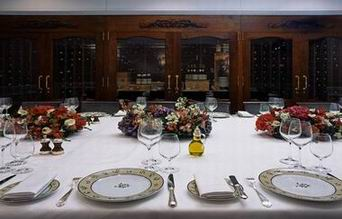

+++
title = "بـ الشوكة والسكينة"
date = 2007-07-21
authors = ["يسر عبد الدايم"]
aliases = ["/articles/7ayatna-6777/"]

[taxonomies]
authors = ["yasr-abdel-eldaim"]
sections = ["banat"]

[extra]
section_name = "بنات"
share_image = "/media/admins.20at.com/cherine/sofraarticle.jpg"
summary = "عندك اليوم عزومة مهمة.. فكرت كثيرا ماذا ستقدمين لهم.. وكيف سيكون شكل المائدة؟.. ومن شدة حرصك علي شياكة مائدتك، جمعت كل الإكسسوارات الثمينة لديك ووضعتيها أمام ال"
section_slug = "banat"
section_colour = "#888888"
thumb = "/media/admins.20at.com/cherine/sofraarticle.jpg"
n_comments = 8
original_url = "http://www.20at.com:80/banat/how-to/6777-2009-11-04-14-47-00.html"
archived = "20100131031850"
date_source = "byline/meta"
aliases_20at = ["/7ayatna/6777.html", "/banat/how-to/6777-2009-11-04-14-47-00.html"]

[extra.provenance]
original_url = "http://www.20at.com:80/banat/how-to/6777-2009-11-04-14-47-00.html"
capture_url = "https://web.archive.org/web/20100131031850/http://www.20at.com:80/banat/how-to/6777-2009-11-04-14-47-00.html"
capture_label = "٣١ يناير ٢٠١٠، ٠٣:١٨ UTC"
date_note = "من سطر التوقيع في المقال"
other_urls = ["/7ayatna/6777.html"]
comments = "٨"
missing_images = ""
+++

<figure></figure>

عندك اليوم عزومة مهمة.. فكرت كثيرا ماذا ستقدمين لهم.. وكيف سيكون شكل المائدة؟.. ومن شدة حرصك علي شياكة مائدتك، جمعت كل الإكسسوارات الثمينة لديك ووضعتيها أمام المعزومين، الأمر الذي أدي في النهاية إلي تكدس المائدة بأدوات كثيرة دون استخدام.. شعرت معها بالزحام!!

ترتيب وإعداد "السفرة" أحد الأمور الهامة التي يجهل الكثير منا فن إعدادها بطريقة سليمة.. لهذا رصدنا لكم بعض المعلومات الهامة كي نتعلم معنا فن إعداد مائدة الطعام

<h3>لا زائد ولا ناقص</h3>

عليك ترتيب سفرتك بذكاء والتأكد من أن كل قطعة موجودة علي المائدة لها استخدام، وأي قطعة زائدة وغير مستخدمه قومي فورا بالاستغناء عنها، فمثلما نحرص على أن لا تكون القطع ناقصة أيضا نحرص على أن لا تكون زائدة.

خبراء الإتيكيت يقولون أن الموائد الكاملة تضم شوكتين علي اليسار واحدة كبيرة والأخرى صغيرة وتكون أسنانهما متجه إلى أعلى، وسكينتان علي اليمين سكين للحوم والدجاج وأخري للأسماك في حاله وجود الأسماك علي المائدة، وفي حاله عدم وجودها يتم الاستغناء عن السكين الإضافي، والحافة الحادة للسكين تكون في اتجاه الطبق.

وعند وضعك للسكاكين والشوك والملاعق يجب ألا تبتعد حافة مقابضها أكثر من 2 سم عن حافة المائدة.

وبالنسبة لوضع الأطباق؛ يوضع في البداية الطبق الأكبر للوجبة الرئيسية ويكون مسطح "فلات"، وفوقه طبق أصغر ويستخدم للمأكولات الباردة والسلطات، وفوقهما يوضع طبق الحساء "الشوربة".

<h3>إكسسوارات ومفارش</h3>

في وجبات الغداء والعشاء لا تبالغي في وضع الإكسسوارات، فالقليل منها يعطي المائدة نوعا من الدفء والرومانسية ويضفي عليها شكلا مميزا، لأن العلاقة بين أنواع الطعام وأشكاله وطبيعة ترتيب المائدة لها دور كبير في احتفاظ المائدة بتوازنها.

أما بالنسبة لألوان مفارش المائدة فيفضل استخدام المفارش ذات الألوان المشرقة المبهجة وذلك في حاله إعداد المائدة للإفطار والغداء مما يعطي شعورا بالتفاؤل، وبالنسبة لمفرش السفرة عند العشاء فتفضل الألوان الداكنة كالأزرق أو القرمزي، على أن تكون الشموع والورود بنفس اللون، وعليك الحرص بألا يتدلي المفرش أكثر من 30 سم من جوانب الطاولة

<h3>اللمسة النهائية</h3>

تبقى اللمسات الأخيرة وترتيب مائدة الطعام بالطريقة اللائقة والمناسبة للضيوف، إليك بعض النصائح لتكون مائدة طعامك مثالية:

1- وضع زجاجتين واحدة خاصة للزيت والأخرى للخل- الخاصتين بالسفرة- فهما يعطيان مظهرا جميلا للمائدة.

2- للحصول علي غرفة مائدة ملكية؛ احرصي علي أن تكون الألوان متناسقة ومميزة، وأن تكون أدوات مائدتك لها علاقة بالديكور العام للغرفة.

3- بالنسبة للإكسسوارات الخاصة استخدمي الشمعدان والشموع باختلاف ألوانها وأحجامها.

4- عليك الحرص علي وجود باقة من الورود بألوان تتناسب مع الديكور العام للطاولة في فازه كريستال.

<h3>حديث المائدة</h3>

الجلوس علي مائدة الطعام له قواعد يجب أن تتبع، وخاصة إذا كان هناك ضيوف، فيجب أن يكون الجو العام للمنزل يتسم بالهدوء حتى يشعر الضيوف بجو من الراحة وعدم الإحراج خاصة لو كانت الدعوة للمرة الأولى، ويرجي عدم إحداث ضجة أثناء الجلوس علي المائدة، وعليك تحديد المكان الخاص بضيوفك مقدما حتى لا يحدث لهم حرج البحث عن مقعد.

وبالنسبة للحديث علي المائدة؛ يجد أن تقومي بفتح موضوع شيق وهام لجميع الضيوف حتى يتحدث الجميع فيه، وعليك بعدم تجاهل أحدا منهم حتى لا يشعر بحرج أو انه غير مرغوب فيه، وعليك بالبعد عن أخبار الحوادث والكوارث التي قد تفقد ضيوفك شهيتهم

