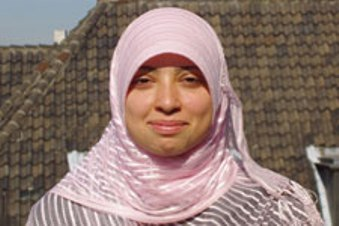

+++
title = "أسماء... مذيعة الدانمارك المحجبة"
date = 2006-04-27
authors = ["نضال أبو عارف"]
aliases = ["/articles/b744/"]

[taxonomies]
authors = ["nadal-abu-aarf"]
sections = ["7ayatna"]

[extra]
section_name = "حياتنا"
share_image = "/media/admins.20at.com/cherine/asmaa1.jpg"
summary = "بعد أكثر من 3 أسابيع على إطلالتها كأول مذيعة محجبة على شاشة التلفزيون الرسمي الدانمركي، تعرب أسماء عبد الحميد عن أمانيها في تفاعل الشباب المسلم داخل المجتمع الد"
section_slug = "7ayatna"
section_colour = "#CA0789"
thumb = "/media/admins.20at.com/cherine/asmaa1.jpg"
n_comments = 20
original_url = "http://www.20at.com:80/component/content/article/1-archive/2061.html"
archived = "20100117011752"
date_source = "byline/meta"
aliases_20at = ["/article2.php?sid=744", "/component/content/article/1-archive/2061.html"]

[extra.provenance]
original_url = "http://www.20at.com:80/component/content/article/1-archive/2061.html"
capture_url = "https://web.archive.org/web/20100117011752/http://www.20at.com:80/component/content/article/1-archive/2061.html"
capture_label = "١٧ يناير ٢٠١٠، ٠١:١٧ UTC"
date_note = "من سطر التوقيع في المقال"
other_urls = ["/article2.php?sid=744"]
comments = "٢٠"
missing_images = ""
+++

<figure></figure>

بعد أكثر من 3 أسابيع على إطلالتها كأول مذيعة محجبة على شاشة التلفزيون الرسمي الدانمركي، تعرب أسماء عبد الحميد عن أمانيها في تفاعل الشباب المسلم داخل المجتمع الدانمركي، وعلى المستوى الخارجي تتمنى أن يسمح للمحجبات بالظهور على كل الشاشات العربية الرسمية.

التقيت بأسماء (24 عاماً) التي تسلطت عليها كاميرات التلفزيون الدانمركي بأطراف العاصمة كوبنهاجن خلال الأسابيع الماضية حيث شاركت في تقديم برنامج على قناة DR شبه الرسمية، واستقبلت بعد إذاعة أولى حلقاته بحملات تأييد من مختلف فئات المجتمع، قابلها انتقادات من جانب البعض من الذين طالبوها بخلع الحجاب إذا أرادت الاستمرار.

وترى مقدمة البرامج الدانمركية، ذات الأصل فلسطيني أن معيار اختيار المذيعات على أساس المظهر أو الزي هو "ظلم وجهل، فيجب أن تكون القدرات والمهارات هي الفاصل في الاختيار، كما يجب على الفتيات اللاتي يحرمن من فرصة الظهور على الشاشة بسبب الحجاب أن يعارضن هذا القرار الظالم".

وفي هذا السياق، تعرب أسماء عن أمانيها في أن "تلحق القنوات العربية الرسمية (التي لا تسمح بظهور المحجبات) بركب الحضارة الأوربية وتسمح للمحجبة بالظهور على الشاشة مثلما فعل التليفزيون الدانماركي"، معتبرة أن التلفزيونات العربية أولى بذلك.

<h3>مشاركة الشباب في المجتمع الدانماركي</h3>

ظهور أسماء على الشاشة أدى إلى توضيح صورة الحجاب لدى العديد من الدانماركيين، بحسب المذيعة المسلمة التي قالت إن الكثيرين من الدانماركيين "أدركوا أن الحجاب ليس اضطهاداً للمرأة كما يروج بعض المنتقدين له، بل إن العكس صحيح".

وحول أحلامها بالنسبة لمسلمي الدانمارك، تقول أسماء: "الشباب المسلم في الدانمارك بحاجة إلى أن يبدأ في الحلم بمستقبل أفضل.. أتمنى من هؤلاء الشباب ألا يستسلموا للواقع المرير وأن يكونوا أكثر تفاؤلاً وتفاعلاً بالمجتمع، فهناك العديد من الفرص في الدانمارك للشباب".

كما تناشد أسماء الشباب المسلم بأن يكون أكثر طموحاً ويستثمر الوسائل المتاحة له على الساحة الدانماركية من تعليم مجاني وحرية في التعبير وأن يشارك بشكل أكبر في الحياة السياسية والاجتماعية.

أما عن الاندماج بالمجتمع، فترى أسماء أن "اللغة ومعرفة عادات وتقاليد المجتمع الذي نعيش فيه أمران مهمان جدا في مسألة الاندماج، فالأقلية بحاجة لأن تشارك في جميع مجالات الحياة وأن نعطي للمجتمع كما نريد أن يعطينا.. أعتقد أن سياسة الاندماج يجب أن تكون مبنية على الاحترام المتبادل وحرية الاعتقاد".

<h3>سفيرة للإسلام.. بالحجاب</h3>

واستبعدت أسماء أن يكون الحجاب عائقاً أمام الاندماج، وقالت: "ظهوري على الشاشة يعد سابقة في تاريخ مسلمي أوروبا، ويثبت أن مجال التفوق والنجاح ليس محصوراً فقط على غير المسلمين".

وبجانب عملها الإعلامي، تعتبر أسماء ناشطة سياسية بحزب الوحدة الدانماركي وكانت مرشحة الحزب للمجلس البلدي.. وعن هذا تقول: "كنت ومازلت ناشطة في الساحة السياسية بالدانمارك، والذي دفعني للمشاركة هو إيماني في القدرة على التغيير.. أنا أومن بالعملية الديمقراطية وتطبيقها وإيجاد مستقبل أفضل للأقلية المسلمة".

وبعد ظهورها كأول مذيعة محجبة على شاشة تلفزيون، تصدت أسماء لمعارضة شديدة من جانب بعض اليمينيين، حيث طالبها بعضهم بخلع الحجاب إذا أرادت الاستمرار في البرنامج، أو وقفه من الأساس، فيما ذهب البعض إلى أبعد من ذلك باتهامها بالسعي "لأسلمة المجتمع" بعد تصريحات قالت فيها إنها "سفيرة للإسلام" بالدانمارك.

وفي هذا الصدد، تقول أسماء: إن "سفيرة للإسلام.. عبارة أثارت حفيظة الكثيرين، لكن هذا الأمر ليس لي اختيار فيه، فالجمهور ينظر إلي بالفعل كسفيرة للإسلام لكوني محجبة، وقد أصبحت ممثلة لمجموعة كبيرة من النساء ورمز لجيل وفئة كاملة من المجتمع، وهو ما يفرض علي دور القدوة".

في المقابل فوجئت أسماء بحملات تأييد واسعة من مختلف فئات المجتمع، حيث انهالت عليها رسائل التأييد وباقات الزهور من المشاهدين منذ عرض أولى حلقات البرنامج. وقالت: "وردتني رسائل تشكرني على البرنامج وتهنئني على نجاحه".

<h3>فريق العمل</h3>

وحول أجواء العمل بالتلفزيون الدانماركي، تقول أسماء: "الزملاء يعاملوني باحترام كبير ويقدمون لي العون متى احتجت إليه، كما يمكنني الصلاة في مكان عملي عندما يأتي موعد الصلاة، فلا يوجد عائق أمام ذلك".

وترفض أسماء مصافحة الرجال خلال البرنامج وهو ما أثار استياء البعض. وحول ذلك تقول: "أصافح فقط ضيوفي من النساء، لكني فوجئت بامتناع أحد السياسيين من أصول عربية عن المشاركة في البرنامج لهذا السبب، لكن العديد من السياسيين شاركوا بالبرنامج وتفهموا ذلك حيث لم تمثل قضية المصافحة أدنى مشكلة بالنسبة لهم".

وأضافت: "أكتفي بوضع يدي على صدري، وأعتقد أنني أعبر بهذه الحركة عن احترامي للضيف، حتى إن أحد أعضاء الحزب اليميني المتشدد (حزب الشعب الدانماركي) شارك في إحدى الحلقات، ولم تكن عنده مشكلة على الإطلاق في عدم المصافحة".

<h3>رسوم الكارتون.. سبب التعيين؟!</h3>

ويفسر البعض قرار تعيين أسماء بالتليفزيون الدانماركي بأنه محاولة من الحكومة للتجمل أمام العالم الإسلامي بعد موجة الغضب تجاه الدانمارك بعد نشر الرسوم المسيئة للنبي صلى الله عليه وسلم.

غير أن أسماء تستبعد ذلك وتضيف: "نرفض تلك الرسومات ونعتبرها مهينة للإسلام، فمبدأ الإساءة مرفوض في ديننا ولو كانت الرسومات تسيء لسيدنا عيسى عليه السلام لرفضتها وحتى لو كانت لشيء آخر يسيء لمشاعر أي فئة من الناس فأنا أرفضها".

وجاءت أسماء عبد الحميد إلى الدانمارك وهي في السادسة من عمرها، وكانت تعمل مرشدة اجتماعية قبل التحاقها للعمل كمذيعة.

ولفتت أسماء إلى أن بعض القنوات العربية الفضائية عرضت عليها العمل، لكنها لا تفكر في الانتقال لأي بلد عربي في الوقت الحالي حتى تنتهي من دراستها الجامعية في الدانمارك حيث تعد رسالة الماجستير في علم الاجتماع.

* منقول بتصرف من موقع إسلام أون لاين. نت.

