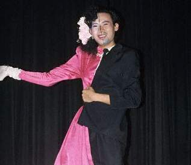

+++
title = "المتحولون.. جنسياً!"
date = 2006-05-24
authors = ["فاطمة عاشور"]
aliases = ["/articles/b854/"]

[taxonomies]
authors = ["fatma-aashor"]
sections = ["7ayatna"]

[extra]
section_name = "حياتنا"
share_image = "/media/admins.20at.com/yasmine/mok1.jpg"
summary = "كيف يمكن أن تكون هناك فتاة تبدو كأنثى، ولكن كل تصرفاتها ذكورية وخشنة كأنها شاب؟!"
section_slug = "7ayatna"
section_colour = "#CA0789"
thumb = "/media/admins.20at.com/yasmine/mok1.jpg"
n_comments = 48
original_url = "http://www.20at.com:80/component/content/article/1-archive/2171.html"
archived = "20091226222856"
date_source = "byline/meta"
aliases_20at = ["/article2.php?sid=854", "/component/content/article/1-archive/2171.html"]

[extra.provenance]
original_url = "http://www.20at.com:80/component/content/article/1-archive/2171.html"
capture_url = "https://web.archive.org/web/20091226222856/http://www.20at.com:80/component/content/article/1-archive/2171.html"
capture_label = "٢٦ ديسمبر ٢٠٠٩، ٢٢:٢٨ UTC"
date_note = "من سطر التوقيع في المقال"
other_urls = ["/article2.php?sid=854"]
comments = "٤٨"
missing_images = ""
+++

<figure></figure>

كيف يمكن أن تكون هناك فتاة تبدو كأنثى، ولكن كل تصرفاتها ذكورية وخشنة كأنها شاب؟!

كيف ترى فتى يبدو ذكراً من اسمه فقط، ولكن كل تصرفاته وهيئته وشكله وانفعالاته وحتى نبرة صوته ورقته توحي لك بأنه فتاة، ضعيفة وهشة؟!

حسناً، هذا هو ما يعرف باضطراب الهوية الجنسية، فلا هي أنثى كاملة الأنوثة، ولا هو ذكر كامل الرجولة!!

وهو أمر ليس قليل الانتشار، كما يتخيل البعض، ما بين الشباب والفتيات، ولكنه قد يبقى مختفياً وخامداً مع ضغوط المجتمع، الذي قد يتقبل خشونة البنت على أنها من إحدى مظاهر القوة، ولكن بالنسبة للشاب، فالرقة والهشاشة تعتبر شذوذاً، وغالبية هؤلاء يعيشون تحت وطأة الضغط في ظروف صعبة، فينغلق بعضهم على نفسه، ويقدم البعض على الانتحار، فيما يتوجه آخرون نحو عالم الفساد والشذوذ.

ولكن ماذا نعرف نحن عن هؤلاء المخنثين؟!

ومن هم المتحولون جنسياً؟!

<h3>هم.. بيننا</h3>

التخنث، هو أن تكون الأعضاء التناسلية الداخلية فى شكلها ونموها والهرمونات الخاصة بها مخالفة للشكل الظاهري للجسم، كأن تكون الأعضاء التناسلية الداخلية هي الأعضاء الذكرية والشكل العام لأنثى.

وتتنوع الخنثى ما بين خنثى حقيقية وخنثى كاذبة؛ فالحقيقية تعنى وجود أعضاء الذكورة والأنوثة في نفس الشخص وهي حالات بالغة الندرة، والكاذبة تعني وجود أعضاء الذكورة عند أنثى أو وجود أعضاء الأنوثة عند ذكر.

أما التعريف الطبي للمتحول جنسياً أو Transsexual فهو الشخص الذي يشعر أنه يفكر ويحب مثل الجنس الآخر وينتمى إليه بشدة، ولكنه في الجسد الخطأ، وأمثال هؤلاء يلجئون للعلاج الطبي والجراحي ليتحولوا إلى الجنس الذي يشعرون أنهم ينتمون إليه سواء ذكر أو أنثى.

وأولى عمليات التحول الجنسي في التاريخ كانت عام 202 لأحد أباطرة الرومان ويدعى إلاجبالوس، ولكن لم يعرف إذا كانت العملية قد نجحت أم لا..!

في الوقت الذي فشلت فيه أول عمليات التحول في عصرنا الحديث، وهي العملية التي أجريت لرسام دانماركي يدعى أينر ويجنر، فقد تحول إلى فتاة تدعى إيلي إلب عام 1931، ولكن حدثت الكثير من المضاعفات بعد اجراء العملية وماتت، بالرغم من إصدار بطاقة وشهادة ميلاد جديدتين لها، وإنهاء زواجها بأمر ملكي!

وكانت بداية النجاح عندما أجرى أحد الجنود الأمريكيين ويدعى جورج يورجنسن، عملية حولته إلى كريستين عام 1952، وأجراها له أطباء اسكندينافيين، ثم عاد لوطنه بعد ذلك، وأرسل لأهله جواباً قال فيه : "لقد أصبحت ابنتكم... وليس ابنكم!"، ولكنهم تقبلوا الموقف واعتادوا عليه بعد ذلك، بعد أن كانوا يعرفون مدى معاناته.

ولكن الآن، وداخل الوطن العربي تحديداً.. هل يوجد من يتقبل هذا الوضع، ويخضع لهذه العمليات بعد التطور الذي شهده هذا المجال؟ وهل هؤلاء الأشخاص، يعيشون بيننا فعلاً؟!

<h3>ونسيت أني امرأة!!</h3>

(ح . ش)... شاب يعيش في ثوب فتاة، مجرد امرأة بالإسم وبالأعضاء التناسلية فقط، وفيما عدا هذا فهي رجل بكل المشاعر والأحاسيس وأيضاً التصرفات الرجولية!

تقول أو "يقول" (ح . ش): "لم أتذوق راحة البال منذ أجريت لي عملية تغيير الجنس، والتي تحولت بمقتضاها إلى فتاة بالغصب".

(ح . ش) شخصية نمطية، ملامحها وشخصيتها لا تختلف كثيراً عن أغلب حالات الخنثي التي تضيع حياتها في رحلة البحث عن الذات، ويعتصر قلبها في صمت من ازدراء الناس لها ونبذها من المجتمع.

ترغب في العيش كشخص طبيعي لا أن تكون مجرد نتيجة للعمليات الجراحية والتجارب، هذا بجانب خوف أهل الخنثى من نظرات الناس وكلامهم الذي يؤدي بهم لأفعال، قد تؤذي أولادهم... مدى الحياة!

وتكمل (ح . ش): "ألبس لبس الرجال وأدخن وأتسكع مثلهم في الشوارع ليل نهار.. طريقة كلامي خالية من أي أنوثة، ولم أضع مكياجاً على وجهي يوماً، والأكثر من ذلك أن علاقتي بالفتيات ليست مجرد علاقة صداقة بين فتاتين ولكني أحببت الكثير من الفتيات كأي رجل آخر يشعر نحو فتاةٍ ما بالحب والإعجاب.. وما هو أكثر"!

<h3>لم أرتدي تنورة</h3>

بعد إجراء الفحوصات والتحاليل التي تم إرسالها للخارج، تحددت الخارطة الصبغية لـ(ح . ش) وهي (46xx) والتي تثبت أنها أنثى. فحسمت أسرتها موقفها وتم تسجيلها في قسم السجل المدني باسم حفيظة!

وتكمل حفيظة معاناتها قائلة: "منذ نعومة أظافري بدأت أتصرف كالأولاد ولم أكن أهتم بالأشغال المنزلية. كنت ألعب ألعاب الأولاد ولم أرتدي التنورة أو أيٍ من ملابس الفتيات طوال حياتي. وكلما تقدم سني، كلما ازددت نضوجاً.. كرجل!

عشت أغلب مراحل حياتي أتنقل بين المستشفيات وخضعت لأكثر من 16 عملية جراحية حتى الآن. واحتار الكثير من الأطباء في تحديد جنسي، فالخارطة الصبغية تقول أني أنثي، ولكن ملامحي وتصرفاتي كلها تدل على أني شاب".

وترجع حفيظة زيادة عدوانيتها وثورتها إلى عملية الختان التي أجريت لها عام 1985، وتنهي حديثها قائلة : "أنا أدفع الثمن وحدي وسط مجتمع لا يرحم، أعيش ولا أعرف من أنا. فكرت مراراً في الإنتحار، ولكن كل مرة أرجع عن هذا".

<h3>من شاب إلى فتاة</h3>

"لم أشعر أبداً أن جسدي على ما يرام، وأفضل أن أموت على أن أبقى كما أنا"... كانت هذه أولى كلمات جواد، الذي يفضل أن يتم التحدث إليه على أنه.. أنثى..!

المتحولون جنسياً يواجهون النبذ والسخرية أياً كانت حالتهم، ويوصمون في الكثير من الأحيان بعار الشذوذ الجنسي، وهي تهمة يعاقب عليها في القانون المغربي. ونجد الآن تفاخر واضح بين هؤلاء عندما يقومون بتغيير الجنس في البطاقة الشخصية، خاصةً بعد أن أصبح تبديل الجنس أمراً مقبولاً وموافقاً عليه دينياً،  وأصبحت هناك فتاوى شرعية تبيحه في الحالات الخاصة.

وقد (تمت الموافقة على عملية التحول الجنسي بالنسبة لـ(ج . م) (27 عاماً)، نظراً لإضطراب في الهوية. وبعد الإنتهاء من العديد من العمليات الجراحية والمعالجات الهرمونية، سوف يكون قادراً على بدء حياة جديدة بصفته "أنثى" بشهادة ميلاد وبطاقة جديدة) كان هذا هو نص الأذن الصادر عن طبيب المركز الطبي للدولة، والذي سيضمن لجواد أن يتحول لأنثى، ولكن ليس بمنتهى السهولة.

<h3>غير جنسك.. في الخارج!</h3>

ويقول أحد الأطباء التخصصيين: "لا يمكن تقديم هذا النوع من العمليات بمنتهى السهولة في الوطن العربي، لكونها تقتصر على الإصلاح فقط، ولأن حالة الخنثى نادراً ما ترد على الطب هنا إلا بعد بلوغ بعض الشباب سن 21 وذلك لتفادي الإنعكاسات النفسية التي تترتب على وضعهم العالق (لا ذكر ولا أنثى)، حيث يرون أن التدخل الجراحي أصبح ضرورياً، ولكن لا يتم ذلك إلا بعد موافقة العائلة".

ويقول طبيب آخر: "قليلاً ما تقوم مستشفيات الوطن العربي جميعاً بمثل هذه العمليات بسبب العادات والتقاليد. مما يدفع أغلب تلك الحالات للسفر إلى الخارج والقيام بها، حيث تتراوح أسعار تلك العمليات بدايةً من 6000 يورو أو 30 ألف يورو، ولأن الغرب أيضاً لديه كل الحرية في عمل تلك العمليات التي تكفل حقها القوانين والتشريعات الصادرة عن حكوماتهم، بلا أي وازع ديني أو أخلاقي".

وحتى الآن مازالت تلك العلميات تقام في السر، ولا توجد احصائيات واضحة ومحددة حول أعداد المخنثين الذين يحتاجون إلى تغيير جنسي داخل الوطن العربي.

<h3>المتحولون</h3>

التحول من امرأة إلى رجل قليل جداً وحالات الإنجاب تكون عندئذ نادرة إن لم نقل منعدمة، ولكن الطب مازال يتساءل عن تحول معظم المخنثين إلى امرأة، والتي غالباً بعد أن تجتاز مرحلة التحول تصبح فتاة جميلة ورقيقة، لديها رغبة جامحة في ممارسة الهوايات الفنية، مثل الرقص والرسم والغناء أيضاً..!

وعندما يتعلق الأمر بإصلاح جنس الخنثى، فيكون هذا أمر طبيعي لأن العائلات غالباً ما تتكتم على هذا السر خوفاً من نفور المجتمع وتجنباً للفضائح. حيث يكبر هذا الطفل بلا شعور بأنه ذكر أو أنثى وتبدأ أعراض الخنوثة بالظهور بعد البلوغ مثل ظهور ثدي لدى الرجل، أو لحية وشارب لدى الأنثى!

ومن هنا نطرح هذا السؤال.. إلى متى سوف نظل نخجل من أبناءنا الذين خلقهم الله على هذه الهيئة، بدلاً من أن نساعدهم بالتشخيص المبكر لتفادي المشاكل النفسية والأخلاقية؟!

إلى متى سيظل وضع المخنثين داخل المجتمعات العربية يمثل نشازاً في المجتمع ويتم مقابلته بالرفض والازدراء؟!..

وبالرغم من وجود جذور عميقة للمخنثين في التاريخ، هل يمكنك في يوم من الأيام أن تعترف وتتقبل وجود خنثى... أو متحول جنسياً.. بيننا؟!

أستمع إلى قصة شاب يريد أن يتحول إلى فتاة ويعيش منذ سنوات حياة فتاة - نقلا عن ال bbc 

