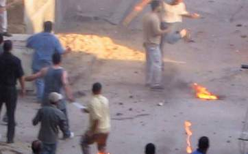

+++
title = "قليل من العنف.. كثير من البلطجة!"
date = 2006-09-01

[taxonomies]
authors = []
sections = ["egyvote"]

[extra]
section_name = "انتخابات مصر ٢٠٠٥"
share_image = "/media/egyvote.20at.com/images/4.jpg"
summary = "الصور التي ستشاهدها هنا، ليست لانتفاضة فلسطينية ضد عدو صهيوني، ولا لحرب استنزاف ضد مستعمر غاشم، ولكنها صور ليوم انتخابات الإعادة في دائرة (بولاق أبو العلا)، الت"
section_slug = "egyvote"
section_colour = "#9C6B00"
thumb = "/media/egyvote.20at.com/images/4.jpg"
n_comments = 5
original_url = "http://egyvote.20at.com:80/article.php?sid=19"
archived = "20070813235305"
date_source = "first-capture"
aliases_20at = ["//egyvote.20at.com/article.php?sid=19"]

[extra.provenance]
original_url = "http://egyvote.20at.com:80/article.php?sid=19"
capture_url = "https://web.archive.org/web/20070813235305/http://egyvote.20at.com:80/article.php?sid=19"
capture_label = "١٣ أغسطس ٢٠٠٧، ٢٣:٥٣ UTC"
date_note = "تاريخ أول لقطة في الأرشيف (لا يوجد تاريخ في المقال)"
other_urls = []
comments = "٥"
missing_images = ""
+++

<figure></figure>

الصور التي ستشاهدها هنا، ليست لانتفاضة فلسطينية ضد عدو صهيوني، ولا لحرب استنزاف ضد مستعمر غاشم، ولكنها صور ليوم انتخابات الإعادة في دائرة (بولاق أبو العلا)، التي تحارب أو – تنافس كما تقول الشائعات - فيها كل من المرشح الوطني اللواء (بدر القاضي)، ومنافسه المستقل رجل الأعمال (محمد المسعود)، في صورة مشينة نقلتها جميع القنوات الفضائية في جميع نشرات الأخبار!

وبالرغم من التواجد المكثف لقوات الأمن في المنطقة كما تذكر صحيفة (المصري اليوم)، تطورت التجاوزات في جولة الإعادة عن انتخابات الجولة الأولى، ووصلت إلى إطلاق الرصاص الحي، وماء النار، وقنابل المولوتوف. وتركزت أحداث البلطجة في أكبر لجنتين من حيث حجم الأصوات، وهما: لجنة (مدرسة السلام)، ولجنة (رملة بولاق)، وقادها بلطجية تابعون لمرشح الوطني على مقعد "الفئات"، بدر القاضي، حيث كان البلطجية يهتفون باسمه.

في لجنة (مدرسة السلام)، التي تأخر افتتاح أبوابها لمدة ساعة كاملة، قامت عناصر الشرطة المكلفة بحراسة اللجنة بفتح أبوابها، لعدد من البلطجية المسلحين بالشوم والأسلحة النارية، والذين قاموا بدورهم بطرد الناخبين ومطارداتهم إلى خارج اللجان، واستهدف البلطجية أنصار المنافس القاضي (محمد المسعود) المرشح المستقل. وكان اللافت مشاركة بعض أعضاء أمانة التنظيم الوطني وأعضاء المجلس المحلي، البلطجية في الاعتداء على المنافسين. وأسفرت عمليات البلطجة عن إصابة عدد كبير من الناخبين.

كما قام البلطجية باحتجاز (المسعود) داخل اللجنة. أما لجنة (رملة بولاق)، فقد تم إحاطتها بكردون أمني كبير، لكنه لم يمنع البلطجية من الاعتداء على الناخبات في هذه اللجنة المخصصة للسيدات، إلى جانب إطلاق الأعيرة النارية في الهواء لترهيب الناخبين، مما أدى إلى إصابة عدد من السيدات بجروح طفيفة.

وقام أنصار بدر القاضي أيضاً بإلقاء قنابل المولوتوف ضد الناخبين. وهاجم البلطجية أنصار المسعود، بماء النار إلى جانب الاعتداء على عدد من المراقبين التابعين للمنظمات الأهلية وأحد أعضاء لجنة الحريات بنقابة المحامين، وقاموا بتكسير كاميرا مصور قناة أبو ظبي، بعد الاعتداء عليه.

إلى ذلك قال المستشار إبراهيم البسيوني، أنه تعرض صباح أمس للإهانة والسب الضباط قسم بولاق أبو العلا، ويدعى أيمن وحيد، الذي قام بتهديده ثم أجبره على الخروج من اللجنة. وأضاف البسيوني أن الحزب الوطني اعتمد على البلطجة، وأن هذه الممارسات تمت تحت رعاية وحماية الشرطة ومباحث قسم بولاق أبو العلا.

* شاهد الجاليري (الجنان)، واقرأ الفاتحة (على) السلطان!

<h3> 16/11/2005 </h3>
