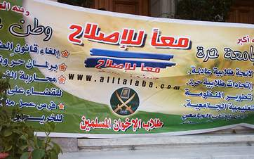

+++
title = "لا جديد.. تزوير انتخابات الجامعة!"
date = 2006-09-02

[taxonomies]
authors = []
sections = ["egyvote"]

[extra]
section_name = "انتخابات مصر ٢٠٠٥"
share_image = "/media/egyvote.20at.com/free-university1.gif"
summary = "اتهم طلاب الإخوان المسلمين إدارة الجامعات المصرية بتزوير انتخابات الاتحادات الطلابية التي جرت في 9 نوفمبر 2005، وأكدوا في مؤتمر طلابي عقدوه اليوم الأحد 13/11/20"
section_slug = "egyvote"
section_colour = "#9C6B00"
thumb = "/media/egyvote.20at.com/free-university1.gif"
n_comments = 0
original_url = "http://egyvote.20at.com:80/article.php?sid=2"
archived = "20070817122748"
date_source = "first-capture"
aliases_20at = ["//egyvote.20at.com/article.php?sid=2"]

[extra.provenance]
original_url = "http://egyvote.20at.com:80/article.php?sid=2"
capture_url = "https://web.archive.org/web/20070817122748/http://egyvote.20at.com:80/article.php?sid=2"
capture_label = "١٧ أغسطس ٢٠٠٧، ١٢:٢٧ UTC"
date_note = "تاريخ أول لقطة في الأرشيف (لا يوجد تاريخ في المقال)"
other_urls = []
comments = ""
missing_images = ""
+++

<figure></figure>

اتهم طلاب الإخوان المسلمين إدارة الجامعات المصرية بتزوير انتخابات الاتحادات الطلابية التي جرت في 9 نوفمبر 2005، وأكدوا في مؤتمر طلابي عقدوه اليوم الأحد 13/11/2005 بجامعة الأزهر تحت عنوان (اتحاد حر في جامعة حرة) أن الجهات الأمنية استهدفت استبعاد طلبة الإخوان المسلمين عن الاتحادات الطلابية.

وأضاف عدد من الطلاب أن الجامعات تعمدت الإعلان عن الانتخابات الطلابية قبل العيد مباشرة، بالإضافة إلى أنه تم فتح باب الترشيح للانتخابات عقب العيد مباشرة، مما منع معظم الطلاب من الإدلاء بأصواتهم نتيجة لظروف السفر إلى المحافظات المختلفة، وأدى إلى حصول الطلاب المرضي عنهم أمنيا على أمانة الاتحادات الطلابية بالتزكية.

وقد أكد الطلاب في كلماتهم على معنى واحد، وهو ضرورة إخلاء الجامعات من التواجد الأمني الذي يمنع تمثيل حقيقي للطلاب بكافة تياراتهم داخل الجامعة، وإلغاء اللائحة 79 من قانون الجامعات من التي تجعل لعمداء الكليات التدخل في النشاط الطلابي، ومنعه إذا لزم الأمر، مطالبين بلائحة جديدة تجعل للطلاب لسيطرة على كافة أمورهم وأنشطتهم الطلابية، ويقتصر دور عمداء الكليات في الإعلام والإخبار فقط، هذا بالإضافة إلى جعل عمداء الكليات بالانتخاب من قبل الطلاب وأعضاء هيئة التدريس.

ففي كلمة طلاب جامعة قناة السويس أكد طلاب الإخوان أن إدارات الجامعة وأمن الدولة وعدوا بأن تكون الانتخابات نزيهة قبل بدايتها، إلا أن ما حدث كان مغايرا لكل ذلك ، حيث تم شطب جميع الطلاب الإخوان من الكشوف الابتدائية، وقالوا علانية أن الكشوف تذهب أولا لأمن الدولة لتفعل ما يراه مناسبا، ولذلك فلابد من تفتيت جهاز امن الدولة داخل الجامعات.

وفي كلمة جامعة الأزهر، أكد الطلاب أن الاتحادات الطلابية أصبحت (هشة) بسبب ما يجرى كل عام من انتهاكات في اختيار ممثلي الطلبة في الاتحادات الطلابية، وجعل أمناء الاتحادات الطلابية عملاء للأمن، ولذلك الذي يفوز دائما بالانتخابات هم طلاب الأمن.

وفي كلمة جامعة حلوان أكد طلابها المنتمين لتيار الإخوان المسلمين أنه بالرغم من أنه يقال أننا في عصر الحريات، إلا أن الشباب داخل الجامعات كبد حريتهم ويمنعون من الإدلاء بصوتهم الحقيقي في الانتخابات الطلابية، كما يمنع طلاب الإخوان لكونهم يحملون فكرا واتجاها مخالف لأفكار من يديرون الجامعات تحت مظلة الأمن.

في حين وعد طلاب جامعة المنصورة بعدم السكوت عن ما حدث من مهازل في انتخابات الطلاب، وأنه يتم الآن اعتصام من قبل الطلاب بإدارة مبنى رئاسة جامعة المنصورة كي يتم اتخاذ قرار من رئاسة الجامعة حول ما تم من تزوير في الانتخابات الطلابية، خاصة وأن بعض الكليات لم يعلن فيها عن الترشيح للانتخابات الطلابية.

<h3> عادل عبد الحليم - القاهرة </h3>
