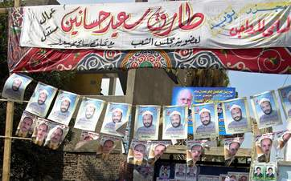

+++
title = "المبشرون بـ\"الوطني\"!"
date = 2006-09-01

[taxonomies]
authors = []
sections = ["egyvote"]

[extra]
section_name = "انتخابات مصر ٢٠٠٥"
share_image = "/media/egyvote.20at.com/images/1_574503_1_34.jpg"
summary = "أطلق أنت عليهم الاسم الذي تراه مناسباً، (منشقين)، (مستقلين)، إلا أن الوصف الأدق في رأينا هو الـ(مضللين).. الذين نجحوا في تضليل الرأي العام، في واحدة من الطرائف "
section_slug = "egyvote"
section_colour = "#9C6B00"
thumb = "/media/egyvote.20at.com/images/1_574503_1_34.jpg"
n_comments = 7
original_url = "http://egyvote.20at.com:80/article.php?sid=24"
archived = "20070817122808"
date_source = "first-capture"
aliases_20at = ["//egyvote.20at.com/article.php?sid=24"]

[extra.provenance]
original_url = "http://egyvote.20at.com:80/article.php?sid=24"
capture_url = "https://web.archive.org/web/20070817122808/http://egyvote.20at.com:80/article.php?sid=24"
capture_label = "١٧ أغسطس ٢٠٠٧، ١٢:٢٨ UTC"
date_note = "تاريخ أول لقطة في الأرشيف (لا يوجد تاريخ في المقال)"
other_urls = []
comments = "٧"
missing_images = ""
+++

<figure></figure>

أطلق أنت عليهم الاسم الذي تراه مناسباً، (منشقين)، (مستقلين)، إلا أن الوصف الأدق في رأينا هو الـ(مضللين).. الذين نجحوا في تضليل الرأي العام، في واحدة من الطرائف السياسية التي يتحفنا بها الحزب الوطني من فترة لأخرى، بعد أن قام 46 من المستقلين بتقديم طلبات عاجلة للانضمام إلى الوطني في المرحلة الأولى للانتخابات البرلمانية 2005... أما الأطرف والمثير للدهشة أن الوطني وافق على الفور!

والحكاية بدأت منذ أن أعلن الأمين العام للحزب الوطني صفوت (الشريف) عن طلب أربعة مرشحين مستقلين - قبيل جولة الإعادة - بالعمل تحت راية الحزب، قال ذلك حينها دون تحديد لهوية هؤلاء، ولكن مرت الساعات وارتفع العدد من 4 إلى 46 في مشهد يتكرر للمرة الثانية عقب مهزلة انتخابات 2000 التي لم يفز فيها الوطني بأغلبية المقاعد، إلا بعد انضمام 113 من المستقلين إلى صفوفه.

ويعلق الكاتب ممدوح الشيخ منسق حركة حماية، الحركة المختصة بمراقبة الفعل الانتخابي، لـ(Egyvote) على تلك ظاهرة المستقلين بقوله: "ما يدور من حديث الآن عن المنشقين - العائدين ورغم فداحته، إلا أنه أمر متوقع طالما الصمت الدستوري والقانوني على ذلك مستمراً".

ويضيف الشيخ: "لقد بدأت تلك الممارسات المستفزة منذ زمن ووصلت لأعلى درجاتها في دورة 2000، ثم هذا العام بتحول 46 مستقلاً إلى الوطني، وكل هذا ولم تتحرك أي جهة، برغم أنه لا جدال على عدم أخلاقية هذا الأمر ومنافاته لأهم حق من حقوق الإنسان وهو احترام إراداته واختياراته".

وعن تحركات حركة (حماية) لصد مثل هذا التحرك، يشير ممدوح الشيخ إلى أن (حماية) لقد سبقنا الواقع وتقدمنا الأسبوع الماضي بمذكرة إلى اللجنة العليا للانتخابات طالبنا خلالها بأن تعلن النتائج طبقاً للصفات الشخصية التي تقدم بها الجميع للترشيح، وإلزامهم بها حفاظاُ على حق الناخبين التي كانت أصواتهم هي كارت مرور الكثير من المضللين خلال الدورات السابقة.

كما قامت حركة (حماية) بإعداد قائمة سوداء تكون بمثابة ذاكرة برلمانية تسجل من قاموا بهذا الفعل المضلل الدورة البرلمانية الماضية، وإعداد مذكرة مشابهة بنهاية تلك الدورة بعد تحديد كل نائب منتخب لموقفه.

ويقول الشيخ أن الحركة قد تتجه إلى تصعيد الأمر عالمياً، وطرح الأمر أمام البرلمان الدولي طالما أن اللجنة العليا للانتخابات لا تكترث بأي مطالب جادة من شأنها الحفاظ على الصفة الشعبية والنيابية للبرلمان.

ويذكر الباحث السياسي (محمد عبد القادر) عدة أسباب أدت إلى هذه الظاهرة، منها ضعف البنيان الحزبي بصفة عامة بمصر، فضلاً عن فقدان الثقة بفعاليتها، فالأحزاب عامة والوطني خاصة عاجز عن استيعاب كثير من الفئات الاجتماعية على اختلافها، مثل الأقباط والمرأة والشباب.

وكذلك تظهر ضعف الأحزاب أمام التكتلات القبلية والعصبيات، ولذا لجأ الحزب الوطني إلى التحالف مع المستقلين الذين يتواجدون داخل هذه التكتلات؛ لأنها غالباً ما تكون وجوه معروفة للأهالي، وهم دائماً من فئة رجال الأعمال وأبناء العائلات الكبرى، وتأتي التحالفات بعد أن يوعدهم الحزب بضمهم في حالة الفوز، وفي الغالب تكون هناك مصالح مالية وتسهيلات مختلفة تخص المرشح وحده دون الناخبين، وهو الحادث في قضية الـ46 المبشرين بالوطني!

<h3> منى سليم </h3>

<h3> 17/11/2005 </h3>
