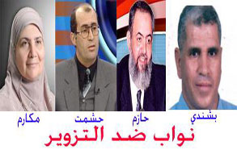

+++
title = "النائب الشرعي..في الخارج فقط!"
date = 2006-09-02

[taxonomies]
authors = []
sections = ["egyvote"]

[extra]
section_name = "انتخابات مصر ٢٠٠٥"
share_image = "/media/egyvote.20at.com/images/na2eb-shar3y.jpg"
summary = "عادة ما يستمد النائب مشروعيته من نسبة تصويت الشارع له، ولكن موازين الفوز ومشروعية النتائج اختلفت هذا العام بل ربما اختلت لتصبح بالأوامر العليا الوطنية، التي أسق"
section_slug = "egyvote"
section_colour = "#9C6B00"
thumb = "/media/egyvote.20at.com/images/na2eb-shar3y.jpg"
n_comments = 4
original_url = "http://egyvote.20at.com:80/article.php?sid=45"
archived = "20070612210855"
date_source = "first-capture"
aliases_20at = ["//egyvote.20at.com/article.php?sid=45"]

[extra.provenance]
original_url = "http://egyvote.20at.com:80/article.php?sid=45"
capture_url = "https://web.archive.org/web/20070612210855/http://egyvote.20at.com:80/article.php?sid=45"
capture_label = "١٢ يونيو ٢٠٠٧، ٢١:٠٨ UTC"
date_note = "تاريخ أول لقطة في الأرشيف (لا يوجد تاريخ في المقال)"
other_urls = []
comments = "٤"
missing_images = ""
+++

<figure></figure>

عادة ما يستمد النائب مشروعيته من نسبة تصويت الشارع له، ولكن موازين الفوز ومشروعية النتائج اختلفت هذا العام بل ربما اختلت لتصبح بالأوامر العليا الوطنية، التي أسقطت رغبة الشارع من حساباتها لتعلو رغبة "الوطني" فوق رقاب الجميع، ولكن وسط هذه المسرحيات الهزلية أصبح واضحا أن هناك نواب في البرلمان، وآخرون يملكون الشرعية، ويملكون أيضا مقعدا دائما، في أي مكان في مصر..إلا البرلمان!

مع بداية العملية الانتخابية لبرلمان 2005، ظهر حرص النظام علي تقويض أكبر عدد من مقاعد مرشحي المعارضة وعلي رأسهم مرشحي الإخوان، مستخدمين في ذلك شتي الوسائل والتي كان من أبرزها عمليات التصويت والقيد الجماعي لصالح مرشحي الوطني في المرحلة الأولي وعمليات البلطجة الموسعة في المرحلة الثانية، وفي المرحلتين ظهرت وسيلة تغيير نتائج الفرز النهائية لعدد من الدوائر الحساسة للنظام والتي كان أبرزها دائرتي الدقي وكرداسة في محافظة الجيزة ودائرة مدينة نصر بالقاهرة ودائرة بندر دمنهور بمحافظة البحيرة، وتشكل كل دائرة منهم حالة وقصة بين النظام والإخوان .

<h3>صراع الإخوة الأعداء</h3>

وكانت دائرة الدقي والعجوزة هي أولي الاختبارات أو المحك الأول بين الإخوان والوطني هذا العام خاصة وأنها صاحبة تاريخ طويل من الصراع بين الإخوان والحزب الوطني، فمنذ عام 1995 رشحت الجماعة المستشار مأمون الهضيبي نائب المرشد آنذاك ضد الدكتورة آمال عثمان وزيرة الشئون الاجتماعية في هذا الوقت.

والمعروف عن آمال قربها الشديد من السيدة سوزان مبارك قرينة الرئيس وشهدت الانتخابات وقتها حالات انتهاكات وتزوير خطيرة لمنع نجاح الهضيبي رغم تقدمه.

السيناريو نفسه تكرر عام 2000 بين آمال والهضيبي وسار إسقاط الإخوان قي هذه الدائرة مسلك وقرار سياسي وشعارا لإسقاط الجماعة بهزيمة نائب مرشدها.

وفي هذا العام رشحت الجماعة حازم صلاح أبو إسماعيل وهو ابن النائب المخضرم الشيخ صلاح أبو إسماعيل صاحب المعارك الساخنة في البرلمان والمشادات الحادة مع زكي بدر أشهر وزير للداخلية في مصر.

واستمرار للمسلك السياسي علي إسقاط الإخوان في هذه الدائرة كان علي النظام أن يدعم الوزيرة السابقة ضد الإخوان رغم أنها أصبحت عبئا ثقيلا علي الحزب الوطني بسياسته الجديدة.

فقد كانت النتيجة المعلنة لنتائج الصناديق والتي عرف بها بوضوح وعلانية داخل قاعة الفرز بوجود 112 قاضي إضافة إلي مندوبي المرشحين , النتيجة أعربت عن فوز حازم أبو إسماعيل بنسبة تتراوح من ( 62 % - 68 % ).

وخرجت الصحف القومية مثل الأهرام المسائي تعلن فوز أبو إسماعيل تحت عنوان (مفاجأة مدوية في نتائج المرحلة الأولي ..سقوط آمال عثمان) وهذا أيضا ما بثته قناة النيل للأخبار وقتها.

هذه كانت النتيجة الظاهرة حتي الساعة الواحدة صباح يوم 10 – 11 -2005 حيث انتهي الفرز لكن عند إعلان النتيجة داخل قاعة الفرز في الساعة 8: 15 من صباح يوم 10 – 11- 2005 كانت النتيجة مختلفة تماما.

حازم أبو إسماعيل النائب الشرعي عن الدائرة قال إن تأخر إعلان النتيجة وتبديلها لصالح آمال حسبما صرح له أحد المشرفين علي اللجان عند سؤاله عن هذا التأخير أنهم منتظرين استيقاظ الرئيس (يقصد مبارك) لمعرفة النتيجة، والتي تحولت من قرار حسابي إلي قرار سياسي!

<h3>ممنوع علي النساء</h3>

الدائرة الثانية كانت دائرة مدينة نصر ومصر الجديدة والتي رشحت فيها الجماعة الدكتورة مكارم الديري أستاذ الأدب العربي في جامعة الأزهر، وحساسيتها في كونها دائرة الرئيس مبارك التي يدلي فيها بصوته في الانتخابات العامة.

هذا ما أعرب عنه وزير البترول سامح فهمي حينما اجمتع بقيادات شركات البترول في هذه المنطقة بعد الجولة الأولي من الانتخابات حيث أعلمهم بغضب الرئيس بأن مرشحة الإخوان حصلت علي أصوات أبناء هذه الدائرة وخاصة أصوات العاملين بقطاع البترول في مدينة نصر وفي جولة الإعادة خاضت مكارم الديري وزميلها عصام مختار المعركة الانتخابية وواجهما سطوة المال والقيد الجماعي ولكن المفاجأة كانت لحظة الفرز بأنه لم تفلح كل طرق المزورين في حسم المعركة فقد تفوقت مكارم وزميلها علي منافسيهما بفارق كبير.

الحساسية الثانية لعدم فوز مكارم أن النظام يرفض دخول أي سيدة من التيار الإسلامي للبرلمان وهذا واضح منذ إسقاط جيهان الحلفاوي مرشحة الإخوان الأولي قي برلمان 2000

وهذا ما أكدت عليه مكارم الديري من أن قرار إسقاطها كان بإرادة سياسية وقرارات عليا وهو ما صرح لها به قضاة وضباط أمن دولة , حتي أن أحد عمداء الشرطة المشرفين علي لجنة الفرز قال صراحة لمدير حملتها الانتخابية إن كنتم خسرتم مقعد مكارم الديري في البرلمان فقد كسبتم عميد شرطة أحبكم (في إشارة منه لرفضه ما حدث من انتهاكات صاحبت العملية الانتخابية ) والتي انتهت بتغيير النتيجة لصالح السلاب

أما دائرة كرداسة بجنوب الجيزة والتي احتلت الدائرة الثالثة من حيث درجة السخونة والمنافسة بين الوطني والإخوان خاصة وأن حساسية هذا المكان ترجع إلي الشعبية الجارفة الإخوان فإجمالي عدد الأصوات بها 153ألف صوت، تصل نسبة التأييد في بعضها إلى أكثر من 65% من إجمالي عدد المشاركين في التصويت , وتقدمت الجماعة بمرشحها عبدالسلام بشندي مدير دار التوزيع والنشر المملوكة للإخوان والمرشح علي نفس المقعد عام 2000 .

النظام أراد أن يضرب هذه القوة التصويتية للإخوان بكافة الطرق إلا أن فساد مرشحي الوطني وحب أهالي كرداسة للإخوان وقف أمام هذه الرغبة فكان الحل الوحيد هو تبديل النتيجة ليصعد مرشح الوطني نائبا بالتزوير ويبقي بشندي النائب الشرعي عن الدائرة والتي بلغت نسبة التصويت له ما يكفيه لضمان فوز أكيد.

<h3>عملها الوطني</h3>

و كانت الدائرة الرابعة ولأكثر سخونة هي دائرة بندر دمنهور بمحافظة البحيرة ومرشحها الدكتور محمد جمال حشمت النائب الشرعي منذ عام 2000 ولعله سيظل حامل للقب النائب الشرعي فترة جديدة.

محمد جمال حشمت والذي فاز بمقعد الفئات عام 2000 وخرج من المجلس بمسرحية هزلية في عام 2003 نظرا لتبنيه ملف حقوق الإنسان والتصدي للداخلية في قضايا التعذيب ومسائلته لوزير الداخلية ورئيس الوزراء في قضايا التعذيب التي حدثت في مقر أمن الدولة بمدينة نصر أو سجن الباستيل كما أسماه حشمت، وتصديه للمسئولين المنحرفين والذي نتج عن استجواباته فصل 7 مسئولين كان أشهرهم علي أبو شادي في وزارة الثقافة وذلك خلال عامين فقط.

المعركة كانت أكثر سخونة معه بعدما قام الوطني بترشيح الدكتور مصطفي الفقي أحد أبرز وجوه النظام عساه يستطيع القضاء علي شعبية حشمت في دمنهور إلا أن صناديق الاقتراع وأصوات الناخبين حرمت الفقي ونظامه من هذه الأمنية.

وأكد هذا الفوز رئيس اللجنة العامة للدائرة المستشار أحمد عبد الستار نصار بعدما أخرج الجميع عنوة من لجنة الفرز بعد دعواه بأن الفرز انتهي والنتيجة لمقعد الفئات حسمت لحشمت لكن مقعد العمال عدد كبير من المرشحين وهم يقومون بإعادة فرزه، المندوبين الذين كانوا يتابعون عملية الفرز رصدوا حتي الساعة الحادية عشر وهي وقت انتهاء فرز الصناديق الفرعية رصدوا 35 ألف صوت لصالح حشمت و أقل من 7 آلاف صوت لصالح الدكتور الفقي.

في هذا الوقت جاءت بعض قيادات الأمن العام وبعض ضباط امن الدولة وكان معهم القاضي شوقى الصالحى ودخلوا إلي السيد رئيس اللجنة العليا في الوقت الذي قام مدير الأمن بطرد الجميع ..المرشحين والوكلاء بالقوة وبدأت جهات عليا تمارس ضغوطا على السيد المستشار رئيس اللجنة العليا , ولان الفقي يسعد كما يقول المثل ففي الصباح أفلحت الضغوط علي رئيس اللجنة الذي أعلن فوز الفقي ب 22982 صوتا مقابل ما يقرب من 4 آلف صوت لحشمت .

وهنا يؤكد زهدي الشامي الأمين المساعد لحزب التجمع ومرشحه لدائرة دمنهور, فوز جمال حشمت في الانتخابات بفارق كبير من الأصوات يتجاوز 34 ألفا مشيرا إلي أن التلاعب حدث في أرقام الفرز التي تم تزويرها لصالح الفقي بالإضافة إلي إغلاق بعض اللجان لفترات متتالية .

وكانت لعبة الأرقام في دائرة دمنهور كالأتي : عدد الحضور 46،948 الف صوت ، وكانت عدد الأصوات الصحيحة 45.774 ، وبلغت الأصوات الباطلة 10174 إلف صوت، وخرجت النتائج الأولية لتؤكد فوز الدكتور حشمت ب35 ألف صوت مقابل 7 ألاف صوت للدكتور الفقي، وبعد اجتماع دائم لمدة ساعين بين المستشار أحمد عبد الستار ورجال الأمن خرج ليعلن فوز الدكتور الفقي ب22 ألف صوت مقابل 19 ألف صوت لحشمت.

<h3>قضاة ضد التزوير</h3>

لا نستطيع أن نغفل دور القضاة في هذه المعركة الانتخابية و والذين تصدوا للمزورين وللنظام الفاسد الذي حاول تشويه صورة صورتهم.

ولا نستطيع أيضا أن نحمل جميع القضاة ذنبا شخصيات قليلة كانت بمثابة كلمات السر في تعديل نتائج الدوائر الأربعة الحساسة.

ومن المعروف أن المستشار محمود مكي نائب رئيس محكمة النقض أرسل مذكرة لرئيس نادي القضاة مطالبه بإصدار بيان للأمة باسم قضاة مصر يبرأون فيه من نتائج هذه الانتخابات.

كما طالب نادي قضاة مصر اللجنة العامة المشرفة على الانتخابات البرلمانية بإلغاء الانتخابات في أي دائرة يثبت وقوع انتهاكات وتجاوزات أو إتلاف للصناديق في أي من لجانها الفرعية، وعدم الاكتفاء باستبعاد هذه الصناديق فقط.

بينما أكد لنا المستشار محمود الخضيري رئيس نادي قضاة الاسكندرية في تصريحات خاصة أن لجنة التحقيق التي يشرف عليها نادي قضاة الإسكندرية قامت بالإطلاع حتى الآن علي نتائج فرز 40 صندوق بدائرة دمنهور والتي شهدت حالة من الاضطرابات حيال إعلان النتيجة النهائية لنتائج الفرز وخرجت النتائج الأولية للجنة التحقيق والتي اشرف عليها المستشار الخضيري بان الدكتور جمال حشمت حصل علي نسبة 88% من أصوات تلك الصناديق.

وعلي جانب أخر أكد أن الدوائر الأربع التي تعرضت للتشكيك في نتائجها تقوم اللجنة الآن بالتعاون مع لجنة القاهرة بالتحقيق في هذا الشأن وإن كانت الظواهر تؤكد أن دائرتي الدقي ودمنهور قد شابت عملية الفرز بهما وإعلان النتيجة حالة من التشكيك بعدم النزاهة والشفافية.

وقد أعلن النادي أن كل دائرة شبتها عمليات تزوير أو تأخر في إعلان النتائج في نتيجة الانتخابات بها باطلة وعلي جانب آخر أكد الخضيري أن نتائج هذه التحقيقات التي تقوم بها اللجنة ستكون متاحة كمستند قانوني في حالة لجوء هؤلاء المرشحين إلي القضاء

<h3>نواب ضد التزوير</h3>

يبدو أن لقب النائب الشرعي عن الدائرة سيصبح رمزا ضد النواب المزورين الذين يجب أن يعاملوا معاملة خاصة وأن توضع قائمة سوداء بأسمائهم في البرلمان وفي كافة وسائل الإعلام الشريفة، وعلي الوجه الآخر علي هؤلاء النواب الشرعيين ألا يختفي دورهم ولا أن يكتفوا بالملاحقات القضائية أدعوهم لتكوين جبهة تسمي (نواب ضد التزوير) ويكون لها دور في الإشراف علي أعمال البرلمان وملاحقة الفساد وملاحقة تحركات نواب التزوير والتصدي لمواقفهم الفاسدة ضد الشعب المصري فيستحيل أن يأتي شخصا بالتزوير ويعمل لصالح هذا الشعب.

<a href="/media/egyvote.20at.com/video/heshmat.wmv">شاهد فيلم الدكتور جمال</a>

<a href="/media/egyvote.20at.com/video/masr1.wmv">فيلم آخر</a>

<h3> عبد المنعم محمود </h3>

<h3> 23/11/2005 </h3>
