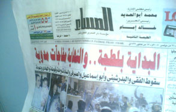

+++
title = "القاضي .. دخل الحمام.!!"
date = 2005-12-28

[taxonomies]
authors = []
sections = ["egyvote"]

[extra]
section_name = "انتخابات مصر ٢٠٠٥"
share_image = "/media/egyvote.20at.com/images/masa2.jpg"
summary = "صورة من جريدة المساء القومية والتي أعلنت فيها فوز جمال حشمت مرشح الإخوان علي مصطفي الفقي"
section_slug = "egyvote"
section_colour = "#9C6B00"
thumb = "/media/egyvote.20at.com/images/masa2.jpg"
n_comments = 7
original_url = "http://egyvote.20at.com:80/article.php?sid=47"
archived = "20080102231617"
date_source = "first-capture"
aliases_20at = ["//egyvote.20at.com/article.php?sid=47"]

[extra.provenance]
original_url = "http://egyvote.20at.com:80/article.php?sid=47"
capture_url = "https://web.archive.org/web/20080102231617/http://egyvote.20at.com:80/article.php?sid=47"
capture_label = "٢ يناير ٢٠٠٨، ٢٣:١٦ UTC"
date_note = "تاريخ أول لقطة في الأرشيف (لا يوجد تاريخ في المقال)"
other_urls = []
comments = "٧"
missing_images = ""
+++

<figure></figure>

<h3>صورة من جريدة المساء القومية والتي أعلنت فيها فوز جمال حشمت مرشح الإخوان علي مصطفي الفقي</h3>

قد يرى البعض أنه لا توجد أدنى علاقة بين الانتخابات والحمامات .. لأن الأولى تختلف مفرداتها عن الثانية، فالانتخابات .. مرشحون ودعاية ولجان وطعون وفرز وناجحون وراسبون، أما الثانية .. فصابون وشامبو ومياه ساخنة.

ولكن بشيء من التفحيص والتمحيص للظواهر التي شهدتها الانتخابات الحالية، وبعيدا عن ظواهر الرشوة واستخدام البلطجية بشكل موسع، فإن ظواهر أخرى عرفت طريقها لهذه الانتخابات، ولا تظهر إلا داخل لجان الفرز، ومن أهم هذه الظواهر تليفونات نص الليل التي يستقبلها المستشار رئيس اللجنة ومعاونيه والتي لا تنقطع منذ انتهاء الفرز، وحتى إعلان النتيجة.

في بعض هذه التليفونات يحمر وجه القاضي ويحاول أن يسيطر على أعصابه، ولكنه يجد أن كثيراً من العيون تراقب حركاته، وتحاول سماع همساته، فلا يجد القاضي مفراً من هذه العيون الجاحظة والآذان المتصنتة، إلا بالذهاب إلى دورة المياه الموجودة في مقر اللجنة، فيصحبه أحد الجنود إلى الحمام.!

هناك بيكون القاضي على راحته، يتلقى التعليمات السيادية – ليس في مكانها الطبيعي بالطبع - ويرد عليها، ثم يعود إلى منصة الفرز مرة أخرى، تكرر هذا الأمر عشرات المرات، خاصة في الدوائر التي بها مرشحين من الإخوان المسلمين من ذوى الوزن الثقيل.

حدث ذلك في انتخابات دائرة الرئيس، دائرة مدينة نصر، حيث كانت تخوض مرشحة الإخوان الوحيدة (مكارم الديرى) المنافسة على مقعد الفئات أمام مرشح الوطنى (مصطفى السلاب) فمع تقدم مرشحة الإخوان على مرشح الوطنى بشكل واضح، وتسريب الخبر إلى وسائل الإعلام، بدأت تليفونات منتصف الليل تعرف طريقها إلى رئيس لجنة مدينة نصر ومعاونه.

وطالما أن التليفونات قد بدأت، فعلى الحمامات أن تستعد لاستقبال السيد المستشار لكي يفك زنقته بكلمتين يسمعهم وكلمتين يرسلهم، وقد أدى ذلك إلى تأخر إعلان النتيجة لعدة ساعات، وبعد عدة زيارات مكوكيه للحمام، أعلن رئيس اللجنة فوز (السلاب) على (مكارم) فما كان منها إلا أن قالت "حسبي الله ونعم الوكيل" وبالطبع لأن النتيجة خرجت من الحمام فجاءت بهذه الرائحة التي تحدثت عنها أغلب الصحف.

تكرر نفس السيناريو مع الدكتور (جمال حشمت) مرشح الإخوان في دمنهور والذي خاض الانتخابات أمام مرشح الوطنى الدكتور (مصطفى الفقى) فعلى الرغم من تقدم حشمت على الفقى بما يزيد على 25 ألف صوت وفقا لشهادة مرشح التجمع في نفس الدائرة، إلا أن تليفونات الساعة الرابعة فجراً وما بعدها غيرت النتيجة لصالح الفقى بعد أن ذهب رئيس اللجنة إلى الحمام أكتر من 5 مرات!!

وكان (حازم أبو إسماعيل) مرشح الإخوان في دائرة الدقي قد سبق الجميع والذي تم إسقاطه لصالح مرشحة الوطنى (أمال عثمان)، وفى دائرة شبرا الخيمة ثاني، كانت النتيجة محسومة لصالح مرشح الإخوان على مقعد العمال (جمال شحاتة) الذي حصل على 14 ألف صوت، بينما حصل منافسه من الوطنى (محمد عوده) على 6 ألاف صوت فقط

وعلى الرغم من انتهاء الفرز في العاشرة مساء والذي أوضح أيضا تقدم المرشح المستقل الدكتور (جمال زهران) على منافسه من الوطنى بما يزيد عن 3 ألاف صوت، ولكن بعد تليفونات طويلة بين رئيس اللجنة وبين جهات غير معروفه تم تأخير إعلان النتيجة حتى السابعة صباحاً، بعد أن كرر رئيس اللجنة ما فعله سابقيه من الذهاب إلىwc عدة مرات، لتصبح النتيجة الكريهة التي جاءت من نفس المكان، الاعاده بين جميع المرشحين.!!

ومن المواقف الطريفة في مسألة الحمامات وعلاقتها بالانتخابات، أن أحد الصحفيين لاحظ زيادة عدد التليفونات التي يتلقاها رئيس اللجنة بالإضافة إلى ذهابه إلى الحمام أكثر من مرة، كان ذلك في انتخابات دائرة الساحل و كان القاضي من الشرفاء فذهب إليه الصحفي وسأله هل هناك علاقة بين التليفونات التي يتلقاها وبين مشكلة احد صناديق الفرز الذي كٌسر، فصاح القاضي: (لا والله العظيم .. دى مشكلة فرن عيش في بنها بحاول أحلها)، وقام بتشغيل الإسبيكر حتى يتأكد الجميع من ذلك، فهل يقتدي باقي رؤساء اللجان بهذا الرجل الشريف أم أنهم يتركون الشكوك تعصف بالأذهان ولماذا لا يصدر قرار بمنع استخدام التليفون المحمول أثناء الفرز.

<h3> محمد أبو زيد </h3>

<h3> 24/11/2005 </h3>
