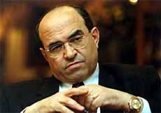

+++
title = "امرأة هزت عرش الفقي!"
date = 2006-04-27

[taxonomies]
authors = []
sections = ["egyvote"]

[extra]
section_name = "انتخابات مصر ٢٠٠٥"
share_image = "/media/egyvote.20at.com/images/pic07a.jpg"
summary = "مستشارة مصرية شاركت في المرحلة الثانية بالانتخابات بدائرة دمنهور الساخنة، شهدت على ما حدث مثل باقي القضاة، الفارق الوحيد بينها وبين زملاءها المشاركين في الدائرة"
section_slug = "egyvote"
section_colour = "#9C6B00"
thumb = "/media/egyvote.20at.com/images/pic07a.jpg"
n_comments = 4
original_url = "http://egyvote.20at.com:80/article.php?sid=48"
archived = "20070610040146"
date_source = "first-capture"
aliases_20at = ["//egyvote.20at.com/article.php?sid=48"]

[extra.provenance]
original_url = "http://egyvote.20at.com:80/article.php?sid=48"
capture_url = "https://web.archive.org/web/20070610040146/http://egyvote.20at.com:80/article.php?sid=48"
capture_label = "١٠ يونيو ٢٠٠٧، ٠٤:٠١ UTC"
date_note = "تاريخ أول لقطة في الأرشيف (لا يوجد تاريخ في المقال)"
other_urls = []
comments = "٤"
missing_images = ""
+++

<figure></figure>

مستشارة مصرية شاركت في المرحلة الثانية بالانتخابات بدائرة دمنهور الساخنة، شهدت على ما حدث مثل باقي القضاة، الفارق الوحيد بينها وبين زملاءها المشاركين في الدائرة ذاتها، هو إصرارها على أن تقول شهادتها حول ما حدث.

ففي بيان لها قالت الدكتورة نهى الزيني التي تشغل منصب نائب رئيس النيابة الإدارية، وكانت مسئولة عن إحدى اللجان الفرعية بدائرة دمنهور وتابعت عمليات الفرز باللجنة العامة: إن هناك تزويرا واضحا جرى في نتيجة دائرة دمنهور خلال الجولة الأولى من المرحلة الثانية من الانتخابات التشريعية المصرية التي أجريت يوم 20-11-2005.

وتابعت في شهادتها لصحيفة "المصري اليوم" الخميس 24-11-2005: "إن هذا التزوير أدى إلى حسم نتيجة مقعد الفئات بالدائرة لصالح مرشح الحزب الحاكم الدكتور مصطفى الفقي على حساب الفائز الحقيقي بأصوات الناخبين الدكتور محمد جمال حشمت مرشح جماعة الإخوان المسلمين".

وكشفت المستشارة أن حشمت حصل في الفرز النهائي على نحو 25 ألف صوت على أقل تقدير فيما حصل الفقي على 7 آلاف صوت على أقصى تقدير.

وأكدت أن الفائز الحقيقي في دائرة دمنهور كان هو حشمت، إلا أن التدخل الأمني والحكومي حال دون إعلان النتيجة الحقيقية لهذه الدائرة، في تكرار لتجربة دائرة الدقي والعجوزة في المرحلة الأولى من الانتخابات؛ حيث تم إعلان فوز مرشح الإخوان على مقعد الفئات فيها المحامي حازم أبو إسماعيل، ثم ألغيت النتيجة، وأُعلن فوز مرشحة الحزب الوطني الدكتورة آمال عثمان.

<h3>اكتساح</h3>

وفي شهادتها تقول المستشارة: "خلال الفترة التي جلست فيها داخل اللجنة العامة - مع ملاحظة أنني بقيت حتى الانتهاء من تسليم جميع النتائج- كان بعض الموجودين سواء من القضاة أم غيرهم يستخدمون المحمول، ودار الحديث في مجمله عن تقدم المرشح جمال حشمت، واستخدمت في الدلالة على هذا عبارة "اكتساح".

وأضافت: "تلاحَظَ لي وجود أفراد من الداخلية داخل اللجنة العامة، كان أحدهم يجلس على طاولة التجميع، ويشارك في العمل، وقد أخبرني أحد أعضاء اللجنة العامة- الذي أدعوه للشهادة- بأنه من أمن الدولة، وطلب مني رئيس اللجنة العامة الانصراف بعد مرور الوقت، فانصرفت وأنا متحققة من النتيجة".

وتابعت: "لذا كان تعجبي من صيحات التشكيك من أنصار حشمت في الخارج، واعتقدت أنهم يبالغون كعادتهم؛ ففوز مرشحهم بات أمرًا محسومًا بالنسبة للجميع ممن شاركوا في العملية، وكان هذا موضوعًا للحديث بين الجالسين داخل اللجنة العامة، حتى قال أحدهم: إن سقوط مصطفى الفقي سوف يقلب الدنيا".

<h3>شهادة القضاة</h3>

وتقول المستشارة نهي الزيني: "إنه قبل الانتهاء من أعمال التجميع انصرف أحد أعضاء اللجنة العامة وهو مستشار من رجال القضاء، وهو الشخص ذاته الذي دعوته قبل قليل للإدلاء بشهادته؛ وهو ما حمل إليَّ مؤشرًا خطيرًا" .

وأردفت: "بعد انصرافي بدأت الأخبار تصلني بأن ما حدث في دائرة الدقي في المرحلة الأولى سوف يتكرر هنا، وأنه من المستحيل ترك مصطفى الفقي ليخسر أمام جمال حشمت".

وأوضحت قائلة: "أنا هنا لا أتحدث عن رأي الناخبين ولكنني أتحدث عما سمعته من رجال القضاء المشرفين على الانتخابات، وقد طلبت منهم قول الحق، وها أنا أدعوهم ثانية لشهادة الحق".

وفي ختام شهادتها طالبت المستشارة القضاة بالإدلاء بشهادتهم في هذه الواقعة؛ "حتى لا يصدق عليهم مصطلح (القضاء المنبطح لإرادة الحكم في مصر) ليسقط بالتالي الحصن الأخير للعدالة في مصر".

<h3>النائب العام</h3>

وخلال مؤتمر صحفي بنقابة المحامين الخميس 24-11-2005 شدد جمال حشمت على "أن ما جرى بدائرة دمنهور يجب ألا يمر، خاصة بعد تضامن 160 قاضيًا معي، منهم المستشارة نهى الزيني التي تطوعت للإدلاء بشهادتها".

وقال: إنه تقدم بطلب إلى النائب العام يطالبه فيه بالتحقيق مع المستشار أحمد عبد الستار نصار رئيس اللجنة العليا التي قامت بالإشراف على دائرة دمنهور. كما وجه رسالة إلى الرئيس حسني مبارك للتدخل لوقف عمليات التزوير والانتهاكات التي يقوم بها الحزب الوطني الحاكم.

وأظهرت النتائج الرسمية التي أعلنت مساء يوم 21-11-2005 فوز جماعة الإخوان بـ13 مقعدا في الجولة الأولى من المرحلة الثانية من 144 مقعدا جرى التنافس عليها؛ ليرتفع إجمالي المقاعد التي حصلت عليها الجماعة قبل إجراء جولة الإعادة إلى 47 مقعدا، وهو ثلاثة أضعاف عدد المقاعد التي كانوا يشغلونها في البرلمان السابق.

كما فاز 6 مرشحين من الحزب الوطني الديمقراطي الحاكم من بينهم وزير الري والموارد المائية محمود أبو زيد. وتشمل جولة الإعادة بالمرحلة الثانية 48 مرشحا من الحزب الوطني و41 مرشحا من الإخوان المسلمين، إضافة إلى 4 مرشحين من حزب الوفد و5 آخرين من حزب التجمع، إلى جانب 23 مستقلا.

<a href="/articles/egyvote-49/">نص الشهادة</a>

