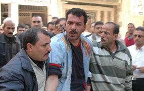

+++
title = "كفاية عنف!"
date = 2006-09-01

[taxonomies]
authors = []
sections = ["egyvote"]

[extra]
section_name = "انتخابات مصر ٢٠٠٥"
share_image = "/media/egyvote.20at.com/images/enough-roughness.jpg"
summary = "ذكر النائب العام اليوم الخميس إنه سيعمل على الحد من العنف في الانتخابات التشريعية التي ستجرى جولة الإعادة من المرحلة الثانية منها يوم السبت."
section_slug = "egyvote"
section_colour = "#9C6B00"
thumb = "/media/egyvote.20at.com/images/enough-roughness.jpg"
n_comments = 1
original_url = "http://egyvote.20at.com:80/article.php?sid=51"
archived = "20070815120841"
date_source = "first-capture"
aliases_20at = ["//egyvote.20at.com/article.php?sid=51"]

[extra.provenance]
original_url = "http://egyvote.20at.com:80/article.php?sid=51"
capture_url = "https://web.archive.org/web/20070815120841/http://egyvote.20at.com:80/article.php?sid=51"
capture_label = "١٥ أغسطس ٢٠٠٧، ١٢:٠٨ UTC"
date_note = "تاريخ أول لقطة في الأرشيف (لا يوجد تاريخ في المقال)"
other_urls = []
comments = "١"
missing_images = ""
+++

<figure></figure>

ذكر النائب العام اليوم الخميس إنه سيعمل على الحد من العنف في الانتخابات التشريعية التي ستجرى جولة الإعادة من المرحلة الثانية منها يوم السبت.

وكان شخصان علي الأقل قد لقيا حتفهما وأصيب عشرات في الجولة الأولى من المرحلة

الثانية، التي أجريت يوم الأحد، والتي أحرق خلالها أشخاص مسلحون بسيوف وعصي

صناديق اقتراع في محافظة بورسعيد، واعتدوا على مرشحين وناخبين وقضاة مشرفين

على الاقتراع ومراقبين تابعين لمنظمات حقوقية في محافظات أخرى.

وأضاف النائب العام في بيان إن: "النيابة العامة تتصدى بكل حزم وقوة لأي خروج على الشرعية و(قررت) اتخاذ كافة الإجراءات القانونية اللازمة."

وأكد البيان أن السلطات ألقت القبض على بعض الأشخاص المشتبه بتورطهم في أعمال العنف، وأمرت بحبس عدد منهم في محافظات الإسكندرية والبحيرة والقليوبية والغربية والإسماعيلية وبورسعيد وقنا والسويس.

وتابع أن النيابة العامة تلقت 171 بلاغا وإخطارا من مرشحين ومواطنين وقضاة مشرفين على الانتخابات بتجاوزات وقعت يوم الأحد شملت "مشاجرات خارج اللجان (الانتخابية) وحمل أسلحة بيضاء واقتحام مقار لجان وحرق بعض الصناديق وبطاقات إبداء الرأي."

وقالت منظمات حقوقية مصرية تراقب الانتخابات إن مختلف الأحزاب والجماعات السياسية التي خاضت الجولة الأولى من المرحلة الثانية استعملت العنف للتأثير في النتيجة.

وتبدأ المرحلة الثالثة والأخيرة من الانتخابات في الأول من ديسمبر القادم، وقد فاز في الجولة الأولى من المرحلة الثانية 13 من مرشحي جماعة الإخوان المسلمين مقابل ستة من مرشحي الحزب الوطني الديمقراطي الحاكم صاروا 8 بعد انضمام مستقلين، ويخوض جولة الإعادة يوم السبت 242 مرشحا يتنافسون على 121 مقعدا.

<h3> رويترز </h3>
