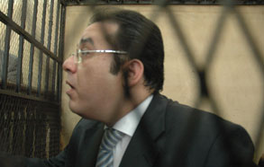

+++
title = "غد نور..مظلم!"
date = 2006-08-18

[taxonomies]
authors = []
sections = ["egyvote"]

[extra]
section_name = "انتخابات مصر ٢٠٠٥"
share_image = "/media/egyvote.20at.com/images/image-e3102157eace11d9.jpg"
summary = "\"أفضل أن أموت وأنا رافع رأسي، على أن أعيش راكعاً\"، ليس هذا شعار مقتبس من كتب التاريخ لزعيم كبير، ولكنه تصريح ممثل التضحية السياسية المصري الدكتور أيمن نور، الذي"
section_slug = "egyvote"
section_colour = "#9C6B00"
thumb = "/media/egyvote.20at.com/images/image-e3102157eace11d9.jpg"
n_comments = 1
original_url = "http://egyvote.20at.com:80/article.php?sid=52"
archived = "20070813225849"
date_source = "first-capture"
aliases_20at = ["//egyvote.20at.com/article.php?sid=52"]

[extra.provenance]
original_url = "http://egyvote.20at.com:80/article.php?sid=52"
capture_url = "https://web.archive.org/web/20070813225849/http://egyvote.20at.com:80/article.php?sid=52"
capture_label = "١٣ أغسطس ٢٠٠٧، ٢٢:٥٨ UTC"
date_note = "تاريخ أول لقطة في الأرشيف (لا يوجد تاريخ في المقال)"
other_urls = []
comments = "١"
missing_images = ""
+++

<figure></figure>

"أفضل أن أموت وأنا رافع رأسي، على أن أعيش راكعاً"، ليس هذا شعار مقتبس من كتب التاريخ لزعيم كبير، ولكنه تصريح ممثل التضحية السياسية المصري الدكتور أيمن نور، الذي أصبح يحمل خلف اسمه العديد من الألقاب، منها مرشح الرئاسة سابقاً، المرشح البرلماني سابقاً، رئيس حزب الغد "احتمال"...

وبجانب الألقاب المتعددة للثائر الليبرالي الدكتور أيمن، نور نجد أن هناك أشياء أخري أصبحت ترتبط به، ومنها كلماته المأثورة : "يريدون أن يستنزفوني ويحطموني" "لن أموت إلا رافعاً رأسي".. تلك الكلمات التي أصبحت إجابة علي أي تساؤل يوجه إليه حتى لو كان "اسمك إيه" ؟

<h3>ارجع أحسن لك !</h3>

لهذا وبمنتهى البساطة اقتبست مجلة "النيوزويك" هذه الكلمات كرد متوهم من نور على بعض الاتهامات الموجهة إليه. ففي تقرير نشرته النيوزويك الأسبوع الماضي تحت عنوان "كابوس أيمن نور"، جاء أن أيمن نور وزوجته قد تسلما خلال الأسبوعين الماضيين سلسلة من الطرود البريدية، التي وصلتها إليهما شركة البريد السريع "d.h.l"، يتضمن بعضها فيما يبدو صور محرفة لمواقف مخجلة، ولم تحدد المجلة صور مخجلة لمن مع من ؟

وأشار التقرير إلي أن هذه الطرود قد حملت في طياتها رسالة قصيرة جدا، لا تحتوى إلا علي تحذير يقول : "سنعري أجزاء مستورة من حياتك الشخصية، لقد تماديت في ما قمت به ضد أسيادك".

<h3>احنا منتهددش !</h3>

وعلي الرغم من أن الرسالة لم تحتوي علي مطلب مباشر، إلا أن التقرير قد فسر هذا التهديد بأن الحكومة المصرية تطلب منه الانسحاب التام من الساحة السياسية، ولم تنس المجلة أن تلمح أيضا إلي التهديد الخفي من إرسال تلك الطرود، فقالت "أن الرسالة التي تحملها تلك الطرود تحمل تحذير من أنه في حالة عدم انسحاب أيمن نور من المعركة السياسية، والاستسلام إلي مقتضيات الأمور فان سيتم توزيع تلك المواد علنا."

الغريب أن جميلة إسماعيل زوجة نور، وصاحبة الطرود المزعومة، وكذلك مراسلة "النيوزويك قد أكدت أنها لم تتلقي أي طرود تحمل تهديدات، أو أنها تلقت تهديداً بهذا الأسلوب قائلة أن ما وصلها من طرود أو رسائل بريدية فهي رسائل وأشياء خاصة لا علاقة لها بالسياسية.

ولكن من ناحية أخرى أشارت جميلة أنها تلقت تهديدات أخري مباشرة وغير مباشرة، ورفضت الإفصاح عن مصدر تلك التهديدات وطبيعتها، وهل هي متمثلة في فضائح جنسية، أم أنها تهديدات راقية علي المستوى السياسي، وإن كان من المعروف أن المعارك السياسية لا تعرف معني للشرف والأخلاق.

كلمات جميلة تؤكد أن المجلة علي ما يبدو استعارت رأي نور في مسألة أخري، أو رده في مسألة عدم تنحيه عن معركة الرياسة عام 2011، والتي أصبح يجهز لها من الآن مؤكد انه يرفض الانسحاب ولو علي جثته.

الشيء الوحيد الذي تتفق فيه جميلة مع تقرير النيوزويك هو تحليله لهذا الاضطهاد الذي يتعرض له نور، حيث وصف معركة أيمن نور علي أنها معركة نظام، لا يستطيع تحمل المعارضين الليبراليين، وهذا يخالف ما يتم الترويج له عن التطور الديمقراطي.

وإذا كان هذا هو التحليل الأمثل لفشل أيمن نور، فهل هذا أيضا هو سبب فشل حزب الوفد أحد مؤسسي الفكر الليبرالي في مصر، وصاحب الشعبية الكبيرة في الشارع المصري؟..

هذه هي وجهة نظر مجلة الأمريكان، والتي تتفق معها زوجة السياسي، فالنظام في رأيهما يعمل بطريقة نار الإخوان ولا جنة الليبرالية ! فهل يمكن أن يكون ذلك تحليلا واقعياً ؟...

