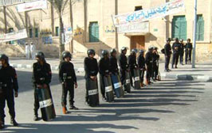

+++
title = "مفيش انتخابات النهاردة!"
date = 2005-12-28

[taxonomies]
authors = []
sections = ["egyvote"]

[extra]
section_name = "انتخابات مصر ٢٠٠٥"
share_image = "/media/egyvote.20at.com/images/mafeesh-intekhabat.jpg"
summary = "حيرة وقع فيها الحزب الحاكم وهو يرى مرشحوه يفقدون مقاعدهم لصالح \"عدوهم اللدود\" الإخوان المسلمون، هذه الحيرة كانت حول الشكل \"الواجب عليهم\" فعله خلال جولة الإعادة "
section_slug = "egyvote"
section_colour = "#9C6B00"
thumb = "/media/egyvote.20at.com/images/mafeesh-intekhabat.jpg"
n_comments = 3
original_url = "http://egyvote.20at.com:80/article.php?sid=57"
archived = "20080102231320"
date_source = "first-capture"
aliases_20at = ["//egyvote.20at.com/article.php?sid=57"]

[extra.provenance]
original_url = "http://egyvote.20at.com:80/article.php?sid=57"
capture_url = "https://web.archive.org/web/20080102231320/http://egyvote.20at.com:80/article.php?sid=57"
capture_label = "٢ يناير ٢٠٠٨، ٢٣:١٣ UTC"
date_note = "تاريخ أول لقطة في الأرشيف (لا يوجد تاريخ في المقال)"
other_urls = []
comments = "٣"
missing_images = ""
+++

<figure></figure>

حيرة وقع فيها الحزب الحاكم وهو يرى مرشحوه يفقدون مقاعدهم لصالح "عدوهم اللدود" الإخوان المسلمون، هذه الحيرة كانت حول الشكل "الواجب عليهم" فعله خلال جولة الإعادة والمرحلة الثالثة، فهل يتخلى الوطني عن فكره الجديد، أم يترك الفرصة للإخوان لتصبح المعركة بعد ذلك شريفة في البرلمان.

ما زاد هذه الحيرة هو موقف القضاة أول أمس و "اعتراف" نهى الزيني ببطلان انتخابات دمنهور التي فاز فيها مصطفى الفقي.

الواضح أن حيرة "الوطني" لم تستمر طويلا، ففي تنسيق واضح مع أجهزة الأمن –صاحبة الحياد السلبي في الجولات الماضية- تم منع عدد كبير من الناخبين من "حقهم الطبيعي" في الوصول إلى صناديق الإقتراع.

وهو تطور يذكرنا بانتخابات 2000 التي تمت بنفس الشكل، لكن المختلف هذه المرة هو موقف القضاة.

فقد أوقف بعض القضاة المراقبين للانتخابات في مصر عمليات الاقتراع في بعض الدوائر احتجاجا على سلوك الشرطة.

وكان المستشار هشام بسطويسي نائب رئيس محكمة النقض وعضو لجنة مراقبة الانتخابات قد صرح لقناة الجزيرة بأن الشرطة تطوق مراكز الاقتراع وتمنع الناخبين من الدخول وعندما أبدى القضاة اعتراضهم على ذلك تعرضوا للإهانة والسب من قبل الشرطة.

وأضاف أنه على إثر ذلك دعا بعض القضاة في هذه الدوائر إلى وقف الاقتراع ولكنه لم يتم بعد تنفيذ هذا القرار فعليا، مشيرا إلى أن المسألة قيد البحث إلا أن قضاة لا يزالون مصرين على عدم المشاركة في مراقبة الانتخابات.

ويأتي ذلك التطور بعد ساعات قليلة من بدء عمليات الاقتراع في جولة الإعادة من المرحلة الثانية للانتخابات التشريعية المصرية في تسع محافظات.

ويتنافس نحو 242 مرشحا من الحزب الوطني الحاكم والمعارضة والمستقلين بمن فيهم مرشحو جماعة الإخوان المسلمين في 68 دائرة لشغل 121 مقعدا.

وفاز في الجولة الأولى من المرحلة الثانية 17 مستقلا بينهم 13 من الإخوان مقابل ستة من مرشحي الحزب الحاكم الذي أعلن ضم اثنين من المستقلين الفائزين لصفوفه.

هذا ونوالي نشر التطورات تباعا..

