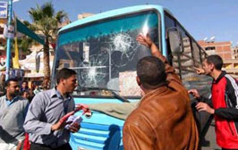

+++
title = "يعني إيه..بلطجة؟!"
date = 2005-12-28

[taxonomies]
authors = []
sections = ["egyvote"]

[extra]
section_name = "انتخابات مصر ٢٠٠٥"
share_image = "/media/egyvote.20at.com/images/baltaga2.jpg"
summary = "بما نتعرض لها مع كل انتخابات، وبما أننا لا نفهمها شأنها شأن أمور كثيرة \"مصرية\" نعيش فيها، فقد كتبت توجان فيصل الكاتبة الأردنية مقالا تحاول أن ترصد فيه هذه الظاه"
section_slug = "egyvote"
section_colour = "#9C6B00"
thumb = "/media/egyvote.20at.com/images/baltaga2.jpg"
n_comments = 0
original_url = "http://egyvote.20at.com:80/article.php?sid=58"
archived = "20080102231437"
date_source = "first-capture"
aliases_20at = ["//egyvote.20at.com/article.php?sid=58"]

[extra.provenance]
original_url = "http://egyvote.20at.com:80/article.php?sid=58"
capture_url = "https://web.archive.org/web/20080102231437/http://egyvote.20at.com:80/article.php?sid=58"
capture_label = "٢ يناير ٢٠٠٨، ٢٣:١٤ UTC"
date_note = "تاريخ أول لقطة في الأرشيف (لا يوجد تاريخ في المقال)"
other_urls = []
comments = ""
missing_images = ""
+++

<figure></figure>

بما نتعرض لها مع كل انتخابات، وبما أننا لا نفهمها شأنها شأن أمور كثيرة "مصرية" نعيش فيها، فقد كتبت توجان فيصل الكاتبة الأردنية مقالا تحاول أن ترصد فيه هذه الظاهرة.

وقد نقلنا هذا المقال عن موقع الجزيرة نت:

الكلمة الرئيسية الغالبة على وصف ما يجري في مراكز الاقتراع للانتخابات النيابية المصرية, هي "البلطجة", وكون هذا التعبير مألوفا جداً في العالم العربي أدى لأن تقبل الكلمة دون توقف عند تعريفها, مع أنها دخلت الآن القاموس السياسي المصري اليومي.

ولعل أول محاولة تعريف يزعم أنه علمي "اقترفها" أستاذ جامعي في علم الاجتماع, قدم على أنه "باحث", ويبدو أن مراسل الجزيرة في القاهرة تورط في استضافته وهو يبحث عن تنويع الضيوف ووجهات النظر, خاصة أن كافة المحللين السياسيين في مصر استُهلكوا على الفضائيات العربية كلها.

وعالم الاجتماع الأكاديمي هذا, والذي تبرع بإعلامنا أنه شخصيا لا يتوجه لصناديق الانتخاب بتاتا, والذي ترحم على الملك فاروق عند ذكر عهده ولم يترحم على عبد الناصر بالمقابل مع أنه ذكر عهده هو أيضا, أشاد بأجواء الانتخاب في عهد الملك, وعزا أسباب "البلطجة" التي تشاهد حاليا "لأمراض نفسية" يعاني منها قطاع غير قليل من المصريين ولم يفسر طبيعة هذا المرض وأسبابه إلا بذكر عارض مرتجل أنها "عطالة وبطالة".

غني عن القول إن هذا الوصف أقرب إلى الشتيمة الدارجة منه إلى التوصيف العلمي الموضوعي "للبطالة" باعتبارها سببا لكثير من أشكال الخلل أو حتى الأمراض الاجتماعية, كما أنه لم يرد في أي تشخيص علمي لأمراض نفسية شائعة أو غير شائعة ذكر "البلطجة" كمرض ناتج عن البطالة. وما يجعل صدور مثل هذا الحكم التعميمي عن عالم وباحث مختص في الاجتماع, مستهجنا, أن الشعب المصري بالذات يتميز بأنه أكثر شعب في العالم أبدع في تحويل معاناته ومآسيه إلى نكات.

ولكن دخول من يؤمنون فيما يبدو "بالدم الأزرق", وبأن هنالك "ناس فوق" مهذبون بالولادة, و"ناس تحت" عندهم استعداد للإصابة بداء البلطجة, استلزم أن نبدأ جميعا, نحن المهتمون بالشأن العام, بمحاولة وضع تعريف علمي محايد لكلمة أصبحت جزءا من قاموسنا السياسي العربي والعالمي, وليس المصري وحسب, كما سنثبت هنا.

وبداية أتقدم بهذا التعريف للبلطجة المبني على ما تيسر لي من اطلاع ودراسة للظاهرة, وهي أنها "محاولة للحصول على وتثبيت سلطة ومنافع ذاتية غير مشروعة باستعمال العنف الجسدي ضد البعض بما يحقق إرهاب عامة الناس نفسيا وفكريا ويؤمن خضوعها لإرادة البلطجية دون نقاش".

فظاهرة البلطجة -كما نراها في الشارع العادي الذي يريد البعض استمرار ربطها به وحده- تبدأ بفرد يفرض نفوذه بالقوة والإرهاب الجسدي على محيطه. وهي ظاهرة اجتماعية معروفة عالميا خاصة بين المراهقين والشبان, وفي اللغة الإنجليزية الدارجة يسمى "البولي" (Bully), ومنها تستمد في الإنجليزية صيغة فعل البلطجة لتعمم على كافة الأفعال ذات نفس الطابع والنهج, دون قصرها على بلطجية الشوارع والأزقة.

ولكن, وكما يتطور كل نشاط بشري تثبت جدواه, فإن بعض أشكال البلطجة الفردية تطورت لتصبح تنظيمات يترأسها بلطجي يثبت نفسه بداية بالقوة والجرأة على الممنوع والمحرّم بالذات, وينصب نفسه بالتالي على أتباع يمارسون البلطجة نيابة عنه. ومع ما يستتبعه هذا من مركز مميز للبلطجي الأول, تطورت ألقابه لتدخل في قدر من التكريم يبعدها قليلا عن لقب "البلطجي", أو "الأزعر" (الرديف السوري للبلطجي), ليصبح "الفتوة" باللهجة المصرية, و"الأبضاي" باللهجة السورية, بمعنى لهجات سوريا الكبرى.

وعلى نطاق أوسع, ومع تطور المجتمعات تكنولوجيا وتنوع الأنشطة الاقتصادية, تعقدت مستلزمات التسلط على تلك الأنشطة, من مجرد فرض إتاوات إلى التهريب والاحتكار وغيرها من وسائل الفساد الحديثة. وطرأ تغير أيضا على مقومات القوة الشخصية اللازمة "للبلطجي" المعاصر, إذ انتقل الثقل من القوة الجسدية والقدرة على النزال العضلي, إلى القدرة على استعمال السلاح الأبيض (الذي يجمع القوة الجسدية إلى المهارة الجسدية), إلى السلاح الناري (الذي يقتصر على المهارة الجسدية دون حاجة للقوة), إلى مجموع قوة الأتباع المسلحين, إلى قوة المال التي تشتري هؤلاء الأتباع وتسلحهم بما لا تعود تلزم معه أية قوة جسدية حقيقية للبلطجي, وإن بقيت الجرأة على المحرم مطلبا ثابتا. وهكذا نشأت المافيا المنظمة, وانتقلت ألقاب قياداتها إلى "الكبير" أو "العراب" أو "الزعيم", وأصبحت تورث كمؤسسة عائلية, بعد أن كانت تنافسية تؤول للأقوى ممن تبقى.

ثم أصبحت قيادة المافيا أو البلطجة تتطلب قدرة على تسهيل مهمة التنظيم عبر ما يسمى "بالعلاقات" بالإنجليزية (يسمى "واصل" باللهجة السورية), وهي علاقات مع متنفذين سياسيين, أدت بالتدريج لدخول المافيات مباشرة للسياسة للسيطرة على منابع القرار المالي والاقتصادي بدلاً من تصيده. وأصبح بعض رجال المافيا الجديدة "رجال دولة" يحملون تشكيلة من الألقاب المبجلة وحتى المحصنة.

ومنذ البداية, لم تكن أساليب "البلطجي" لتحقيق نفوذه تهدف للتصفية الجسدية إلا حيث تلزم كنوع من أنواع القسوة التي تلقن درس الطاعة. ويمكن استبدال القسوة المادية بالإهانة أو الجمع بينهما. فالبلطجي ليس محاربا يريد تدمير خصمه والحلول محله, بل هو طفيلي يريد للمجموعة المستهدفة أن تبقى سليمة بما يكفل استمرار إنتاجها الذي يستولي البلطجي على جله بأن يفرض نفسه زعيما مطلقا على المجموعة. ولأن قيادات الجموع المفروزة طبيعيا وباستحقاق تتميز بالهيبة والكرامة, فإن تعمد انتقاء القياديين كضحية لتلقين الدرس للآخرين, يتضمن إهانة بقدر أو بآخر لهذه القيادات لإسقاط قيم القيادة السائدة والتي لا يستطيع البلطجي المنافسة ضمنها.

وعكس هذا نجده في تاريخ "الفروسية", رغم ما واكبها من استيلاء على السلطة, وصولا للسلطة السياسة, بالقوة أيضا. فالمحارب "الفارس" (وهي ترد هنا كصفة وليس بمعنى النزال من على ظهر فرس) في كافة الأمم , يظهر احتراما لكبار خصومه ينطلق من احترامه هو لنفسه, كونه لا يليق به أن يخاصم من هو أقل قدرا ولا أن يخضع تلك "الطبقة" من القيادة النخبوية التي يشعر أنه ينتمي إليها إلى أي إذلال يمس "الطبقة" ذاتها.

وهذا يوضح لماذا كان شعراء الفخر العرب من الفرسان يمدحون خصومهم قبل أن يرووا كيف انتصروا عليهم في النزال. وكيف أن قادة متحاربين أوقفوا القتال في انتظار أن يتعافى قائد الخصم من إصابة نزلت به. أو أن لا يقتل الفارس خصمه في فرصة غير متكافئة سنحت, بل أن يتحداه في نزال علني متكافئ الفرص يحدد موعده وحضوره الذين هم شهود على جدارة الفوز وأنه لم تشبه أية خسة.

وهذه مقارنة تاريخية مهمة لأن البلطجة -كما عرضناها وشرحناها- حالة "سياسية" نمطية متكررة, ولكنها ليست رديف الدكتاتورية أو حكم القوة بالضرورة, بل هي رديف حكم المال الفاسد ولأجل المال قبل السلطة, وترخص السلطة ويرخص صاحبها أمام المال إن لزم. ولكنها, أي البلطجة, في العصر الحديث, تتداخل أكثر مع الدكتاتوريات كون "الفروسية" التي تهدد أي حكم غير شرعي, انتقلت من ميادين القتال إلى صناديق الانتخاب. ولكن حتى هذه يتخلى عن مناصبها "فرسان الديمقراطية", إن شعروا أن البقاء فيها يمثل نزولا عن صهوة الجواد.

وفهم "البلطجة" كما نقيضها "الفروسية" بهذا الإطار السياسي, ليس من ابتداعنا, بل سبقنا إليه كتاب وفنانون في أكثر من حقل, هم أساتذتنا الذين منهم نتعلم فهم الإنسان ككائن اجتماعي, وبالتالي فهم التاريخ. ودونما حاجة لسرد أسماء كبار الكتاب العالميين, نذكر هنا بأن كبار الكتاب والمخرجين المصريين درسوا ظاهرة "البلطجة" في مصر ذاتها كظاهرة سياسية, وفي مقدمتهم نجيب محفوظ, وبالذات في روايته "الحرافيش" التي تحولت إلى مسلسل, إلى جانب العديد من المسلسلات والأفلام الأخرى لمبدعين آخرين.

ضمن هذا الفهم وهذا التعريف "للبلطجة", قد يقبل الوصول للحكم في العالم العربي عبر وسائل غير ما هو مشروع ديمقراطيا في عصرنا هذا (كون الوصول ديمقراطيا شبه مستحيل), باعتباره ثورة وطنية تحركها قيم الفروسية, ولكن البقاء فيه بالقمع يصبح "بلطجة".

ولا يختلف توظيف "فتوات" عن تجنيد المرتزقة لقمع الشعوب محليا, أو دوليا بإرسالهم لحروب "إستباقية" تلحقها شركات الحكام إلى المناطق "المحررة". فكله استزلام ببلطجية مقابل لقمة عيش هؤلاء أو بالترغيب بامتيازات ومنافع أكثر تجند مرتزقة وبلطجية أكبر, وكلها مدفوعة من أموال تحصل "إتاوة" من الشعوب. ومثله الاستقواء على الشعوب بعناصر الأمن والمخابرات وحتى الجيوش التي تتحول "لحاميات" شخصية, أو بالمحاكم الاستثنائية والعسكرية, أو بالقوانين التي تمرر من مجالس تشريعية لا تمثل الشعب, أو حتى القوانين المؤقتة أو قوانين الطوارئ التي تقوم دونما طارئ أو تدوم سنوات وعقودا بعد زوال هذا الطارئ, والمراسيم التي تصدر دون سند حيث تغيّب السلطة أية مرجعية ولو شكلية غير إرادتها المنفردة.

ومثله الاستيلاء على المال العام بالعطاءات والتلزيمات للحكام وأقربائهم. ومثله الاستزلام بالأقلام الرخيصة المشتراة التي تهين نفسها بنفسها يوميا وعلى الملأ. ومثله قصف محطات الإعلام التي تحترم نفسها على رؤوس من فيها, أو خطف صحفي قيادي وضربه وتعريته, والشروع في تعرية صحفية تتظاهر لأجل الديمقراطية, وإرهاب الناخبين وتكسير الصناديق ومراكز الاقتراع والدوس على كل مظاهر ورموز الديمقراطية والشرعية, ثم الزعم –أم هل هو اعتراف ضمني يوصل الرسالة– بأن من فعلوا هذا هم "بلطجية".

<h3> توجان فيصل </h3>
