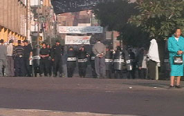

+++
title = "إسكندرية.. ممنوع الاقتراب أو \"التصويت\"!"
date = 2005-12-28

[taxonomies]
authors = []
sections = ["egyvote"]

[extra]
section_name = "انتخابات مصر ٢٠٠٥"
share_image = "/media/egyvote.20at.com/images/alex-no-voting.jpg"
summary = "استعدادات عالية اتخذتها سلطات الأمن لدعم الحزب الوطني في جولة الإعادة بالإسكندرية، 17 معتقل من إخوان الإسكندرية فجر الجمعة، حشود من الأمن المركزي حول اللجان.. و"
section_slug = "egyvote"
section_colour = "#9C6B00"
thumb = "/media/egyvote.20at.com/images/alex-no-voting.jpg"
n_comments = 6
original_url = "http://egyvote.20at.com:80/article.php?sid=61"
archived = "20090205000601"
date_source = "first-capture"
aliases_20at = ["//egyvote.20at.com/article.php?sid=61"]

[extra.provenance]
original_url = "http://egyvote.20at.com:80/article.php?sid=61"
capture_url = "https://web.archive.org/web/20090205000601/http://egyvote.20at.com:80/article.php?sid=61"
capture_label = "٥ فبراير ٢٠٠٩، ٠٠:٠٦ UTC"
date_note = "تاريخ أول لقطة في الأرشيف (لا يوجد تاريخ في المقال)"
other_urls = []
comments = "٦"
missing_images = ""
+++

<figure></figure>

استعدادات عالية اتخذتها سلطات الأمن لدعم الحزب الوطني في جولة الإعادة بالإسكندرية، 17 معتقل من إخوان الإسكندرية فجر الجمعة، حشود من الأمن المركزي حول اللجان.. ولكن الجديد هذه المرة هو منع الناخبين من الوصول للجان، وعدم السماح بالتصويت إلا في لجان القيد الجماعي !!

<h3>الكل ممنوع</h3>

شهدت المدينة منذ الصباح وصول حشود كبيرة من الأمن مركزي داخل سيارات مصفحة، وأخرى تابعة لشركة غرب الدلتا، لتتجمع هذه القوات عند مداخل دائرة الدخيلة ومنيا البصل وغربال، كما تم عمل كردون أمن مركزي حول عدد آخر من اللجان مثل مدرسة الورديان الثانوية بنات – الورديان الثانوية الصناعية بنات – طاهر بك الإعدادية، وتم منع الوكلاء والمندوبون من الدخول إلى اللجان المذكورة.

وفى الدخيلة تراصت قوات أمنية على مداخل العمارات المؤدية إلى اللجان، من أجل منع وصول الإعلاميين والصحفيين إليها.

ولا يقتصر المنع على المندوبين والمراقبين والصحفيين، والنكتة أنه يمتد إلى الناخب الإسكندراني نفسه.. يعني ببساطة الأمن المصري يريدها انتخابات بلا ناخبين !!

لجنة مدرسة بلال بن رباح، تم إغلاق كل الطرق المؤدية إليها، ومطاردة الأهالي في الشوارع من أجل منع وصولهم إليها، كما قام ضابط يدعى خالد دهشان بمدرسة الكنج بدائرة غبريال بمنع النساء من المشاركة في الانتخابات، وفى مدرسة الورديان الإعدادية تم منع د. حمدي حسن عضو مجلس الشعب السابق من الإدلاء بصوته، وفى مدرستي باحثة البادية والجزائر تم منع الأهالي من المرور أساساً أمام اللجان.

ورصد مراسلنا حالة الضحك والسخرية المنتشرة بين أهالي غبريال، حيث وقف ضابط أمن دولة أمام باب أحد اللجان بمدرسة احمد طلعت واخبرهم أن لديه أوامر بأنه لا انتخابات اليوم، وانه ولن يسمح لأحد بأن ينتخب مهما كان، وفى لجنة مدرسة باحثة البادية شوهد ضابط أمن الدولة محمد فاروق وهو يقوم بنفسه بمنع دخول الأهالي إلى اللجنة في حالة من الترهيب.

<h3>للقيد الجماعي فقط !</h3>

اللجان الوحيدة التي يمكنك إذا كنت إسكندراني أن تدلي بصوتك فيها وأنت آمن هي لجان القيد الجماعي !! يعني مثلاً لجنة مدرسة أمين الرافعي بدائرة غبريال، التي رصد أمامها أوتوبيس رحلات إسكندرية يحمل رقم 345، ينقل ناخبي القيد الجماعي للجان.

وفى دائرة رشيد وإدكو تم ضبط 7 سيارات كبيرة وهي تحمل حشودا من الناس أصحاب القيد الجماعي، وتنطلق هذه السيارات من أمام شركة الإسكندرية للبترول، وفد تمكن مراسلنا من رصد بيانات بعض تلك السيارات ومنها: سيارتان لشركة محمد رجب تحمل الأرقام ( 1959- 2109 )، وسيارتان لشركة الصفوة تحمل الأرقام ( 174 – 1714 )، و سيارتان مجهولتان الهوية تحمل الأرقام ( 1651 – 2172 )، وسيارة تابعة لشركة الحديثة للرحلات وتحمل الرقم ( 979 ) وفي لجنة أخرى استطاع الأهالي أن يمنعوا سيارة أجرة الغربية من الدخول إلى المنطقة.

ولم يختلف الأمر في مدينة رشيد والمعدية، فقد تم إغلاق العديد من اللجان المعروفة بتأييدها لمرشح الإخوان، في حين تتم العملية الانتخابية بشكل طبيعي في مدينة إكو وهى موطن مرشح الحزب الوطني، كما ورد خبراً عن تغييرات تمت بالكشوف الانتخابية عما كانت علي يوم الأحد الماضي، ووصلت عمليات القيد الجماعي إلى ما يزيد عن 400 صوت داخل تلك اللجنة التابعة للحزب الوطني.

<h3>وحملة اعتقالات</h3>

ولا يمكن بالطبع أن تكتمل الصورة بدون بعض الاعتقالات (على الماشي)، فتم اعتقال العديد من مندوبي مرشحي الإخوان والمراقبين، فقد تم القبض على 3 محامين وكلاء لأحد مرشحي الإخوان واقتيادهم إلى جهة غير معلومة، وهم رضوان محمد رضوان و محمد محمد عبد الرحيم وسعد السيد شعبان.

كما وجهت قوات الشرطة اتهامات مباشرة إلى الإخوان المسلمين بإتلاف ثلاث سيارات شرطة، وهو ما علق عليه أهالي المنطقة بالقول أنهم شاهدوا قوات الشرطة وقد أتت بسيارة شرطة مكسرة، ووضعوها أمام القسم المجاور لمدرسة الورديان من أجل اتهام الإخوان بأنهم وراء تكسيرها.

ومن أمام مدرسة النهضة التربوية تم اعتقال 5 أشخاص، و12 شخص من أمام مدرسة أحمد طلعت من مندوبي مرشح الإخوان أسامة جادو، منهم إسلام نجم ومحمد مجدي ومصطفى كامل وتم شحن هؤلاء المعتقلين في سيارات ميكروباص... تابعونا لتعرفوا التطورات أولا بأول...

