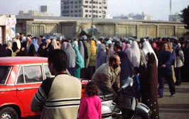

+++
title = "الاعتقالات.. أجرة بورسعيد !"
date = 2005-12-28

[taxonomies]
authors = []
sections = ["egyvote"]

[extra]
section_name = "انتخابات مصر ٢٠٠٥"
share_image = "/media/egyvote.20at.com/images/port-saiied.jpg"
summary = "لم يعد غريبا أن نبدأ أخبارنا عن الانتخابات البرلمانية بعبارات مثل \"بلطجة في محافظة كذا\" \"اعتقالات بالجملة في محافظة كذا\"، ولأننا لا نريد أن نقطع عادتنا نبدأ تقر"
section_slug = "egyvote"
section_colour = "#9C6B00"
thumb = "/media/egyvote.20at.com/images/port-saiied.jpg"
n_comments = 1
original_url = "http://egyvote.20at.com:80/article.php?sid=62"
archived = "20080102231321"
date_source = "first-capture"
aliases_20at = ["//egyvote.20at.com/article.php?sid=62"]

[extra.provenance]
original_url = "http://egyvote.20at.com:80/article.php?sid=62"
capture_url = "https://web.archive.org/web/20080102231321/http://egyvote.20at.com:80/article.php?sid=62"
capture_label = "٢ يناير ٢٠٠٨، ٢٣:١٣ UTC"
date_note = "تاريخ أول لقطة في الأرشيف (لا يوجد تاريخ في المقال)"
other_urls = []
comments = "١"
missing_images = ""
+++

<figure></figure>

لم يعد غريبا أن نبدأ أخبارنا عن الانتخابات البرلمانية بعبارات مثل "بلطجة في محافظة كذا" "اعتقالات بالجملة في محافظة كذا"، ولأننا لا نريد أن نقطع عادتنا نبدأ تقريرنا عن انتخابات الإعادة ببورسعيد بهذه العبارة...

تجاوزات أمنية متعددة الأشكال في انتخابات الإعادة اليوم بمحافظة بورسعيد، والتي تشهد تنافسا بين مرشحي الحزب الوطني وجماعة الإخوان المسلمين والجبهة الوطنية للتغيير (الوفد والتجمع) بجانب بعض المرشحين المستقلين...

فقد قامت قوات الأمن باعتقال العديد من مؤيدي ومندوبي مرشح جماعة الإخوان عن دائرة العرب والضواحي والجنوب د/ أكرم الشاعر، وتم القبض عليهم من داخل اللجان في سيارة ميكروباص رقم 11059 أجرة بور سعيد، وقد وصل عدد الاعتقالات إلى60 معتقل، منهم اثنين من المحامين وهم عبد المنعم الشتيوى ومحمد المرسي، وبعد ذلك تم الإفراج عنهم وإخراجهم خارج المحافظة بحجة أنهم من محافظة دمياط، رغم حملهم توكيلات وتهديدهم بالقبض عليهم إذا عادوا للجان مرة أخرى.

<h3>تعطيل بكافة الوسائل</h3>

ولأن سياسة الأمن في هذه الجولة الانتخابية هي تعطيل الانتخابات، ومحاولة منع الناخبين من الإدلاء بأصواتهم بأي شكل وأي وسيلة، قامت قوات الأمن بمدرسة قاسم أمين الابتدائية بدائرة العرب والضواحي بالاستيلاء على كشوف الناخبين، وإعطاء بيانات خاطئة للناخبين على الرغم من إدلائهم بأصواتهم في هذه اللجان في الجولة الأولى.

كما فرض قوات الأمن طوق أمنى على لجان الانتخاب بمنطقة القابوطى، حيث يقف الناخبين في طوابير أمام اللجان، ويتم إدخال ناخب كل عشرة دقائق للإدلاء بصوته مما يعطل سير العملية الانتخابية، وقد أدى ذلك لتهديد القضاة في مدرسة "أحد" بإلغاء انتخابات هذه اللجنة، وهى نفس اللجنة التي تم إحراق ثلاث صناديق انتخابية بها في الجولة الأولى من المرحلة الثانية.

وكامتداد لسياسة التعطيل، تم منع عدد من السيدات في مدرسة أشتوم الجميل الابتدائية بالعرب من الدخول للجان الانتخاب للإدلاء بأصواتهن بعد مرورهم على جهاز الكشف المعدني، إلا قبل أمرهن بخلع المصاغ الذي ترتدينه.

هذه التجاوزات دفعت المستشار زكريا عبد العزيز للتوجه إلي هناك للوقوف علي آخر تطورات الموقف، ورفع مذكرة سريعة إلي المستشار محمود أبو الليل رئيس اللجنة العليا للانتخابات، ووزير العدل يشرح فيها أبعاد الموقف الذي تشهده العديد من دوائر هذه المحافظة.

<h3>الحال في الشرق</h3>

وفى الشرق وبور فؤاد وصل عدد المعتقلين إلى 6، منهم محمد الحلوجي مرشح الإخوان المسلمين سابقاً لمجلس الشعب أثناء قيامه بالإدلاء بصوته بلجنة مدرسة بورسعيد الإعدادية بنات، وتم اقتياده إلى قسم الشرطة.

وفي نفس الدائرة يقوم محمود السيد صبح مرشح الوطني على مقعد العمال بتوزيع مظروفات على الناخبين بها خمسين جنية، وذلك في مقرين بشارع محمد علي، ليتم حشدهم بعد ذلك إلى اللجان الانتخابية.. انتظروا التطورات...

