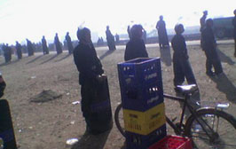

+++
title = "بحيرة رصاص.. في البحيرة!"
date = 2005-12-28

[taxonomies]
authors = []
sections = ["egyvote"]

[extra]
section_name = "انتخابات مصر ٢٠٠٥"
share_image = "/media/egyvote.20at.com/images/beheira-3.jpg"
summary = "رصد مراقبو مركز (سواسية) لحقوق الإنسان ومناهضة التميز تصاعد موجات العنف وأعمال البلطجة بشكل كبير في دوائر محافظة (البحيرة) في انتخابات الجولة الثانية من المرحلة"
section_slug = "egyvote"
section_colour = "#9C6B00"
thumb = "/media/egyvote.20at.com/images/beheira-3.jpg"
n_comments = 6
original_url = "http://egyvote.20at.com:80/article.php?sid=63"
archived = "20090205000605"
date_source = "first-capture"
aliases_20at = ["//egyvote.20at.com/article.php?sid=63"]

[extra.provenance]
original_url = "http://egyvote.20at.com:80/article.php?sid=63"
capture_url = "https://web.archive.org/web/20090205000605/http://egyvote.20at.com:80/article.php?sid=63"
capture_label = "٥ فبراير ٢٠٠٩، ٠٠:٠٦ UTC"
date_note = "تاريخ أول لقطة في الأرشيف (لا يوجد تاريخ في المقال)"
other_urls = []
comments = "٦"
missing_images = ""
+++

<figure></figure>

رصد مراقبو مركز (سواسية) لحقوق الإنسان ومناهضة التميز تصاعد موجات العنف وأعمال البلطجة بشكل كبير في دوائر محافظة (البحيرة) في انتخابات الجولة الثانية من المرحلة الثانية، تمثل العنف في إثارة الفزع وإرهاب المواطنين في الشوارع من خلال إطلاق أعيرة نارية في الهواء من أنصار الحزب الوطني، وقد طالت أعمال العنف هذه أيضا أحد مراقبي المركز ويدعي أحمد أبو عجور ومصادرة بطاقته الشخصية لمنعه من أداء عمله في المراقبة في دائرة شبراخيت.

رصد المركز كذلك العديد من التجاوزات داخل دوائر البحيرة المختلفة ، فمنذ الصباح الباكر شهدت دائرة قلشان التابعة لإيتاي البارود قيام أنصار الحزب الوطني بإطلاق أعيرة نارية في الهواء أمام اللجان من جانب حسين الصرفي المرشح المستقل والاعتداء على أنصار مرشح الإخوان من جانب أنصار الصيرفي ، ونجم عن ذلك إصابة اثنين من أنصار مرشح الإخوان ، أما في لجنة شبرا النون التابعة لنفس الدائرة فتم ضرب المندوبين ومنعهم من دخول اللجان حيث تم تطويقها من جانب الشرطة و منع الأهالي بالإدلاء بأصواتهم وحدث تلاعب بتغيير في كشوف الناخبين.

تعرضت مدينة أبو حمص لحشود أمنية ضخمة وحملة اعتقال واسعة لمؤيدي الدكتور رجب عميش مرشح الإخوان مع إرهاب الناخبين في الشوارع ، و ملاحظة وجود مكثف من البلطجية لمنع المندوبين والمواطنين من دخول اللجان ، حيث منع المواطنين من دخول لجان مدرسة عبد العزيز مخيون لجان 1 و 2 و 3 ، ومدرسة أبو رواش لجان 4 و 5 و 6، ومدرسة جلال الشرقاوي 7و 8 و9، ومدرسة النخلة البحرية 32 و33.

وفي دائرة المحمودية حدثت تحرشات أمنية واسعة مع مداهمات لمنازل أنصار مرشح الإخوان الدكتور جمال شعلان ، وتم إغلاق اللجان بقوات الأمن المركزي التي شكلت كردون أمنى ومنعت الناخبين ومندوبي المرشحين من الدخول ، وعلي النقيض لم يتم رصد انتهاكات في قرى المحمودية.

أما بوادي النطرون قامت قوات الأمن المركزي بحملات مداهمات واسعة حيث قامت بالاعتداء على الأستاذ محمد شتات مرشح الإخوان المسلمين وقامت باعتقال نجله حسن شتات وسبعة آخرين بالإضافة إلى الاعتداء على المندوبين ومراقبو منظمات حقوق الإنسان واعتقال عدد كبير من المواطنين.

وكذلك الاعتداء على مقرات المهندس زكريا الجنايني مرشح الإخوان بكفر الدوار وسرقة أجهزة الكمبيوتر من المقرات ، و تشكيل كردون أمنى لمنع الناخبين ومندوبي اللجان من الدخول والقبض علي 30 فرد بالإضافة إلي القبض على مراقب حقوق الإنسان سواسية من أمام إحدى اللجان.

كما رصد المركز أخطاء كبيرة في كشوف الناخبين بمدرسة صفية ببندر كوم حمادة في لجان 9و10و11 و12 ، كما ألقي رجال الأمن قنابل مسيلة للدموع علي الناخبين في مدينة الهنا ، ورصد شاهد عيان وجود حالات اختناق وتعدي علي السيدات المحجبات داخل اللجان بقرية أنه ، كما قامت عربات الأمن بإغلاق بلدة شنديد وكثفت قوات الشرطة الوجود الأمني في قري أم حكيم والد فراوي ومحلة شكر وأم ممدوح وتم منع مراسلي وسائل الأعلام المختلفة من تغطية أحداث الإنتخابات والتصوير.

