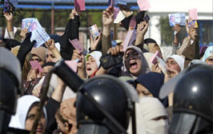

+++
title = "انتهاكات وتجاوزات رصدتها المنظمة المصرية!"
date = 2006-01-04

[taxonomies]
authors = []
sections = ["egyvote"]

[extra]
section_name = "انتخابات مصر ٢٠٠٥"
share_image = "/media/egyvote.20at.com/images/monazzama.jpg"
summary = "من خلال مراقبتها لجولة الإعادة للمرحلة الثانية للانتخابات البرلمانية 2005، رصدت (المنظمة المصرية لحقوق الإنسان) من خلال مراقبوها العديد من التجاوزات والانتهاكات"
section_slug = "egyvote"
section_colour = "#9C6B00"
thumb = "/media/egyvote.20at.com/images/monazzama.jpg"
n_comments = 0
original_url = "http://egyvote.20at.com:80/article.php?sid=64"
archived = "20080102231638"
date_source = "first-capture"
aliases_20at = ["//egyvote.20at.com/article.php?sid=64"]

[extra.provenance]
original_url = "http://egyvote.20at.com:80/article.php?sid=64"
capture_url = "https://web.archive.org/web/20080102231638/http://egyvote.20at.com:80/article.php?sid=64"
capture_label = "٢ يناير ٢٠٠٨، ٢٣:١٦ UTC"
date_note = "تاريخ أول لقطة في الأرشيف (لا يوجد تاريخ في المقال)"
other_urls = []
comments = ""
missing_images = ""
+++

<figure></figure>

من خلال مراقبتها لجولة الإعادة للمرحلة الثانية للانتخابات البرلمانية 2005، رصدت (المنظمة المصرية لحقوق الإنسان) من خلال مراقبوها العديد من التجاوزات والانتهاكات التي تخللت جولة الإعادة والتي تضمنها تقريرها الصحفي الصادر صباح اليوم.. يأتي علي رأسها استمرار عمليات العنف والبلطجة من قبل أنصار مرشحي الوطني والأخوان والمستقلين، وقيام قوات الأمن بمحاصرة بعض اللجان الانتخابية مما تسبب في تأخير فتح أبواب هذه اللجان أمام الناخبين للإدلاء بأصواتهم ، فضلاً عن عدم تنقية وتحديث الكشوف الانتخابية، و استمرار منع مراقبي المنظمة المصرية ومراقبي المنظمات الأخرى من القيام بدورهم الرقابي للانتخابات البرلمانية..

<h3>عنف وبلطجة</h3>

أول ما رصدته المنظمة المصرية استمرار أعمال العنف والبلطجة خلال جولة الإعادة للمرحلة الثانية، كأبرز الملامح السيئة التي تهدد سير ونزاهة العملية الانتخابية، وطالبت المنظمة ضرورة مواجهة ممثلي هذه الظاهرة بحزم وتنفيذ القانون دون تمييز بين المرشحين كافة، حيث أشار التقرير إلي وقوع اشتباكات بين أنصار مرشح الإخوان محمد العزباوي وأنصار مرشح الوطني أحمد شوبير أمام لجنة مدرسة الشهيد النجار بدائرة بندر طنطا بمحافظة الغربية ، وقامت قوات الأمن بالتدخل وإطلاق القنابل المسيلة للدموع، وفي دائرة الدخيلة وبرج العرب بمحافظة الإسكندرية، قام عدد من أنصار مرشح الوطني بإطلاق أعيرة نارية في وجه الناخبين الموجودين خارج اللجنة، ومنعوا جميع السيارات التابعة للمرشحين المنافسين من دخول اللجنة فيما عدا السيارات التابعة لمرشح الوطني والتي يرافقها مندوب من الحزب .

<h3>محاصرة الأمن</h3>

ثاني التجاوزات تتمثل فيما يخص الأداء الأمني أثناء العملية الانتخابية ، حيث أشار تقرير المنظمة بقيام قوات الأمن بمحاصرة بعض اللجان الانتخابية وهي لجنة مدرسة العربات بدائرة طنطا بمحافظة الغربية، ولجان بطن هريت وأبو جنشو بدائرة أبشواي بمحافظة الفيوم،ولجان مدارس أم المحسنين وعلي الجارم وأم المصريين ورشيد الجديدة وسيدي عمر بالدائرة الثامنة ادكو ورشيد بمحافظة البحيرة، وكذلك اللجان الانتخابية التابعة لدائرة وادي النطرون رقم 13 بمحافظة البحيرة أيضاً، ولجنة مدرسة بورتوفيق الابتدائية بالدائرة الأولى ومقرها قسم شرطة السويس بمحافظة السويس، ولجنة مدرسة الباحثة البادية بدائرة غربال، ولجنة مدرستي سعد زغلول وجمال عبد الناصر بدائرة العرب والضواحي بمحافظة بورسعيد، وقيام الأمن كذلك بإلقاء القبض على (22) مندوباً لمرشح جماعة الإخوان أكرم الشاعر من بينهم نجله محمد أكرم الشاعر.

<h3>الكشوف الانتخابية</h3>

تضمن التقرير كذلك بعض الحالات التي رصدها مراقبيها تتعلق بالجداول الانتخابية والتي تراها المنظمة إحدى المعضلات الرئيسية في الانتخابات البرلمانية مثل وجود أخطاء كثيرة في تلك الجداول سواء كانت أسماء مكررة أو متوفين، أو خلو الجداول من أسماء الكثير من الناخبين ، أو عدم وجود الكشوف الانتخابية خارج لجان، مما جعل المنظمة تطالب بإلغاء هذه الجداول الموجودة حالياً ، والانتهاء من مشروع بطاقات الرقم القومي الذي كان من المفترض الانتهاء منه عام 2003 وإعطاء حق التصويت لحامل بطاقة الرقم القومي فقط على أن تتضمن بيانات كاملة تشمل تاريخ الميلاد، وعنوان الإقامة، أو عنوان العمل والوظيفة.

<h3>منع المراقبين من دخول اللجان</h3>

كما أشار تقرير المنظمة المصرية إلي أن أعمال المنع لمراقبي المنظمة المصرية لحقوق الإنسان مستمرة ، واستشهد التقرير بقيام عدد من البلطجية بمنع مراقبي المنظمة من الدخول لمقر لجنة مدرسة غيث جمعة بدائرة الدخيلة وبرج العرب بمحافظة الإسكندرية ودائرة نجع حمادي بمحافظة قنا،وهو ما جعل المنظمة استنادا لقرار اللجنة العليا للانتخابات البرلمانية وحكم محكمة القضاء الإداري بشأن متابعة منظمات حقوق الإنسان للانتخابات التشريعية داخل اللجان الانتخابية وأثناء عملية فرز الأصوات تطالب بضرورة تمكين مراقبي منظمات المجتمع المدني ومندوبي المرشحين من حضور جميع مراحل العملية الانتخابية بدءاً من عملية الاقتراع ومصاحبة الصناديق وحضور عمليات الفرز للأصوات إعمالاً لحكم محكمة القضاء الإداري ولتعليمات اللجنة العليا للانتخابات البرلمانية.

<h3>تجاوزات أخرى</h3>

كما رصد التقرير بعض التجاوزات الأخرى مثل قيام الناخبين بالتصويت العلني أمام القاضي وليس خلف الستائر المخصصة لذلك، وهو ما رصده المراقبين باللجنة 42 في الدائرة السابعة ومقرها مركز شرطة إسنا واللجنة 10 ولجنة قرية العبايدة ولجنة الجمعية الزراعية في الدائرة التاسعة ومقرها نقطة شرطة الرئيسية، ولجنة 133 بالوحدة المجمعة بقوازم بدائرة قوص، كما أشار التقرير أيضا إلي قيام أحد الضباط بالاعتداء بالضرب على مراسل هيئة الإذاعة البريطانية أمام لجنة مدرسة الشهيد النجار بدائرة بندر طنطا بمحافظة الغربية.

