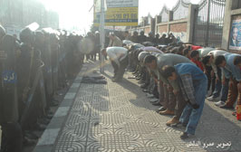

+++
title = "ringtone :"
date = 2005-12-28

[taxonomies]
authors = []
sections = ["egyvote"]

[extra]
section_name = "انتخابات مصر ٢٠٠٥"
share_image = "/media/egyvote.20at.com/images/sos-our-reporter.jpg"
summary = "عبد المنعم محمود مراسل عشرينات في الإسكندرية، بالصدفة كان في لجنة مدرسة بلال بن رباح بالدخيلة، وفجأة حضرت قوات الأمن لتحاصر الأهالي وهو معهم، وبعد ما يزيد عن ال"
section_slug = "egyvote"
section_colour = "#9C6B00"
thumb = "/media/egyvote.20at.com/images/sos-our-reporter.jpg"
n_comments = 2
original_url = "http://egyvote.20at.com:80/article.php?sid=65"
archived = "20090205000610"
date_source = "first-capture"
aliases_20at = ["//egyvote.20at.com/article.php?sid=65"]

[extra.provenance]
original_url = "http://egyvote.20at.com:80/article.php?sid=65"
capture_url = "https://web.archive.org/web/20090205000610/http://egyvote.20at.com:80/article.php?sid=65"
capture_label = "٥ فبراير ٢٠٠٩، ٠٠:٠٦ UTC"
date_note = "تاريخ أول لقطة في الأرشيف (لا يوجد تاريخ في المقال)"
other_urls = []
comments = "٢"
missing_images = ""
+++

<figure></figure>

عبد المنعم محمود مراسل عشرينات في الإسكندرية، بالصدفة كان في لجنة مدرسة بلال بن رباح بالدخيلة، وفجأة حضرت قوات الأمن لتحاصر الأهالي وهو معهم، وبعد ما يزيد عن الأربعة ساعات من العنف والضرب المتواصل لم يستطيعوا فعل أي شيء سوى أن يطلقوا استغاثة، وهذا هو نصها..

<h3>استغاثة</h3>

نحن أهالي منطقة الدخيلة، شارع البحر، خلف مكتب البريد، أمام مدرسة بلال بن رباح، نتعرض لممارسات قمعية على يد قوات الأمن وأفراد مديرية أمن الإسكندرية.

حيث تقوم هذه القوات بإطلاق قنابل مسيلة للدموع منذ مايزيد عن الساعتين والنصف بشكل متواصل وعنيف ومؤذي.

وهو ما أدى إلى إصابة عدد من الموجودين بالإختناق، وبينهم أطفال وسيدات حوامل.

كما نتعرض لوابل من الرصاص المطاطي على النوافذ والشرفات، بشكل مستمر أيضا رغم عدم تواجد أحد بالشوارع المحيطة بنا.

بيننا عجائز وأطفال، وقوات الأمن تحاصرنا وتمنع تحركنا، كما يوجدد عدد من مراسلي القنوات الفضائية ورجال الإعلام، وكلهم محاصرون معنا، وأصيب عدد من الموجودين باختناقات تستلزم علاج سريع، كما لم تصلنا أي وسائل إسعاف أو مساعدة وممنوع على أي شخص مهما كانت وظيفته الإقتراب من المنطقة حيث أن الحصار مضروب حولها بعمق خمسة كيلوا مترات.

وهذا نداء لكل من يستطيع التدخل لإنهاء هذه الأزمة..

الموقعون

عبد المنعم محمود...مراسل موقع عشرينات

أحمد سعد رجب

إسلام عبد الله

عبد الرحمن محمد

إبراهيم أحمد

محمد علي

