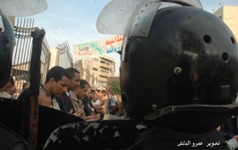

+++
title = "الغربية .. الأمن هو الحل!"
date = 2005-12-28

[taxonomies]
authors = []
sections = ["egyvote"]

[extra]
section_name = "انتخابات مصر ٢٠٠٥"
share_image = "/media/egyvote.20at.com/images/amn-is-a-solution.jpg"
summary = "تدخل رجال الأمن المركزي بشكل سافر لصالح مرشحي الحزب الوطني كان العامل المشترك والواضح في أغلب دوائر محافظة الغربية خلال جول الإعادة اليوم، فقد اشتدت المنافسة بي"
section_slug = "egyvote"
section_colour = "#9C6B00"
thumb = "/media/egyvote.20at.com/images/amn-is-a-solution.jpg"
n_comments = 0
original_url = "http://egyvote.20at.com:80/article.php?sid=69"
archived = "20080102231502"
date_source = "first-capture"
aliases_20at = ["//egyvote.20at.com/article.php?sid=69"]

[extra.provenance]
original_url = "http://egyvote.20at.com:80/article.php?sid=69"
capture_url = "https://web.archive.org/web/20080102231502/http://egyvote.20at.com:80/article.php?sid=69"
capture_label = "٢ يناير ٢٠٠٨، ٢٣:١٥ UTC"
date_note = "تاريخ أول لقطة في الأرشيف (لا يوجد تاريخ في المقال)"
other_urls = []
comments = ""
missing_images = ""
+++

<figure></figure>

تدخل رجال الأمن المركزي بشكل سافر لصالح مرشحي الحزب الوطني كان العامل المشترك والواضح في أغلب دوائر محافظة الغربية خلال جول الإعادة اليوم، فقد اشتدت المنافسة بين مرشحي الإخوان المسلمين ومرشحي الحزب الوطني وسط توقعات بتحقيق فوز كاسح ومحقق لمرشحي الإخوان..

وقد أفاد مراسلنا (محمد فوزي) بمحافظة الغربية أن قوات الأمن قامت باختطاف 19 شخصًا من مندوبي ومؤيدي مرشحي الإخوان، إلي جانب العديد من الانتهاكات في عدد من الدوائر، ففي الدائرة الأولى ومقرها قسم شرطة طنطا رصد المركز قيام 15 مخبرا باختطاف احدي موكلات المرشح المستقل سيد عسكر من أمام لجنة مستشفى المغربي واحتجزت في قسم شرطة ثان طنطا، وشهدت نفس الدائرة قيام قوات الأمن بالاعتداء بالضرب على مذيع هيئة الإذاعة البريطانية (بي بي سي) بالعصي والهراوات أثناء إذاعته لتقرير على الهواء مباشرة عن أحداث الدائرة من أمام مدرسة الشهيد السيد النجار بمنطقة قحافة.

وفي دائرة زفتى تم منع مندوب مرشح الإخوان الدكتور وليد الشيتاني من دخول اللجنة في قرية شرشابة، كما قام الضباط بطرد مندوبي الدكتور الشيتاني بمساعدة 15 من البلطجية، ووصل الأمر لقيام أنصار مرشح الوطني عبد الأحد جمال الدين بالتهجم علي مقر مرشح الإخوان بل والتهجم علي صيدلية يمتلكها شقيق مرشح الإخوان أدهم الشيتاني مما تسبب في إصابة أحد المواطنين بجرح في الرأس تصادف تواجده أمام الصيدلية.

كما منع الأمن أنصار مرشح الإخوان حسين الشورى من التصويت حتى الساعة التاسعة صباحًا في دائرة كفر الزيات ضد مرشح الوطني صلاح الحصاوي، كما قام أحد الضباط بالمرور علي اللجان مهددا بإلقاء القبض علي أنصار مرشح الإخوان وقامت سيارة ميكروباص وبها مجموعةٌ من المخبرين بالمرور على اللجان في الدائرة والقبض علي بعض أنصار مرشحي الإخوان من أمام اللجان، كما تكرر نفس المشهد في دائرة قطور حيث تدخل مدير أمن الغربية ليجعل التصويت يتم بشكل علني لصالح مرشح الوطني محمد الحشاش ضد علي لبن مرشح الإخوان.

وشهدت دائرة السنطة حيث تجري المنافسة بين إبراهيم زكريا إخوان وشريف الخطيب وطني إطلاق أعيرة نارية في قرية عطاف، نجم عنها إصابة أحد المواطنين نقل علي أثرها إلي المستشفي ، كما لوحظ وجود تكثيف أمني أمام اللجان لمنع الناخبين من التصويت لصالح مرشح الإخوان وفي نفس المركز ألقي الأمن القنابل المسيلة للدموع لتفريق الناخبين من أنصار مرشح الإخوان.

