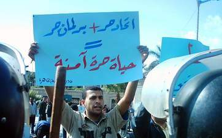

+++
title = "ضربة معلم.. تحت قبة الجامعة!"
date = 2006-09-01

[taxonomies]
authors = []
sections = ["egyvote"]

[extra]
section_name = "انتخابات مصر ٢٠٠٥"
share_image = "/media/egyvote.20at.com/images/img_0556.jpg"
summary = "في إجراء احتجاجي قوي على التدخلات الأمنية في الانتخابات الطلابية وشطب كافة الطلاب أصحاب الاتجاهات السياسية، نظم طلاب جامعة القاهرة انتخابات بديلة تحت اسم (اتحاد"
section_slug = "egyvote"
section_colour = "#9C6B00"
thumb = "/media/egyvote.20at.com/images/img_0556.jpg"
n_comments = 1
original_url = "http://egyvote.20at.com:80/article.php?sid=7"
archived = "20070814071913"
date_source = "first-capture"
aliases_20at = ["//egyvote.20at.com/article.php?sid=7"]

[extra.provenance]
original_url = "http://egyvote.20at.com:80/article.php?sid=7"
capture_url = "https://web.archive.org/web/20070814071913/http://egyvote.20at.com:80/article.php?sid=7"
capture_label = "١٤ أغسطس ٢٠٠٧، ٠٧:١٩ UTC"
date_note = "تاريخ أول لقطة في الأرشيف (لا يوجد تاريخ في المقال)"
other_urls = []
comments = "١"
missing_images = ""
+++

<figure></figure>

في إجراء احتجاجي قوي على التدخلات الأمنية في الانتخابات الطلابية وشطب كافة الطلاب أصحاب الاتجاهات السياسية، نظم طلاب جامعة القاهرة انتخابات بديلة تحت اسم (اتحاد حر) في كليات (طب – علاج طبيعي – هندسة – علوم – تجارة – آداب – صيدلة – دار علوم).

الاتحاد الحر دعا إليه طلاب الإخوان المسلمين أصحاب الرقم الأكبر في الشطب من الكشوف الانتخابية وشاركهم في الدعوة اللجنة التنسيقية بين القوي الطلابية (جامعتنا)، حيث فتح الطلاب باب الترشيح لكل الطلاب التي تمت أدرجت أسمائهم بالكشوف الابتدائية وشطبت بالكشوف النهائية كما سمحت اللجنة المشرفة على تلك الانتخابات بتقدم طلاب جدد رفضت إدارات رعاية الشباب تسليمهم أوراق الترشيح من البداية.

وبمشاركة حوالي 40% من طلاب الجامعة تمت الانتخابات في صناديق شفافة وتحت إشراف أعضاء هيئة التدريس، وفي المرحلة الأولى تم تصعيد أمين عام اتحاد وأمين مساعد لكل كلية.

كما نظم الطلاب مؤتمرا حاشدا تحت قبة جامعة القاهرة، لزملائهم لإجراء انتخابات الاتحاد العام للجامعة بين الطلاب الذين فازوا بمقعدي الأمين والأمين المساعد، وتم تصعيد أول مجلس لاتحاد حر لجامعة القاهرة بعد 15 عاما من تزوير اردة الطلاب بتعيين اتحادات أمنية لا تمت للطلاب بصلة.

وفي بيان تم توزيعه، وصف الطلاب اتحادهم الحر بأنه (بديل عن ذلك الاتحاد الطلابي الذي سيطرت عليه إدارة الكلية بوازع من الأمن، والذي لم يتسم بالحرية ولا بالنزاهة، ابتداء من الإعلان عنه والذي جاء متأخرا جدا في أخر يوم في الدراسة قبل أجازة العيد، مرورا بفتح باب الترشيح ليوم واحد فقط، وهو أول يوم بعد إجازة العيد، وانتهاء بشطب واستبعاد كل طالب صاحب نشاط من الانتخابات ليصل مجمل من تم شطبهم إلي 700 طالب منهم 400 طالب من طلاب الإخوان المسلمين).

وفي ذلك أكد الطالب إيهاب أحمد لـ(عشرينات) أن الاتحاد الحر أفرزته أفكار الطلاب اعتراضا على هذا الشطب الجماعي للطلاب المعارضين للحكومة، وضد العملية الانتخابية التي أفرزت اتحاداً هشاً لا يهتم بقضايا الطلاب الحقيقية، بل بأنشطة الرحلات والحفلات الغنائية!

وحول مشروعية هذا الإجراء، أكد إيهاب أن الاتحاد أخذ مصداقيته من الطلاب الذين شاركوا فيه ومن إشراف أعضاء هيئة التدريس بالجامعة عليه وبمراقبة ثلاث منظمات للمجتمع المدني لإجراءات انتخابه وأضاف إيهاب بقوله: "سوف نبلغ رئيس الجامعة ووزير التعليم العالي بنتائج هذه الانتخابات، وعليهم إما قبولها أو فتح باب الترشيح من جديد لانتخابات حرة وحقيقية، دونما تدخلات أمنية أو شطب للطلاب.

وهذا وقد قام د – عمرو سلامة بالاتصال بطلاب اللجنة التنسيقية (جامعتنا) وطلب مقابلتهم السبت القادم لمناقشة قضية الانتخابات الطلابية وسماع شكواهم ومطالبهم للإصلاح داخل الجامعة.

<h3>جامعيون من أجل الإصلاح</h3>

ودعما لتحرك الطلاب، نظم أساتذة جامعة القاهرة لجنة فرعية لمتابعة العملية الانتخابية لاتحادات الطلاب، تابعة للجنة الحريات بنادي أعضاء هيئة التدريس، وسميت بـ(منتدى جامعيون من أجل الإصلاح)، وشاركت في متابعة العملية الانتخابية منذ بدايتها.

وقد أعربت اللجنة في بيان لها وزعته على الطلاب أنهم تفهموا ما قام به الطلاب من انتخابات بديلة بعد الممارسات القمعية التي حدثت للطلاب من شطب واستبعاد وفصل للطلاب النشطين، كما هنأ أساتذة الجامعة في البيان الطلاب على تحركهم الجرئ، وأكدوا أنهم يعترفون بهذا الاتحاد الحر بأنه اتحاد جامعة القاهرة.

<h3>الشطبجية يفصلون الطلب</h3>

وفي المقابل، لم تكتفي إدارة الجامعة بشطب الطلاب من قوائم الترشيح، بل قامت بإجراء التحقيق مع 106 طالباً من الذين شاركوا في الدعوة لانتخابات حرة وترواحت العقوبات ما بين الإنذار بالفصل والفصل لمدد أسبوع وشهر. وقامت كلية الهندسة بحرمان 10 طالب من امتحان مقرر دراسي كامل.

مصطفى إبراهيم طالب بطب القاهرة، استنكر هذه العقوبات والمخالفات التي اتهم الطالب بارتكابها والتي جاء منها: (مخالفة القوانين واللوائح والخروج على النظم والتقاليد الجامعية لقيام الطالب مع أخرين بتعليق لافتات ورقية بفناء الكلية مدون عليها بعض العبارات التي تدعو للايجابية والإصلاح).

وأضاف مصطفى ساخرا: "الجامعة ستكرمنا إذن إذا ما دعونا زملائنا للسلبية والخمول والسكوت عن حقوقهم".

ومصطفى على حق، فقد باتت الحياة الجامعية تعيش تحت حصار أمني موسع حيث يتحكم في الجامعة ضابط الأمن بدلا من عميد الكلية أو رئيس الجامعة، ولعل طارق الباب أوشك أن يفتح له فطلاب الجامعة طرقوا كل الأبواب، وعندما رفض الجميع فتح هذا الباب قرر الطلاب اقتحامه وأعلنوا عن اتحادهم الحر الذي يعبر عن الإرادة الطلابية المخلصة والمحبة لهذا البلد وهذه الجامعة.

<h3> عبد المنعم محمود – القاهرة </h3>
