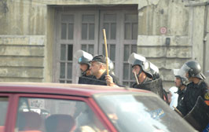

+++
title = "القليوبية .. معارك طاحنة"
date = 2006-06-25

[taxonomies]
authors = []
sections = ["egyvote"]

[extra]
section_name = "انتخابات مصر ٢٠٠٥"
share_image = "/media/egyvote.20at.com/images/qalyoubiya.jpg"
summary = "برلمان المصري 2005، وذلك على العكس من الهدوء الذي شهدته هذه المحافظة في الجولة الأولى."
section_slug = "egyvote"
section_colour = "#9C6B00"
thumb = "/media/egyvote.20at.com/images/qalyoubiya.jpg"
n_comments = 0
original_url = "http://egyvote.20at.com:80/article.php?sid=70"
archived = "20090211003324"
date_source = "first-capture"
aliases_20at = ["//egyvote.20at.com/article.php?sid=70"]

[extra.provenance]
original_url = "http://egyvote.20at.com:80/article.php?sid=70"
capture_url = "https://web.archive.org/web/20090211003324/http://egyvote.20at.com:80/article.php?sid=70"
capture_label = "١١ فبراير ٢٠٠٩، ٠٠:٣٣ UTC"
date_note = "تاريخ أول لقطة في الأرشيف (لا يوجد تاريخ في المقال)"
other_urls = []
comments = ""
missing_images = ""
+++

<figure></figure>

برلمان المصري 2005، وذلك على العكس من الهدوء الذي شهدته هذه المحافظة في الجولة الأولى.

فقد بدأت بوادر التزوير وفقا لخطة "ملائكة الإنقاذ" التي أطلقها زكريا عزمي رئيس ديوان رئيس الجمهورية وهى خطة العودة القديمة للتزوير بطرقه التقليدية حيث بدأت قوات الأمن المركزي وامن الدولة بحصار معظم اللجان في المحافظة واعتقال العديد من الناخبين من أمام اللجان الانتخابية والذين وصل عددهم إلى 36 معتقل كلهم من أمام اللجان الانتخابية حيث اعتقل 6 في القناطر الخيرية، و13 شبين القناطر، 7 في الخانكة، و15 كفر شكر، وواحد بقليوب.

<h3>كفر شكر</h3>

ففي دائرة كفر شكر منع العديد من المواطنين من الإدلاء بأصواتهم حيث أغلقت لجنة مدينة كفر شكر ولجان قري الشموت ومرصفا وكفر العرب والمنشية الصغرى والمنشية الكبرى، كما قام بعض البلطجية التابعين لمرشح حزب التجمع خالد محي الدين بالهجوم على البيوت بدعوى أنهم تابعين لمرشح الإخوان بالدائرة تيمور عبد الغنى وترهيب الناخبين بالقتل إذا قاموا بانتخاب مرشح التجمع بهدف تشويه صورة الإخوان، وقد تم نقل 4 أفراد من أنصار مرشح الإخوان إلى المستشفى في حالة خطرة بعد اعتداء بالسنج والمطاوي عليهم.

<h3>شبرا الخيمة</h3>

في شبرا الخيمة تم إغلاق اللجان أمام الناخبين ، ولم يتم السماح بالدخول إلا لحاملي البطاقات الوردية وهى الخاصة بمرشح الحزب الوطني عيد سالم موسى.

كما قام المرشح المستقل على مقعد العمال د. جمال زهران مع أنصاره بعمل مسيرة أمام مدرسة بهتيم الإعدادية اعترضا على غلق اللجان مما دفع الأمن لفتح اللجان في الواحدة ظهرا، وقد تم إطلاق الأعيرة النارية على الناخبين من قبل الأمن أمام نفس اللجنة ،كما قام الناخبين من أنصار المرشح جمال شحاتة إخوان بالهتاف في الرغبة في الدخول للانتخاب وسط اعتداءات واسعة من جانب الأمن.

وتم إطلاق أعيرة نارية أمام مدرسة اسكو الابتدائية من أنصار مرشحي الوطني مما أدى إلى إرهاب الناخبين و فرارهم من أمام اللجنة خوفا من اندلاع أعمال عنف أو الإصابة بأحد الأعيرة النارية ، وفى لجنة 106 بمدرسة 15 مايو قام رئيس اللجنة بتوجيه الناخبين للتصويت لصالح مرشحي الحزب الوطني فئات و عمال ، وشهدت مدرسة بهتيم الإعدادية في الساعات الأخيرة لإغلاق صناديق الاقتراع انقطاع التيار الكهربائي!

<h3>الخانكة</h3>

شهدت دائرة الخانكة اختطاف أربعة من أنصار مرشح الإخوان عبد الله عليوة بالدائرة ،كما قام الضابط نفسه بخطف عددا من الناخبين الذين أصروا أن يقتحموا المعهد الأزهري الذي تم احتجاز أحد القضاة بداخله ، للإدلاء بأصواتهم حيث يجلس القاضي محتجزا هناك منذ الساعة الثانية تقريبا.

وقرية عرب العليقات بدائرة الخانكة يتم منذ الصباح الباكر محاصرتها بالأمن المركزي والقوات الخاصة لمنع الناخبين من التوجه لصناديق الاقتراع نظرا لان القرية تناصر مرشح الإخوان ومرشح أخر مستقل وترفض أن تعطى أصواتها للحزب الوطني وأشار شهود العيان أنه منذ ساعات قليلة يسمع أصوات طلقات نارية في الهواء.

<h3>طوخ وقليوب</h3>

شهدت الدائرتان إغلاق للعديد من اللجان ، حيث تم إغلاق لجان قرية السفينة ومشتهر وميت كنانة والدير والمنزلة وبلتان بطوخ، كذلك تم إغلاق لجان قليوب البلد كاملة بدائرة قليوب ، التي أشار شهود العيان إلي إصابة العديد من الناخبين في نهاية اليوم الانتخابي بها نتيجة إطلاق أعيرة نارية وقنابل مسيلة للدموع لإبعادهم عن اللجان.

