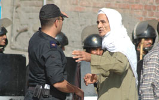

+++
title = "قنا.. حظر التجوال سيد الموقف"
date = 2006-06-25

[taxonomies]
authors = []
sections = ["egyvote"]

[extra]
section_name = "انتخابات مصر ٢٠٠٥"
share_image = "/media/egyvote.20at.com/images/qena-main.jpg"
summary = "الشوارع الخالية كانت سمة هذا اليوم في دوائر محافظة قنا بسبب حظر التجوال الذي فرضته قوات الأمن المركزي علي المواطنين خاصة في ظل تزايد توافد الناخبين علي صناديق ا"
section_slug = "egyvote"
section_colour = "#9C6B00"
thumb = "/media/egyvote.20at.com/images/qena-main.jpg"
n_comments = 0
original_url = "http://egyvote.20at.com:80/article.php?sid=71"
archived = "20090211003625"
date_source = "first-capture"
aliases_20at = ["//egyvote.20at.com/article.php?sid=71"]

[extra.provenance]
original_url = "http://egyvote.20at.com:80/article.php?sid=71"
capture_url = "https://web.archive.org/web/20090211003625/http://egyvote.20at.com:80/article.php?sid=71"
capture_label = "١١ فبراير ٢٠٠٩، ٠٠:٣٦ UTC"
date_note = "تاريخ أول لقطة في الأرشيف (لا يوجد تاريخ في المقال)"
other_urls = []
comments = ""
missing_images = ""
+++

<figure></figure>

الشوارع الخالية كانت سمة هذا اليوم في دوائر محافظة قنا بسبب حظر التجوال الذي فرضته قوات الأمن المركزي علي المواطنين خاصة في ظل تزايد توافد الناخبين علي صناديق الاقتراع للتصويت لصالح مرشحي الإخوان..

وشهدت الدوائر العديد من التجاوزات، أبرزها إغلاق شارع الصهاريج وفرض حظر التجوال بالشارع الرئيسي بقنا ، وإغلاق بعض اللجان لساعات طويلة .

وقيام مرشح الوطني اللواء حسن النجار بمساعدة من مباحث قنا بإجبار سائقي الأجرة علي حمل مؤيديه لصناديق الاقتراع ، وفي نفس الوقت تم منع مرور أنصار المرشح المستقل المنافس له، ومن جهة أخري ذكر شهود عيان أن زوجة اللواء هددت السيدات داخل اللجان بإلقاء القبض عليهن وبالاعتقال والتشريد إذا لم يصوتوا لصالح زوجها .

في دائرة قفط والمرشح فيها عن الإخوان المحامي محمود يوسف المحامي فئات قامت أجهزة الأمن بسد الطرق المؤدية إلى اللجان الانتخابية، ومنعوا المرور بما في ذلك طلبة المدارس، وقاموا بإلقاء القبض على أحد المندوبين ، وتم منع المرور أمام اللجنة في قرية الأشراف كما تم خطف المندوبين التابعين لمرشح الإخوان وسُحب منهما التوكيلات الخاصة بهما وأُخذا إلى جهة غير معلومة.

أما في دائرة قوص والمرشَّح فيها من الإخوان هشام القاضي علي مقعد العمال فقد فرض حظر التجوال فيها، وقام أحد ضباط أمن الدولة بسحب توكيلات كثير المندوبات بمقر مدرسة النصر الإعدادية لجنة سيدات .

وفي دائرة أبو طشت حيث يتنافس علي مقعد الفئات أبو النجا المحرزي وطني في مواجهة ماهر الدربي مستقل، رصد بعض مراقبي منظمات المجتمع المدني قيام الأمن بمساعدة مرشح الوطني علي الفوز من خلال عمل المتاريس ومنع دخول الناخبين وتسويد البطاقات لصالح الوطني وذلك في مدرسة الزرقاء الابتدائية.

