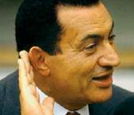

+++
title = "رفع دعوى من سبعة أحزاب لإبطال الانتخابات"
date = 2006-06-25

[taxonomies]
authors = []
sections = ["egyvote"]

[extra]
section_name = "انتخابات مصر ٢٠٠٥"
share_image = "/media/admins.20at.com/albaraa/018429.jpg"
summary = "أعلن وحيد الأقصر رئيس حزب مصر العربي الاشتراكي أن لجنة التشاور والتضامن الحزبي والتي تضم سبعة أحزاب معارضة قررت اليوم رفع دعوى أمام محكمة القضاء الإداري للطعن ف"
section_slug = "egyvote"
section_colour = "#9C6B00"
thumb = "/media/admins.20at.com/albaraa/018429.jpg"
n_comments = 8
original_url = "http://egyvote.20at.com:80/article.php?sid=76"
archived = "20090205000615"
date_source = "first-capture"
aliases_20at = ["//egyvote.20at.com/article.php?sid=76"]

[extra.provenance]
original_url = "http://egyvote.20at.com:80/article.php?sid=76"
capture_url = "https://web.archive.org/web/20090205000615/http://egyvote.20at.com:80/article.php?sid=76"
capture_label = "٥ فبراير ٢٠٠٩، ٠٠:٠٦ UTC"
date_note = "تاريخ أول لقطة في الأرشيف (لا يوجد تاريخ في المقال)"
other_urls = []
comments = "٨"
missing_images = ""
+++

<figure></figure>

أعلن وحيد الأقصر رئيس حزب مصر العربي الاشتراكي أن لجنة التشاور والتضامن الحزبي والتي تضم سبعة أحزاب معارضة قررت اليوم رفع دعوى أمام محكمة القضاء الإداري للطعن في الانتخابات البرلمانية التي تمت على المرحلتين الأولى والثانية، وأعادتهما ، وإيقاف المرحلة الثالثة ، بالإضافة إلى طلب بطلان نتائج الانتخابات التي تمت لأنها اشتملت على تجاوزات وسلبيات لم تحدث في تاريخ الحياة البرلمانية ، وهو ما يستلزم بطلان الانتخابات.

وأضاف أن مجلس الشعب من المفترض أنه يتعلق بمصير امة، وما حدث يشكك في نزاهة من سيتولون التعبير عن الشعب واحتياجاتهم، خاصة وان الأمر كما هو واضح كان خاضعا لعمليات الرشوة والبلطجة، فمن كان يدفع أكثر كان له السبق على غيره في الفوز بالمقعد، إلا نادرا، حيث أصبحت الرشاوى هي أهم دعامات فوز المرشح في خوض الانتخابات، الأمر الذي يهدد بوجود برلمان مصري يستشري فيه أعضاء دخلوا البرلمان بناءا على جريمة الرشوة والبلطجة وهم في نظر قانون العقوبات بذلك ، وقانون الانتخابات أيضا مجرمين لا يمكن أن يؤتمنوا على تحمل مسئولية النيابة عن الشعب لأنهم لم يدخلوا إلا بالتزوير.

وأوضح أن الأحزاب التي قامت برفع الدعوى هي حزب مصر العربي الاشتراكي، حزب الوفاق القومي، وحزب الاتحاد الديمقراطي ، وحزب الأحرار ، وحزب مصر 2000، وحزب السلام الديمقراطي، وحزب شباب مصر، مشيرا إلى أنه تم توكيل أحمد الفضالي في رفع تلك القضية اليوم.

<h3> صبحي مجاهد </h3>

<h3> 27/11/2005 </h3>
