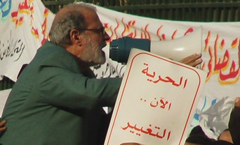

+++
title = "الإخوان والأزهر..Face off"
date = 2006-08-18

[taxonomies]
authors = []
sections = ["egyvote"]

[extra]
section_name = "انتخابات مصر ٢٠٠٥"
share_image = "/media/admins.20at.com/albaraa/imga1225.jpg"
summary = "استخدام لغة الخطاب الديني كان أهم ما يميز الإخوان في ظهورهم الانتخابي الأخير بشكل أصبح يثير التفكير في وجود منافسة لدور المؤسسة الدينية، واستخدام للغة الدينية ب"
section_slug = "egyvote"
section_colour = "#9C6B00"
thumb = "/media/admins.20at.com/albaraa/imga1225.jpg"
n_comments = 3
original_url = "http://egyvote.20at.com:80/article.php?sid=80"
archived = "20070815123230"
date_source = "first-capture"
aliases_20at = ["//egyvote.20at.com/article.php?sid=80"]

[extra.provenance]
original_url = "http://egyvote.20at.com:80/article.php?sid=80"
capture_url = "https://web.archive.org/web/20070815123230/http://egyvote.20at.com:80/article.php?sid=80"
capture_label = "١٥ أغسطس ٢٠٠٧، ١٢:٣٢ UTC"
date_note = "تاريخ أول لقطة في الأرشيف (لا يوجد تاريخ في المقال)"
other_urls = []
comments = "٣"
missing_images = ""
+++

<figure></figure>

استخدام لغة الخطاب الديني كان أهم ما يميز الإخوان في ظهورهم الانتخابي الأخير بشكل أصبح يثير التفكير في وجود منافسة لدور المؤسسة الدينية، واستخدام للغة الدينية بشكل واضح يؤثر بشكل ملحوظ في استجابة الناس للخطاب الموجه من المؤسسة الدينية في مصر.

حول تلك القضية توضح الدكتورة آمنة نصير أستاذ العقيدة والفلسفة بجامعة الأزهر الشريف، أن قضية الانتخابات في هذه المرحلة أفرزت أسوأ ما يوجد في النصف قرن الماضية، وأنه لابد وأن نواجه هذه الحقيقة بالجدية والمصارحة،

فقد تغير العقل المصري، وأكد أن ترك الساحة لتيار واحد كانت مشكلة، ونحن الآن نجني ثماره، ولذلك عندما يطل من يرفع الشعار الديني ويستخدم اللغة الدينية في خطابه للناس وهو ما ظهر بوضوح في لغة الإخوان الانتخابية فإن ذلك في الحقيقة يصيب الهدف في قلوب الناس لأن الدين متداخل في خلايا المصريين وعندما خطط الإخوان المسلمون في هذا الأمر كان تطبيقا لما يعرفونه من شعار الإسلام هو الحل.

<h3>أمية دينية!</h3>

وتضيف الدكتورة آمنة أن ما يعطي الخطاب الديني للإخوان قوة داخل فئات المجتمع المختلفة هو أن المؤسسة الدينية في غيبوبة وبالتالي فالساحة فارغة والكوب الفارغ يملؤه كل من يستطيع الحديث بلغة دينية مقبولة لدى عقول الناس، وتتساءل قائلة: " أين دور المؤسسة الدينية، وخطابها الديني الفعال ؟!، مشيرة إلى أن هناك وعاظ يملأن المساجد بكلام لا يمحو الأمية الدينية، كما أنه لا توجد أي خدمات تقوم بها المؤسسة الدينية للناس بالرغم من أنها تملك بند جمع الزكاة ولا تخدم به المواطنين.

وتؤكد أن الخطاب الديني للإخوان سيلقى تأثيرا لدى الناس وهذا سيساعدهم بالتأكيد في الانتخابات، وأنه بالرغم من الحرب الشعواء التي تصوب على الإخوان المسلمين في وسائل الإعلام فإن ما حصدوه وما سيحصدوه في الانتخابات رغم المعاناة وكل ألوان الحروب المقبلة عليهم ستكون كافية ومرضية لهم، موضحة أن هناك تجاوز في الحرب على الأخوان، ولم يستخدم معهم لغة موضوعية وسدد إليهم كل ألوان الحروب المختلفة.

وترى الدكتورة آمنة أن لغة الخطاب الديني للإخوان قد تتوقف عن النجاح إذا لم يطور الإخوان أنفسهم ويطبقوا ما رفعوه من شعار ديني ولغة دينية، وبالتالي فإن استمرار نجاح خطابهم الديني متوقف على التطبيق خاصة وان الناس في حاجة طبيعية إلى تطبيق حقيقي لكل من أعلن برنامجا، والتاريخ لن يرحم احد أخوان أو غيرهم فيما يتم استخدامه من برامج للدعاية الانتخابية لا يتم تطبيقها.

<h3>خطاب إخواني أصيل</h3>

الدكتور محمد إبراهيم الفيومي عضو مجمع البحوث الإسلامية يشير إلى أن الأصل في خطاب الإخوان ولغتهم هو الخطاب الديني، فخطابهم الديني أمر أصيل في توجهاتهم وليس فيه ما يدعو إلى القول بأن الإخوان ينافسون بخطابهم لغة المؤسسة الدينية، مشيرا إلى التكثيف الإخواني للخطاب الديني في دعايتهم الانتخابية أمر طبيعي.. بل أنه يفيد على الجانبين مرشحي الإخوان، والناخبين.

وعن مدى تفاعل الناس مع خطاب الإخوان الديني يوضح الدكتور محمد إبراهيم الفيومي أن أي لغة بها محبة للإسلام تعتبر أمرا مقبولا لدى الكثيرين، خاصة وأن الجميع لديه نزعة دينية ولن يجد غير الإسلام بديلا، وبالتالي ستكون هناك استجابة للغة الخطاب الديني للإخوان الديني، معربا عن استغرابه لتكثيف الهجوم على الإخوان بشكل غير معقول، وهم خطباء من الخطاب الديني.

ويؤكد أن القول بخطف الإخوان لدور المؤسسة الدينية أمر غير صحيح لأن توجهات الإخوان معروفة أما المؤسسة الدينية ليس لها توجه لاحتلال مكانة سياسية ، مشيرا إلى أن استجابة الناس للخطاب الديني للإخوان لن يؤثر على الاستجابة لخطاب الديني للمؤسسة الدينية.

ويختتم الدكتور محمد إبراهيم الفيومي كلامه بالتأكيد على أن الإسلام في الأصل عدالة اجتماعية وسياسية، ولكل تيار الحرية في استخدام اللغة الدينية وليس الإخوان وحدهم في الدعاية والحديث إلى الناس، حيث أن الخطاب الديني ليس حكرا على احد ولكل جماعة سياسية لها الحرية في استخدامه، وبالتالي فان الإسلام ليس حكرا على الأخوان والقول بذلك هو مجرد إثارة الخصومة.

<h3>دين وسياسة..وإخوان!</h3>

من جهته يشير الدكتور محمد شامة مستشار وزير الأوقاف المصري للشئون الثقافية إلى أن الظاهر يدل على أن ما شجع الإخوان على استخدام الخطاب الديني في لغتهم هو أنهم أرادوا الدخول في الساحة، فقاموا باستخدام لغة الخطاب الديني وتوجيهه للناس، مع أنه من المفترض الامتناع عن توظيف الخطاب الديني في مجال المنافسات السياسية والسعي وراء تحقيق هدف خاص، موضحا أن استجابة بعض الناس لخطاب الإخوان جاءت نتيجة معايشتهم للأزمات التي عاصروها في الاشتراكية والنظام الحر وقاموا بتجريب كل الأمور دون نجاح، ورأوا أن يجربوا ما يعلنه الإخوان فكانت الاستجابة لخطاب الإخوان.

ويضيف الدكتور محمد شامة أنه في الحقيقة لا توجد منافسة بين الخطاب الديني للمؤسسة الدينية، وخطاب الإخوان الديني لأن المؤسسة في الأصل لغتها إرشادية وليس بها أي توجيه سياسي، مشيرا إلى أنه ربما يكون هناك استغلال بعض الشيء من الإخوان للغة المؤسسة الدينية في مسألة الخطاب الديني، وقد لا في استجابة لدى المواطنين لأنه من المحتمل أن تكون الناس قد تكون يأست من خطاب المؤسسة الدينية لأنها لم تقدم لهم خطابا دينيا يحل لهم مشكلهم الحياتية فتوجهوا للإخوان الذين قاموا بطرح حلول من خلال خطاب ديني جذاب جعلهم أكثر جذبا للجمهور، خاصة في هذه المرحلة الانتخابية.

<h3> صبحي مجاهد </h3>
