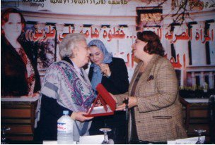

+++
title = "نهى الزيني..مسألة مبدأ"
date = 2006-09-01

[taxonomies]
authors = []
sections = ["egyvote"]

[extra]
section_name = "انتخابات مصر ٢٠٠٥"
share_image = "/media/admins.20at.com/albaraa/20new.jpg"
summary = "بين ليلة وضحاها، أصبحت نجمة متألقة، ليس لأنها بطلة فيلم سينما، ولكن لأنها صاحبة مبدأ وشهادة حق وكلمة شرف.. لمعت نجوميتها لأنها رفضت وتحدت وواجهت بكل شجاعة ما هر"
section_slug = "egyvote"
section_colour = "#9C6B00"
thumb = "/media/admins.20at.com/albaraa/20new.jpg"
n_comments = 9
original_url = "http://egyvote.20at.com:80/article.php?sid=82"
archived = "20070813233816"
date_source = "first-capture"
aliases_20at = ["//egyvote.20at.com/article.php?sid=82"]

[extra.provenance]
original_url = "http://egyvote.20at.com:80/article.php?sid=82"
capture_url = "https://web.archive.org/web/20070813233816/http://egyvote.20at.com:80/article.php?sid=82"
capture_label = "١٣ أغسطس ٢٠٠٧، ٢٣:٣٨ UTC"
date_note = "تاريخ أول لقطة في الأرشيف (لا يوجد تاريخ في المقال)"
other_urls = []
comments = "٩"
missing_images = ""
+++

<figure></figure>

بين ليلة وضحاها، أصبحت نجمة متألقة، ليس لأنها بطلة فيلم سينما، ولكن لأنها صاحبة مبدأ وشهادة حق وكلمة شرف.. لمعت نجوميتها لأنها رفضت وتحدت وواجهت بكل شجاعة ما هرب منه عشرات الرجال، إما خوفا علي منصب أو كرسي، أو هربا بالأبناء من جحيم تحدي الحكومة، خاصة وأن السجون والمعتقلات لا تخلو من القضاة الشرفاء.

عندما تسألها عن سر تطوعها وتقدمها للشهادة، لا ترد إلا بهذه الكلمات الثلاث.. "هذا هو واجبي"...

<h3>مسلمة فقط!</h3>

اعتقدها البعض سيدة "إخوانية فدائية" تنتمي إلي نفس الجماعة والفكر والاتجاه الذي ينتمي إليه المستفيد الأول من شهادتها، الدكتور جمال حشمت، أحد الأعضاء البارزين بجماعة الإخوان المسلمين.

ولكن ردها القنبلة كان أنها ليست من الإخوان، ولكنها امرأة مؤمنة تعرف أن الله سبحانه وتعالي أمرها بعدم كتم الشهادة، كما أنها قاضية درست وتخرجت من كلية الحقوق وأقسمت أن تحكم بما أمر الله وليس بما أمر أي أحد أخر.

وتضيف أنها لم تكن تعرف الدكتور حشمت من قبل إلا من خلال الاستجوابات القليلة التي قدمها في مجلس الشعب خلال مدة عضويته القصيرة إلا أنها كانت محط إعجاب واهتمام منها

وتضيف أيضا أنها حتى يوم الانتخابات لم تتقابل مع أي مرشح للإخوان، وبالذات حشمت لأنه منع من دخول لجنة الفرز ولم يحضر عمليات فرز الصناديق.

<h3>سيدة القضاة</h3>

وعن سر شهادتها تؤكد قدوة نساء هذا القرن أنها كانت ضمن فريق القضاة الذين شاركوا في عملية فرز أصعب دائرة بالمرحلة الثانية وتقول المستشارة نهي أنها كانت تعلم جيد هي ومن معها من القضاة صعوبة هذه الدائرة منذ اليوم الأول للانتداب خاصة وأنها دائرة الثائر بين

الوطني والإخوان لذلك أصرت علي إلا تترك اللجنة العامة إلا بعد انتهاء عملية الفرز وتجميع النتائج وكانت كل المؤشرات والدلائل لا ترتسم علي صفحات محاضر اللجان فقط ولكن علي وجوه مندوبي المرشحين.

حتى وصلت النتيجة إلي 25 ألاف صوت لمرشح الإخوان بينما الدكتور الفقي لم تتجاوز 6أو 7 ألاف صوت فقط .

وتؤكد نهي الزيني أن هناك مؤشر أخر كان اكبر دليل علي النتيجة وهي رد فعل الشارع الدمنهوري.

وعندما سألتها عن تفسير لذلك التزمت الصمت !

<h3>مسألة مبدأ!</h3>

بعد صمت طويل تحولت إجابات المستشارة الشابة إلي حالات من الرفض ليس لأسلوب إعلان نتائج الانتخابات ولا التجاوزات والتدخلات الأمنية أو وضع القضاة وارتباط أسماء بعضهم بعمليات التزوير وانحناء رءوسهم للأوامر الوطنية دون أي اعتراض أو تحكيم لضمائرهم.

ولكن كان أول رفض لها أن يتحول ما فعلته إلي شهادة تقدير أو نوط شرف أو مسالة تأخذ اكبر من حجمها لأن الموضوع ببساطة - وهذا ما تؤكده - هو مسالة مبدأ وأمانة وواجب، مؤكده أن الواجب لا يستحق كل هذه الضجة الإعلامية.

وكان الرفض الثاني من نصيب هذا الكم من التنبؤات والتوقعات والآراء التي انطلقت كأعيرة النارية التي صوبت في وجوه الناخبين إمام أبواب اللجان الانتخابية عقب نشرها لشهادتها.

تلك التوقعات التي حولت كلمة الحق إلي شهادة تحت التهديد، ومنها من حولها إلي أنها إحدى المرشحات الـ25 التي كان من المتوقع أن ينزلوا علي قائمة الإخوان، وهو ما رفضته ونفته المستشارة بقوة.

ويبدو أن هذا التحليل ربط بين حجاب السيدة نهي والدكتورة مكارم وفدائية السيدتين في مواجهة بلطجة الأمن والمجتمع، وإن كان تناسى أن منطق ومنهج الإخوان يرفض تولي المرأة القضاء واشتغالها في أموره، وبالتالي فهم لا ينظرون لها – في السابق – باعتبارها مؤهلة لأن تقف موقف يخدم مصالحهم(!!)، هذا لو افترضنا وجود علاقة بالفعل بينها وبين الإخوان.

وكان رفضها الثالث ضد التهديدات التي تعرضت لها والتي تجاوزات أكثر من عشرة تهديدات.

وقبل الرفض الرابع كان هناك مشهد خاص كتب السيناريو الخاص به مئات الناخبين من أبناء دائرة دمنهور وأنصار الدكتور حشمت لتحيتها وتقديم الشكر لها، ولكن فجأة اختفت بطلة ونجمة الانتخابات عن الدائرة.

فالجميع صباح يوم السبت الماضي ومع بداية جولة الإعادة يبحث عنها في جميع اللجان ليقدم لها التحية ولكن للأسف لم تظهر لها أي ملامح هل خطفت، تم احتجزها، اعتقلت، أم.....!

ولكن نائبة رئيس الهيئة الإدارية رفضت ذلك قائلة أنها لم تتعرض لأي نوع من التهديدات،

ولكن يبدو أن الحقيقة غير ذلك لأنه عقب انتهاء حورنا معها بالأمس أصدر المجلس الأعلى للقضاء قراره بمنع تعامل القضاة مع وسائل الإعلام وأن كل من يخالف ذلك يتم تحويله إلي النائب العام..!!

