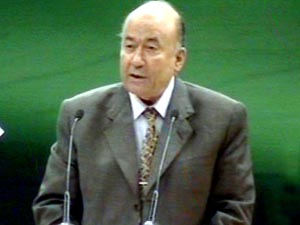

+++
title = "سر بكاء يوسف والى!"
date = 2006-09-01

[taxonomies]
authors = []
sections = ["egyvote"]

[extra]
section_name = "انتخابات مصر ٢٠٠٥"
share_image = "/media/admins.20at.com/albaraa/walllly.jpg"
summary = "يتذكر الناس للحجاج بن يوسف الثقفي بعد رحيله، أنه وبرغم الديكتاتورية والعنف والإرهاب قام بنشر الدين وتوسيع رقعة الدولة الإسلامية في بلاد الشرق، فما الذي يمكن أن "
section_slug = "egyvote"
section_colour = "#9C6B00"
thumb = "/media/admins.20at.com/albaraa/walllly.jpg"
n_comments = 2
original_url = "http://egyvote.20at.com:80/article.php?sid=84"
archived = "20070815120836"
date_source = "first-capture"
aliases_20at = ["//egyvote.20at.com/article.php?sid=84"]

[extra.provenance]
original_url = "http://egyvote.20at.com:80/article.php?sid=84"
capture_url = "https://web.archive.org/web/20070815120836/http://egyvote.20at.com:80/article.php?sid=84"
capture_label = "١٥ أغسطس ٢٠٠٧، ١٢:٠٨ UTC"
date_note = "تاريخ أول لقطة في الأرشيف (لا يوجد تاريخ في المقال)"
other_urls = []
comments = "٢"
missing_images = ""
+++

<figure></figure>

يتذكر الناس للحجاج بن يوسف الثقفي بعد رحيله، أنه وبرغم الديكتاتورية والعنف والإرهاب قام بنشر الدين وتوسيع رقعة الدولة الإسلامية في بلاد الشرق، فما الذي يمكن أن يتذكره نفس الناس اليوم أو غداً أو بالدنيا الأخرى لـ(يوسف والى) بعد رحيله عن قبة المجلس..

سؤال من الطبيعي أن يقفز لدماغ كل منا بعد أن تابع السجل الحافل للرجل والذي توقف (اخيرأً وليس آخرا) مع هذا اليوم الصعب الذي شهدته دائرة ابشواى محافظة الفيوم خلال دورة الإعادة.. والذي انتهى بخسارة فادحة للدكتور.

<h3>أبشواي.. تتحدى</h3>

يوم متنوع وحال مختلف داخل لجان مركز ابشواى في يوم الإعادة، فالجميع تابع التدخل الأمني المبالغ فيه الذي شهدته الدائرة، حيث منع الناخبين من الإدلاء بأصواتهم في عدد كبير من اللجان وأغلقت لجان أخرى، وعلاوة على أعمال البلطجة التي شهدتها الدائرة بشكل كبير، فقد تطرق الأمر لمشاهد أخرى من التعسف فقامت الجهات الإدارية بنقل المهندس جمال يحيى من مقر عمله لمساندته الإخوان بالجولة الأولى، كما تم نقل مأمور قسم شرطة ابشواى من دائرة القسم بعد انتهاء انتخابات الجولة الأولى دون أسباب معلنه.

<h3>ظواهر طبيعية</h3>

واستمرت الانتهاكات بشكل جعل الجميع يوقن بأن النتيجة ستحسم لصالحه، إلا أن كل ممارسات الحزب لم تقدر على استيعاب هذا التفاوت الكبير الذي أغلقت عليه صناديق الجولة الأولى بفارق ما يزيد عن 7000 صوت بين والى ومنافسه من الإخوان حسن عبد الغفار الذي حسم الأمر لصالحه في تمام الساعة الحادية عشر مساء أمس.

ولم تقدر أيضا على استيعاب حالة الاستياء العام التي انتابت الكثير من أهالي أبشواى (خاصة المتعلمين منهم) للجرأة التي أتت الرجل ليرشح نفسه باسم الناس بعد أن تعبأت نفوس أغلبهم بما نشرته الجرائد عن المبيدات المسرطنة علاوة على امتلاء أجسامهم بتلك السرطانات.

<h3>لم يفلح الـ new look</h3>

ومن المشاهد الملفتة عقب إعلان النتيجة هذا الاندهاش الذي أصاب مناصري والى، ويرجع هذا الاندهاش لسببين، الأول هو ما قام به رجال الوطني من جهود دعائية بالمنطقة وكان أهمها مؤتمر انتخابي الذي تم تنظيمه قبل جولة الإعادة بيومين، والذي شهد بحق newlook يوسف والى، فقد بدأ الآمر بالمعتاد من إعصار الترحيب وتلاها المعتاد أيضا من الوعود المتدفقة، إلى أن وصل المرشح الكريم والى النقطة (الحساسة) والتي أطلق عليها الصراحة المطلوبة بين أهل البيت الواحد.

تأسف والي بداية عن هذا الإهمال الذي لاقته طلبات أهالي الدائرة طوال الفترة الماضية، وألقى باللوم الكامل على من استعملهم من رجال لم يكونوا محل ثقة ولم ينقلوا صورة حقيقية عن أوضاع الدائرة (التي لم يزرها سيادة النائب ولو مرة واحدة خلال تلك الفترة).

<h3>البكاء لا يفيد أحيانا</h3>

ثم انتقل الدكتور في حديثه المؤثر عن دائرته الصغيرة إلى الدائرة الكبرى (مصر) والتي عندها بكى والى وقال أن أي قيادي وعلى مدار التاريخ دائماً ما يلتف حوله مجموعة من الوصوليين والمرتشين وقد أخذ المذنبين جزاؤهم وتم محاصرة قضية المبيدات (ولم أتعرض أنا لأي مساءلة قانونية) برغم كل ما ردده البعض عن طلب القضاء استجوابه.

أضاف أخيرا ليس لي مصلحة في التكسب من وراء اى منصب لأنني كما يعرف الكثيرون ليس لي ولد أو زوجة وليس لي إلا أهالي تلك الدائرة، أما السبب الثاني للاندهاش وهو الأهم تأكيدات والى المتكررة لأنصاره بأنه (تلقى ضمانات من الرئيس مبارك بأن الدولة تدعمه وأنه خاض الانتخابات بناء على تعليمات الرئيس مبارك وأنه لو أيقن أن مبارك لا يدعمه لانسحب).. وقد خسر.

<h3>هل ننسى</h3>

هل يعتقد والي أن الناس تنسى؟..انشغل الكثيرين بالإجابة عن هذا السؤال خلال الانتخابات، فملف والى مازال هو الأكثر سواداً في أرشيف العديد من الصحف، فالبطاقة الشخصية تقول أنه ترقى داخل أجهزة وزارة الزراعة حتى وصل لمنصب الوزير بها تلاها مقعد نائب رئيس الوزراء ووزير، ثم رحل عنهما ليتمسك بمنصب نائب الأمين العام للحزب الوطني.

أما الصفحات الخلفية فتذكر ممارساته داخل الوزارة والتي بدأت مع إنشاء مركز بحثي مشترك مع جهة زراعية صهيونية لعبت دور كبير في إسقاط عدة مشاريع هامة كمشروع القمح الذي تقدمت به مجموعة من أقوي أساتذة مركز البحوث الزراعية لتوفير الاحتياج المحلى من خلال استخدام أساليب مستحدثة في زراعته بمناطق لم تستصلح بعد، وهو ما كشفت عنه الكاتبة سكينة فؤاد من قبل في وقت زاد فيه معدل استيراد القمح بشكل قوى.

<h3>والأدهى!</h3>

والأدهى والأمًر، تلك الكارثة التي سبقت خروج والى من الوزارة، حيث كشفت الجرائد وعلى رأسها جريدة الشعب الصفقات المشبوهة التي قام بها عدد من مستشاري الوزير وعلى رأسها قضية المبيدات المتسرطنة التي اتهم فيها أحد مستشاريه يوسف عبد الرحمن والتي انتهت بسجن الرجل والإقرار بسمية هذه المواد وتسببها في حالات عديدة من السرطان، وإن تعلل والى بـ(عذر أقبح من ذنب) وهو أنه خدع برجاله، فكيف يفسر شهاداته المثيرة للجدل في تلك القضية وأخريات غيرها مثل قضية محافظ الجيزة وقضية الريف الأوروبى التي اتهم فيها أحد وكلائه احمد عبد الفتاح.

فخلال تلك الجولات تسبب والى في حبس عدد من الصحفيين مثل أحمد عز الدين ومجدي حسين وغيرهم، وقد قام مركز الجيل للمساعدة القانونية بتقديم ورقة حول موقف والى القانوني جاء فيه حكم محكمة جنايات القاهرة بإحالة والى للنيابة العامة للمساءلة في 11 تهمة .

<h3>الحملة المحروقة.. والمرتقبة</h3>

ومن الحملة الدعائية التي قادها الإعلام الرسمي (والتي جاء أعلاها صوتاً بجريدة أخبار اليوم التي نشرت في عددها الصادر يوم السبت مقال بعنوان انتخابات ابشواى.. أساسها الوفاء أخذت تعدد به انجازات والى بالمنطقة)، إلى الملفات القديمة التي من المتوقع أن يعاد فتحها ولكن هذه المرة على سطح مكتب النائب العام وليس على صفحات الجرائد فقط، فقد أعلن ناشطى حركة التجمع الوطني من أجل التحول الديمقراطي منذ فترة أنهم أسسوا لجنة برئاسة الأستاذة سكينة فؤاد لإعداد ملفات كاملة عن قضايا الفساد الحكومي وتقديمها للنائب العام على أن تكون أولى تلك القضايا هي ملف وزير الزراعة السابق يوسف والى.

<h3>محاكمة الشعب اصدق</h3>

ومن جانبه قال مجدي حسين رثيس تحرير جريدة الشعب (التي تم غلقها بعد معركة طويلة مع والي)،أن محامي الحزب بدأ في إعداد ملف والى لتقديمه للمرة الثانية للنائب العام وتحريك الشارع من أجل صدور حكم ضده، وأضاف أنه سعيد بالنتيجة لأن ماحدث في هذه الانتخابات يعنى أن الشعب قد أصدر حكمه ولم ينتظر قول الحق الغائب من النائب العام والحكومة من ورائه.

وأضاف مجدي حسين ، عندما هاجمنا والى لتطبيعه مع العدو الصهيوني وفتح أبواب الوزارة على آخرها لهم احتمى بالموقف الرسمي وبأن الدولة تنتهج خط التطبيع، وما حدث اليوم قد يكون عبرة لكل من يقف خارج مظلة الموقف الشعبي.

<h3>إنا معكم من المنتظرون</h3>

نتائج مدوية.. ِإشاعات تتردد عن إصابة والى بجلطة دماغية.. ملفات قديمة مازالت نارها مشتعلة ما بين مبيدات سرطانية ومراكز إسرائيلية وزوجة يهودية..

فما هو الحكم الذي تحمله الأيام القادمة للرجل.. بعد سقوط الوزارة.. وضياع الحصانة.. وتأرجح كرسي الحزب الذي يحاول (الآن) التملص من الوجوه المحروقة شعبيا.. التي اكتوى هو بنارها خلال الانتخابات البرلمانية الحاليةً.. تساؤلات..لا تنتظر إجابة!

<h3> منى سليم </h3>

<h3> 29/11/2005 </h3>
