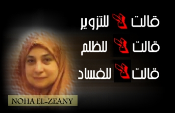

+++
title = "هو فيه إيه؟"
date = 2006-09-01

[taxonomies]
authors = []
sections = ["egyvote"]

[extra]
section_name = "انتخابات مصر ٢٠٠٥"
share_image = "/media/admins.20at.com/albaraa/zeny.jpg"
summary = "فعلا هو فيه إيه ؟"
section_slug = "egyvote"
section_colour = "#9C6B00"
thumb = "/media/admins.20at.com/albaraa/zeny.jpg"
n_comments = 3
original_url = "http://egyvote.20at.com:80/article.php?sid=88"
archived = "20070815043722"
date_source = "first-capture"
aliases_20at = ["//egyvote.20at.com/article.php?sid=88"]

[extra.provenance]
original_url = "http://egyvote.20at.com:80/article.php?sid=88"
capture_url = "https://web.archive.org/web/20070815043722/http://egyvote.20at.com:80/article.php?sid=88"
capture_label = "١٥ أغسطس ٢٠٠٧، ٠٤:٣٧ UTC"
date_note = "تاريخ أول لقطة في الأرشيف (لا يوجد تاريخ في المقال)"
other_urls = []
comments = "٣"
missing_images = ""
+++

<figure></figure>

فعلا هو فيه إيه ؟

وإيه اللي بيحصل ؟

كل هذه تساؤلات مرت بذهني بعد إنهاء المكالمة مع المستشارة نهى الزيني والتي أثارت شهادتها ضجة كبيرة في الأوساط السياسية المصرية ومن المنتظر أن تلعب دور حيوي في نتائج الانتخابات وأنا هاحكي وانتوا احكموا...!

<h3>ليست جمعية علمية</h3>

بدأت المكالمة برفض من د. نهى الزيني الحديث مع الصحافة أو في الموضوع عموما وكفاها ما حدث ولم توافق على الاستكمال إلا بعد أن أكدت لها إنني لن أتعرض للشهادة وأن الهدف من الاتصال هو معرفة موضوع الجمعية العلمية وما أثير حولها من أقاويل من ان المستشارة المرشح الخاسر رسميا جمال حشمت كلاهما عضو بجمعية علمية وأن بينهما علاقة قوية.

قالت أن هذه الجمعية ليست علمية بل هي جمعية خيرية تسمى "الحق في الدواء" وهي رئيسة مجلس الإدارة، ونشاطها الأساسي هو مقاومة مافيا الدواء وتوفيره للمحتاجين وتوصيله لهم والجمعية متوقفة منذ فترة، ويشارك فيها عدد كبير من الفنانين واليساريين ورفضت ذكر الأسماء لأن من حقهم عدم إقحام أسمائهم في هذا الجدل الدائر.

وأضافت أن الاشتراك بالجمعية متاح لأي شخص عادي وليست حكرا على أحد ومن حق أي مواطن مصري أن يشترك في أي جمعية خيرية يوافق على نشاطها.

وعن علاقتها بالدكتور حشمت قالت أنها لا تجمعها به أية علاقة فهو عضو عادي في الجمعية بصفته طبيب وأنها تعرفه من خلال العمل الشعبي كما أنها دكتورة في القانون وهو طبيب بشري فليس هناك رابط بينهما وهي تعيش في القاهرة وهو في الإسكندرية وأنها لم تراه في حياتها كلها إلا ثلاث أو أربع مرات ولا تذكر بالتحديد أين رأته.!

أما عن انتماء خالها للجماعة فقد رفضت الرد معربة عن أنه كلام فارغ لا يستحق التحدث فيه.

<h3>أنا عضو وهذا حقي!</h3>

أما حشمت فقد جاء رده واثقا وقاطعا أنه بالفعل عضو في تلك الجمعية ولكن بصفته طبيب ومواطن مصري خاصة أنها جمعية خيرية تهتم بمساعدة الفقراء وتوصيل الدواء لهم وبها عدد كبير من الأطباء والصيادلة.

ومن أشهر أعضاء الجمعية الفنانة القديرة سميحة أيوب ود.محمد الجوادي وغيرهم الكثيرين ولكن ذهني لن يسعفني الآن (رفضت الزيني الإدلاء بأي اسم)

وعما أثير حول علاقته بالزيني أو علاقتها بالجماعة فقد أكد أنه لا يعرفها بصفة شخصية بل انه لم يراها إلا حوالي ثلاث مرات في اجتماعات الجمعية العادية حيث أنه عضو بالجمعية منذ حوالي تسعة أشهر فقط (قالت أنها لا تتذكر المكان أو المناسبة) وما أثير حول هذا الموضوع غير صحيح وليس له أي جذور من الصحة.

<h3>أمال إيه؟</h3>

وبعد أن عرضت ملخص المكالمة أو كلها في الغالب فهناك عدة علامات استفهام أهمها إذا كانت الزيني لها علاقة ب د.حشمت فما موقف الـ137 قاضي آخرين والذين صدقوا على شهادتها؟

هل هم أيضا تربطهم علاقة بحشمت ؟ولماذا تفضل الزيني السكوت على مجابهة الموقف؟ وهل بدأت الضغوط الحكومية على الزيني واشتدت لدرجة وصولها لمرحلة الانهيار؟

وفي النهاية فإن موقف القضاة هو المحدد الرئيسي لما سيحدث خلال الأيام القليلة الباقية ...!

نقدر نقول.. ربنا يستر!

<h3> 29/11/2005 </h3>
