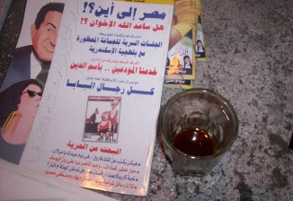

+++
title = "الصحبة تحلى في الانتخابات!"
date = 2006-08-18

[taxonomies]
authors = []
sections = ["egyvote"]

[extra]
section_name = "انتخابات مصر ٢٠٠٥"
share_image = "/media/admins.20at.com/albaraa/ikhwan-where.jpg"
summary = "بلا شك أن فوز الإخوان المسلمين في انتخابات مجلس الشعب قد فاق كل التوقعات حتى توقعات الإخوان أنفسهم من عدة نواحي منها هل ما حصل عليه الإخوان من مقاعد حتى الآن يف"
section_slug = "egyvote"
section_colour = "#9C6B00"
thumb = "/media/admins.20at.com/albaraa/ikhwan-where.jpg"
n_comments = 2
original_url = "http://egyvote.20at.com:80/article.php?sid=92"
archived = "20070815045014"
date_source = "first-capture"
aliases_20at = ["//egyvote.20at.com/article.php?sid=92"]

[extra.provenance]
original_url = "http://egyvote.20at.com:80/article.php?sid=92"
capture_url = "https://web.archive.org/web/20070815045014/http://egyvote.20at.com:80/article.php?sid=92"
capture_label = "١٥ أغسطس ٢٠٠٧، ٠٤:٥٠ UTC"
date_note = "تاريخ أول لقطة في الأرشيف (لا يوجد تاريخ في المقال)"
other_urls = []
comments = "٢"
missing_images = ""
+++

<figure></figure>

بلا شك أن فوز الإخوان المسلمين في انتخابات مجلس الشعب قد فاق كل التوقعات حتى توقعات الإخوان أنفسهم من عدة نواحي منها هل ما حصل عليه الإخوان من مقاعد حتى الآن يفوق قوتهم الفعلية في الشارع السياسي المصري وأنه نتيجة تساهل الحزب الوطني معهم في المرحلة الأولى وأن هذا الفوز جاء نتيجة أن الناس ملت من وجوه أعضاء الحزب الوطني التي لا تراها أيام الانتخابات فاتجهوا إلى انتخاب الإخوان باعتبارهم ممثلين لتيار ديني وأن الشعب المصري متدين بطبعه أم أن هذا الفوز أقل من قوة الإخوان الحقيقة والتي كان من الممكن أن تزيد في البرلمان المصري لولا تدخل الحكومة المصرية لإسقاط بعض مرشحي الإخوان من أجل إعلان فوز مرشحي الحزب الوطني.

عدد من الأسئلة والاحتمالات تشغل عقلي الأيام الماضية دون أن اسمح لها بذلك، وقد رحلت عنها ملتجأ إلى المقهي.

لم أصدق نفسي، حالة الفكر قد أصابت هذا المكان العزيز صاحب شعار(تنهد الدنيا على صحابها ما أنا قايم)، أسئلة وحوارات.. لكن الحق يقال تفكيرهم كان سابقني ووصل للسؤال الأهم الذي يتدواله الجميع وكأنه لعبة عروستي.

ماذا سيفعل الإخوان بعد فوزهم في الانتخابات؟؟

ـ أحد الشباب الواعد قال: الإخوان سيحصلون على عدد من المقاعد يجبر الحزب الوطني على تشكيل حكومة ائتلافية مع الإخوان وساعتها سنرى وزراء من الإخوان يخدمون المواطن المصري فقط و ليس أي شئ آخر ونرى الإصلاح الحقيقي وليس الإصلاح الموجه إلى الخارج ولن يتفاخر الحزب الوطني بعد ذلك بأنه حزب الأغلبية.

وقبل أن يفكر زميله في الرد بادر أحد العقلاء قادما من مقعده المعتاد بآخر القهوة وقال: الإخوان بكل ما حصلوا عليه من مقاعد لا يستطيعون أن يهددوا هيمنة الحزب الوطني على مجلس الشعب ففي ظل عدد المقاعد التي حصل عيها الحزب والتي تمثل حوالي أربعة أضعاف ما حصل عليه الإخوان إلى جانب أن الحزب الوطني ما يزال يمارس هواية ضم نواب مجلس الشعب الذين فازوا في الانتخابات كمستقلين مما يرفع من تمثيله الحزبي في البرلمان.

رد الشاب متسرعا : لو ظل كل مستقل على موقفه "زى ما الناس انتخبته" فالحزب الوطني لن يبقى حزب أغلبية ولولا أن المستقلين انضموا للحزب في انتخابات الدورة الماضية عام 2005 لكان نصيب الحزب لا يتجاوز نسبة الـ38 % من مقاعد المجلس وكانوا سيكونوا مضطرين لعمل ائتلاف مع المعارضة.

و هنا تدخل أحد الجالسين بالقرب منهما قائلا أن النظام السياسي في مصر لا يعتمد على البرلمان كجهة لاعتماد تشكيل الحكومة ولو أن مجلس الشعب قدم حجب ثقة عن الحكومة فهذا سيؤدى إلى حل المجلس وعرض الأمر على الشعب في استفتاء رسمي ولأن تاريخ الاستفتاءات ونتائجها في مصر معروف فلن يوافق الشعب على حجب الثقة عن الحكومة ومن ثم يتم حل مجلس الشعب وإجراء انتخابات من جديد طبعا لن يقوم أي نائب في البرلمان بفعل يؤدى به إلى الدخول في دوامة إعادة الانتخابات من جديد.

انضم إلينا أحد كبار السن قائلا : حتى إذا عرضت الحكومة على الإخوان منصبا وزاريا فلا تتوقع أن الإخوان سيدفعون على الفور بأحد قياداتهم و لكن في الغالب سيرشحون أحد رموز تيارا الوسط وغير المحسوبين عليهم، لأن الإخوان طوال تاريخهم يعتمدون على سياسات مرحلية لا تعتمد على الاندفاع وإنما على التخطيط المنظم والمحسوب بدقة وليس أدل على ذلك من أن الإخوان رفضوا نزول أي مرشح أمام فتحي سرور رئيس مجلس الشعب في دائرة السيدة زينب بدعوى احترامهم لتاريخه في المجلس !!

انضم آخر بعد طول تفكير: أضيف إلى كلامك أن الإخوان لن يغامروا بفقدان السبب الأكبر من شرعيتهم التي يستندون إليها وهو أنهم أحد الفصائل القليلة جدا التي لم تصل للحكم أو تشترك في وزارات تحكم البلاد، وهو ما يساعد دعاياتهم القائلة بأن الإخوان لديهم الحل لكل المشاكل لو ترك لهم حال البلاد و لذلك لن يخسروا هذه الدعاية من أجل المشاركة فقط في حكومة تواجه الكثير من المشاكل التي يصعب على الإخوان أو غيرهم حلها من ارتفاع معدلات البطالة وغلاء الأسعار وزيادة سكانية انخفاض الدخل الحقيقي للمواطن المصري إلى آخر هذه المشاكل.

بالإضافة إلى إن الحزب الوطني في غنى عن التعرض لضغوط و انتقادات خارجية إذا ضمت حكومته من تصفهم الولايات المتحدة بالمتشددين الإسلاميين حتى إذا جاءوا بناءاً على إرادة الشعب و عبر صناديق الاقتراع.

هنا انتفض الشاب الذي كان بدأ الحكاية غاضبا وأعلن رحيله عن المقهى قائلا أن الإخوان لا يعطلهم غير تجاوزات الحزب الوطني والضغوط الخارجية عليهم وعدم ثقة "بعض" أفراد الشعب في جدية رغبة الإخوان و قدرتهم على الإصلاح الفعلي.

مما دفع رفيقه (الذي لم يسعده الحظ أن يفتح فمه إلا في هذه اللحظة) إلى أن يركض خلفه قائلاً : و كده أتفضلهم إيه يا ابنى؟!!.

لا تنزعج.. رحل الشابان.. لكن لم ينفض المولد بعد.. اسحب لك كرسي ويمكنك المشاركة في الحوار لكن دون مشاريب.

<h3> أحمد الهواري </h3>

<h3> 30/11/2005 </h3>
