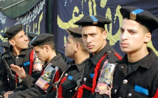

+++
title = "\"الثالثة\"..تابتة!"
date = 2006-09-01

[taxonomies]
authors = []
sections = ["egyvote"]

[extra]
section_name = "انتخابات مصر ٢٠٠٥"
share_image = "/media/admins.20at.com/albaraa/s3.jpg"
summary = "مرت مرحلتنا، وبقيت الثالثة، ورغم ما شاب الأولى والثانية من نسيم حرية وهباب بلطجة، فإن المرحلة الثالثة والأخيرة ستشهد – دون شك – ضربة الحسم للأطراف \"المتنازعة\" ج"
section_slug = "egyvote"
section_colour = "#9C6B00"
thumb = "/media/admins.20at.com/albaraa/s3.jpg"
n_comments = 2
original_url = "http://egyvote.20at.com:80/article.php?sid=94"
archived = "20070813233447"
date_source = "first-capture"
aliases_20at = ["//egyvote.20at.com/article.php?sid=94"]

[extra.provenance]
original_url = "http://egyvote.20at.com:80/article.php?sid=94"
capture_url = "https://web.archive.org/web/20070813233447/http://egyvote.20at.com:80/article.php?sid=94"
capture_label = "١٣ أغسطس ٢٠٠٧، ٢٣:٣٤ UTC"
date_note = "تاريخ أول لقطة في الأرشيف (لا يوجد تاريخ في المقال)"
other_urls = []
comments = "٢"
missing_images = ""
+++

<figure></figure>

مرت مرحلتنا، وبقيت الثالثة، ورغم ما شاب الأولى والثانية من نسيم حرية وهباب بلطجة، فإن المرحلة الثالثة والأخيرة ستشهد – دون شك – ضربة الحسم للأطراف "المتنازعة" جميعا.

الحزب الوطني هو الأكبر عددا حتى الآن، سواء في عدد المرشحين الذين فازوا بالفعل حتى الآن، أو عدد المرشحين الموجودين في المرحلة الثالثة، أو حتى عدد الذين خسرهم الوطني خلال الجولتين الأولى والثانية.

في المقابل يظهر الإخوان المسلمون ككتلة جديدة لم تعرف الأرقام التي حصلت عليها حتى الآن، فبعد حصولهم على مغانم "غير متوقعة" خلال الجولتين السابقتين، أصبحوا عفريت "الوطني" حيث تأتي مغانم الإخوان عادة على حساب خسائر (فادحة عادة) للحزب الوطني الحاكم!

تسعة محافظات هم كل ما تبقى في المحافظات المصرية، وهي المحافظات التي ستشهد المرحلة الثالثة اليوم على أن تتم الإعادة في الدوائر غير المحسوم أمرها بعد أسبوع، وبذلك تنتهي الانتخابات ويبدأ المجلس القادم الأكثر غرابة والأوسع جدلا خلال العشرون عاما الماضية على الأقل.

وقبيل ساعات من بداية هذه المرحلة قامت قوات تابعة للشرطة المصرية باعتقال نحو 600 من أعضاء جماعة الإخوان المسلمين "المحظورة رسميا" و100 من الناصريين في اليومين السابقين على المرحلة الثالثة والأخيرة من الانتخابات التشريعية التي تبدأ غدا الخميس فيما وصفته المعارضة بأنه محاولة لتقويض حملتها الانتخابية.

وهو التصرف الذي يعكس خوف وترقب للوطني من الجماعة التي حصدت حتى الآن على 76 مقعدا من بين 444 مقعدا يجري التنافس عليها في مجلس الشعب المكون من 454 مقعدا، والعشرة المتبقية منها تشغل بالتعيين.

ويدور التنافس في المرحلة الثالثة والأخيرة في تسع محافظات على 136 مقعدا وهو نحو ثلث عدد مقاعد المجلس. وللإخوان المسلمين في هذه المرحلة 49 مرشحا. كما أن لهم ستة مرشحين في ثلاث دوائر لم تجر فيها الانتخابات في المرحلة الثانية تنفيذا لأحكام من محكمة القضاء الإداري وستجرى انتخاباتها بعد المرحلة الأخيرة التي تنتهي في السابع من ديسمبر كانون الأول.

وقال خيرت الشاطر نائب المرشد العام لجماعة الإخوان المسلمين "السلطات لجأت لهذه الاعتقالات (للإخوان المسلمين) نظرا لعدم جدوى معظم الوسائل التي استخدمها النظام في المرحلتين السابقتين."

وقال متحدث باسم وزارة الداخلية المصرية إنه لا يملك أي معلومات بشان حدوث اعتقالات.

وأضاف في تصريحات لموقع اخوان أون لاين، أن الممارسات مثل البلطجة ومنع ناخبي الإخوان من الوصول إلى لجان الانتخاب والقيد الجماعي لناخبين من خارج الدوائر ليقترعوا لمرشحي الحزب الحاكم لم تفلح في وقف مكاسب الإخوان.

في حين قال محمد أسامة المتحدث باسم الجماعة إن معظم الاعتقالات وقعت في محافظات ستجرى فيها الانتخابات غدا الخميس. وتجري الانتخابات في محافظات الدقهلية والشرقية وكفر الشيخ ودمياط وسوهاج وأسوان والبحر الأحمر وشمال سيناء وجنوب سيناء.

وأضاف أسامة أن أجهزة الأمن احتجزت أكثر من 1600 من أعضاء جماعة الإخوان المسلمين في الأسبوعين الماضيين للتأثير على أداء مرشحي الجماعة في الانتخابات البرلمانية لكن كثيرين منهم أطلق سراحهم.

ومن جانب آخر قالت نيفين سمير مديرة مكتب المرشح الناصري حمدين صباحي عضو مجلس الشعب المنتهية ولايته إن أجهزة الأمن احتجزت نحو 100 من أنصاره.

ويخوض صباحي وهو وكيل مؤسسي حزب الكرامة العربية وعضو قيادي في الحركة المصرية من أجل التغيير "كفاية" الانتخابات في دائرة البرلس والحامول في محافظة كفر الشيخ وهي الدائرة التي يمثلها في البرلمان المنتهية ولايته.

وأضافت مديرة مكتب صباحي أن "رجال مباحث يستوقفون مؤيدينا في الشوارع والأسواق وينزعون منهم بطاقات الهوية أو البطاقات الانتخابية اللازمة للتصويت."

وسيحتفظ الحزب الوطني الديمقراطي بأغلبية مريحة في مجلس الشعب لكن كتلة نواب الإخوان المسلمين في المجلس ستكون الأكبر منذ الإطاحة بالنظام الملكي عقب قيام ثورة يوليو عام 1952.

وإن كان محللين يقولون أن الحزب الحاكم الذي يستحوذ على أكثر من 85 في المائة من مقاعد البرلمان المنتهية ولايته قد لا يحتفظ بأغلبية الثلثين التي يحتاجها لإجراء تغييرات دستورية وقتما يشاء.

وقال بيان للجماعة عن اعتقال عدد من أعضائها البارزين في محافظة الدقهلية في دلتا النيل إن الهدف من هذه الاعتقالات هو إفشال الحملة الانتخابية للإخوان.

وأضاف البيان أن بين المحتجزين ممثلين لمرشحين ومديرين لحملات انتخابية للإخوان.

وقال البيان "تدعي وزارة الداخلية في محاضرها أن هذه الشخصيات ذات الثقل الاجتماعي والسياسي... ينوون إفساد العملية الانتخابية وأنه تم ضبط عدد من السيوف والسنج والشوم بحوزتهم."

ووقعت الاعتقالات الأخيرة في محافظات الدقهلية ودمياط والشرقية وكفر الشيخ في دلتا النيل وسوهاج في صعيد مصر.

وجرت عادة أجهزة الأمن على اعتقال أعداد كبيرة من الإخوان المسلمين قبل الانتخابات للحد من قدرتهم على تعبئة الناخبين. لكن الاعتقالات التي تمت قبل المرحلة الثانية في وقت سابق من نوفمبر تشرين الثاني لم تمنع الجماعة من كسب 42 مقعدا أضيفت إلى 34 مقعدا كسبتها في المرحلة الأولى.

ولم يظهر أي انزعاج على المسئولين في الحكومة لنجاحات الإخوان المسلمين لكن منذ الانتصارات المبكرة لهم حاول رجال أمن ونشطون من الحزب الوطني الديمقراطي إثارة المتاعب للإسلاميين في كثير من الدوائر.

وقال محمود محيي الدين وزير الاستثمار أمام مؤتمر استثماري اليوم الأربعاء أنه يرحب بالتحدي الذي يمثله ذلك الوجود الكبير للإخوان المسلمين في مجلس الشعب.

وأضاف "أنا لا أبحث عن مشاكل ولكن ما أتوقعه هو أننا سنواجه تحديا وإذا كانت هناك حكومة حقيقية قادرة على التعامل مع الإصلاح يتعين عليها أن تتمسك بما تؤمن به."

وتابع محيي الدين "المنافسة أمر جيد للاستثمار وجيد للاقتصاد وجيد للحياة (بوجه عام) ... لم يكن معظم أعضاء الحزب الوطني الديمقراطي يكلفون أنفسهم حتى عناء حضور الجلسة العامة (للبرلمان). لذا فإن قدرا من التحدي والتنافس سيكون موضع ترحيب شديد".

<h3> رويترز </h3>

<h3> 30/11/2005 </h3>
