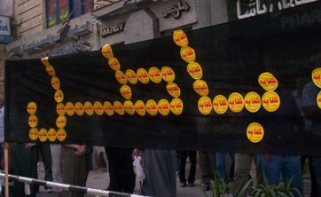

+++
title = "للولاية الخامسة..مع تحياتي!"
date = 2006-08-18

[taxonomies]
authors = []
sections = ["egyvote"]

[extra]
section_name = "انتخابات مصر ٢٠٠٥"
share_image = "/media/admins.20at.com/albaraa/m5.jpg"
summary = "خطاب وصلنا عن طريق الخطأ!"
section_slug = "egyvote"
section_colour = "#9C6B00"
thumb = "/media/admins.20at.com/albaraa/m5.jpg"
n_comments = 1
original_url = "http://egyvote.20at.com:80/article.php?sid=95"
archived = "20070814072101"
date_source = "first-capture"
aliases_20at = ["//egyvote.20at.com/article.php?sid=95"]

[extra.provenance]
original_url = "http://egyvote.20at.com:80/article.php?sid=95"
capture_url = "https://web.archive.org/web/20070814072101/http://egyvote.20at.com:80/article.php?sid=95"
capture_label = "١٤ أغسطس ٢٠٠٧، ٠٧:٢١ UTC"
date_note = "تاريخ أول لقطة في الأرشيف (لا يوجد تاريخ في المقال)"
other_urls = []
comments = "١"
missing_images = ""
+++

<figure></figure>

خطاب وصلنا عن طريق الخطأ!

وللأمانة قررنا تحمل التكلفة وإرسالها إلى الشخص المطلوب، لكن.. ولأن الصحافة أمَارة بالنشر قررنا.. طبع نسخة قبل الإرسال.. ونشرها لكم:

العزيزة الكريمة النزيهة:

انتهت الانتخابات أو كادت أن تنتهي.. بسقوط رموز الوطني وصعود نجم الإخوان أو أى نتيجة أخرى..

فنحن مازلنا في أماكننا هنا بهامش صورة نقف منتظرين أقوالك وممارساتك أيتها الولاية الخامسة المرتدية كل ملابس الشتاء والصيف بألوان الإصلاح المديد والفكر السعيد والديمقراطية.. نحلفك بكل أيام الهنا.. اللي فاتت واللي جايه.. أن تخبرينا.. ولا ترتبكي أو تتلعثمي.. فأنت منا وأنت لنا.. اخبرينا.. بأي شيء، من الديمقراطية للطحينة.. فنحن نطالب باسم السيادة والريادة والإعادة بعض من التوضيح.

<h3>النصب الناعم!</h3>

قلتم في برنامجكم الرئاسي أن الإصلاح الدستوري خطوة أولى، تشمل نظام انتخابي جديد يضمن تمثيل حقيقي للقوى السياسة، فهل يدخل في إطار ذلك (والعلم الغزير لكم) رشاوى المجمع الانتخابي التي بدعها ابنكم الفاضل كمال الشاذلي؟!

وماذا عن البطاقة الدوارة التي يصوت من خلالها أكثر من ألف شخص لصالح الحزب الوطني رغم الاختراع العبقري الحبر السري، ولماذا لم تقروا أسلوب موحد للترشيح أما القائمة أو الأسلوب الفردي، أم تلك هي متطلبات العملية العتيقة بضم المنشقين والمستقلين بعد نجاهم في الدخول للمجلس وانحصاركم المتزايد في ذلك من 37% الموسم القادم إلى ما لا يزيد عن 30% هذا العام.

وفوق هذا ويزيد.! أليس بيننا تعاليم متوارثة آن كل شاء ممكن يكون.. ديمقراطية تزوير تمرير.. فالذكاء والهدوء يصنع كل شيء، وقد كانت لكي تجربتك السابقة مع المادة 76.. إيه اللي صابك في انتخابات البرلمان؟.

<h3>بلطجة وإيه كمان</h3>

فرغم كل التحذيرات والاحتياطات لم تستطع عائلتكم الحزبية احتمال هذا الانفلات البرلماني الذي ألقى بأغلب وجوه الوطني إلى خارج الحلبة، فتابعنا على يديك عودة الحنين القديم وخروج البلطجية من السجون لتأديب الناخبين، ولقد تحدثت في برنامجك أيضا عن تفعيل دور البرلمان في الرقابة‏ ومساءلة الحكومة‏ وأكدت على حقه في سحب الثقة من الحكومة‏، فكيف يكون الحال إذا زادت ضغوط الحرية، هل نشهد عمليات رفع الحصانة عن بعض الأعضاء مثلما حدث مع أيمن نور من قبل وفى نفس الوقت نترك أصدقاء والى يرمحوا داخل الحزب رغم مثولهم لمسائلة قانونية، وهل يكن تهديد المجلس بحله إذا زادت الاستجوابات وتم سحب الثقة عن الحكومة كما حدث في برلمان 1985.. ولا سنعتبر من اللي فات..ونلتفت للكلام الداير هنا وهناك.

<h3>هنعمل إيه مع الأمريكان</h3>

هل نسى كل ساكني الحزب إن الدنيا صغيًرة والفرصة قصيًرة، فقد نقلت كل الكاميرات العالمية مشاهد ال thungs أو بلطجية مصر كما جاءت بتعليقات اغلب الجرائد، وقد كان تقرير البرلمان الاوروبى عن العملية الانتخابية وافى وكافي لان يثير العالم بأكمله على موديل 2005 المصري للديمقراطية، لكن الغريب أنه أثار رجالك فقد أكد وزير الخارجية المصري أحمد أبو الغيط في تصريح لصحيفة "الوفد" المعارضة أن "وفد البرلمان الأوربي الذي حضر إلى مصر لمراقبة الانتخابات لم يكن له صفة شرعية"، وأنه "منح نفسه حق الحضور إلى مصر" دون أن توجه إليه دعوة رسمية.

بل وحذر قائلا انه إذا حدث ورفع الوفد الأوربي تقريرا إلى قمة برشلونة حول الانتخابات المصرية فإن ذلك سيكون أمرا غير مقبول لعدم انتهاء الانتخابات وأعقب ذلك مباشرة إعلان الرئيس المصري تخلفه عن الذهاب لقمة برشلونة الاورو متوسطية، وقال بعض المراقبون أن هذا التصرف يعكس تخوفا مصريا من التعرض للإحراج إذا رفع الوفد تقريرا إلى القمة حول التجاوزات التي شهدتها الانتخابات البرلمانية.

<h3>ما رأيكم دام عزكم</h3>

ليس لدينا الكثير حتى نضيفه، ولكن وبصراحة ..ولا تأخذيها على محمل الشماتة .. أنت خسرتى أول معركة حرية.

إمضاء: المهشمون بمزاجهم مصر المحروسة

<h3>حقوق شرعية</h3>

ما سبق هو شهادة من لم يصوتوا ولم يهتفوا واكتفوا بمشاهدة أموال الدعاية والرشاوى تمر من أمام أعينهم، ولم يتوقعوا أن حتى المشاهدة في بعض الأحيان تحمل الأذى على يد بلطجي يحمل سكين وجنزير، تعليقاتهم جاءت متواضعة لم تستطع (بحكم أسلوب التربية) أن تصل إلى مرتبة المطالب، فهل هناك من يهتم أو يغتم.. وهل يأتي هؤلاء ونحن معهم اى رد أو صد.

<h3>وخيالات أكثر شرعية</h3>

وكنوع من المشاركة، فكرنا وقبل رد الرسالة إلى أصحابها أن نضم إليها فقرة تحمل سؤال محدد وأخير ..وهو(الم يأتي الوقت بعد ليضم البرنامج الانتخابي لرئيس جمهورية مصر العربية بند يختص بفتح باب المساءلة عن كل خطوة تخرج عن شريط الوعود التي وصل من خلالها للحكم، ففي بلدنا مصر تفاعل البعض مع ملف الانتخابات الرئاسية ولم يهتم البعض، لكن النتيجة الأخيرة جاءت بوصول مبارك للحكم رافعاًٍ برنامجه الذي لم ينفذ على مدار24 سنة، وبند أول به الإصلاح النيابي والدستوري وجاءت الخطوة الأولى على أرض الواقع مهزلة تشريعية.

فهل يتمكن الـ70 مليون مساءلة من يتحدث ويحكم باسمهم عن ما جرة بالأيام الماضية، وماذا عن القادم ووعود فرص العمل وإطلاق الحريات ودفع المعاشات) ..

هذا ما أضفناه وان كان لديكم المزيد .. أرسلوا إلينا.

<h3> منى سليم </h3>

<h3> 30/11/2005 </h3>
