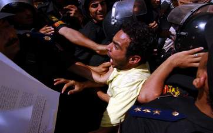

+++
title = "مسرحية انتخابية من 100 مشهد!"
date = 2006-09-01

[taxonomies]
authors = []
sections = ["egyvote"]

[extra]
section_name = "انتخابات مصر ٢٠٠٥"
share_image = "/media/egyvote.20at.com/images/main-parliment.jpg"
summary = "كأنه فيلم عربي قديم، وكأنه كلاكيت للمرة المائة، انتهت المرحلة الأولى من الجولة الثالثة على خلفية مشهد البلطجة الذي خلف قتيل وعشرات الجرحى في تسع محافظات شهدت ال"
section_slug = "egyvote"
section_colour = "#9C6B00"
thumb = "/media/egyvote.20at.com/images/main-parliment.jpg"
n_comments = 0
original_url = "http://egyvote.20at.com:80/article.php?sid=96"
archived = "20070813224356"
date_source = "first-capture"
aliases_20at = ["//egyvote.20at.com/article.php?sid=96"]

[extra.provenance]
original_url = "http://egyvote.20at.com:80/article.php?sid=96"
capture_url = "https://web.archive.org/web/20070813224356/http://egyvote.20at.com:80/article.php?sid=96"
capture_label = "١٣ أغسطس ٢٠٠٧، ٢٢:٤٣ UTC"
date_note = "تاريخ أول لقطة في الأرشيف (لا يوجد تاريخ في المقال)"
other_urls = []
comments = ""
missing_images = ""
+++

<figure></figure>

كأنه فيلم عربي قديم، وكأنه كلاكيت للمرة المائة، انتهت المرحلة الأولى من الجولة الثالثة على خلفية مشهد البلطجة الذي خلف قتيل وعشرات الجرحى في تسع محافظات شهدت الجولة التي تنافس خلالها 1770 مرشحاً في 68 دائرة على 136 مقعداً، وننشر لكم هنا موجزاً لما حدث في تلك الدوائر خلال 100 مشهد سريع.

• في دائرة السيالة، بكفر الشيخ اعتدى عدد من البلطجية على مندوب منظمه المجتمع المدني لحقوق الإنسان محمود عبد الحي.

• الزقازيق: قام أنصار المرشح المستقل جمال الزينى بمنع مندوبي كلا من مندوبي محمد الفلاحجى ، وعلاء التهامي بدائرة الزرقا من الدخول في لجنة مدرسة الشهداء الإعدادية بالناصرية.

• وبنفس القرية منع النساء من الدخول إلى المقر الإنتخابى بلجنة مدرسة الكاشف الابتدائية حيث يوجد قوات أمن مركزي وأمن دولة أمام مقر اللجنة ولايسمح بدخول إلا أنصار مرشح الحزب الوطني .

• وقف عدد من رجال المباحث أمام مدرسة فارسكور الجديدة منذ 9 صباحا ولا يسمح بدخول الناخبين إلا لمن معه بطاقات وكارنيهات الحزب الوطني.

• قام الضابط أحمد الغباري بمركز شرطة الزرقا بالاعتداء على الصحفيتين رشا عزب من جريدة الموقف العربي ودينا العامي الباحثة في الجامعة الأمريكية وسحب الكرنيهات الخاصة بهما أثناء تغطيتهما العملية الانتخابية بقرية دقهلة .

• وفي نفس الدائرة رصد مراقبو المركز عمليات نقل جماعي لناخبين من محافظة الجيزة من العاملين بمدارس نائب الحزب الوطني عن دائرة بولاق والعمرانية المندوه الحسيني للتصويت في لجان السرو لصالح الحزب الوطني فئات العميد العزب العراقي .

• قامت قوات الأمن بمحاصرة المقر الانتخابي ومنع المندوبين والناخبين من الدخول إلى اللجان .

• في قرية "عزبة اللحم "قامت قوات الأمن بالقبض على مندوبي ووكلاء المرشح المستقل صابر عبد الصادق أثناء توجههم للحضور أمام اللجان.

• في مقر مدرسة الجمرك التابع لقسم رابع بندر دمياط قامت قوات الأمن بمحاصرة المقر الانتخابي ومنع المندوبين والناخبين من دخول اللجان .

• فى قرية دقهلة قامت قوات الشرطة بقيادة الرائد أحمد الغباري بإغلاق المدخل الرئيسي للقرية المؤدي للمقر الانتخابي بها ومنع الناخبين من الوصول إليه.

• وفى الدائرة الأولى ومقرها قسم شرطة دمياط تم وقف التصويت في لجان مدرسة الجمرك حتى الآن بحجة عدم وجود مندوبين.

• في الدائرة الأولى ومقرها قسم شرطة أول المنصورة تم الكشف عن البطاقة الدوارة في لجنة خالد الطوخي التي لا يسمح بالتصويت فيها إلا بعد إظهار الكارت الأصفر الخاص بمرشحي الحزب الوطني.

• في عمليات أشبه بالقرصنة قامت ثلاث سيارات ميكروباص وسيارة فيات تخطف المرشح أيمن المنياوي من أمام مدرسة النصر.

• اثنان من سيارات الميكروباص ذات لوحات مطموسة المعالم ،و ممتلئة بالبلطجية انطلقت من أمام قهوة أبو جلالة مهمتها خطف المندوبين والناخبين ، وذلك بدائرة الخياطة.

• د.إبراهيم السنباطى المرشح المنشق عن الحزب الوطني في فارسكور لا يسمح إلا بدخول أنصاره ومن معه بطاقة تصويت منه.

• بقرية "العطوى" بفارسكور يقف رئيس مباحث المركز محسن نجيب وبصحبته مجموعة من الأمن ومعهم 2 ميكروباص مدني وسيارة نقل ويقوموا بمنع دخول الناخبين.

• في "البصارطه " يقوم المرشح عبده سحلول بتنظيم الناخبين بنفسه وذلك في حضور رئيس المباحث .

• إغلاق لجان سندوب بالكامل بمعرفة رئيس مباحث قسم أول المنصورة والذي قام بطرد جميع المندوبين والوكلاء .

• في دائرة بني عبيد قرية "ويش" قيام قوات الأمن باختطاف اثنين من مندوبي المرشح المستقل طارق الدسوقي كما قامت قوات الأمن بخطف مواطنين من أمام اللجان الأربعة بالدائرة.

• وفي الدائرة الثانية عشر ومقرها مركز شرطة الجمالية رصد مراقبو المركز وجود تواجد أمني كثيف أمام لجان مقر مدرسة الثانوية بنات والمدرسة الإعدادية والمدرسة الفنية كما تم منع الناخبين من الإدلاء بأصواتهم .

• بينما شهدت الدائرة العاشرة ومقرها مركز شرطة منية النصر اختلاف الكشوف المعلقة خارج مقر اللجان بقرية الكردي عن تلك الموجودة مع السادة القضاة مسئولي اللجان ، كما قامت قوات الأمن بحصار قرية" برمبال" التي تمثل بلدة المرشح المستقل إبراهيم أبو عوف حيث تم منع الناخبين من الإدلاء بأصواتهم.

• في الدائرة الثالثة ومقرها مركز شرطة بني عبيد قامت السيارة رقم 4015 أجرة دقهلية ( ميكروباص ) بنقل مجموعة من النساء البلطجيات إلى قرية ويش الحجر للاعتداء على الناخبات هناك ونكرر نفس المشهد بقيام سيارة ميكروباص دون أرقام بنقل مجموعة من البلطجية إلى قرية ميت

• بمقر مدرسة الجعفرية دائرة أبو حماد قامت قوات الأمن بمنع وكلاء ومندوبي المرشح المستقل سيد حزين من دخول اللجان .

• قامت قوات الأمن بإغلاق 3 مقرات انتخابية بالكامل وهي مقر مدرسة هدى شعراوي ، مقر مدرسة الضايع المتقدمة ، مقر مدرسة سخا التجارية .

• وفي الدائرة الثامنة ومقرها مركز شرطة شربين قامت قوات الأمن باستخدام القنابل المسيلة للدموع والرصاص الحي لتفريق الناخبين الذين احتشدوا أمام مقر اللجان الفرعية .

• في الدائرة الأولى ومقرها قسم شرطة العريش تم إغلاق المقر الانتخابي بمدرسة أبو صقل .

• في الدائرة الأولى ومقرها قسم شرطة العريش رصد مراقبو المركز احتشاد عدد كيبر من البط لجية أمام مدرسة حمدي عواد لمنع الناخبين من الإدلاء بـأصواتهم .

• وفي نفس الدائرة رصد مراقبو المركز عمليات تصويت جماعي والسماح بالتصويت دون التحقق من شخصية الناخب .

• وفي نفس الدائرة رصد مراقبو المركز قيام قوات الأمن بمنع الناخبين من التصويت في لجنتي 43 و44 بمدرسة عايش الأسمر .

• وفي لجنة السيدات بنفس المدرسة يتم التصويت أمام رئيس اللجنة وليس خلف الستار كما ينص القانون

• في الدائرة الأولى ومقرها قسم شرطة الزقازيق رصد مراقبو المركز حالات عديدة من القيد الجماعي في اللجان من 1 إلى 14 بمدارس ناصر النموذجية ومدرسة الزقازيق الثانوية بنات والغرفة التجارية والسجل التجاري ومدرسة هدى شعراوي .

• في الدائرة الأولى ومقرها قسم أول شرطة الزقازيق قام عدد كبير من البلطجية بمنع الناخبين من الإدلاء بأصواتهم في لجان المعهد الفني التجاري ومدرسة الناصرية .

• منع الناخبين بالدائرة الخامسة من الإدلاء بأصواتهم في لجان مدارس عبد الله الشرقاوي الابتدائية والإعدادية ولجنة السيدات بمدرسة الشمالية.

• في الدائرة الأولى ومقرها قسم شرطة أول سوهاج قوات الأمن باعتقال بعض الناخبين من أمام مدرسة النيل الابتدائية.

• تم منع الناخبات اللاتي يرتدين الحجاب من دخول اللجان 82 ، 83 ، 84 ، 85 بمدرسة باحثة البادية.

• وفي الدائرة الرابعة ومقرها مركز شرطة طهطا رصد مراقبو المركز قيام بعض البلطجية بالاعتداء على أنصار المرشح المستقل محمد يوسف محمود وتمزيق الكشوف الانتخابية الموجودة معهم.

• وفي نفس الدائرة اعتدت قوات الأمن بقيادة الضابط وسام إسماعيل من مباحث طهطا على مراقب المركز الأستاذ / إسلام توفيق وقاموا بمصادرة الكاميرا الخاصة به ، كما تم طرد أنصار ومندوبي المرشح المستقل محمد يوسف من أمام مدارس بنت النيل والتجارة بنات والنصر الابتدائية.

• وفي الدائرة الأولى ومقرها قسم شرطة أول سوهاج رصد مراقبو المركز قيام قوات الأمن باختطاف.

26 من أنصار المرشح المستقل مختار البيه من أمام مدارس أسماء بنت أبو بكر وتيسير والإعدادية الجديدة بنين ، وعبد الله وهبي ، ومنهم محمد عز ومحمد عابدين .

• كما قامت قوات الأمن بمنع الناخبات اللاتي يرتدين الحجاب من دخول اللجان 82 ، 83 ، 84 ، 85 بمدرسة باحثة البادية.

• وفي نفس الدائرة اعتدت قوات الأمن بقيادة الضابط وسام إسماعيل من مباحث طهطا على مراقب المركز الأستاذ/ إسلام توفيق وقاموا بمصادرة الكاميرا الخاصة به ، كما تم طرد أنصار ومندوبي المرشح المستقل محمد يوسف من أمام مدارس بنت النيل والتجارة بنات والنصر الابتدائية.

• كما تم اختطاف 26 من أنصار المرشح المستقل مختار البيه من أمام مدارس أسماء بنت أبو بكر وتيسير والإعدادية الجديدة بنين .

• في الدائرة الثالثة ومقرها قسم شرطة "بيلا"رصد مراقبو المركز قيام قوات الأمن بإطلاق أكثر من 10 قنابل مسيلة للدموع لتفريق الناخبين ومنعهم من الإدلاء بأصواتهم بقرية "حاذق".

• شهدت الدائرة السابعة ومقرها قسم شرطة دسوق إغلاق اللجان الموجودة بحي دحروج الذي يمثل أكبر تجمع للمرشح المستقل رجب البنا ، وكذلك إغلاق المقار الانتخابية بمدارس هدى شعراوي والصنايع الزخرفة والسادات الإعدادية وسخي التجارية وسيدي طلحة .

• بينما فرضت قوات الأمن حصار قرية الجزيرة الخضراء وبها لجان 184 ، 196 ومنع الناخبين من الإدلاء بأصواتهم.

• في الدائرة الأولى ومقرها قسم شرطة أول سوهاج رصد مراقبو المركز قيام قوات الأمن باعتقال بعض الناخبين من أمام مدرسة النيل الابتدائية .

• في الدائرة الرابعة ومقرها مركز شرطة طهطا رصد مراقبو المركز قيام بعض البلطجية بالاعتداء على أنصار المرشح المستقل محمد يوسف محمود وتمزيق الكشوف الانتخابية الموجودة معهم .

• حصار أمني علي قرية ههيا بالدبابات والقنابل المسيلة للدموع.

• وفي مدينة دمياط شهد قطع يد احدي الناخبين علي يد قوات الأمن.

• احدث الشغب بالمنصورة تسفر عن إصابة 70 من الناخبين.

• وفى الدائرة التاسعة ومقرها قسم شرطة (فوه) رصد مراقبو المركز قيام قوات الأمن بحصار قرية الجزيرة الخضراء وبها لجان 184 ، 196 ومنع الناخبين من الإدلاء بأصواتهم

• اتخذت قوات الأمن شكلاً جديداً فى بث روح الفزع والبلطجة واثارة الشغب بين جمهور الناخبين بارتداء ملابس مدنية والانتشار وسط الناخبين كانهم ناخبين بالخياطة

• وفى قرية بساتين الإسماعيلية _ بلد مرشح الأخوان ياسر حسانين – قام الأمن بحصار اللجان وأعتدي على الناخبين الذين اعترضوا على عرقلة الانتخابات فى ظل السماح لأنصار الحزب الوطنى بالدخول.

استمرارا لعمليات التزوير والحصار الأمني للجان فى محافظة الشرقية قامت قوات الامن بمحاصرة لجان دائرة مشتول السوق خاصة لجنة32 بكفر ابراش دائرة مشتول السوق – قرية مرشح أحد خصوم مرشح الأخوان –وتم التسويد لصالح مرشح الحزب الوطني, وتكرر الأمر فى لجان 19 بمدرسة السيدة عائشة بمشتول المدينة , ولجنة 50 بقرية دهمشا

أما فى لجان 34 , 35 , 36 , 37 بكفر إبراش فقد تم اعتماد أصوات عدد من الناخبات اللاتي يرغبن في الإدلاء بأصواتهن لصالح مرشح الوطني بدون إثبات شخصية في الوقت الذي يتم فيه منع أنصار المرشحين الآخرين.

• أما بقرية ههيا قام المرشحون الدكتور عبد المطلب جزر والسيد البرى مرشحا الأخوان المسلمون, وثلاثة مرشحين مستقلين وهم السيد عبد المجيد وأبو العزايم عبد الحميد حسن واحمد يونس بالاعتصام داخل مقر اللجنة العامة وذلك لمنع قوات الأمن الناخبين من الإدلاء بأصواتهم

• وبالقنابل مسيلة للدموع، قامت قوات الأمن بقذف مدرسه الغباشى بكفر الشيخ مما أدى إلى اختناق عدد كبير من المواطنين بسبب الدخان الكثيف.

• تزايدت ظاهرة شراء الأصوات لصالح مرشحي الحزب الوطني في العديد من الدوائر خاصة بدائرة بلبيس تم رصد شراء أصوات في قرى شبرا والعادلية وسراج الدين حيث وصل سعر الصوت إلى 200 جنيه.

• وبمدينة دمياط شهدت مدرسه صادق كرات واختطاف ناخب وأصابت طفل صغير ونشر الرعب بين الناخبين بالتهديد والشتائم ،كما تم ضبط سيارات أجره دمياط رقم (3877) (1742) (3777) باختطاف عدد كبير من أنصار مرشحي الإخوان داخل عربات ميكروباص تحمل أرقام (250)(251)(252)(253)(254).

• بينما تشهد مدينة المنصورة حالة من الغليان تشهدها جميع الدوائر هناك وذلك بعض تعرض القضاة إلي التعدي علي يد قوات الأمن مما دفع الأهالي للتدخل لفك الاشتباك وانتهي الأمر قيام الأهالي في منطقة الابراهمية بحرق عدد من صناديق الاقتراع بعد فشلهم في الدخول إلي اللجان للتصويت!

• كما شهدت دائرة بلقيس مشاهد من تعدي قوات الأمن علي القضاة بعدما هددوا بغلق اللجان وإلغاء الانتخابات إذا استمرت قوات الأمن في منع الناخبين من الأداء بأصواتهم، وقام الناخبون برفع البطاقات الحمراء احتجاجا على ما يحدث من انتهاكات أمنية ـبينما تقوم سيارات الأمن المركزي بحصار وغلق جميع الطرق المودية إلي لجان الاقتراع.

• كما تعرض مراسل anbالعربية والذي تم احتجازه هو وأربعة آخرون ومصادرة الكاميرا الخاصة بهم، أثناء تصوير احد دوائر "العدوة "حيث قامت قوات الأمن بسحبه هو وزملاء إلي داخل اللجنة حيث قام ضباط الأمن بمسح الشرائط الخاصة بالقناة ومصادرة باقي الشرائط وقام الضابط بتحذيرهم من التصوير مرة أخري ثم تم الإفراج عنهم بعد ساعة كاملة من الاحتجاز.

• بينما شهدت دوائر كفر الشيخ الأخرى أحداثا دامية علي يد قوات الأمن، ففي بلطيم قامت قوات الأمن بقتل المواطن جمعة الزفتاوي" 35 سنه" بعدما اشترك في التظاهر الذي نظمه مؤيدي حمدين صباحي أمام عدد من اللجان بعدما قامت قوات الأمن بعمل كردون امني حول اللجان.

• كما قامت قوات الأمن بإلقاء القنابل المسيلة للدموع لتفريق الأهالي الذين تجمعوا أمام مدرسة "رزق حماموا" و"جمال عبد الناصر" الابتدائية ومدرسة "الصديق" بعد تجمع أكثر من إلفين من مؤيدي حمدين صباحي.

• وفي بلطيم قام المستشار وليد عبد اللطيف رئيس اللجنة الفرعية رقم 134 بمدرسة الإعدادية بنين ببلطيم بإغلاق اللجنة بسبب المنع الأمني لدخول الناخبين ، كما شهدت قرية الربع تعرض الأهالي للقنابل المسيلة للدموع مما أدي إلي فرارهم إلي المقابر.

• أما في قلين تم استخدام السيدات في القرى لصالح المرشح المستقل العقيد محي القطان من خلال نقلهم بالسيارات للتصويت لصالحه وخلت الدائرة إلي حد ما من العنف الذي كان متوقعا بسبب ترشيح ابن عم العقيد إمامه، أما مرشح الوطني فلم يلقي أي دعم وبات من المضحي بهم في هذه الجولة.

<h3> عبد المنعم محمود - نسيبة داود </h3>

<h3> 01/12/2005 </h3>
