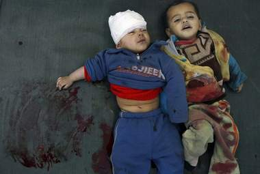

+++
title = "مشاهد القتل .. تبشر بجيل عنيف"
date = 2009-01-19
authors = ["إسماعيل دبارة"]
aliases = ["/articles/20at-politics-10991/"]

[taxonomies]
authors = ["ismail-dabara"]
sections = ["eshtbak"]

[extra]
section_name = "اشتباك"
share_image = "/media/currentarticleassets/3169823511_bcdb773590.jpg"
summary = "مع نشر صور القتل والدماء والأشلاء للشهداء الفلسطينيين التي لم تتورّع الفضائيات والصحف والمواقع الالكترونية عن بثها ليلا ونهارا منذ بدء العدوان الإسرائيلي على غز"
section_slug = "eshtbak"
section_colour = "#E77B13"
thumb = "/media/currentarticleassets/3169823511_bcdb773590.jpg"
n_comments = 0
original_url = "http://20at.com/20at/politics/10991.html"
archived = "20100105192719"
date_source = "byline/meta"
aliases_20at = ["/eshtbak/10991.html", "/20at/politics/10991.html"]

[extra.provenance]
original_url = "http://20at.com/20at/politics/10991.html"
capture_url = "https://web.archive.org/web/20100105192719/http://20at.com/20at/politics/10991.html"
capture_label = "٥ يناير ٢٠١٠، ١٩:٢٧ UTC"
date_note = "من سطر التوقيع في المقال"
other_urls = ["/20at/politics/10991.html"]
comments = ""
missing_images = ""
+++

<figure></figure>

مع نشر صور القتل والدماء والأشلاء للشهداء الفلسطينيين التي لم تتورّع الفضائيات والصحف والمواقع الالكترونية عن بثها ليلا ونهارا منذ بدء العدوان الإسرائيلي على غزة وحتى بعد توقفه؛ تحاول السيّدة سهام فوراتي قدر الإمكان إزاحة ابنيها فهد وجواد عن تلك المشاهد إلى جانب مشاهد هدم البيوت والقصف والغارات..

تقول: "لاحظت تغيرا في سلوكهما منذ بدء العدوان الإسرائيليّ على أهل القطاع، فهما يترقبان عودة والدهما الذي يمكث كثيرا أمام التلفزيون ويبادران بطرح الأسئلة عن أسباب قتل الأطفال ومن يأوي المشردّين؟ وكيف لصبيّ قضت والدته أمام عينيه أن يعيش حياة سليمة؟ .. وعلى الرغم من حداثة عهدهما إلا أنهما يطرحان علينا أسئلة تدلّ عن اضطراب كبير لديهما لما يشاهدانه على الهواء".

أما الابن فهد، 11 عاما، فيحكي لنا كابوسه المؤلم قائلا: "حلمت بنفسي وسط القطاع وأنا أدرس في مدرسة تعرضت للقصف جنبا إلى جنب مع أطفال فلسطينيين، وتخيلت نفسي أحتضنهم.. كم هم لطفاء ..هم لا يستحقون القتل"

تعقب السيدة سهام: "هذا برهان على الخلل النفسي والاضطرابات التي طرأت على سلوك ولديّ في الآونة الأخيرة.. أحمّل المسؤوليّة لزوجي الذي لا يغيّر القنوات الإخبارية، وأيضا الفضائيات التي لا تنتقي ما تبثه".

<h3>إسرائيل هي السبب</h3>

أمام معهد الحبيب بورقيبة وسط العاصمة تونس استوقفنا عدد من التلاميذ وسألناهم عن آثار صور القتل والدماء والأشلاء عليهم..

فراس، 15 سنة، لا تهمّه الجهة التي تبثّ صور الأطفال القتلى والمصابين، فهو يحمّل المسؤولية كاملة "للجزار أولمرت" - على حدّ تعبيره- ويقول: "لنفترض أنّ الفضائيات والصحف امتنعت عن نشر الحقيقة وتواطأت مع إسرائيل في حجب الحقيقة، هل سنعجز نحن الشباب المتعلمين عن الولوج إلى الإنترنت ومتابعة مشاهد فيديو وصور ربما تكون أشنع وأقسى مما تبثه الجزيرة وغيرها؟"

زميلته حنان ساسي، 14 سنة، قالت: "بلا شك أن الله سيحاسب حكام إسرائيل على ما يقترفونه من انتهاكات في حقّ كل سكان العالم"، فأضرار القصف بلغتها شخصيا لما رأت الرّضع قتلى مفصولين الرؤوس والإطراف، وتضيف بألم: "أخشى أن ينجح الإعلام في جعل صور الأطفال القتلى أمرا اعتياديا مما يجعلنا نكتفي بالتفرّج و ننسى واجباتنا تجاه أشقائنا".

<h3>سياسة إعلامية مُوحّدة</h3>

"لم لا تتوافق جلّ الفضائيات الناطقة بالعربية و الصحف على سياسة إعلامية موحّدة"، هذا ما تقوله لمياء ناجي، 22 سنة، وتتابع: "لقد أصبنا بصدمة رهيبة جراء تلك المشاهد الفظيعة التي لا تحترم أبسط المشاعر الإنسانية، على وسائل الإعلام إعادة صياغة ميثاق شرف جديد يراعي نفسية الأطفال و كبار السنّ، فليس كلّ ما يحدث في غزة قابل للنشر".

أما ريّان الناصفي، طالب الاقتصاد، فدعا وسائل الإعلام إلى بث مزيد من الصور الدامية "لعلّ الضمير العالمي يفيق من سباته"، مؤكدا أن كلّ تلك المشاهد لم تعد كافية لتبيان حقيقة ما يجري في الأراضي المحتلة من عدوان همجيّ بربريّ، "علينا نشر صور القتل خصوصا قتل الأطفال عبر أوسع نطاق، شخصيا انشر ما يصلني عبر الفايس بووك وعدد من المدونات لكي يرى العالم ما يجري في القطاع".

<h3>علم النفس يُحذر</h3>

الأخصائية في علم النفس رانيا البحوري، توضح أنّ أكثر ما تخشاه هو أن تؤثر مشاهد قتل الفلسطينيين بذلك الشكل الرهيب على سلوكيات أطفال عالمنا العربي عموما، والأطفال التونسيون غير المتعودين على تلك المشاكل نظرا لأنهم يعيشون في بيئة هادئة وآمنة وهو ما يعرضهم إلى تأثيرات خطيرة بسبب مشاهد القتل.

واعتبرت البحوري أن تعرض الأبناء لمشاهد العنف و إراقة الدماء في التلفزيون وعبر صفحات الجرائد و الانترنت أمرا شديد الخطورة "كونه سيخلّف جيلا من الشباب العنيف والحاقد الذي لا ندري رد فعله في المستقبل".

وشدّدت على أنّ لجهاز التلفاز دور كبير في نشر العنف و إصابة الأبناء بالأمراض النفسية المستعصية، داعية في ذات الوقت الآباء إلى فرض رقابة صرامة على ما يشاهده أبنائهم "فالدم يخلّف دما".

