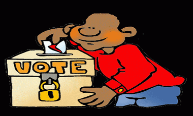

+++
title = "اللوائح الانتخابية.. أزمة شبابية"
date = 2009-02-02
authors = ["محمد الشدادي"]
aliases = ["/articles/20at-politics-11162/"]

[taxonomies]
authors = ["mohamed-elshdadi"]
sections = ["eshtbak"]

[extra]
section_name = "اشتباك"
share_image = "/media/currentarticleassets/amhis_election.gif"
summary = "هل نحن ملزمون بالتسجيل في اللوائح الانتخابية ؟"
section_slug = "eshtbak"
section_colour = "#E77B13"
thumb = "/media/currentarticleassets/amhis_election.gif"
n_comments = 0
original_url = "http://20at.com/20at/politics/11162.html"
archived = "20100105192408"
date_source = "byline/meta"
aliases_20at = ["/eshtbak/11162.html", "/20at/politics/11162.html"]

[extra.provenance]
original_url = "http://20at.com/20at/politics/11162.html"
capture_url = "https://web.archive.org/web/20100105192408/http://20at.com/20at/politics/11162.html"
capture_label = "٥ يناير ٢٠١٠، ١٩:٢٤ UTC"
date_note = "من سطر التوقيع في المقال"
other_urls = ["/20at/politics/11162.html"]
comments = ""
missing_images = ""
+++

<figure></figure>

هل نحن ملزمون بالتسجيل في اللوائح الانتخابية ؟

سؤال يدور بين الشباب المغربي الذين بلغوا سن الرشد (18سنة) خاصة مع اقتراب يوم 13 فبراير الجاري؛ وهو تاريخ انتهاء الفترة المخصصة لإيداع جدول التعديل المؤقت للمشاركة في الانتخابات العامة الجماعية المقبلة بتاريخ 12 يونيو 2009، ويتزامن مع تصريح مدير الانتخابات بوزارة الداخلية السيد حسن اغماري أن "التسجيل في اللوائح الانتخابية إلزامي وإغفاله له تبعات".

التصريحات الرسمية ترى أن "التسجيل في اللوائح الانتخابية واجب وطني"، الغاية منه "انخراط المسجلين الجدد وعموم المواطنين في الحياة الديمقراطية للبلاد"، وأيضا "أداء واجبهم كمواطنين"، إذ بفضل هذا التسجيل سيتمكن الشباب من الحصول على بطاقة الناخب التي تمكنهم من المشاركة في التصويت يوم الاقتراع.

<h3>خلفية انتخابية</h3>

هذا الإلزام في التسجيل في اللوائح الانتخابية، قد يكون نابعا – بحسب تحاليل المختصين في الشأن الانتخابي – من الصورة السوداء والقاتمة التي خلفتها الانتخابات البرلمانية التي جرت في المغرب يوم 7 سبتمبر 2007، حيث قدر عدد الناخبين الذين أدلوا بأصواتهم بـ 37 ٪ فقط من المواطنين!.

أما عضو البرلمان المغربي وعضو المجلس البلدي بالقنيطة السيد عبد العزيز الرباح، فيؤكد أن التصريح "لا يكتسب الصيغة القانونية، ولا يوجد في الدستور المغربي ما يِؤكد ذلك، وقانون الحريات العامة يترك الأمر للأشخاص وذلك خطأ".

<h3>مؤيد ومعارض</h3>

الشباب المغربي انقسمت آراؤه وتعددت بين مؤيد ومعارض حول التسجيل في اللوائح الانتخابية.. فيقول مصطفى، 32 سنة: "أنا سُجلت في اللوائح الانتخابية منذ أن بلغت سن21 سنة وأدليت بصوتي لمن كنت أعرف من أبناء بلدتي، كنا نشارك ليس من منطلق القناعة ببرامج الحزب والمرشح ولكن انطلاقا من حسابات شخصية وعائلية تتحكم فيها الإغراءات المادية التي كنا نستفيد منها".

مصطفى مجرد واحد من مئات السكان الذين يتم تسجيلهم في اللوائح الانتخابية في الأحياء الهامشية ليس خوفا من تصريح مدير الانتخابات بوزارة الداخلية لما يمكن أن يقعوا تحته من تبعات؛ ولكن طلبا في تحقيق مصالحهم الشخصية بعيدا عن دفع الرشاوى.

أما غيره فدواعي الامتناع عن التسجيل عندهم كثيرة، نذكر من بينها وعلى لسانهم "انعدام الإنارة في الأزقة والطرقات، وشوارع لا تصلح حتى لسير الدواب"، ولعل هذه الدوافع مبنية على ضعف أداء المجالس البلدية الماضية وهي التي رسخت هذه القناعة.

أسباب أخرى للامتناع عن التسجيل يسوقها أحد الشباب هي: "بنية تحية هشة، سياسة صناعية ضعيفة، طابور البطالة، أحزاب ضعيفة لا تتواصل مع الشعب إلا أثناء الحملات الانتخابية، مدارس مكتظة، عنف في الشوارع في وضح النهار".

<h3>"والله لن أسجل"</h3>

"ما آلت إليه أوضاع المدن والقرى ليس قدرا مقدرا من السماء بل هو نتاج لسياسات تدبيرية فاشلة متلاحقة"، هذا ما يقوله أحد المواطنين الذين رفضوا التسجيل حتى في اللوائح الانتخابية، مؤكدا: "والله لن أسجل في اللوائح الانتخابية وليكن ما يكن، إن أردوا معاقبة ثلثي الشعب فلا بأس إن كانت هذه هي الديمقراطية".

على النقيض كان رأي إدريس، 32 سنة، يقول: "إن لم نقم نحن بما يجب علينا فمن يقوم به مكاننا؟، هل نترك الأمر لسماسرة الانتخابات وناهبي المال العام؟، فأول نقطة في القطع مع الماضي البائس تنطلق من التسجيل في اللوائح الانتخابية عن وعي وقناعة بأن السبيل الوحيد إلى الديمقراطية والتنمية الشاملة هي صناديق الاقتراع والانتخابات الشفافة والنزيهة".

يؤيد ذات الرأي شاب آخر، بقوله: "إن لم نسجل ولم نصوت فالانتخابات ستكون ستكون، والواقع يفرض علينا ذلك، فلماذا نتأخر أو نتحفظ أو نقاطع، فالحقوق لا تعطى ولكن تنزع.. فهيا بنا للجداول ولنسجل أهدافا لصالحنا وليس ضد مرمانا".

