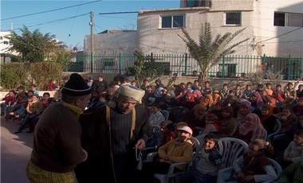

+++
title = "العيشة في فلسطين.. بالك بتهون؟"
date = 2009-03-26
authors = ["رنا خموس"]
aliases = ["/articles/20at-politics-11717/"]

[taxonomies]
authors = ["rana-khmos"]
sections = ["eshtbak"]

[extra]
section_name = "اشتباك"
share_image = "/media/currentarticleassets/bethounn.jpg"
summary = "أبو العبد..خرج يبحث عن عمل بعد أن طرد من عمله بسبب سوء الأوضاع الاقتصادية والحصار الإسرائيلي المفروض على مدينته.. خرج من البيت معصب و(مش طايق ذبان وجهه) فلم يجد"
section_slug = "eshtbak"
section_colour = "#E77B13"
thumb = "/media/currentarticleassets/bethounn.jpg"
n_comments = 0
original_url = "http://20at.com/20at/politics/11717-2009-04-16-07-53-03.html"
archived = "20100105192921"
date_source = "byline/meta"
aliases_20at = ["/eshtbak/11717-2009-04-16-07-53-03.html", "/20at/politics/11717-2009-04-16-07-53-03.html"]

[extra.provenance]
original_url = "http://20at.com/20at/politics/11717-2009-04-16-07-53-03.html"
capture_url = "https://web.archive.org/web/20100105192921/http://20at.com/20at/politics/11717-2009-04-16-07-53-03.html"
capture_label = "٥ يناير ٢٠١٠، ١٩:٢٩ UTC"
date_note = "من سطر التوقيع في المقال"
other_urls = ["/20at/politics/11717-2009-04-16-07-53-03.html"]
comments = ""
missing_images = ""
+++

<figure></figure>

أبو العبد..خرج يبحث عن عمل بعد أن طرد من عمله بسبب سوء الأوضاع الاقتصادية والحصار الإسرائيلي المفروض على مدينته.. خرج من البيت معصب و(مش طايق ذبان وجهه) فلم يجد سوى تسلق الجدار العازل، يحاول فيه العبور إلى القدس المحتلة ليبحث عن عمل في مدينته التي حرم منها، وأثناء تسلقه الجدار قبض عليه جنود الاحتلال وأوسعوه ضربا.

لم ينته مشهد المسرحية بعد، بل استمرت دائرة العنف التي يعاني منها المجتمع الفلسطيني التي تم تجسيدها في عرض مسرحية "بالك بتهون" والتي جابت كثير من مدن الضفة الغربية.

<h3>حلقة عنف مغلقة</h3>

أبو العبد الذي هم على وجهه عائدا إلى المنزل، يصرخ طالبا كوبا من الشاي أو القهوة غاضبا من خلو منزله من كل شيء حتى من كوب مياه للشرب، بسبب قطع الكهرباء والماء عن المنزل لعدم تسديد الفواتير.

صب أبو العبد جام غضبه على زوجته أم العبد، التي تحملت معه شقاء سنين الحياة ومرارتها، وإذ به يعنفها ويضربها ويقسو على ابنه، الذي بالتالي يخرج إلى الشارع ليمارس العنف ضد أقرانه.

عن هذه المسرحية التي عرضت ولا زالت تعرض بالمراكز الثقافية وشوارع الضفة الغربية يقول الكاتب المسرحي سليم دبور:" المسرحية أرادت تسليط الضوء على العنف الأسري ومما يتولد في ظل الظروف الصعبة التي يعيشها الشعب الفلسطيني، خاصة أن الاحتلال يلعب دورا كبيرا في هذا العنف الذي يمارس ضد أفراد الأسرة، نتيجة الضغوط الناتجة عن الاحتلال التي تراكمت من مأساة الشعب الفلسطيني، وبالأساس نواة المجتمع ألا وهي الأسرة، التي تتعرض لتلك الضغوط، فمجريات الحياة التي يعيشها المواطن صعبة وتنعكس سلبا على تصرفاته وردات فعله".

وأوضح دبور لـ"عشرينات" أن حالة الفقر التي يعيشها المواطن الفلسطيني، ما هي إلا حلقة عنف مغلقة، فكان الهدف من المسرحية هو التغلب على الواقع المرير والخروج من الأزمات، لأن هذا يؤدي إلى دمار الأسرة الفلسطينية وهو ما يرده الاحتلال الإسرائيلي، وأردنا بالمسرحية نقل جزء من هذا الواقع ووضع حلول له وجعل منه متنفس لتلك الضغوط.

<h3>نكهة خاصة</h3>

ويرى دبور أن المسرح الفلسطيني له نكهته الخاصة في نقل الواقع المعاش، بالأخص الحياة السياسية والاجتماعية، وبالذات المسرح الفلسطيني لا يخلو من السياسة لذا له طابعه الخاص والمختلف عن المسارح العربية التي تتسم بطابع التسلية والفكاهة والخيال، ولكن هنا لدينا واقع يفوق الخيال ويأخذ الطابع السياسي، وهو أفضل الوسائل التي يمكن استخدامها لنقل الحقائق، وهو أسلوب قديم جدا واثبت نجاحه على مر السنين.

الممثلة أميرة عواد التي لعبت دورا هاما بالمسرحية، ترى أنه من الضروري أن يتم عرض مسرحيات بنفس المعنى بين الحين و الأخر، مؤكدة أن الضغوط التي يتعرض لها المواطن الفلسطيني كثيرة ومؤلمة ولها أثارها السلبي على حياته المجتمعية والنفسية والجسدية، وكافة شرائح المجتمع الفلسطيني يتعرضون لضغوط جمة، مما يولد العنف الأسري، وحتى العنف مع كافة الطبقات، سواء أطفال وطلاب وموظفين.

وأجمع عدد ممن شاهدوا المسرحية أنها تعبر عن حياتهم المعاشة وحالة الشعور بالغضب واليأس، الإحساس الذي تولد نتيجة الحصار الإسرائيلي و نقص المال والوظائف وانقطاع الكهرباء و الماء وكل وسائل الحياة المريحة.

