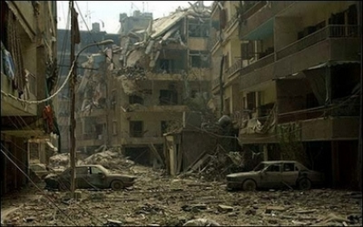

+++
title = "ليال .. كلمة وداع"
date = 2006-07-27

[taxonomies]
authors = []
sections = ["harb"]

[extra]
section_name = "الحرب الآن"
share_image = "/media/admins.20at.com/harb/dahia.jpg.a.jpg"
summary = "لم تكن ليال تبتسم في صورتها الأخيرة، صورتها التي ستُطبع في الذاكرة إلى الأبد."
section_slug = "harb"
section_colour = "#7A1E1E"
thumb = "/media/admins.20at.com/harb/dahia.jpg.a.jpg"
n_comments = 0
original_url = "http://harb.20at.com:80/article.php?sid=60"
archived = "20070323171521"
date_source = "byline/meta"
aliases_20at = ["//harb.20at.com/article.php?sid=60"]

[extra.provenance]
original_url = "http://harb.20at.com:80/article.php?sid=60"
capture_url = "https://web.archive.org/web/20070323171521/http://harb.20at.com:80/article.php?sid=60"
capture_label = "٢٣ مارس ٢٠٠٧، ١٧:١٥ UTC"
date_note = "من سطر التوقيع في المقال"
other_urls = []
comments = ""
missing_images = "١"
+++

لم تكن ليال تبتسم في صورتها الأخيرة، صورتها التي ستُطبع في الذاكرة إلى الأبد.

كانت مستلقية بين أيدي رجال الدفاع المدني، أجفانها مسدلة تخفي عينيها الزرقاوين. كأنها تستريح.

لم تودع ليال (23 عاما) أسرتها التي كانت تنتظر زيارتها بعد ظهر أمس الأحد. أسرتها لم تصدق أنها رحلت، وهي لم تفق بعد من صدمة ذهاب ليال إلى الجنوب. تقول راوية الجواد، خالة ليال لا شيء يمكن أن يردع ليال إذا حزمت أمرها.

والدتها ليلى مرعبي متسمرة في صدر المنزل، تتمتم بكلمات قليلة تخاطب بها ابنتها البكر. تبكي وتعود الى صمتها.

الوالد، العقيد المتقاعد نجيب نجيب، يسرح في ذكرياته. صور ليال الصغيرة تمر في باله واحدة تلو الأخرى، هي التي اتصلت به صباحا لتوصيه بتوخي الحذر بابا أنا بعيدة عن القصف، طمئن ماما علي.

سقطت ليال شهيدة فورا بعد سقوط صاروخ بالقرب من سيارة الأجرة التي كانت تقلها على طريق صديقين قانا، كما يشرح سائق السيارة حسين عبادة، الذي لم يصب بأذى، لوكالة الصحافة الفرنسية.

ساعات قليلة فصلت بين الموت الذي خطف ليال، وبين صوتها المنبعث من الهاتف، مخاطبا والدتها ليلى في طرابلس، لزرع قليل من الطمأنينة في قلبها، ولكن لا شيء إلا ألم غير محدود، يسكن قلب العائلة الآن.. يسكن قلب والدها نجيب، وأختها ريان (21 عاما)، وأخيها محمد (16 عاما).

سيبقى الكثير من ليال، ستبقى صور التقطتها للضاحية الجنوبية، في أرشيف وكالات أنباء عالمية تتعاون معها. يقول مسؤول قسم التصوير في الوكالة الفرنسية رمزي حيدر، إن الوكالة لم تكلف يوما ليال بمهمة، إلا انها كانت تتمتع بروح حماسية جدا، دفعتها الى قصد الجنوب يومي أمس وأمس الأول.

<figure></figure>

يتذكر رمزي اليوم، ما كرره مساء أمس الأول لليال، عندما عادت من الجنوب، الصورة لن تدخلك التاريخ، محولا تحذيرها من المخاطرة بحياتها.

بدورها، تقول رئيسة تحرير مجلة الجرس نضال الأحمدية، إن المجلة كانت تعد ملفا خاصا عن الحرب وألحت ليال في طلب الذهاب إلى الجنوب، فرضخت المجلة بعد تأكيد ليال أنها ستكون بأمان برفقة عدد من الزملاء الصحافيين. ولكن الأحمدية لم تكن تدرك أنها ستخاطر بحياتها وتقصد قانا.

لا أحد يدري كم مرة فقدت ليال ابتسامتها الدائمة على طرقات الجنوب. لا أحد يمكن أن يتكهن جرأة ابنة الأعوام الثلاثة والعشرين التي دفعتها إلى حمل آلة التصوير، وتركيز عدستها والانطلاق الى هدفها: تصوير الجنوب.

وقد نعت أسرة الجرس الزميلة الشهيدة، وأدانت بربرية العدو الصهيوني التي قتلت زهرة الصحافة، ليال نجيب (23 عاما)، مواليد طرابلس الشمال، التي بدأت عملها في المجلة في كانون الثاني ,2004 واحترفت التصوير في شباط ,2005 وعشقت الكاميرا فقتلها العدو الصهيوني لأنها حرة وحرة وحرة.

كما استنكرت نقابة المصورين الصحافيين في لبنان جرائم العدو الصهيوني التي تمارس ضد المدنيين والصحافيين والمؤسسات الاعلامية، داعية المؤسسات الدولية، خاصة جمعية مراسلين بلا حدود، والأمم المتحدة، لفضح خروقات العدو لكل القوانين الدولية.

مصور صحافي آخر، نجا من الموت أمس، هو محمد مسرّة من الوكالة الأوروبية، كان من المفترض أن يقصد الجنوب مع ليال في السيارة نفسها، كما يقول مسؤول قسم التصوير في الوكالة نبيل منذر، إلا أن عطلا تقنيا في آلاته، أدى إلى تأخر محمد عن موعد الانطلاق، فنجا من موت وشيك.

من يوصل ليال الى طرابلس تحت القصف؟

______________________________

*نقلا عن

<a href="https://web.archive.org/web/20070323171521/http://www.maktoobblog.com/abirjaber">مدونة عبير جابر</a>

