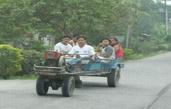

+++
title = "سوق على مهلك .. تروق"
date = 2008-05-22
authors = ["رانيا الشاعر"]

[taxonomies]
authors = ["rania-elshaar"]
sections = ["harb"]

[extra]
section_name = "الحرب الآن"
share_image = "/media/admins.20at.com/aly/056.jpg"
summary = "- حاسب يا عم"
section_slug = "harb"
section_colour = "#7A1E1E"
thumb = "/media/admins.20at.com/aly/056.jpg"
n_comments = 0
original_url = "http://www.harb.20at.com:80/newArticle.php?sid=3244"
archived = "20080522193447"
date_source = "first-capture"
aliases_20at = ["//harb.20at.com/newarticle.php?sid=3244"]

[extra.provenance]
original_url = "http://www.harb.20at.com:80/newArticle.php?sid=3244"
capture_url = "https://web.archive.org/web/20080522193447/http://www.harb.20at.com:80/newArticle.php?sid=3244"
capture_label = "٢٢ مايو ٢٠٠٨، ١٩:٣٤ UTC"
date_note = "تاريخ أول لقطة في الأرشيف (لا يوجد تاريخ في المقال)"
other_urls = []
comments = ""
missing_images = ""
+++

<figure></figure>

- حاسب يا عم

- أنت حاسب، أنت مش شايف

- تعال يمين.

- هو كل يوم كدة...

سيناريو يتكرر تقريبا يوميا بين قائدي السيارات، والنتيجة حوادث تصادم ومشادات وتعطيل للمرور..

لكن هل يمكن لنا أن نتفادى ذلك؟، بالطبع ممكن من خلال اتخاذ بعض الإجراءات للوصول لمكانك بالسلامة...

<h3>أولا لابد من عمل فحص بسيط للسيارة قبل التحرك بها، مثل:</h3>

- افتح أنوار السيارة كلها وقم بالدوران حولها للتأكد أن كل الأنوار تعمل.

- ابحث عن أية آثار لتسرب وقود من السيارة أو سوائل تساقطت منها.

- التأكد من سلامة الإطارات .

- اضبط المرايا والمقعد قبل تشغيل السيارة، لضبط المرآة اليسرى ضع رأسك عند زجاج الباب الأيسر لترى الجزء الأيسر من السيارة، واذا كنت تريد ضبط المرآة اليمنى حرك رأسك في اتجاه منتصف السيارة واضبط المرآة بنفس الطريقة.

- ارتدِ حزام الأمان دائماً قبل التحرك بالسيارة.

<h3>إرشادات عامة للقيادة</h3>

أثناء القيادة..عندما تتحول إشارة الانطلاق للأخضر انظر يسارك ثم يمينك، ثم أمامك ثم يسارك مرة أخرى قبل التقدم، حتى تتأكد أن السيارات الآتية من الجهة الأخرة لن تتخطى إشارة الوقوف الخاصة بها.

- انظر في المرآة لترى السيارات خلفك كل 6-8 ثواني.

- اذا كان الطريق الذي تسير فيه مكان مخصص لركن (صف) السيارة خذ حذرك فقد يفتح أحدهم باب سيارته ليخرج منها فتصتدم به.

- توقع الخطأ من الآخرين، فكر ماذا ستفعل اذا أخطأ أحدهم، مثلاً: توقع ألا تقف سيارة ما في الإشارة وجهز نفسك لو حدث ذلك ماذا ستفعل.

- عندما تذهب لتملأ الوقود تأكد أنه لا يوجد تسرب وتأكد من مستوى الزيت.

- عند تعطل سيارتك لا تتركها وتذهب، توجه للجانب الأيمن من الطريق وأضئ النور لتراك السيارات القادمة واطلب المساعدة من المختصين.

- اترك مسافة بينك وبين السيارة التي أمامك.

- لا تتكلم في المحمول أثناء القيادة فهذا يشغل تركيزك ويساعد على زيادة الحوادث بنسبة 400% ولو كان لابد من استعمال التليفون توقف حتى تنتهي من المكالمة.

- تجنب القيادة اذا كنت مجهداً.

- تأكد من وجود صندوق الأدوات الأساسية بالسيارة.

- اذا كان لديك موعد، اذهب مبكراً بمقدار 10 دقائق، السرعة لن تفيدك لتصل في الموعد ولكنها تزيد من فرص عدم وصولك نهائياً، مع مراعاة عند تحديد ميعاد نزولك أنه قد يحدث بعض التأخير بسبب بطء الحركة أوانخفاض الرؤية، أو حدوث تصادم في الطريق عطل حركة السير...

<h3>للشتاء ظروفه</h3>

القيادة في الشتاء مع الأمطار والبرد تخلق تحدياً كبيراً للسيارة وللسائقين، وتتطلب هذه الأجواء الحذر والسيطرة الكاملة في كل الأوقات كما أن الحفاظ على السيارة بحالة جيدة يقلل من فرص الحوادث أثناء القيادة.

ولكي تجهز سيارتك لمواجهة فصل الشتاء عليك باجراء فحص شامل عليها:

<h3>النظام الكهربائي:</h3>

أولا: شحن البطارية أو تغييرها اذا كانت ضعيفة.

ثانيا: التأكد من سلامة جميع الأسلاك الداخلية.

ثالثا: فحص كل الأنوار بالسيارة: الأمامية، الجانبية، الإشارات، نور الفرامل و الإنتظار...

<h3>الفرامل (المكابح):</h3>

- فحص الفرامل والتأكد من جودتها.

<h3>الإطارت:</h3>

- التأكد من متانة الاطارات واختيار الاطارات المناسبة لسيارتك.

- فحص ضغط الهواء مع العلم أنه يتأثر بانخفاض درجات الحرارة.

- ضبط الزوايا والإتزان.

<h3>نظام العادم:</h3>

- فحص نظام العادم للتأكد من عدم وجود تسريب.

<h3>مساحات الزجاج الأمامي:</h3>

- التأكد من عملها بكفاءة وتغيرها اذا كانت قديمة.

- ملء قربة الماء الخاص بالزجاج بالماء والصابون المناسب.

<h3>الوقود :</h3>

لا تدع مستوى الوقود ينخفض للحد الأدنى لأن الوصول إلى المحطة التالية قد يستغرق وقتا أطول من المتوقع.

<h3>نصائح عامة لسيارتك في الشتاء:</h3>

اختيار ملابس دافئة ومريحة تساعدك على القيادة.

- سخن السيارة جيداً قبل الانطلاق إن كان نوع محرك سيارتك يحتاج إلى التسخين (تستطيع أن تعرف ذلك من دليل الاستعمال)، ولكن لا تفعل ذلك داخل جراج مغلق.

- ارتداء النظارات الشمسية في الأيام المشرقة حتى ترى جيدا.

- لا تسرع كثيرا خاصة في الشتاء حتى تتجنب الحوادث خاصة إذا كنت الشوارع مبتلة.

- اخفض السرعة عند التقاطعات فربما لا تتمكن من التوقف أو الفرملة في الوقت المطلوب.

- استخدام الإشارات عند تغيير الاتجاه.

- تحلّ بالصبر ومرر السيارات الأخرى اذا كنت تستطيع ذلك.

- كن صادقا مع نفسك بخصوص قدرتك على القيادة، اسأل أصدقائك عن مهاراتك في القيادة وكن مستعداً للتعامل مع تعليقاتهم بإيجابية.

- إذا تعرضت لحادث حاول أن تعرف نقاط القوة والضعف حتى لا تتكرر مرة أخرى، أسال نفسك بعد الحادث، هل كان نتيجة سوء قيادتك أو اذا كان الحادث نتيجة خطأ الآخرين كيف يمكن أن تتفاداه في المرة القادمة؟!

- اذا كنت تشعر بالنعاس تنحى عن الطريق وارتح قليلاً أو اغسل وجهك حتى تفيق ثم ابدأ القيادة من جديد.

- كن أكثر حذراً بالليل لأن معدلات الحوادث أعلى بكثير من تلك التي تحدث أثناء النهار.

بهذا نكون قد وصلنا للمحطة الأخيرة، نتمنى لكم قيادة آمنة بدون حوادث...

<h3>9c4c</h3>

موضوع رايق جدا من حد فايق قوى

أرسل هذا التعليق بواسطة : بيبو

الموضوع سوفت جدا جدا عكس الموضوع التانى اللى مش قدرت اكمله .. بس احان عاوزين موضوعات من ديه كتير

سلام

ياسيدتي دي نصائح تقوليها لواحد مسافر أوروبا ولا حاجة

بس هنا في مصر ممكن تحذي حذوا الأستاذ شعبان في نصائحه الغالية في أغنيته وفيها يقول

خد بالك من الكمين لا الظابط يمسكك

أوراقك لوسليمة ولا عمره يقلبك ...

بلاش شغل الأونطة خليك في الأمان

متجبش حزام شنطة .. تعمله حزام أمان وأييييييييييييييييييييييييه

فينك من زمان؟

أرسل هذا التعليق بواسطة : واحد من الناس

والله من زمان وانا كنت بدور على كتاب الاشارات علشان امتحان القيادة اصلى كنت عايز اطلع رخة لو كنت اعرف انك عندك نسخه من الكتاب كنت اخدته منك على فكرة انا قبل ما اروح اطلع الرخصة اتصلت بصديق لتله انا رايح اعمل رخصة وشوفلى حد من معارفك يوصى عليا قالى والله اللى اعرفه فالمرور مش عايز يتوسط علشان رمضان وكل سنة وانت طيب هو صايم وخايف من ربنا قالى خليها بعد رمضان على طول قلت وعلى ايه انا رايح واللى يحصل يحصل ودخلت امتحنت ولاقيت بجد امتحان السواقة تافه لدرجة ان اللى مش يعمله مرتثين تلاتة من غير تدريب عليه مخصوص يبقى مش يستحق رخصة ومش عارف ليه البنت اللى امتحنت قبلى واللى امتحنت بعدى جاية تطلع رخصة يتلهو على عينهم دول مش بيعرفو يسوقو اصلا الامتحان اهبل جدا وفرحت اوى لما الظابط سقطهم فالكشف وعرفت انا احنا بلد فعلا عكس ما يقال عنها وتانى يوم رحت اتصور علشان استلم الرخصة وبعد ما اتصورت فوجئت فايدى باربع رخص ورقة واحدة قال ايه انزل غلفهم وقطعهم ووزعهم على زمايل وانكشحو من هنا عايزين ايه تانى وحانت منى التفاتة فضوليه على التلات رخص التانين لافاجاء برخصتين يخصو البنتين الساقطين اللى واحدة منهم معرفتش تطلع بالعربية برة التراك بعد ما شاطط كل العساكر قدامها والتالتة لواحدة ممتحنتش اصلا بس عندها مقومات تخلينى لو مسؤل اديها رخصة عربية مش رخصة سواقة ورخصتى الغلبانة وصورتى انكمشت فوسط 3صور ل3 عربيات قصدى بنات ومن يومها وانا بدور على اى خبر عنهم فالحوادث واكيد هلاقى

