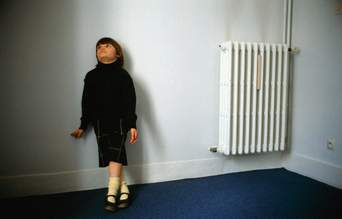

+++
title = "التوحد..الإعاقة الغامضة"
date = 2008-05-22
authors = ["شيماء فايد"]

[taxonomies]
authors = ["shaimaa-faid"]
sections = ["harb"]

[extra]
section_name = "الحرب الآن"
share_image = "/media/admins.20at.com/do3a2/twahod.jpg"
summary = "في دراسة حديثة بكلية كينج ومعهد ستانفورد ببريطانيا أجريت على 15 ألف طفل تتراوح أعمارهم ما بين الثانية والسادسة، وجد أن نسبة الإصابة بمرض \"التوحد\" وصلت إلى نحو 1"
section_slug = "harb"
section_colour = "#7A1E1E"
thumb = "/media/admins.20at.com/do3a2/twahod.jpg"
n_comments = 0
original_url = "http://www.harb.20at.com:80/newArticle.php?sid=3254"
archived = "20080522193452"
date_source = "first-capture"
aliases_20at = ["//harb.20at.com/newarticle.php?sid=3254"]

[extra.provenance]
original_url = "http://www.harb.20at.com:80/newArticle.php?sid=3254"
capture_url = "https://web.archive.org/web/20080522193452/http://www.harb.20at.com:80/newArticle.php?sid=3254"
capture_label = "٢٢ مايو ٢٠٠٨، ١٩:٣٤ UTC"
date_note = "تاريخ أول لقطة في الأرشيف (لا يوجد تاريخ في المقال)"
other_urls = []
comments = ""
missing_images = ""
+++

<figure></figure>

في دراسة حديثة بكلية كينج ومعهد ستانفورد ببريطانيا أجريت على 15 ألف طفل تتراوح أعمارهم ما بين الثانية والسادسة، وجد أن نسبة الإصابة بمرض "التوحد" وصلت إلى نحو 17 حالة في كل 10 آلاف طفل، وهي ما تعد زيادة بمعدل أربع أضعاف عن السنوات السابقة!!

حتي يومنا هذا لم تحدد أسباب بعينها للإصابة بمرض التوحد Autism الذي يصيب الأطفال، لكنها مجموعة من العوامل والإضطرابات التي تصيب المخ، ولا يزال البحث جاريا عن الأسباب..

فما هو مرض التوحد؟ وما هي طرق علاجه؟

التوحد بحسب تعريف الجمعية الأمريكية للتوحد هو إعاقة تطوريه تظهر دائماً في الثلاث سنوات الأولى من العمر وذلك نتيجة من الاضطرابات العصبية التي تؤثر على وظائف المخ وتسبب ضعف في التواصل اللفظي والغير لفظي، وضعف في التواصل الاجتماعي وأنشطة اللعب التخيلي، وقد بدأ التعرف علي هذا النوع من الإعاقة عام 1943علي يد طبيب أمريكي يدعى ليوكانر.

<h3>طفلي مصاب بالتوحد</h3>

تروي لنا سلوى محمد، قصة إبنها "رأفت" الذي يبلع من العمر خمسة أعوام، فتقول: انه مصاب بقليل من التوحد، حيث يعاني من تأخر في الكلام رغم أنه يفهم كل شي حوليه، كما أنه يتكلم عبارات قصيرة لا تزيد عن ثلاث كلمات غير مضبوطة الضمائر والأزمنة، كما أنه لا يركز في أي سؤال ولا بد من تكراره عدة مرات، لكنه يحفظ أفلام الكرتون والإعلانات والأغاني، كما أنه يركز جيدا وهو يجري ويلعب تركيز يفوق التركيز الطبيعي.

أما خديجة أشرف، فتخبرنا أن ابنها "محمود " سلوكه شديد العدوانية ويُحدث إصابات شديدة لزملائه في الحضانة، يحب سماع الأغاني ويغضب عند غلق الكاسيت، يحب السهر، وعند النوم يهمهم بكلمات غير مفهومه.

بينما تحكي وفاء احمد، أن طفلتها لديها نشاط زائد وتعاني من عدم التركيز وعدم الانتباه، عنيده جدا لكنها حادة الذكاء، شخصيتها قوية، قليلة النوم ، شديدة البكاء، تحب مشاهدة التليفزيون وسماع شرائط الكاسيت، لا تخاف ولا تخجل، فإذا أرادت دخول الحمام تخلع ملابسها أمام الجميع،لا ينفع معها العقاب!

<h3>أعراض التوحد</h3>

الدكتورة "منال دحروج" - أخصائية تقويم اضطرابات النطق واللغة – تقول : التوحد هو إعاقة نمائية أي أنها تحدث في الطفولة، وتستمر طوال العمر، وله أعراض مثل أن يتصرف الطفل وكأنه لا يسمع من حوله فلا ينظر لمن يكلمه ولا يهتم به، يكره أن يحتضنه أحد، يقاوم طرق التعليم التقليدية، لا يخاف ، يردد كلام الآخرين، لا يحب اللعب مع الأطفال، يضحك في أوقات غير مناسبة، يبكي بشدة لأسباب غير معروفة، يقاوم الروتين، لا يستطيع التعبير عما يؤلمه، يفقد الخيال والإبداع، يفقد القدرة على الاتصال والتواصل.

<h3>علاج التوحد</h3>

أما الدكتورة "سلوي حسين"- أخصائية تخاطب بمدرسة النور والأمل – فتواصل الحديث عن أعراض التوحد قائلة : من أعراض مرض التوحد أيضا أداء حركات مكررة بالأيدي أو الأصابع، الاهتمام بالأشياء المتحركة، الاهتمام بتفاصيل الأشياء، الخربشة علي الأبواب، تكرار حركات جسدية على شكل زوايا أو خطوط مستقيمة، إيذاء الذات أو الآخرين، الصراخ أو إصدار أصوات معينة والتحدث بكلام غير مفهوم بشكل مكرر ونمطي، الارتباط غير المبرر بأشياء معينة، الاضطراب عند تغيير روتين معين، الاهتمام غير المبرر بأصوات معينة، جمع أشياء بدون هدف، عمل طقوس معينة عند النوم.

تضيف : أما عن العلاج بالنسبة للطفل المصاب بمرض التوحد فلابد أن نأخذ في الاعتبار أهمية الكشف المبكر عند ملاحظة مثل هذه الأعراض، ليبدأ العلاج والتأهيل ..الذي قد يكون عن طريق العلاج الدوائى حيث تستخدم بعض العقاقير لتقليل النشاط الزائد، أو علاج الصرع إن وجد أوالإكتئاب.

أما العلاج بالتخاطب فيكون لمواجهة قصور النموّ اللغوي والقدرة على الاتصال والتواصل الاجتماعي، أما العلاج النفسي فيكون للطفل الذي يعاني من تأخير لغوي، حيث يساعد العلاج النفسي في ضبط وتعديل السلوك.

<h3>بعيد عن التوحد</h3>

وأخيرا تقدم الخبيرتان نصائح للآباء والأمهات الذين رزقوا بأبناء مصابين بهذا المرض:

1- تحديد ما يرغب فيه الطفل من لعب ومشاهدة برامج معينه أو سماع أغاني معينه ومحاولة تحقيقه له، واجتناب ما يضايقه.

2- التعرف علي النظام الروتيني الذي يحبه الطفل وتلبيته في الطعام والملبس والمأكل.

3- لابد من تحديد ما يجيده من جوانب الحياة.

4- التقرب إليه بعلاقات الجسدية (الملامسة باليد – السير معه – قول له كلام رقيق) .

5- على الأبوين أن يجمعا أكبر قدر من المعلومات حول حالة طفلهما.

6- محاولة التوجه إلى المؤسسات التي تعتني بالأطفال ذوي الحاجات الخاصة.

<h3>4b6e</h3>

شكرا

أرسل هذا التعليق بواسطة : محمد محسن

شكرا جزيلا عن هذا المقال المكتوب بأسلوب سهل وسلس عن مرض غامض وشكرار لتوضيح الاعراض الخاصة بالمرض بكثير من الدقة

لبنان

أرسل هذا التعليق بواسطة : nour

الف شكر اولا على الموضوع ولكن لي راي اخر بالنسبة للتاخير بالنطق اللغوي هذا لا يعني انه مرض اكثر الاطفال لا ينطقون مبكرا واعتقد هذه وراثة .. وليش مرض .. لدينا بالعائلة الولد لا ينطق جيدا قبل الخمس ستوات وبعدها يتكلم بطلاقة قوية

ولو اعتقدنا اي حركة من هذه الحركات هي مرض توحد فلنقل كل الاطفال مرضى بها المرض لان الطفل من الصعب تحديد هويته لانه بطبعه متقلب وفضولي وكل يوم يتغير سلوكه هذا راي عن تجارب بتربية 8 اطفال

وشكرا

القاهرة

أرسل هذا التعليق بواسطة : ياسرسلامة

اشكرك جدا على هذا المقال الرائع وان تابعنا لكنك لم تذكري شئ غامض كما يوضح عنوانك مع العلم ان هذه الحالات تقع تحت عنوان الحالة الغامضة فعلا لكن المقال مختصر جداا ويحتاج الي بحث اكثر ........ شكرا لك

أى معلومة جديدة تعظيم سلام

أرسل هذا التعليق بواسطة : مجدى محمود جبر

شكرا على أى معلومة جديدة مع شكرى وتقديرى للدكتور / محمد نادر من المنصورة على جهده الكبير فى مجال الطفل التوحدى

أرسل هذا التعليق بواسطة : رشا لطفي

شكرا جزيلا على هذا المقال المفيد والمبسط ولكني سمعت كثيرا انه يجب على الاهل أن يحالون منع الطفل عن كل الاشياء التي تبعده وتعزله عن البيئة المحيطة مثل مشاهدة الاغاني لفترة كبيرة حتى ولو كان يحبها ويفضلها وهذا يتعارض مع كلام حضرتك فما صحة هذا الكلام أرجو افادتي وشكرا

أخي متوحد نصف معالج

أرسل هذا التعليق بواسطة : سماح يازجي

انا اخي لديه التوحد؛عمره 17 سنة انا اكبر منه بثلاث سنوات

اذكر تماما كل طفولته وكل هذه التصرفات كانت تبدو عليه تماما الان اخي تخلص من الكثير من هذه التصرفات

واستطيع القول انه اصبح بعكس ما كان؛فهو الذي كان يخلع كل ثيابه عندما يريد الدخول الى الحمام الان يصرخ بشدة اذا شاهده احدهم نصف عاري اي بثيابه الداخلية وبدلا من انعزاله الشديد عندما كان طفلا حتى انه كان يبعدني عنه بشدة الان لا استطيع ان اتخلص من معانقته وتحرشه بي (عالطالعة والنازلة)لكن مازالت تصرفاته اصغر من عمره بالاضافة الى عصبيته الشديدة

اتمنى حقا ان اتواصل مع اي مركز او اي احد لديه حالات مشابهة علنا نستطيع ان نساعد قليلا

هؤلاء الذين هم حقا بحاجة لنا بعيدا عن سخافات المجتمع الذي يعتبرهم مختين عقليا

اذا لم نقل (مجانين)

اثابكم الله

أرسل هذا التعليق بواسطة : قمر عز الدين

شكرا جزيلا على هزه المعلومات القيمة عن هزا المرض اللعين الزى لطالما تساءلت عنه اثابكم الله وشفى جميع مرضى هزا المرض

اخي متوحد نصف معالج

أرسل هذا التعليق بواسطة : سماح يازجي

انا طلبت المساعدةولم اتلقى اي رد

لو سمحتو

اطلب المشاركة معا للوصول الى افضل مستوى علاجي للتوحد

HYTHAM_CHC@YAHOO.COM

أرسل هذا التعليق بواسطة : هيثم حسين

انا طالب باماجستير واشكركم على تلك المعلومات الجيدة عن التوحد

فلسطين _غزة

أرسل هذا التعليق بواسطة : حاتم ماضي

انا اسمى حاتم ...ادرس ارشاد نفسي ..سنة 3 ,

ارجو من المتخصصين ان يساعدونى في علاج حالة من حالات التوحد لانه انا بفلسطين في مدينة غزة ولا يوجد مراكز علاج وعمر الخالة 5 سنوات وهاذا ايميلى nadia_killed_me@hotmail.com

وهذا رقمى 00972599344970

معا لعلاج افضل

أرسل هذا التعليق بواسطة : سماح يازجي

اقترح ان نبحث سويا لايجاد علاج ناجع وفعال لهذا المرض

ايمانا منا بمقدرة الله على كل شيء

اقترح عليكم اعزائي القراء

ان نتعاون سويا لايجاد اي شيء من الممكن ان يساعد في القضاء على هذا المرض

ايميلي هو katya_katy2001@yahoo.com

انتظر تعليقاتكم

مصر

أرسل هذا التعليق بواسطة : MM

المرض دة زادت نسبته أوي بس اللي بيحزني إن مفيش مراكز كافية في مصر لرعاية المتوحدين

البحث عن الاسباب

أرسل هذا التعليق بواسطة : بيشوى عوض

انا بيشوى مدرب اتعامل مع اولاد التوحد يوجد عندى بعض الحالات الصعبة التى تحتاج الى دراسة انا اريد مزيد من المعلومات عن كيفية تعليم الاولادوالتعامل معهم بطريقة صحيحة وعن اسباب المرض وطريقة التعليم المفضلة لكى يعتمد على نفسة فى رعاية الذات والنظافة الشخصية وتجهيز الاطعمة البسيطة ويكون لة دور فى المجتمع فعال كيف نصل الى وشكرا

تعريف المرض

أرسل هذا التعليق بواسطة : mohamed

المرجو منكم التعريف بهدا المرض قدر المستطاع علئ جميع الوسايل الأعلامية لتفادي الدرر قبل فوات الأوان لأن العلاج يستدعي البدء مبكرا.وشكرا تكم

هل تناقشونا

أرسل هذا التعليق بواسطة : محمد عبدالله

السلام عليكم

فعلاً هذا مرض هام ويجب النقااش فيه ايضاً نحن نتناقش حول هذا المرض على هذا الرابط فأرجو التعاون معنا

http://alzar3.com/vb/t2968.html

