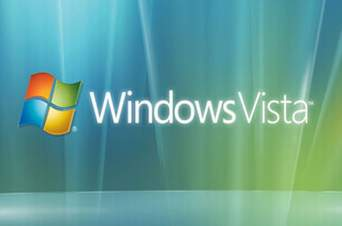
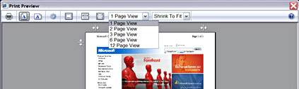
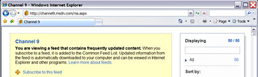
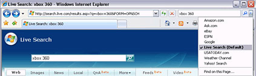
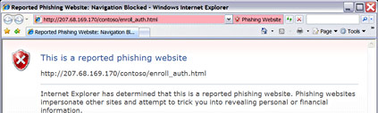

+++
title = "حملت Windows Internet Explorer.."
date = 2008-05-22

[taxonomies]
authors = []
sections = ["harb"]

[extra]
section_name = "الحرب الآن"
share_image = "/media/admins.20at.com/aly/windows-vista.jpg"
summary = "بعد طول انتظار تم إطلاق النسخة العربية من متصفح الإنترنت الشهير IE 7 ، حيث يأتي هذا الإصدار بالعديد من المميزات والتطويرات التي تجعله من أفضل المتصفحات في ظل ال"
section_slug = "harb"
section_colour = "#7A1E1E"
thumb = "/media/admins.20at.com/aly/windows-vista.jpg"
n_comments = 0
original_url = "http://www.harb.20at.com:80/newArticle.php?sid=4578"
archived = "20080522193457"
date_source = "first-capture"
aliases_20at = ["//harb.20at.com/newarticle.php?sid=4578"]

[extra.provenance]
original_url = "http://www.harb.20at.com:80/newArticle.php?sid=4578"
capture_url = "https://web.archive.org/web/20080522193457/http://www.harb.20at.com:80/newArticle.php?sid=4578"
capture_label = "٢٢ مايو ٢٠٠٨، ١٩:٣٤ UTC"
date_note = "تاريخ أول لقطة في الأرشيف (لا يوجد تاريخ في المقال)"
other_urls = []
comments = ""
missing_images = ""
+++

<figure></figure>

بعد طول انتظار تم إطلاق النسخة العربية من متصفح الإنترنت الشهير IE 7 ، حيث يأتي هذا الإصدار بالعديد من المميزات والتطويرات التي تجعله من أفضل المتصفحات في ظل التنافس الكبير بينها.

ومن أهم التغييرات التي طرأت على المتصفح في إصداره الجديد أن تم تغيير اسمه منMicrosoft Internet Explorer إلىWindows Internet Explorer والذي قد يعني بان هذا المتصفح لن يعمل إلا مع نظام ويندوز فقط!

<h3>مميزات متعددة</h3>

أما بالنسبة للبرنامج فقد تميز بالكثير من المميزات منها:

1- واجهه سهلة ومساحة أكبر لفتح المواقع.

<figure></figure>

2- خاصية الـ Tabs والتي تتيح لك فتح أكثر من موقع في نافذة المتصفح الرئيسية دون الحاجة لفتح المتصفح أكثر مرة كما في الإصدار السابق.

3- أصبح المتصفح أكثر مرونة لطباعة أي صفحة أو صورة مباشرة من أي موقع انترنت وبخيارات عديدة دون الحاجة لاستخدام أي برنامج آخر لضبط الصفحة قبل الطباعة.

<figure></figure>

4- دمج خاصية RSS مع المتصفح للحصول على أخر الأخبار والتطورات للمواقع الإخبارية أو من أي موقع يدعم هذه الخاصية دون الحاجة لأي برنامج آخر للاستفادة من هذه الخاصية.

<figure></figure>

5- تم دمج خاصية البحث في المتصفح ومع إمكانية اختيار محرك البحث المفضل إليك، كذلك بإمكانك إضافة أي محرك بحث غير موجود بالمتصفح ليكون هو محرك البحث الافتراضي إليك.

<figure></figure>

6- تم الاهتمام بأمن المتصفح بشكل رئيسي خاصة ضد المواقع المشبوهة والتي قد تحتوي على ملفات تجسس.

<figure></figure>

<h3>بعض السلبيات</h3>

ولا يخلو الإصدار كذلك من بعض السلبيات، مثل البطء وعدم التوافق الجيد مع بعض المواقع، كذلك فهذا الإصدار يتطلب وجود حزم الأمان الثانية Service Pack 2 في الويندزو، كما يتطلب ان تكون نسخة الويندوز أصلية ومسجلة برقم تسجيل مفّعل!

<h3>حمل الإصدار</h3>

لتحميل Internet Explorer 7.0 .. اختر النسخة المناسبة لك من حيث اللغة و النظام.

<h3>e45b</h3>

و على إيه تعب القلب ؟؟؟؟

أرسل هذا التعليق بواسطة : واحد معدي

(( كما يتطلب ان تكون نسخة الويندوز أصلية ومسجلة برقم تسجيل مفّعل! ))

يعني م الآخر ملووووش لاازمــــــــــــة !!!!

متأخر أوي

أرسل هذا التعليق بواسطة : أحمد

كل هذه الإضافات أنا أستخدمها من أكثر من سنة مع المتصفح الرائع FireFox و أستخدمه من على Linux و بالعربي .

FireFox افضل متصفح إنترنت إستخدمته ..أدعوكم لتجربته ...و يوجد نسخه منه تعمل على النظام الرديء Windows !!

ربنا يتوب عليكم من Windows ويفك أسركم.

لا حول ولا قوة إلا بالله

أرسل هذا التعليق بواسطة : عمرو الشرنوبي

إيه يا جدعان؟ هوا أنتم مايكروزفت دافعالك رشاوي؟ وللا بيل جيتس كان قريب حد فيكم؟

يا جماعة بجد حرام عليكم ... أنتم عارفين كويس جدا أن الفايرفوكس أفضل ...

وعارفين برضه أن سياسات مايكروزفت القذرة لا هي في صالحنا كشعوب ... ولا حتى في صالح التقدم التقني بوجه عام

يعني موضوع ويندوز فيستا ... وقلنا الراجل اتعمل له غسيل مخ في المؤتمر اللي راحه

لكن إنترنت زفتلبورر كمان؟؟؟؟ دا كتير قوي بصراحة

أرسل هذا التعليق بواسطة : واحد معدي صدفة

انترنيت أكسبلورر ايه .. اطلع ليكم أكثر من 30 ثغرة أمنية في المتصفح الجديد ، كمان ده مسروق عيني عينك من فايرفوكس ، يعني مش كفاية انه محتكر كمان .. حرامي ههههه ، و زي مقال الأخوة اللي علقوا قبلي مالوش لازمة

لسه بدري عليع قوي علي ما يحصل فاير فوكس

أرسل هذا التعليق بواسطة : م/كريم منير

بالفعل فاير فوكس اكتر من رائع

انا جربت اكسبلورر 7 قلت يمكن بقي فيه الخير

مالقتش اي ميزة زادت عن فاير فوكس لكن العكس فاير فوكس اقوي واسرع وفي تابس وفيع ريستور للصفحات اللي اتقفلت بشكل غير شرعي وخاصة مع واحد زيي بيفتح اكتر من 15 صفحة مع بعض وفيه انتي بوب وبيقلص حجم الصور عشان يفتح اسرع واقوي مع اللغة العربية وأأمم ميت مرة

بعد كل الميزات دي اروح لاكسبلورر

مستحييييييييييييييييل

ضع عنوان التعليق الفاير احسن بكتير

أرسل هذا التعليق بواسطة : اكتب اسمك هنا ضد الاكسبلورر

زى الشباب ما قالوا الفاير فوكس احسن بكتير

وبعدين انا اعرف واحد جرب الاكسبلورر ده وضرب له نسخه الويندوز

يعنى برنامج فااااااااااااااااااااااااااشل

ودمتم بود :)

مصر

أرسل هذا التعليق بواسطة : bazemus79

افضل متصفحين فى العالم هما opera و firefox .

طبعاً فاير فوكس أفضل

أرسل هذا التعليق بواسطة : أحمد شطا

منذ فترة قصيرة أستعمل fire fox و أشعر بفرق كبير بينه و بين منتجات مايكرو زفت

الحمد لله الزى هدنا للولا ان هدنا الله انا حرين على الى بيحصل فى العرب والاسلام

ليا سؤالين

أرسل هذا التعليق بواسطة : كتكوتة

انا باستعمل الفاير فوكس من اول مانزل وبجد اللي يجربه مايفكرش انه يدور على انترزفت اكسبلورر ده خاااالص وكل المميزات دي موجودة في فاير فوكس 2 والاحسن منه انه اسرع بكتير وفي مزاياكتير جدا اكبر من اننا نحصرهامثلا اذا ضغطت زر (الكونترول ) في لوحة المفاتيح وحركت زر الماوس الاوسط ( العجلة ) يكبر لك حجم الكلام اللي في اتلصفحة اللي مرات لامتناهية والعكس ودي حاجة اكتشفتها صدفه

بس انا ليا سؤالين عند الاخوة اللي ليهم خبرة هو اصله ايه يعني منين اصله مين صاحبة السؤال التاني اني لما بافتح بعض الصفحات بيكون جزء منها مختفي على جمب ومش قادرة اعرف العيب فين ياريت حد يجاوبني

11 شارع اولاد الشيخ

أرسل هذا التعليق بواسطة : منة

نفسى اسجل حلقات برنامج على باب الجنة

تعليق

أرسل هذا التعليق بواسطة : kebboud

يا أخوة قبل الحديث عن فاير فوكس أو الأنترنت أكسبلورر إنتبهوا إلى هذا المستوى الضعيف للعربية التي تتكلمون بها

يا اخوة كفاكم ابتعادا عن لغتكم العربية الجميلة التي تتسع لكل العلوم والمعارف والتقنيات ، يا اخوة حان الأوان للتصالح مع لغتكم العربية المقدسة والرجوع إليها .... أما الفاير فوكس أو الأنترنت أكسبلورر فهذه برامج صنعها الغرب أما نحن العرب المساكين الجهلة فنتنافس بيننا في وصف و ومدح هذا البرنامج أو ذاك ...لماذا لا يكون عندنا نحن العرب برنامج متصفح عربي مئة في المئة هل هم أذكى منا ؟ هل الله سبحانه وتعالى خلق لهم عقلا ليس لدينا ؟ يجب الرجع إلى لغتنا العربية الجميلة أقوى و أقدم لغة في العالم و الرجوع إلى العلم والبحث و الإستفادة من الآخرين كما استفادوا هم منا من قبل

و في الأخير أرجو المراسلة على kebboud@maktoob.com

