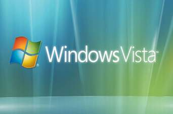

+++
title = "Vista من أجل التغيير"
date = 2008-05-22
authors = ["البراء أشرف"]

[taxonomies]
authors = ["elbaraa-ashraf"]
sections = ["harb"]

[extra]
section_name = "الحرب الآن"
share_image = "/media/admins.20at.com/aly/windows-vista.jpg"
summary = "بالإضافة للميزات العديدة الموجودة في الإصدار الجديد، فإن هناك ميزة نوعية لا تعلمها شركة Microsoft، وهي أن نظامها الجديد \"\"Vista\"\" منعها من أن تكسب لنفسها عدوا ج"
section_slug = "harb"
section_colour = "#7A1E1E"
thumb = "/media/admins.20at.com/aly/windows-vista.jpg"
n_comments = 0
original_url = "http://www.harb.20at.com:80/newArticle.php?sid=4580"
archived = "20080522193502"
date_source = "first-capture"
aliases_20at = ["//harb.20at.com/newarticle.php?sid=4580"]

[extra.provenance]
original_url = "http://www.harb.20at.com:80/newArticle.php?sid=4580"
capture_url = "https://web.archive.org/web/20080522193502/http://www.harb.20at.com:80/newArticle.php?sid=4580"
capture_label = "٢٢ مايو ٢٠٠٨، ١٩:٣٥ UTC"
date_note = "تاريخ أول لقطة في الأرشيف (لا يوجد تاريخ في المقال)"
other_urls = []
comments = ""
missing_images = ""
+++

<figure></figure>

بالإضافة للميزات العديدة الموجودة في الإصدار الجديد، فإن هناك ميزة نوعية لا تعلمها شركة Microsoft، وهي أن نظامها الجديد ""Vista"" منعها من أن تكسب لنفسها عدوا جديدا لمنتجاتها.. هذا العدو هو.. أنا!

كنت على وشك أن أكره Microsoft ومنتجاتها إلى الأبد، وكاد زميلي مصعب أن ينجح في خطته لاستقطابي لأصبح "أوبن صورصيا" مثله.. لكن الحمد لله الذي أدام علينا نعمة النوافذ (Windows) وإصدارها الجديد.. ""Vista""..

الأسبوع الماضي تلقيت دعوة لحضور مؤتمر صحفي وحفل استقبال تقيمه شركة Microsoft Egypt بمناسبة تدشينها لإصدارها الجديد من الويندوز بالإضافة إلى النسخة الجديدة المطورة من الأوفيس..

نسخة الويندوز التي تحمل اسم ""Vista"" هي الإصدار الذي طال انتظار وصوله ليدي مستخدمي الكومبيوتر في العالم كله بعد أن أعلنت شركة Microsoft العالمية تأجيلها لموعد طرحه أكثر من مرة سابقة نظرا لأنها تريد إجراء تعديلات على النسخة فيما يتعلق بالحماية والرفاهية!

<h3>الكلمتان السحريتان</h3>

الحماية والأمان هما الكلمتان السحريتان لنظام "Vista"، فإجراءات الأمن التي تتبعها Microsoft ربما تقلل من حدة الهجوم الذي تتعرض له مع كل إصدار جديد من نظام التشغيل الأكثر انتشارا في العالم كله.. يكفي أن تعرف أن ميزانية إطلاق هذا النظام تجاوز الـ20 مليار دولار حسب تصريحات كريم رمضان مدير عام شركة Microsoft مصر!

فقد كانت الشكوى الرئيسية التي تتلقاها Microsoft من عملاءها حول العالم تتعلق بمستوى كفاءة نظم الحماية وعجزهم عن مواجهة البرامج غير المرغوب فيها أو التي يتم تثبيتها بدون علم المستخدم.. لهذا السبب زودت نظامها الجديد بخاصية الـwindows Defender التي تعمل بشكل دائم على حماية الجهاز من أي محاولات قرصنة أو عمليات اختراق عبر البرامج غير الآمنة أو أحصنة طروادة، وهي البرامج التي أكدت الدراسات أن ثلثي عملاءها يعانون منها على أجهزتهم الشخصية!

<h3>السريع</h3>

المحور الثاني الذي ركزت عليه Microsoft في إصدارها الجديد كان يتعلق بالرفاهية وسرعة الأداء للمستخدم، وهو ما جعلهم يطرحون على أنفسهم سؤالا مهما.. "كيف يصل المستخدم لمعلوماته في النظام؟؟، وكيف يستطيع "Vista" توفير الوقت والطاقة لزيادة سرعة حصوله على المعلومات؟؟"..

الدراسات تقول أن الموظف الأمريكي يضيع كل عام 14 ألف دولار في الوقت الذي يهدره في البحث عن معلوماته والتنقل بين الملفات العديدة على جهازه للبحث عن وثيقة وورد مثلا..

"Vista" يتيح للمستخدم الآن البحث في كل ملفات جهازه بمجرد كتابة اسم الملف أو كلمة من الكلمات الواردة فيه أو حتى كلمة مرتبطة بنوع الملف، حتى لو كان هذا الملف وورد أو حتى PDF..

أيضا يوفر "Vista" البحث داخل الصور من خلال اسمها أو تصنيفها.. ويعيد ترتيب الصور بناء على تصنيفها بمجرد دخولها للجهاز، البحث لا يتقف عند الصور فقط.. بل في صفحات الويب وأيضا في الرسائل الإليكترونية الواردة لك!

<h3>السحر الإكتروني</h3>

كفانا كلام عن "Vista".. فقط لكم أن تعرفوا أنه قطعة من السحر الإليكتروني الحقيقي الذي كنا نشاهده في أفلام الخيال العلمي منذ سنوات.. لن أحدثكم عن الشكل وسأتركه لخيالكم.. لكن اعلموا فقط أنه يستحق أن تستخدموه..

المفاجأة التي فجرها كريم رمضان في المؤتمر الصحفي الذي حضرته، هي المواصفات التي يج توافرها في جهازك لتحصل على نسخة "Vista"، فالجهاز يتطلب فقط 256 رام، وبروسيسور 800 ميجا.. وهي مواصفات قليلة ومتواضعة جدا بالنسبة لمستخدمي الشرق الأوسط.. خصوصا وأن مظمهم يمتلك أجزة حديثة لأن عمر استخدامهم للكومبيوتر ليس كبيرا!

كذلك فإن "Vista" تم تعديله أكثر من مرة ليتوافق مع جهاز المستخدم، فمثلا لو كانت سرعة الجهاز محدودة فإن "Vista" يتوافق معها بإلغاء الجرافيك والخلفيات ثلاثية الأبعاد للتوفير في السرعة لصالح البرامج التي يتم استخدامها!

كريم أكد أن سعر "Vista" لن يزيدعن سعر آخر نسخة من XP وهي حوالي 125 دولار.. كذلك فإنه أشار إلى أن النسخة التي تم طرحها في السوق يوم 12 ديسمبر هي مخصصة للشركات وتطلب إمكانيات خاصة ولها استخدامات عديدة قد لا يحتاجها المستخدم العادي..

أما النسخة المخصصة للمستخدم العادي في المنزل أو الأجهزة المحمولة.. فسيتم طرحها لاحقا في فبراير 2007!

هل انتهت القصة.. الحقيقة أن ما قرأته هو نصفها فقط..

<h3>ready for a new day</h3>

الجزء الثاني من إصدار Microsoft هو الأوفيس.. أو بمعنى أدق office system 2007 ... هل لاحظت كلمة "system".. أنت تعرف بالتأكيد أن معناها "نظام".. وتعرف أن الأوفيس هو مجرد برنامج.. كيف تحول البرنامج إلى نظام.. هذا ما شرحه لنا مسئول التسويق في Microsoft في ساعة كاملة..

وثيقة الوورد أصبحت الآن متاحة لأن يعمل عليها أكثر من مستخدم في وقت واحد، وبالنسبة للأوت لوك.. فقد تغير شكله ومضمونه تماما.. أصبحت الآن عبر الأوفيس الجديد قادرا على الاتصال بجهازك من تليفونك المحمول وسماع رسائلك عبر الهاتف..

هل مللت الشكل القديم للوورد.. لقد تغير تماما.. هل تريد أن تحصل على عرض للباور بوينت بمنتهى البساطة.. الآن تستطيع أن تفعلها في ثلاث نقرات فقط..

الأوفيس الجديد أكبر من أن يتم شرحه.. لأن استخدامه هو الطريقة الوحيدة لمعرفته والتمتع به.. ال

Microsoft التي تواجه انتقادات عديدة منذ إطلاقها لـXP.. تقول أن "Vista" والأوفيس هما قفزتها التالية بعد نظام تشغيلها الذي أطلقته في 95.. هي تراهن بالكثير من أجل نظامها الحالي.. وتعلن أنها أصبحت قادرة للرد على مناهضيها.. وأن "Vista" يوفر لهم ما لم يكونوا يتوقعوه..

"Vista" الذي تأخر الإعلان عنه كثيرا، استمرت النسخة التجريبية منه BETA 2 لفترة طويلة في شركات عديدة حول العالم لتطويره وتنقيحه، في مصر مثلا وقعت Microsoft مع شركات عديدة لتطوير "Vista" جعله يتواؤم أكثر مع المستخدم المصري..

السؤال الذي يطرحه "Vista" على المستخدم وعلى السوق كله هو .. "Ready for a new day?".. وهو السؤال الذي يحمله "Vista" على شعاره الجديد.. فهل سيشهد السوق يوما جديدا مع "Vista" فعلا أم أن الغد لن يختلف كثيرا عن البارحة!

 أهم التغييرات التي طرأت علي المتصفح في إصداره الجديد

<h3>079e</h3>

الكتابة حلوة، لكن المضمون...

أرسل هذا التعليق بواسطة : مصعب

ماشي يا البراء يا ابني،

مش هأخلي منتجات ميكروسوفت توقع ما بيننا

بص يا ابني أنا في كام نقطة هأوضحهم هنا، ونقاااااااااااااط أخى كثيرة لا يتسع المجال لذكرها هأحطها في مقال إن شاء الله

1) أنا مش متعصب للأوبن سورس أو ضد ميكروسوفت، أنا بأحترم أي حاجة "محترمة" سواء كانت تجارية أو مفتوحة المصدر أو أي شكل تاني من أشكال التعامل، المهم تكون محترمة، ودي اللي تاريخ وسلوكيات ميكروسوفت ما حققتهمش على طول الخط..

2) أنا بأحترم "عقلية" بيل جيتس جدا لأنه قدر يعمل حاجة، بس بأكره "تصرفاته" ... بس!

دي بس النقط اللي هأقولها هنا، الباقي (وهو كتييييييير أوي) في المقال الجاي بإذن ربك

بس كتابتك حلوة جدا :)

بحبك يا صاحبي...

تقدم غربي وتخلف

أرسل هذا التعليق بواسطة : عبدالله

السلام عليكم مصر تاكل بعضها و طظ في افكار ولادها لو في امكانيات اتفرج علي الشباب خلي الاخوان يفرحو

رأيي في مايكروسوفت

أرسل هذا التعليق بواسطة : أحمد القطب

نحن المتخصصون في مجال تقنية المعلومات نرى مايكروسوفت تماماً مثل الحكومة المصرية، جهة تحتكر القوة وتحتقر الناس.. نحن المصريون لم نثق يوماً في الحكومة المصرية ولا في قراراتها.. وأنا كرجل يعمل في هذا المجال منذ عام 2000 لم أثق يوماً في مايكروسوفت ولا في أي منتج من منتجاتها..

وأنا بصراحة باحلم باليوم اللي يبقى عندي فيه كمبيوتر أبل بنظام ماكنتوش.... آاااااااااااااااااه

معلومات اضافية

أرسل هذا التعليق بواسطة : علي

شكرآ للموضوع لكن انبهار الكاتب بغسيل المخ الذي قدمته ميكروسوفت لم بعجب الكثيرين وانا منهم فللمعلومية الاتحاد الاوربي رفع قضية احتكار وعدم مطابقة ضد ميكروسوفت حيث ان الفيستا بشكلها الجديد لا تدعم الا معالجات الثنائية النواة بشكل يجعلها تعمل بكل كفائتها وغير ذلك فالمعالجات القديمة والتي معظم المستخدمين يمتلكونها لا يستطيعون الحصول على كامل مميزاتها فنات تدفع اكثر لتحصل على اقل وهذا غش وتدليس. ومن ناحية أخرى لا يفوتنا خيار الترقية او الابغريد للأكس بي والذي تغافلت عمه ميكروسوفت فالخيار هذا صار شبه غير محسوب وغير متوفر. واخيرآ اتذكر على صدى هذه الضجة الكبيرة ضجة الاكس بي والويندوز 2000 حيث انه ميكروسوفت بالغت بوصف الاكس بي لدرجة انها صارت تبيع الاحلام بينما الواقع يقول ان الفرق بين الاثنين هو الرسومات والثيمات وبعض النوافذ والخيارات الجديدة فقط لا غبر بينما بشتركان بنفس النواة الواحدة.

تحياتي للجميع

تعليقا على تعليق علي

أرسل هذا التعليق بواسطة : مصعب

أوافقك تماما خاصة أن هذه سياسة الشركة منذ قديم الأزل، وخصوصا مع ظهور windows NT

جبت الكلام ده منين؟!!

زوروا هذا الرابط تجدوا كل شيء موثقا

http://roughlydrafted.com/RD/Q4.06/4E2A8848-5738-45B1-A659-AD7473899D7D.html

كويس

أرسل هذا التعليق بواسطة : ميدو

كويس.

فيستا

أرسل هذا التعليق بواسطة : مختبر برمجيات

انا عن رأيى انة كعادة ميكروسوفت فى كل برامجها ستقوم بالاهتمام بالمنظر الذى يوحى لك انك تستخدم شئ خيالى ذو امكانيات رهيبة بينما ان الواقع هو ان النظام مثلة مثل سابقة و الاختلاف فقط فى المنظر و بعض الامكانيات عديمة الاستخدام التى يقوموا بالدعاية لها ليجعلوك تعتقد انك لن تستطيع العيش بدون هذة الامكانية بينما هى فى الواقع لا فائده لها.

و عند القراءة عن الامكانيات التى تحتاجها اتشغيل فيستا فهى فى الواقع كما قال كاتب الموضوع ولكنه اغفل اهم شئ و هو ان هذة الامكانيات لتشغيل فيستا بدون AERO و الذى يعتبر اهم شئ فى الفيستا و هو نظام نوافذ ثلاثى الابعاد و لتشغيلة تحتاج الى 1جيجا رامات و معالج بينتيوم 4 و هذة الامكانيات ليست متوفرة لاغلبنا بالطبع وبعد كل هذا ستكتشف انة هو نفسة XP و لكن متخفى وراء دعاية و هميه بأسم جديد

فيستا

أرسل هذا التعليق بواسطة : مختبر برمجيات

انا عن رأيى انة كعادة ميكروسوفت فى كل برامجها ستقوم بالاهتمام بالمنظر الذى يوحى لك انك تستخدم شئ خيالى ذو امكانيات رهيبة بينما ان الواقع هو ان النظام مثلة مثل سابقة و الاختلاف فقط فى المنظر و بعض الامكانيات عديمة الاستخدام التى يقوموا بالدعاية لها ليجعلوك تعتقد انك لن تستطيع العيش بدون هذة الامكانية بينما هى فى الواقع لا فائده لها.

و عند القراءة عن الامكانيات التى تحتاجها اتشغيل فيستا فهى فى الواقع كما قال كاتب الموضوع ولكنه اغفل اهم شئ و هو ان هذة الامكانيات لتشغيل فيستا بدون AERO و الذى يعتبر اهم شئ فى الفيستا و هو نظام نوافذ ثلاثى الابعاد و لتشغيلة تحتاج الى 1جيجا رامات و معالج بينتيوم 4 و هذة الامكانيات ليست متوفرة لاغلبنا بالطبع وبعد كل هذا ستكتشف انة هو نفسة XP و لكن متخفى وراء دعاية و هميه بأسم جديد

فيستا

أرسل هذا التعليق بواسطة : مختبر برمجيات

انا عن رأيى انة كعادة ميكروسوفت فى كل برامجها ستقوم بالاهتمام بالمنظر الذى يوحى لك انك تستخدم شئ خيالى ذو امكانيات رهيبة بينما ان الواقع هو ان النظام مثلة مثل سابقة و الاختلاف فقط فى المنظر و بعض الامكانيات عديمة الاستخدام التى يقوموا بالدعاية لها ليجعلوك تعتقد انك لن تستطيع العيش بدون هذة الامكانية بينما هى فى الواقع لا فائده لها.

و عند القراءة عن الامكانيات التى تحتاجها اتشغيل فيستا فهى فى الواقع كما قال كاتب الموضوع ولكنه اغفل اهم شئ و هو ان هذة الامكانيات لتشغيل فيستا بدون AERO و الذى يعتبر اهم شئ فى الفيستا و هو نظام نوافذ ثلاثى الابعاد و لتشغيلة تحتاج الى 1جيجا رامات و معالج بينتيوم 4 و هذة الامكانيات ليست متوفرة لاغلبنا بالطبع وبعد كل هذا ستكتشف انة هو نفسة XP و لكن متخفى وراء دعاية و هميه بأسم جديد

فيستا

أرسل هذا التعليق بواسطة : مختبر برمجيات

انا عن رأيى انة كعادة ميكروسوفت فى كل برامجها ستقوم بالاهتمام بالمنظر الذى يوحى لك انك تستخدم شئ خيالى ذو امكانيات رهيبة بينما ان الواقع هو ان النظام مثلة مثل سابقة و الاختلاف فقط فى المنظر و بعض الامكانيات عديمة الاستخدام التى يقوموا بالدعاية لها ليجعلوك تعتقد انك لن تستطيع العيش بدون هذة الامكانية بينما هى فى الواقع لا فائده لها.

و عند القراءة عن الامكانيات التى تحتاجها اتشغيل فيستا فهى فى الواقع كما قال كاتب الموضوع ولكنه اغفل اهم شئ و هو ان هذة الامكانيات لتشغيل فيستا بدون AERO و الذى يعتبر اهم شئ فى الفيستا و هو نظام نوافذ ثلاثى الابعاد و لتشغيلة تحتاج الى 1جيجا رامات و معالج بينتيوم 4 و هذة الامكانيات ليست متوفرة لاغلبنا بالطبع وبعد كل هذا ستكتشف انة هو نفسة XP و لكن متخفى وراء دعاية و هميه بأسم جديد

فيستا

أرسل هذا التعليق بواسطة : مختبر برمجيات

انا عن رأيى انة كعادة ميكروسوفت فى كل برامجها ستقوم بالاهتمام بالمنظر الذى يوحى لك انك تستخدم شئ خيالى ذو امكانيات رهيبة بينما ان الواقع هو ان النظام مثلة مثل سابقة و الاختلاف فقط فى المنظر و بعض الامكانيات عديمة الاستخدام التى يقوموا بالدعاية لها ليجعلوك تعتقد انك لن تستطيع العيش بدون هذة الامكانية بينما هى فى الواقع لا فائده لها.

و عند القراءة عن الامكانيات التى تحتاجها اتشغيل فيستا فهى فى الواقع كما قال كاتب الموضوع ولكنه اغفل اهم شئ و هو ان هذة الامكانيات لتشغيل فيستا بدون AERO و الذى يعتبر اهم شئ فى الفيستا و هو نظام نوافذ ثلاثى الابعاد و لتشغيلة تحتاج الى 1جيجا رامات و معالج بينتيوم 4 و هذة الامكانيات ليست متوفرة لاغلبنا بالطبع وبعد كل هذا ستكتشف انة هو نفسة XP و لكن متخفى وراء دعاية و هميه بأسم جديد

فيستا

أرسل هذا التعليق بواسطة : مختبر برمجيات

انا عن رأيى انة كعادة ميكروسوفت فى كل برامجها ستقوم بالاهتمام بالمنظر الذى يوحى لك انك تستخدم شئ خيالى ذو امكانيات رهيبة بينما ان الواقع هو ان النظام مثلة مثل سابقة و الاختلاف فقط فى المنظر و بعض الامكانيات عديمة الاستخدام التى يقوموا بالدعاية لها ليجعلوك تعتقد انك لن تستطيع العيش بدون هذة الامكانية بينما هى فى الواقع لا فائده لها.

و عند القراءة عن الامكانيات التى تحتاجها اتشغيل فيستا فهى فى الواقع كما قال كاتب الموضوع ولكنه اغفل اهم شئ و هو ان هذة الامكانيات لتشغيل فيستا بدون AERO و الذى يعتبر اهم شئ فى الفيستا و هو نظام نوافذ ثلاثى الابعاد و لتشغيلة تحتاج الى 1جيجا رامات و معالج بينتيوم 4 و هذة الامكانيات ليست متوفرة لاغلبنا بالطبع وبعد كل هذا ستكتشف انة هو نفسة XP و لكن متخفى وراء دعاية و هميه بأسم جديد

فيستا

أرسل هذا التعليق بواسطة : مختبر برمجيات

انا عن رأيى انة كعادة ميكروسوفت فى كل برامجها ستقوم بالاهتمام بالمنظر الذى يوحى لك انك تستخدم شئ خيالى ذو امكانيات رهيبة بينما ان الواقع هو ان النظام مثلة مثل سابقة و الاختلاف فقط فى المنظر و بعض الامكانيات عديمة الاستخدام التى يقوموا بالدعاية لها ليجعلوك تعتقد انك لن تستطيع العيش بدون هذة الامكانية بينما هى فى الواقع لا فائده لها.

و عند القراءة عن الامكانيات التى تحتاجها اتشغيل فيستا فهى فى الواقع كما قال كاتب الموضوع ولكنه اغفل اهم شئ و هو ان هذة الامكانيات لتشغيل فيستا بدون AERO و الذى يعتبر اهم شئ فى الفيستا و هو نظام نوافذ ثلاثى الابعاد و لتشغيلة تحتاج الى 1جيجا رامات و معالج بينتيوم 4 و هذة الامكانيات ليست متوفرة لاغلبنا بالطبع وبعد كل هذا ستكتشف انة هو نفسة XP و لكن متخفى وراء دعاية و هميه بأسم جديد

فيستا

أرسل هذا التعليق بواسطة : مختبر برمجيات

انا عن رأيى انة كعادة ميكروسوفت فى كل برامجها ستقوم بالاهتمام بالمنظر الذى يوحى لك انك تستخدم شئ خيالى ذو امكانيات رهيبة بينما ان الواقع هو ان النظام مثلة مثل سابقة و الاختلاف فقط فى المنظر و بعض الامكانيات عديمة الاستخدام التى يقوموا بالدعاية لها ليجعلوك تعتقد انك لن تستطيع العيش بدون هذة الامكانية بينما هى فى الواقع لا فائده لها.

و عند القراءة عن الامكانيات التى تحتاجها اتشغيل فيستا فهى فى الواقع كما قال كاتب الموضوع ولكنه اغفل اهم شئ و هو ان هذة الامكانيات لتشغيل فيستا بدون AERO و الذى يعتبر اهم شئ فى الفيستا و هو نظام نوافذ ثلاثى الابعاد و لتشغيلة تحتاج الى 1جيجا رامات و معالج بينتيوم 4 و هذة الامكانيات ليست متوفرة لاغلبنا بالطبع وبعد كل هذا ستكتشف انة هو نفسة XP و لكن متخفى وراء دعاية و هميه بأسم جديد

Microsoft Certified Professional

أرسل هذا التعليق بواسطة : فارس ربيع

أنا صحيح معايا شهادة من مايكروسوفت بس أنا برضه لازم أقول الحق على حسب معلوماتي

الموضوع ان مايكروسوفت عندها من زمان عائلتين من نظم التشغيل

1- 9X ودي معمولة لمستخدمي المنازل

2- NT ودي معمولة للشركات

ميكروسوفت نزلت نظام تشغيل قنبلة من ناحية الأداء والاستقرار والأمان .... النظام ده ويندوز 2000 وطبعا نظام التشغيل ده نجح نجاح ساحق على مستوى الشركات لدرجة ان شركات كتير جدا ما زالت تستخدم نظام ويندوز 2000 بعد 7 سنوات من اصداره

الموضوع بقى ان مايكروسوفت كانت عاوزة تستثمر النجاح الساحق لويندوز 2000 وخاصة مع الفشل الذريع لويندوز ميلينيوم في اصدار نسخة ويندوز موجهة لمستخدمي المنازل وتكون في نفس الوقت في نفس قوة ويندوز 2000 من هنا جت فكرة دمج فوة ويندوز 2000 ( أو عائلة NT ) مع سهولة وبساطة عائلة 9X وبدأ العمل في ويندوز اكس بي اعتمادا على النواة الخاصة بويندوز 2000 وتطويرها واضافة شكل جذاب لمستخدمي المنازل.

طبعا كل ما كانت واجهة المستخدم فيها مؤثرات أكتر .. كل ما كان استهلاك الموارد أعلى وبالتالي احتياج امكانيات عتاد أعلى لكن في نفس الوقت جذب تسويقي أكبر للمستخدمين المبهورين بالشكل الجديد.

اكس بي ... مع شكله الجديد نجح نجاح ساحق بدلالة عدد الأجهزة التي تعمل بنظام ويندوز اكس بي في العالم ولذلك كان لازم ميكروسوفت تركز في النظام الجديد على الشكل لأن الشريحة الأكبر من المستخدمين من غير المتخصصين تبحث عن الشكل بدون الاهتمام بأشياء أخرى ...

ويندوز اكس بي تعرض لهجمات أمنية خطيرة جدا قبل اصدار الحزمة الخدمية الثانية ... صحيح معظم الهجمات دي كان الخطأ الأكبر فيها على المستخدمين لكن برضه ده كان لازم يوضع في الحسبان في نسخة الويندوز الجديدة وعشان كده تأجل اطلاقه أكتر من مرة

مشكلة ميكروسوفت الأساسية من أول ويندوز 95 لحد النهاردة انها مبتعملش نظام تشغيل من الصفر أبدا ... لازم تبني نظام التشغيل على النظام اللي قبله وده بيعمل تراكم للمشاكل اللي في الويندوز.

ده طبعا غير سعر نسخة الويندوز المبالغ فيه.

من ناحية تانية أنا شخصيا بعتبر ان برمجيات المصادر المفتوحة أكثر سهولة في الاختراق لأن الهاكر يقدر يشوف الشفرة بتاعت البرنامج ويحللها ويطلع الثغرات الموجودة ويهاجمها. الهجمات كتير على ويندوز وميكروسوفت بسبب نسبة الأجهزة اللي بتشتغل بويندز في العالم ورأيي ان لما لينكس يبقى نسبته في العالم نفس النسبة دي ... هيتعرض لكمية هجمات قد كده و ممكن أكتر. أنا بحب لينكس جدا اشتغلت عليه فترة ... بس عيبه الوحيد انه مش معقول أدوخ السبع دوخات عشان أعرف كارت أو مودم ومش معقول أقعد ربع ساعة عشان أعرف أنزل برنامج.

أنا بحترم مايكرسوفت جدا .... بس بيدايقني جدا انهم عندهم كل الامكانيات اللي تخليهم أحسن من كده كتير ومنساش أبدا كنت بتكلم مع واحد من شركة ميكروسوفت نفسها فسألته ميكروسوفت ليه مبتعالجش مشاكل كتير معروفة في الويندوز ؟

قاللي : المشاكل كلها ميكروسوفت عارفاها بس لو حليتها مرة واحدة هتبيعلك ايه بعد كده !

معلش ... طولت عليكم

Microsoft Certified Professional

أرسل هذا التعليق بواسطة : فارس ربيع

أنا صحيح معايا شهادة من مايكروسوفت بس أنا برضه لازم أقول الحق على حسب معلوماتي

الموضوع ان مايكروسوفت عندها من زمان عائلتين من نظم التشغيل

1- 9X ودي معمولة لمستخدمي المنازل

2- NT ودي معمولة للشركات

ميكروسوفت نزلت نظام تشغيل قنبلة من ناحية الأداء والاستقرار والأمان .... النظام ده ويندوز 2000 وطبعا نظام التشغيل ده نجح نجاح ساحق على مستوى الشركات لدرجة ان شركات كتير جدا ما زالت تستخدم نظام ويندوز 2000 بعد 7 سنوات من اصداره

الموضوع بقى ان مايكروسوفت كانت عاوزة تستثمر النجاح الساحق لويندوز 2000 وخاصة مع الفشل الذريع لويندوز ميلينيوم في اصدار نسخة ويندوز موجهة لمستخدمي المنازل وتكون في نفس الوقت في نفس قوة ويندوز 2000 من هنا جت فكرة دمج فوة ويندوز 2000 ( أو عائلة NT ) مع سهولة وبساطة عائلة 9X وبدأ العمل في ويندوز اكس بي اعتمادا على النواة الخاصة بويندوز 2000 وتطويرها واضافة شكل جذاب لمستخدمي المنازل.

طبعا كل ما كانت واجهة المستخدم فيها مؤثرات أكتر .. كل ما كان استهلاك الموارد أعلى وبالتالي احتياج امكانيات عتاد أعلى لكن في نفس الوقت جذب تسويقي أكبر للمستخدمين المبهورين بالشكل الجديد.

اكس بي ... مع شكله الجديد نجح نجاح ساحق بدلالة عدد الأجهزة التي تعمل بنظام ويندوز اكس بي في العالم ولذلك كان لازم ميكروسوفت تركز في النظام الجديد على الشكل لأن الشريحة الأكبر من المستخدمين من غير المتخصصين تبحث عن الشكل بدون الاهتمام بأشياء أخرى ...

ويندوز اكس بي تعرض لهجمات أمنية خطيرة جدا قبل اصدار الحزمة الخدمية الثانية ... صحيح معظم الهجمات دي كان الخطأ الأكبر فيها على المستخدمين لكن برضه ده كان لازم يوضع في الحسبان في نسخة الويندوز الجديدة وعشان كده تأجل اطلاقه أكتر من مرة

مشكلة ميكروسوفت الأساسية من أول ويندوز 95 لحد النهاردة انها مبتعملش نظام تشغيل من الصفر أبدا ... لازم تبني نظام التشغيل على النظام اللي قبله وده بيعمل تراكم للمشاكل اللي في الويندوز.

ده طبعا غير سعر نسخة الويندوز المبالغ فيه.

من ناحية تانية أنا شخصيا بعتبر ان برمجيات المصادر المفتوحة أكثر سهولة في الاختراق لأن الهاكر يقدر يشوف الشفرة بتاعت البرنامج ويحللها ويطلع الثغرات الموجودة ويهاجمها. الهجمات كتير على ويندوز وميكروسوفت بسبب نسبة الأجهزة اللي بتشتغل بويندز في العالم ورأيي ان لما لينكس يبقى نسبته في العالم نفس النسبة دي ... هيتعرض لكمية هجمات قد كده و ممكن أكتر. أنا بحب لينكس جدا اشتغلت عليه فترة ... بس عيبه الوحيد انه مش معقول أدوخ السبع دوخات عشان أعرف كارت أو مودم ومش معقول أقعد ربع ساعة عشان أعرف أنزل برنامج.

أنا بحترم مايكرسوفت جدا .... بس بيدايقني جدا انهم عندهم كل الامكانيات اللي تخليهم أحسن من كده كتير ومنساش أبدا كنت بتكلم مع واحد من شركة ميكروسوفت نفسها فسألته ميكروسوفت ليه مبتعالجش مشاكل كتير معروفة في الويندوز ؟

قاللي : المشاكل كلها ميكروسوفت عارفاها بس لو حليتها مرة واحدة هتبيعلك ايه بعد كده !

معلش ... طولت عليكم

Microsoft Certified Professional

أرسل هذا التعليق بواسطة : فارس ربيع

أنا صحيح معايا شهادة من مايكروسوفت بس أنا برضه لازم أقول الحق على حسب معلوماتي

الموضوع ان مايكروسوفت عندها من زمان عائلتين من نظم التشغيل

1- 9X ودي معمولة لمستخدمي المنازل

2- NT ودي معمولة للشركات

ميكروسوفت نزلت نظام تشغيل قنبلة من ناحية الأداء والاستقرار والأمان .... النظام ده ويندوز 2000 وطبعا نظام التشغيل ده نجح نجاح ساحق على مستوى الشركات لدرجة ان شركات كتير جدا ما زالت تستخدم نظام ويندوز 2000 بعد 7 سنوات من اصداره

الموضوع بقى ان مايكروسوفت كانت عاوزة تستثمر النجاح الساحق لويندوز 2000 وخاصة مع الفشل الذريع لويندوز ميلينيوم في اصدار نسخة ويندوز موجهة لمستخدمي المنازل وتكون في نفس الوقت في نفس قوة ويندوز 2000 من هنا جت فكرة دمج فوة ويندوز 2000 ( أو عائلة NT ) مع سهولة وبساطة عائلة 9X وبدأ العمل في ويندوز اكس بي اعتمادا على النواة الخاصة بويندوز 2000 وتطويرها واضافة شكل جذاب لمستخدمي المنازل.

طبعا كل ما كانت واجهة المستخدم فيها مؤثرات أكتر .. كل ما كان استهلاك الموارد أعلى وبالتالي احتياج امكانيات عتاد أعلى لكن في نفس الوقت جذب تسويقي أكبر للمستخدمين المبهورين بالشكل الجديد.

اكس بي ... مع شكله الجديد نجح نجاح ساحق بدلالة عدد الأجهزة التي تعمل بنظام ويندوز اكس بي في العالم ولذلك كان لازم ميكروسوفت تركز في النظام الجديد على الشكل لأن الشريحة الأكبر من المستخدمين من غير المتخصصين تبحث عن الشكل بدون الاهتمام بأشياء أخرى ...

ويندوز اكس بي تعرض لهجمات أمنية خطيرة جدا قبل اصدار الحزمة الخدمية الثانية ... صحيح معظم الهجمات دي كان الخطأ الأكبر فيها على المستخدمين لكن برضه ده كان لازم يوضع في الحسبان في نسخة الويندوز الجديدة وعشان كده تأجل اطلاقه أكتر من مرة

مشكلة ميكروسوفت الأساسية من أول ويندوز 95 لحد النهاردة انها مبتعملش نظام تشغيل من الصفر أبدا ... لازم تبني نظام التشغيل على النظام اللي قبله وده بيعمل تراكم للمشاكل اللي في الويندوز.

ده طبعا غير سعر نسخة الويندوز المبالغ فيه.

من ناحية تانية أنا شخصيا بعتبر ان برمجيات المصادر المفتوحة أكثر سهولة في الاختراق لأن الهاكر يقدر يشوف الشفرة بتاعت البرنامج ويحللها ويطلع الثغرات الموجودة ويهاجمها. الهجمات كتير على ويندوز وميكروسوفت بسبب نسبة الأجهزة اللي بتشتغل بويندز في العالم ورأيي ان لما لينكس يبقى نسبته في العالم نفس النسبة دي ... هيتعرض لكمية هجمات قد كده و ممكن أكتر. أنا بحب لينكس جدا اشتغلت عليه فترة ... بس عيبه الوحيد انه مش معقول أدوخ السبع دوخات عشان أعرف كارت أو مودم ومش معقول أقعد ربع ساعة عشان أعرف أنزل برنامج.

أنا بحترم مايكرسوفت جدا .... بس بيدايقني جدا انهم عندهم كل الامكانيات اللي تخليهم أحسن من كده كتير ومنساش أبدا كنت بتكلم مع واحد من شركة ميكروسوفت نفسها فسألته ميكروسوفت ليه مبتعالجش مشاكل كتير معروفة في الويندوز ؟

قاللي : المشاكل كلها ميكروسوفت عارفاها بس لو حليتها مرة واحدة هتبيعلك ايه بعد كده !

معلش ... طولت عليكم

Microsoft Certified Professional

أرسل هذا التعليق بواسطة : فارس ربيع

أنا صحيح معايا شهادة من مايكروسوفت بس أنا برضه لازم أقول الحق على حسب معلوماتي

الموضوع ان مايكروسوفت عندها من زمان عائلتين من نظم التشغيل

1- 9X ودي معمولة لمستخدمي المنازل

2- NT ودي معمولة للشركات

ميكروسوفت نزلت نظام تشغيل قنبلة من ناحية الأداء والاستقرار والأمان .... النظام ده ويندوز 2000 وطبعا نظام التشغيل ده نجح نجاح ساحق على مستوى الشركات لدرجة ان شركات كتير جدا ما زالت تستخدم نظام ويندوز 2000 بعد 7 سنوات من اصداره

الموضوع بقى ان مايكروسوفت كانت عاوزة تستثمر النجاح الساحق لويندوز 2000 وخاصة مع الفشل الذريع لويندوز ميلينيوم في اصدار نسخة ويندوز موجهة لمستخدمي المنازل وتكون في نفس الوقت في نفس قوة ويندوز 2000 من هنا جت فكرة دمج فوة ويندوز 2000 ( أو عائلة NT ) مع سهولة وبساطة عائلة 9X وبدأ العمل في ويندوز اكس بي اعتمادا على النواة الخاصة بويندوز 2000 وتطويرها واضافة شكل جذاب لمستخدمي المنازل.

طبعا كل ما كانت واجهة المستخدم فيها مؤثرات أكتر .. كل ما كان استهلاك الموارد أعلى وبالتالي احتياج امكانيات عتاد أعلى لكن في نفس الوقت جذب تسويقي أكبر للمستخدمين المبهورين بالشكل الجديد.

اكس بي ... مع شكله الجديد نجح نجاح ساحق بدلالة عدد الأجهزة التي تعمل بنظام ويندوز اكس بي في العالم ولذلك كان لازم ميكروسوفت تركز في النظام الجديد على الشكل لأن الشريحة الأكبر من المستخدمين من غير المتخصصين تبحث عن الشكل بدون الاهتمام بأشياء أخرى ...

ويندوز اكس بي تعرض لهجمات أمنية خطيرة جدا قبل اصدار الحزمة الخدمية الثانية ... صحيح معظم الهجمات دي كان الخطأ الأكبر فيها على المستخدمين لكن برضه ده كان لازم يوضع في الحسبان في نسخة الويندوز الجديدة وعشان كده تأجل اطلاقه أكتر من مرة

مشكلة ميكروسوفت الأساسية من أول ويندوز 95 لحد النهاردة انها مبتعملش نظام تشغيل من الصفر أبدا ... لازم تبني نظام التشغيل على النظام اللي قبله وده بيعمل تراكم للمشاكل اللي في الويندوز.

ده طبعا غير سعر نسخة الويندوز المبالغ فيه.

من ناحية تانية أنا شخصيا بعتبر ان برمجيات المصادر المفتوحة أكثر سهولة في الاختراق لأن الهاكر يقدر يشوف الشفرة بتاعت البرنامج ويحللها ويطلع الثغرات الموجودة ويهاجمها. الهجمات كتير على ويندوز وميكروسوفت بسبب نسبة الأجهزة اللي بتشتغل بويندز في العالم ورأيي ان لما لينكس يبقى نسبته في العالم نفس النسبة دي ... هيتعرض لكمية هجمات قد كده و ممكن أكتر. أنا بحب لينكس جدا اشتغلت عليه فترة ... بس عيبه الوحيد انه مش معقول أدوخ السبع دوخات عشان أعرف كارت أو مودم ومش معقول أقعد ربع ساعة عشان أعرف أنزل برنامج.

أنا بحترم مايكرسوفت جدا .... بس بيدايقني جدا انهم عندهم كل الامكانيات اللي تخليهم أحسن من كده كتير ومنساش أبدا كنت بتكلم مع واحد من شركة ميكروسوفت نفسها فسألته ميكروسوفت ليه مبتعالجش مشاكل كتير معروفة في الويندوز ؟

قاللي : المشاكل كلها ميكروسوفت عارفاها بس لو حليتها مرة واحدة هتبيعلك ايه بعد كده !

معلش ... طولت عليكم

المفاجأة التي فجرها كريم رمضان في المؤتمر الصحفي الذي حضرته، هي المواصفات التي يج توافرها في جهازك لتحصل على نسخة "Vista"، فالجهاز يتطلب فقط 256 رام، وبروسيسور 800 ميجا.. وهي مواصفات قليلة ومتواضعة جدا بالنسبة لمستخدمي الشرق الأوسط.. خصوصا وأن مظمهم يمتلك أجزة حديثة لأن عمر استخدامهم للكومبيوتر ليس كبيرا!

false and in accurate.

you need 1 GB cash memory to enjoy good performance with windows vista.

Check how microsoft loves to copy MAC

أرسل هذا التعليق بواسطة : Tarek Mamdouh

Plz Check the following video

http://www.youtube.com/watch?v=N-2C2gb6ws8

مايكرو مية زفت مش زفت واحد

أرسل هذا التعليق بواسطة : معاك يا عمرو

يا جماعه والله انا بعد ما جربت نظام ماكنتوش ونظام لينيكس

لقيت انو وندز دي زباله يا جماعه الوندوز شركة نصب واحتيال

أرسل هذا التعليق بواسطة : Mohamed Helmy

انتو عاملين هيصه على فيستا ليه انتو عارفين ان نظام ميكروسوفت كله فاشل لانه مش بيحترم عقل المستخدم لكن لو فكرتوا شويه حتلاقوا ان نظام ابل ماكنتوش هو الافضل لانه بيحترم عقل المستخدم واخر احصاذيه بتقول انه في عام &amp;--1634;&amp;--1632;&amp;--1632;&amp;--1638; ضرب نظام ميكروسوفت &amp;--1640;&amp;--1636;&amp;--1632;&amp;--1632; فيروس وانه لم يضرب نظام ابل ماكنتوش اي فيروس ( على فكره انا باسعمل ابل ماكنتوش من &amp;--1633;&amp;--1633; سنه) شكرا هذا للعلم فقط

اطلع منها

أرسل هذا التعليق بواسطة : جمال

يااحمد ياقطب اطلع منها

تعريب الفيزتا

أرسل هذا التعليق بواسطة : السمؤال

الكتابة طيبة بس نريد التعريب لنظام الفيزتا بالعربي اغلب الأصدارات باللغة الإنكليزية

