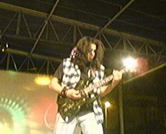

+++
title = "شباب تونسي.. في عشق الروك"
date = 2008-12-16
authors = ["إسماعيل دبارة"]
aliases = ["/articles/20at-arts-10733/"]

[taxonomies]
authors = ["ismail-dabara"]
sections = ["klam-rosas"]

[extra]
section_name = "قلم رصاص"
share_image = "/media/masr.20at.com/currentarticleassets/marwah/getattachment.jpg"
summary = "في مقهى \"لونيفار\" وسط العاصمة تونس، انبرى كلّ من سفيان بن عمر، 25 سنة، ونصر الدين الطرابلسي، 22 سنة، وبلال عبداوي، 29 سنة، يتهامسون فيما بينهم عن موسيقى الهارد "
section_slug = "klam-rosas"
section_colour = "#333333"
thumb = "/media/masr.20at.com/currentarticleassets/marwah/getattachment.jpg"
n_comments = 1
original_url = "http://20at.com/20at/arts/10733.html"
archived = "20100106005230"
date_source = "byline/meta"
aliases_20at = ["/klam-rosas/10733.html", "/20at/arts/10733.html"]

[extra.provenance]
original_url = "http://20at.com/20at/arts/10733.html"
capture_url = "https://web.archive.org/web/20100106005230/http://20at.com/20at/arts/10733.html"
capture_label = "٦ يناير ٢٠١٠، ٠٠:٥٢ UTC"
date_note = "من سطر التوقيع في المقال"
other_urls = ["/20at/arts/10733.html"]
comments = "١"
missing_images = ""
+++

<figure></figure>

في مقهى "لونيفار" وسط العاصمة تونس، انبرى كلّ من سفيان بن عمر، 25 سنة، ونصر الدين الطرابلسي، 22 سنة، وبلال عبداوي، 29 سنة، يتهامسون فيما بينهم عن موسيقى الهارد روك وأخر الأغاني الموجودة على الساحة خلال هذه الأيام.

الشبّان الثلاثة هم مؤسسّوا فرقة "سناك" لاغاني الهارد روك، وهي فرقة لا تحمل صيتا واسعا بين التونسيين لكنها تبدو كغيرها من الفرق الموسيقية التي يؤسسها شباب يافع انجذب إلى هذا النوع من الموسيقى الصاخبة، حيث بدأت موسيقى الهارد روك تأخذ حيزا مهما من اهتمام الشباب التونسي ليس فقط من زاوية الاستماع بل أيضا من زوايا اللباس والمظهر العام والسلوكات.

<h3>مظاهر</h3>

يقول بلال: "تأثرت بهذه الموسيقى منذ 3 سنوات تقريبا، وعلى الرغم من الانتقادات، فإنني لا أنكر أن تأثري بهذه الموسيقى يوازيه تأثر مماثل بمظاهر مغنّي الهارد الأمريكيين والأوروبيين".

أما نصر الدين، فيقول: "شرائح مهمة من المراهقين في تونس يقلدون بعض فرق الروك العالمية من خلال إطالة الشعر والأظافر واللحية ووضع إكسسوارات ومواد تجميل تحمل رموزا على شكل جماجم أو زواحف أو أشكال هندسية مختلفة، وكلّ هذا يختلف من شاب إلى آخر وهو مرتبط بمدى التأثر بهذه الموسيقى ورموزها وبمدى القدرة على تجاوز محرمات المحيط العائلي الذي يعشون فيه".

بينما يوضح سفيان: "أقبلت على غناء الهارد لأني وجدته نمطا موسيقيّا ملائما لأحاسيسي ومشاعري كشاب تونسي، فهذه الموسيقى الصاخبة تدفع للعمل والنضال، وإيقاعاتها تتضمن شحنة معنوية خاصة تميزها عن بقية الأشكال الموسيقية".

ويرى سفيان أن انتشار هذه الموسيقى أمر ملموس في صفوف الشباب التونسي، وقد تجاوز عدد الفرق المعروفة الـ 30 فرقة وذلك عائد برأيه إلى تفرّد موسيقى الهارد روك عن كلّ من موسيقى التكنو والهاوس وغيرها كونها شعبية تنبع من الواقع وتكشف عن معاناة الشباب دون قيد قيود أو تابوهات وبالأخص قضايا الفقر والمجاعات والتمييز العنصري والاعتداءات الجنسية والتضييق على الحريات والحروب.

<h3>أماكن خاصة</h3>

أما شباب الهارد روك التونسي فله أماكنه الخاصة جدّا، لأنهم يعتبرون أنفسهم منبوذين من شرائح واسعة من المجتمع، حيث يتواجد عدد من مغني الهارد في أماكن ومساحات أضحت بحكم العادة محسوبة عليهم..

يقول مراد عرفاوي، 27 سنة: "حتى أماكنهم لها خصوصيتها، إذ تغلب العتمة والسواد على الأماكن التي يرتادونها، ثمّ إنهم يقومون بسلوكيات مشينة داخلها تمس الحياء العام وعلى مرأى ومسمع من الجميع، ومن ذلك لباسهم ومظاهرهم غير اللائقة وتعمّدهم ثقب أنوفهم وشفاههم وأماكن حساسة من أجسادهم للتباهي والظهور".

<h3>عبدة الشيطان</h3>

ويربط بعض الشباب المحترز من الهارد روك بين هذه الموسيقى وعبادة الشيطان، خصوصا وأنّ هذا العام شهد في بدايته تواترا لعدد من التقارير الأمنية والصحفية تشير في معظمها إلى القبض على شبكة من عبدة الشياطين في تونس أبطالها شباب الهارد روك.

وتمكنت السلطات الأمنية من إلقاء القبض على أكثر من 15 شابا لهم علاقة بقضية "عبدة الشيطان" أغلبهم من طلبة الجامعات والمدارس ووجهت لهم تهمة الانتماء إلى جمعية غير مرخص لها بعد أن بينت الأبحاث أنهم اتخذوا أماكن منعزلة في جهات متفرقة من العاصمة تونس لإقامة حفلاتهم السرية وممارسة طقوسهم وهي الرقص على أنغام الهارد روك الصاخبة وذبح الكلاب والقطط السوداء وشرب دمائها ووضع عصابة سوداء على معصم اليد اليمنى وارتداء ملابس وقبعات سوداء.

هيام فرحات، 23 سنة، طالبة، تقول: "لي عدد من الأصدقاء ممن يعجبهم الهارد روك ويغنّونه، لكنّ المشكلة في أنهم جاهلون بأصله وجذوره وهويته وأنماطه، هم مهووسون به نظرا لإيقاعه الجنوني الصاخب الذي يعتبر وسيلة للهروب من مشاكل الواقع وتعمد عدم مواجهتها لا غير، أما ما يتداولُ عن علاقاتهم بطقوس عبدة الشياطين فأنا لا أصدقها أبدا".

ويهاجم الطالب منير فاضل، 24 سنة، من سماهم "مقلدي المظاهر" بالقول: "هم ليسوا مقتنعين البتة بجدوى وأهمية موسيقى الهارد روك، لكنه أعجبوا بلباس المغنين وتسريحة شعرهم فحسبُ، ولم يأخذوا عنهم سوى المظاهر دون أدنى مراعاة لتقاليد المجتمع التونسي التي تضلّ محافظة مهما حاول شبابنا الانفتاح على الآخر والارتماء في أحضانه".

