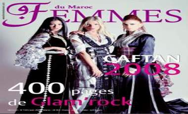

+++
title = "صحافة نسائية.. لنشر الميوعة!"
date = 2009-03-03
authors = ["محمد الشدادي"]
aliases = ["/articles/20at-arts-11469/"]

[taxonomies]
authors = ["mohamed-elshdadi"]
sections = ["klam-rosas"]

[extra]
section_name = "قلم رصاص"
share_image = "/media/currentarticleassets/femmee.jpg"
summary = "الحب عند المغاربة بلية ولا تفلية؟ .. المطابخ العصرية قلب البيت النابض بالحياة.. نساء سنوات الضياع في القطار.. طرائف مشاهير المغرب مع المعجبات وغير الزوجات.. سحر"
section_slug = "klam-rosas"
section_colour = "#333333"
thumb = "/media/currentarticleassets/femmee.jpg"
n_comments = 2
original_url = "http://20at.com/20at/arts/11469.html"
archived = "20100106003654"
date_source = "byline/meta"
aliases_20at = ["/klam-rosas/11469.html", "/20at/arts/11469.html"]

[extra.provenance]
original_url = "http://20at.com/20at/arts/11469.html"
capture_url = "https://web.archive.org/web/20100106003654/http://20at.com/20at/arts/11469.html"
capture_label = "٦ يناير ٢٠١٠، ٠٠:٣٦ UTC"
date_note = "من سطر التوقيع في المقال"
other_urls = ["/20at/arts/11469.html"]
comments = "٢"
missing_images = ""
+++

<figure></figure>

الحب عند المغاربة بلية ولا تفلية؟ .. المطابخ العصرية قلب البيت النابض بالحياة.. نساء سنوات الضياع في القطار.. طرائف مشاهير المغرب مع المعجبات وغير الزوجات.. سحر المحبة حقيقة أم وهم؟

ما سبق مجموعة من العناوين "المثيرة" التي تتصدر أغلفة المجلات النسائية المغربية التي تعج بها الساحة الإعلامية في المغرب، والتي تزايدت في السنوات الأخيرة بشكل ملفت للانتباه نظرا لما تجنيه من أرباح مالية نتيجة تمكنها من إيجاد قاعدة واسعة من القراء خاصة في أوساط (الجنس اللطيف) ولتنافس المجلات النسائية الخليجية والمصرية واللبنانية، جاعلة لنفسها مكانا يتميز بالطابع المغربي.

من هذه المجلاتFemmes du maroc" " ، "femina، "ousra"، "citadin" وهي مجلات تصدر باللغة الفرنسية وفي مقابلها مجلات تصدر إما باللغة العربية أو بالدارجة المغربية ومنها "للافاطمة" و"نجمة" و"نسمة" و"نساء من المغرب".

من سمات هذه الصحف الاعتماد على الصورة والإعلانات أكثر من اعتمادها على الكلمة والتثقيف، وهو ما يؤجج من حدة الانتقادات الموجهة إليها لأنها توظف جسد المرأة لأغراض دعائية وجنسية، مع تخصيص حيز لا بأس به لحياة الفنانين وخصوصياتهم والشائعات المثارة حولهم وهو ما يفقد هذه المواضيع جديتها عند البعض ويحسبها البعض الآخر نقط قوتها.

<h3>مؤيدات ومعارضات</h3>

تختلف وجهة نظر الفتيات المغربيات في الصحافة النسائية مابين مؤيدة ومشجعة وقائلة بتفاهتها فالرأي الأول يرى أنها حققت طفرة نوعية في الإعلام المطبوع المغربي.. فمريم، 22 سنة، تخبرنا أنها تفتني وتتابع جيدا ما يصدر من مجلات شهريا للاطلاع على أخبار الموضة وطرق التجميل والرشاقة الجسدية والعناية الطبية، كما تستهويها صفحات أخبار الفن والفنانين بها.

توافقها في الرأي نعيمة، 26 سنة، حيث تجد في الصحف النسائية متعتها وضالتها لأنها تطرح "مواضيع اجتماعية محضة تهتم بالأسرة وتربية الأطفال، كما تعتني بالمطبخ المغربي وحياة كبار الفنانين الذين لا يمكن أن تطلع على أخبارهم إلا في هذه المجلات".

أصحاب مهنة الخياطة ومن علت أسماءهم في عالم تصميم الأزياء، وممتهنات التجميل والمعجبات بآخر صيحات عالم الموضة في نظرهن أن هذه النوعية من الصحافة تمدهن بالمعلومة الهادفة والفكرة الصائبة في أدق تفاصيل حياتهم اليومية.. يقول عبد الصمد، أحد الشباب المواظب على اقتناء مجلة "سيتادين" أنه يجد فيها "دراسات وأبحاث علمية وتاريخية مفيدة وبالغة الأهمية"، أما غيره من الحرفين فإنهم يشجعونها لأنها تقدم لهم خدمات مجانية فيها يجد الحلاق أخر قصات الشعر وبها يجد الخياط أخر تصميم لأزياء الموضة.

على الجانب الآخر ترى أخريات بأن هذه الصحافة تافهة ولا تهتم بالقضايا الأساسية التي تجري في دهاليز الدولة والمجتمع والأسرة.. منهن فاطمة حيث تقول: "إنها تتناول المواضيع السخيفة مثل مراهقة المتأخرين وعرض الجسد النسائي في صور فاضحة تخدش الحياء، لقد حولت المرأة إلى سلعة تجارية ينظر إليها كأنثى أكثر مما ينظر إليها كإنسانة مشرفة ومكرمة لم تخلق فقط للمتعة، وهذا فكر دخيل ومُغرب ومتعلمن نشأ في بيئة غربية متحررة من كل قيد".

وتسايرها في نفس الملاحظة أمال، 28 سنة، إذ تقول: "المجلات النسائية سواء المغربية أو العربية والخليجية تهتم بالشكل أكثر ما تهتم بالمضمون، ومن يتصفحها يحس بالأسى والحسرة التي لا تنتهي فهي حتى إن طبعت بجودة عالية وغلافها جذاب لكن مواضيعها تبقى دون طموح المرأة المغربية وتتناول الأمور بسطحية كبيرة وتكرس السلوكيات اللأخلاقية بين الجنسين وهي تخاطب غريزة الإنسان الجنسية أكثر ما تخاطب حسه الفني وذوقه الإبداعي وتتمرد على القيم الدينية للمجتمع المغربي الذي أوجب على المرأة الحجاب".

<h3>صحافة الموضة</h3>

بحسب خبراء الإعلام والنقاد أن ما يفقد مواضيع الصحافة النسائية جديتها أنها جُعلت لجذب الشباب والشابات لإبراز مواهبهم فقط في الرقص والغناء وذلك في تجل واضح أن هدف هذه المجلات على اختلاف أسماءها هو تجميع الأموال بأسهل وأقرب الطرق، ولكنا بقاسم مشترك هو التفاهة والسطحية ونشر الميوعة، إلا إنها لا تخلو بطبيعة الحال من تناول مواضيع مهمة وجيدة في بعض الأحيان وهذا لا يمنع بحسب النقاد أنفسهم أن يكون ذلك "مجرد عسل في السم".

كما أن بعض الخبراء يرون أن هذه الصحف تهدف إلى تمييع العمل الصحافي وتفقده شرعيته ومكانته بين أصحاب الذوق الرفيع، كما تقلل من دور وأهمية رسالة الإعلام في تشكيل وصناعة الرأي العام مما جعلهم يصفونها بـ "صحافة الموضة" التي جعلت لأخبارها موضة خاصة غير تلك التي ألفوها في الأخبار التقليدية التي تتزاحم في الإعلام المكتوب.

