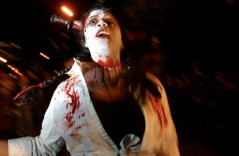

+++
title = "Zombie .. نجاح منقطع النظير!"
date = 2006-12-24
authors = ["أميرة حسن"]

[taxonomies]
authors = ["amira-hassan"]
sections = ["klam-rosas"]

[extra]
section_name = "قلم رصاص"
share_image = "/media/admins.20at.com/aly/z2.jpg"
summary = "السينما الأمريكية من أكثر السينمات إنتاجاً لأفلام الرعب بجميع أنواعه..فمن السهل أن تجد سلسلة كاملة من الأفلام لكل نوع من أنواع الرعب، بل قد تجد بعض المخرجين قد "
section_slug = "klam-rosas"
section_colour = "#333333"
thumb = "/media/admins.20at.com/aly/z2.jpg"
n_comments = 10
original_url = "http://www.20at.com:80/klam-rosas/2955.html"
archived = "20090511135948"
date_source = "byline/meta"
aliases_20at = ["/klam-rosas/2955.html"]

[extra.provenance]
original_url = "http://www.20at.com:80/klam-rosas/2955.html"
capture_url = "https://web.archive.org/web/20090511135948/http://www.20at.com:80/klam-rosas/2955.html"
capture_label = "١١ مايو ٢٠٠٩، ١٣:٥٩ UTC"
date_note = "من سطر التوقيع في المقال"
other_urls = []
comments = "١٠"
missing_images = ""
+++

<figure></figure>

السينما الأمريكية من أكثر السينمات إنتاجاً لأفلام الرعب بجميع أنواعه..فمن السهل أن تجد سلسلة كاملة من الأفلام لكل نوع من أنواع الرعب، بل قد تجد بعض المخرجين قد كرس حياته لخدمة هذا النوع كما هو الحال مع المخرج الأمريكي "جورج أندرو روميرو" الذي كرس ما يقرب من 50 عاما من حياته المهنية لإخراج أفلام الزومبي Zombie..

والزومبي هو المصطلح الذي يطلق على الموتى الأحياء أو الذين تتحلل أجسادهم وهم إحياء، فتجد أن جلودهم ننعرض للتآكل وتظهر عظامهم النخرة من تحت الجلد، وتتشوه وجوههم وتتساقط أطرافهم مع الوقت، فيعطيهم ذلك منظراً مرعباً ومقززاً في نفس الوقت، فهم يشبهون كثيراً الحالة المتقدمة من مرضى الجذام إذا كنت رأيت واحدا منهم، ولكن المشكلة لا تتوقف فقط على شكلهم المرعب، لكن المشكلة الأكبر أن هدفهم هو أكل الأحياء وتمزيقهم!

<h3>سلسلة ناجحة</h3>

بدأ "روميرو" رحلة صناعة أفلام الزومبي بفيلم Night of the Living Dead"" أو"ليلة الموتى الأحياء" والذي عرض بالأبيض والأسود عام 1968، حيث قام بإخراجه والمشاركة في كتابته, ودارت أحداثه عن مجموعة من الأموات يعودون إلى الحياة باحثين عن بشر لالتهامهم، فيضطر أبطال الفيلم إلى قضاء الليلة سجناء في منزل خوفاً من هؤلاء الزومبي.

حقق الفيلم نجاحاً مذهلا ولاقي إعجاب الجماهير بشكل ملحوظ، مما دفع "روميرو" إلى اللجوء لإخراج فيلم آخر من نفس النوعية فجاء فيلم "Dawn of the Dead" أو "فجر الموتى"، والذي قام المخرج Zack Snyder بإعادة إخراجه مره أخرى عام 2004، ولن نكلف أنفسنا بذكر قصة الفيلم، فهي تدور بالطبع حول محور واحد هو "مجموعة من الموتى الأحياء يقومون بإثارة ذعر الأحياء وقضاء وقت فراغهم في التهام أكبادهم في مشاهد مقززة يسيل فيها الكثير من اللعاب والدماء والأشلاء وكل تلك الأشياء المحببة لمشاهدي هذه النوعية من الأفلام!

بعد ذلك، وفي عام 1982، جاء فيلمه الثالث Creep show الذي قام بكاتبة السيناريو له المخرج العالمي "ستيفين سبلبيرج"، وتلاه بعد ذلك بفيلمه "Day Of The Dead" أو "يوم الموتى" عام 1985، وقام "روميرو" بكتابة السيناريو الخاص به بنفسه.

<h3>رحلة الزومبي مستمرة</h3>

وحاليا يشترك "روميور" في صناعة فيلم "Diamond Dead"، حيث انه يشارك Brian Cooper في كتابة السيناريو الخاص به وبالطبع يقوم هو بالإخراج، ولازال الفيلم تحت الإنتاج حتى الآن، وهذا الفيلم- كما قال عنه النقاد - يعتبر من الأفلام التي تبدو رائعة على الورق ولكن يصعب تخليها على شاشة السينما..

حيث تدور أحداث الفيلم حول فرقة غناء للروك وبعد فترة من أحداث الفيلم تكتشف أن أعضاء هذه الفرقة قد ماتوا من حوالي سنة، وبذلك نعود لنفس الحبكة المميزة لروميرو، وهي الأحياء الذين ليسوا كذلك أو الأموات الذين لم يموتوا بشكل كاف!

أما "Diary of the Dead"، أو "يوميات ميت"، فهو الفيلم الذي يعمل "روميرو" على كتابته حاليا ومن ثم إخراجه، ومن المفترض أن يعرض الفيلم خلال عام 2007، وتدور أحداثه حول رحلة يقوم بها مجموعة من الشباب الذين يدرسون السينما مستهدفين مكان ما به غابات ليقوموا بتصوير فيلم رعب تدور أحداثه حول ظاهرة الزومبي، فيهاجمهم زومبي حقيقيون ويقومون بأكلهم واحداً تلو الآخر.

<h3>زومبي تقليد</h3>

وقد تبع خطى "روميرو" بعض المخرجين في صناعة هذا النوع من الافلام، فتجد انه بعد أن أطلق أول أفلامه ظهرت بعض الأفلام الشبيهة سواء في السينما الأمريكية أو من خارج هوليوود، فمثلا فيلم "After Death" هو فيلم إيطالي تم عرضه عام 1988، تدور أحداثه حول مجموعة من الباحثين الذي يذهبون إلى جزيرة بعيدة منعزلة للبحث عن البعض من سحرة الفودوو، فيتعرضون لهجوم الزومبي.

وهناك فيلم أمريكي أيضا بعنوان "Hell Of The Living Dead"، قام بإخراجه "برونو ميتي" عام 1980، وتدور أحداثه أيضا حول مجموعة من "شيء ما" ذهبوا ليبحثون عن "شيء ما " آخر فيهاجمهم الزومبي.

حيث خرجت هذه الأفلام بنفس الحبكة الدرامية لأفلام "روميرو" لدرجة تثير الغيظ، ولكنك في تلك الأفلام الشبيهة تستطيع أن تستشعر بسهولة أن هذه الأفلام ليست إلا محاكاة وتقليد حتى في الأفيشات.

<h3>الأب الروحي</h3>

لذا يعتبر "جورج روميرو" هو الأب الروحي لأفلام الزومبي والمؤسس الأول لها، وعلى الرغم من مهاجمة النقاد الدائمة لروميرو واتهامه بتكرار نفسه وعدم قدرته على الابتكار, إلا أن تلك النوعية من الأفلام لازلت لها جمهورها الذي ينتظر الجديد- أو المكرر- منها بشكل مختلف تقنياً نظراً للتطور الذي تتميز به السينما الأمريكية.. ولا نظن كذلك أن "روميرو" يلقى بالاً للوم هؤلاء النقاد، وإلا لم يكن الآن منهمك في إعداد فيلمه الجديد.

.. فهل أنت من محبي سينما أفلام الزومبي؟

